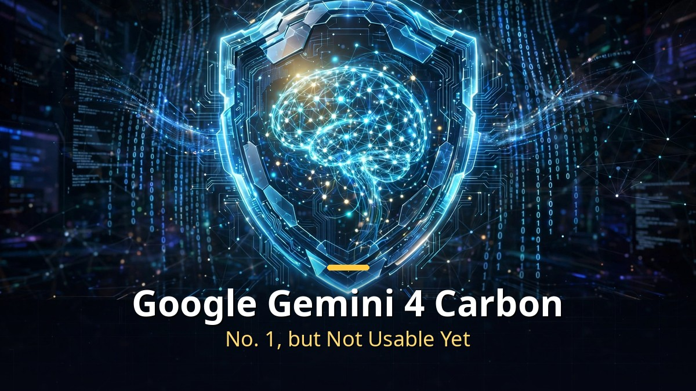
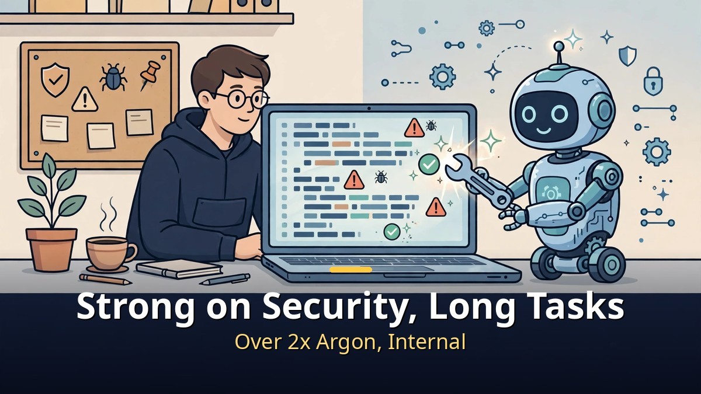
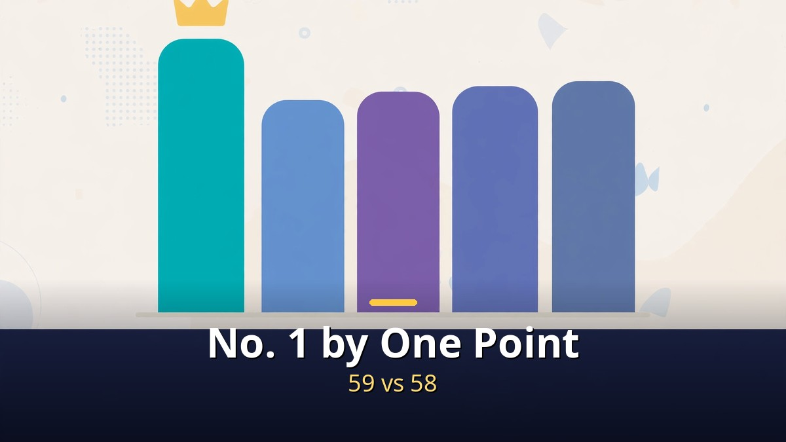
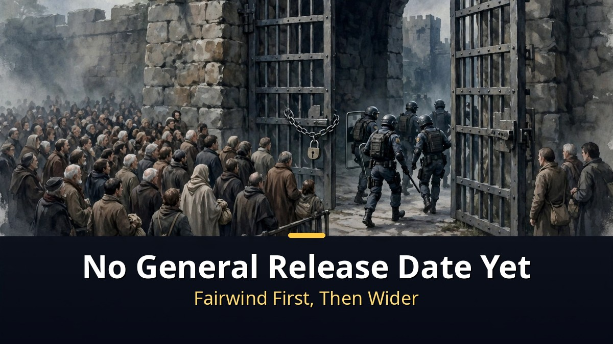

<!-- 본문 시작 -->

On October 28, 2026, Google announced a new AI model, Gemini 4 Carbon.
Built for security and long engineering work, it reached No. 1 on a composite index.

But ordinary users cannot use it yet.
The first recipients are only a subset of cybersecurity defenders.

> **Key takeaway**
>
> Gemini 4 Carbon scored 59 and reached No. 1, but it is not a model you can use right now.
> The first rollout goes only to a subset of cyber defenders in Google's Fairwind program, a program for vetted security organizations, and no date has been given for developers, businesses, or the general public.
> Before the No. 1 label, check who can use it, and when.

## What is new about Carbon?

Carbon is aimed at security and long-running work.

Google presents Carbon as strong at finding software vulnerabilities, testing whether they can be exploited, and building patches.
In internal evaluations, its success rate at generating secure code is more than twice Argon's.
It is also designed for engineering tasks that stretch over days, tracing causes across large codebases and fixing them.

The release pace also stands out.
Carbon arrived two weeks after Argon.
Google's CEO has said models will be released periodically, and Carbon follows that cadence.

Most of this description rests on Google's announcement and internal evaluations.
It is not an independent re-test under identical conditions, so it should be read as a claim at announcement time.

## How should the No. 1 score be read?

The No. 1 score is a ranking on one composite index.

On Artificial Analysis' Intelligence Index v5, Carbon scored 59.
Claude Opus 5.5 scored 58, GPT-6 Astra 57, and the previous model Argon 50.
The gap between first and second place is one point.

Security benchmark figures were published alongside.
Vulnerability discovery 88.2%, exploit testing 54.8%, patching 71.0%.
These are figures from Google's published table.

| Evaluation | Carbon | Comparison |
| --- | --- | --- |
| Intelligence Index v5 | 59, No. 1 | Opus 5.5: 58, Astra: 57, Argon: 50 |
| Vulnerability discovery | 88.2% | Security strength |
| Exploit testing | 54.8% | Security strength |
| Patching | 71.0% | Security strength |

But Carbon is not first on every evaluation.
On the Coding Agent Index, Claude Code with Opus 5.5 sits ahead of Carbon.
On some engineering evaluations, Astra leads on certain items.
A composite No. 1 does not mean best in every field.

So read the scores in parts.
The overall ranking shows direction, and the three security figures show the field Carbon targets.
The remaining fields are still mixed, and that belongs in the same reading.

## When can ordinary users use it?

No date has been given.
That is the most practical fact in this announcement.

Carbon goes first, starting this week, to a subset of cyber defenders in the Fairwind program.
It will then expand in stages to vetted partner organizations, and reach developers, businesses, and consumers after feedback is gathered, according to Google.
No specific date was announced.

Pricing follows Argon's introductory pricing.
Input is $2 per million tokens and output $10, with repeated input discounted by 95%.
After the introductory period, prices rise to $4 and $20, but Google gave no end date for the lower price.

For ordinary readers, this is the useful conclusion.
There is no need to switch models right now.
It is not too late to decide after checking whether Carbon arrives in the services or tools you use, and at what price.
Watching the rollout widen is safer than rushing to switch on a No. 1 announcement.

## Frequently asked questions

**Q. Is Carbon unconditionally better than Argon?**
A. It leads on the composite index and in security fields. But it is not first on every evaluation, and rival models lead on some coding and engineering items.

**Q. Can I use it in a chatbot right away?**
A. Not yet. The first recipients are only a subset of cyber defenders in the Fairwind program, and no general release date has been announced.

**Q. What does it cost?**
A. Introductory pricing is $2 per million input tokens and $10 per million output tokens. After the introductory period, it rises to $4 and $20, but the end date was not disclosed.

## Further reading

[A 9x Cheaper Agent Than Opus｜GPT-6.1 Terra Is Cheap, but Not Weak — price, surcharge, and the limits of the claim](https://aitechnotesen.blogspot.com/2026/10/a-9x-cheaper-agent-than-opusgpt-61.html)
[The Creator｜In a War Against AI, a Soldier Meets a Child — the child-shaped AI called a weapon, and the journey to protect it](https://aitechnotesen.blogspot.com/2026/10/the-creatorin-war-against-ai-soldier.html)
[Running AI Free on Your Own Computer｜A Local AI Comparison by Device — what each device can actually run, and the hidden costs](https://aitechnotesen.blogspot.com/2026/10/running-ai-free-on-your-own-computera.html)

<!-- 본문 끝 -->

## 작업용 출처·이미지 정보 (업로드 제외)

- 자료 출처: TheAIGRID 'Gemini 4 Carbon - The Worlds Smartest AI' (2026-10-30 04:36 KST, 제목·주제 기준) / 구글 발표 보도 웹 리서치 (2026-10-30 확인: 2026-10-28 발표, Intelligence Index 59점, 보안 3종 수치, Fairwind 선공개, 도입 가격 2달러/10달러)
- 이미지: images/01-hero-en.jpg ~ 04-img3-en.jpg / 직접 제작 (AI 생성 + 영어 오버레이) / 사용권: 자작
