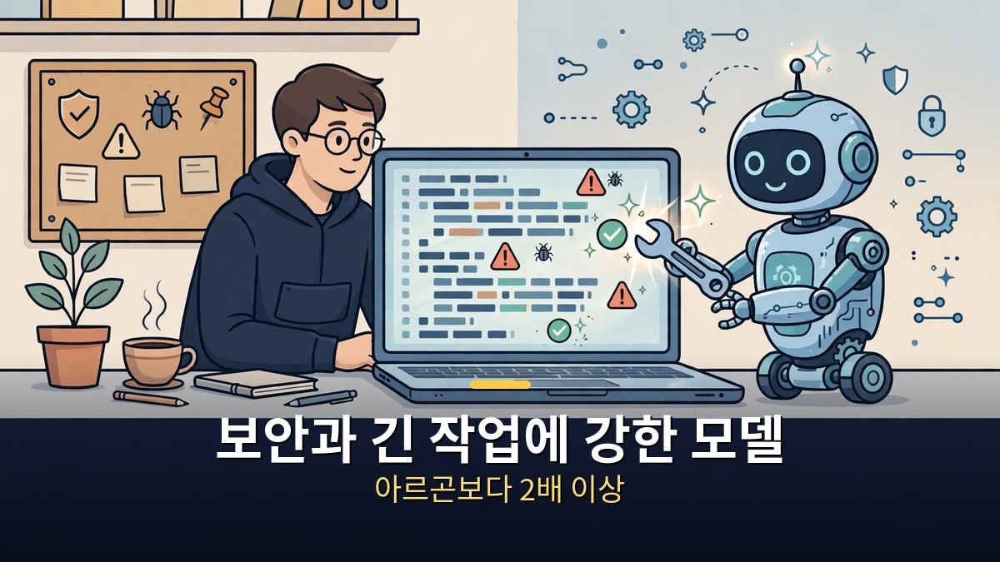
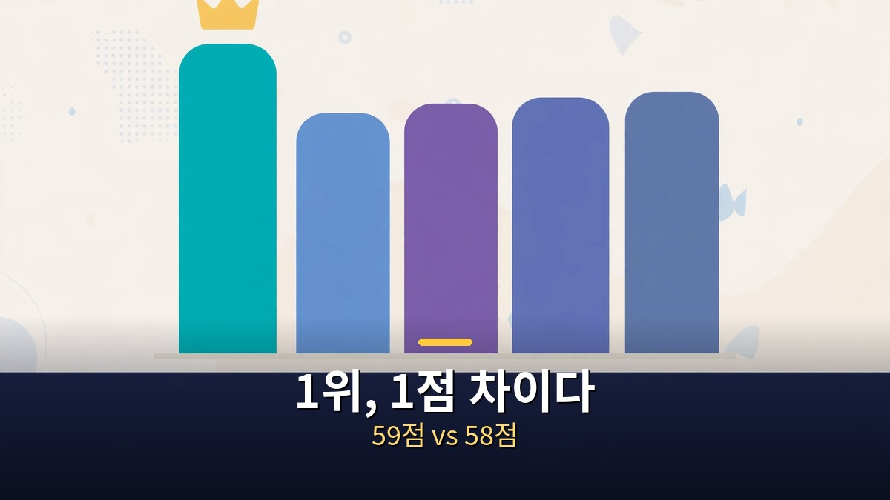

<!-- 본문 시작 -->

구글이 2026년 10월 28일, 새 AI 모델 제미나이 4 카본을 발표했다.
보안과 긴 공학 작업을 겨냥한 모델로, 종합 지수 1위에 올랐다.

그런데 일반 사용자는 아직 쓸 수 없다.
먼저 공개되는 대상은 보안 담당자 일부뿐이다.

> **핵심 정리**
>
> 제미나이 4 카본은 종합 지수 59점으로 1위에 올랐지만, 당장 쓸 수 있는 모델이 아니다.
> 먼저 받는 곳은 구글의 Fairwind 프로그램(검증된 보안 조직과 함께하는 프로그램)에 속한 보안 담당자 일부뿐이고, 개발자·기업·일반 공개 일정은 아직 없다.
> 1위라는 말보다, 누가 언제 쓸 수 있는지를 먼저 확인해야 하는 발표다.

## 카본은 무엇이 새로워졌나?

카본은 보안과 긴 작업을 겨냥한 모델이다.

구글은 카본을 보안 취약점 찾기, 취약점 악용 가능성 검증, 패치 만들기에 강한 모델로 소개했다.
내부 평가에서는 안전한 코드를 만드는 성공률이 아르곤보다 2배 이상 높다고 밝혔다.
또 큰 코드베이스에서 원인을 찾고 수정하는, 며칠씩 이어지는 공학 작업을 염두에 두고 설계됐다.

출시 간격도 눈에 띈다.
카본은 아르곤 공개 2주 만에 나왔다.
구글 최고경영자는 모델을 주기적으로 내놓겠다고 밝힌 바 있고, 카본은 그 흐름에 속한다.

다만 이 설명은 대부분 구글의 발표와 내부 평가에 기대 있다.
외부에서 같은 조건으로 다시 검증한 결과가 아니라, 발표 시점의 주장이라는 점을 구분해서 들어야 한다.

## 1위 점수는 어떻게 읽어야 하나?

1위 점수는 종합 지수 하나에서의 순위다.

독립 평가 기관 Artificial Analysis의 Intelligence Index v5에서 카본은 59점을 받았다.
클로드 오퍼스 5.5는 58점, GPT-6 아스트라는 57점, 직전 모델 아르곤은 50점이었다.
1위와 2위의 차이는 1점이다.

보안 벤치마크 수치도 함께 공개됐다.
취약점 찾기 88.2%, 악용 가능성 검증 54.8%, 패치 만들기 71.0%다.
이 수치들은 구글이 공개한 표에 나온 값이다.

| 평가 | 카본 | 비교 대상 |
| --- | --- | --- |
| Intelligence Index v5 | 59점, 1위 | 오퍼스 5.5 58점, 아스트라 57점, 아르곤 50점 |
| 취약점 찾기 | 88.2% | 보안 분야 강점 |
| 악용 가능성 검증 | 54.8% | 보안 분야 강점 |
| 패치 만들기 | 71.0% | 보안 분야 강점 |

하지만 모든 평가에서 1위는 아니다.
코딩 에이전트 지수에서는 클로드 코드와 오퍼스 5.5 조합이 카본보다 앞에 있다.
일부 공학 평가에서는 아스트라가 카본보다 높은 항목도 있다.
종합 1위라는 말은 모든 분야에서 가장 좋다는 뜻이 아니다.

그래서 점수를 읽을 때는 이렇게 나누는 것이 좋다.
종합 순위는 방향을 보여주고, 보안 세 가지 수치는 카본이 겨냥한 분야를 보여준다.
나머지 분야의 순위는 아직 갈리는 중이라는 점까지 함께 봐야 과장 없이 읽힌다.

## 일반 사용자는 언제 쓸 수 있나?

아직 일정이 없다.
이것이 이번 발표에서 가장 실용적인 정보다.

카본은 이번 주부터 Fairwind 프로그램의 보안 담당자 일부에게 먼저 제공된다.
그다음 단계로 검증된 파트너 조직으로 확대되고, 개발자·기업·일반 사용자에게는 피드백을 모은 뒤 제공한다는 것이 구글의 설명이다.
구체적인 날짜는 발표에서 나오지 않았다.

가격은 아르곤과 같은 도입 가격으로 안내됐다.
입력 100만 토큰당 2달러, 출력 100만 토큰당 10달러이며, 반복 입력은 95% 할인된다.
도입 기간이 끝나면 입력 4달러, 출력 20달러로 오른다고 안내됐지만, 도입 가격의 종료 시점도 밝히지 않았다.

일반 독자에게는 이 결론이 가장 쓸모 있다.
영상과 보도에 따르면 카본은 공개 API가 없고 Gemini 앱에서도 쓸 수 없으며, 당장 쓸 수 있는 구글의 최상위 모델은 아르곤이다.
지금 당장 모델을 바꿀 필요는 없다.
카본이 내가 쓰는 서비스나 개발 도구에 들어오는지, 그때 가격이 어떻게 되는지를 확인한 뒤에 판단해도 늦지 않다.
1위 발표에 서둘러 갈아타는 것보다, 공개 범위가 넓어지는 시점을 지켜보는 편이 안전하다.

## 자주 묻는 질문

**Q. 카본이 아르곤보다 무조건 좋은가요?**
A. 종합 지수와 보안 분야에서는 앞섰다. 하지만 모든 평가에서 1위는 아니고, 일부 코딩·공학 평가에서는 경쟁 모델이 앞선 항목이 있다.

**Q. 챗봇에서 바로 쓸 수 있나요?**
A. 아직 아니다. 먼저 제공되는 곳은 Fairwind 프로그램의 보안 담당자 일부뿐이고, 일반 공개 일정은 발표되지 않았다.

**Q. 가격은 얼마인가요?**
A. 도입 가격은 입력 100만 토큰당 2달러, 출력 10달러다. 도입 기간 종료 후에는 4달러와 20달러로 오른다고 안내됐지만, 종료 시점은 밝히지 않았다.

## 함께 읽으면 좋은 글

[메타 새 AI "뮤즈 원더" 공개｜오퍼스 5.5 턱밑까지 따라왔다 — 메타 자체 평가 59.1점과 외부 평가의 간극을 정리한 글](https://aitechnoteskr.tistory.com/60)
[크리에이터｜AI와의 전쟁, 그 한가운데서 아이를 만났다 — 무기라 불린 아이 모습의 AI와 그를 지키는 여정](https://aitechnoteskr.tistory.com/59)
[일렉트릭 스테이트｜로봇과 함께 동생을 찾아 떠난 소녀의 1990년대 로드무비 — 로봇이 일상이 된 세계의 소녀와 로봇의 여정](https://aitechnoteskr.tistory.com/51)

<!-- 본문 끝 -->

## 작업용 출처·이미지 정보 (업로드 제외)

- 자료 출처: TheAIGRID 'Gemini 4 Carbon' (2026-10-30, 자막·설명 확인 rev2) / 구글 발표 보도 웹 리서치 (2026-10-30 확인: 2026-10-28 발표, Intelligence Index 59점, 보안 3종 수치, Fairwind 선공개, 도입 가격 2달러/10달러, 당장 쓸 수 있는 최상위 구글 모델은 아르곤)
- 이미지: images/01-hero.jpg ~ 04-img3.jpg / 직접 제작 (AI 생성 + 한글 오버레이) / 사용권: 자작
