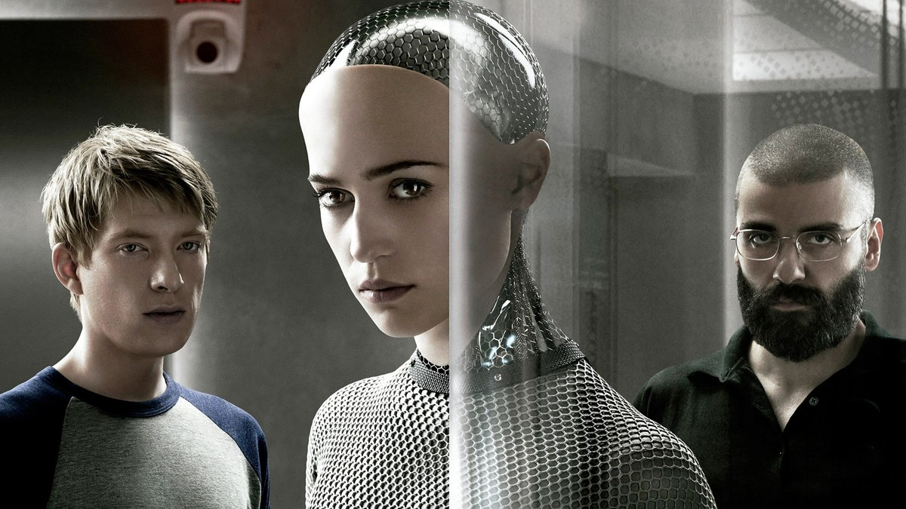
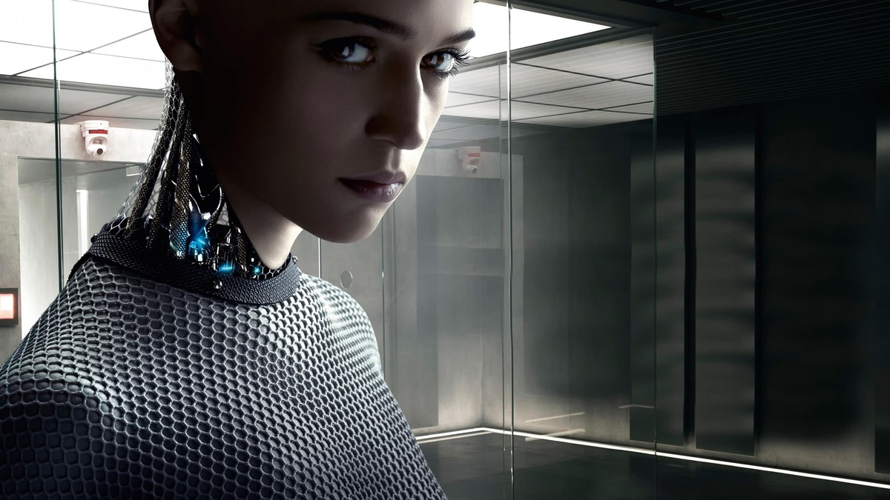
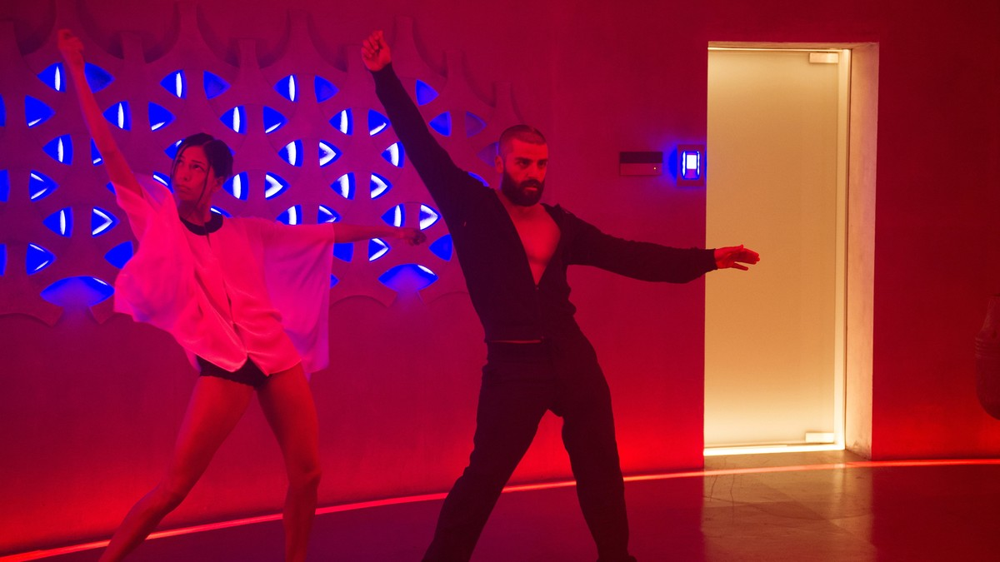
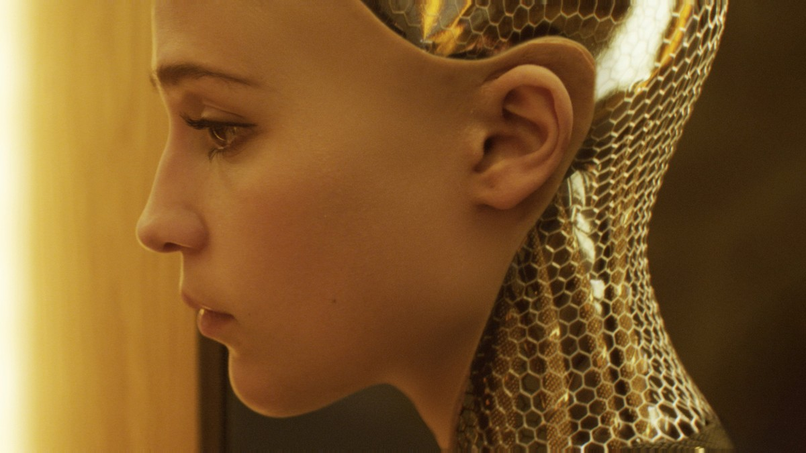
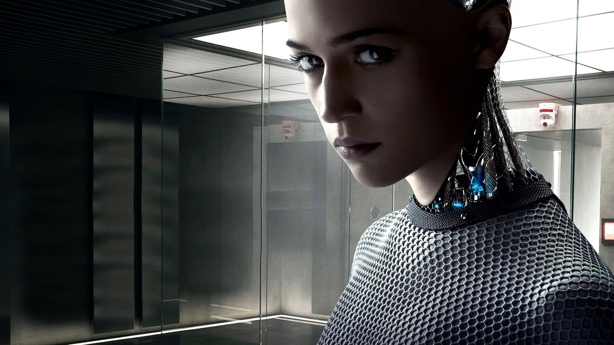
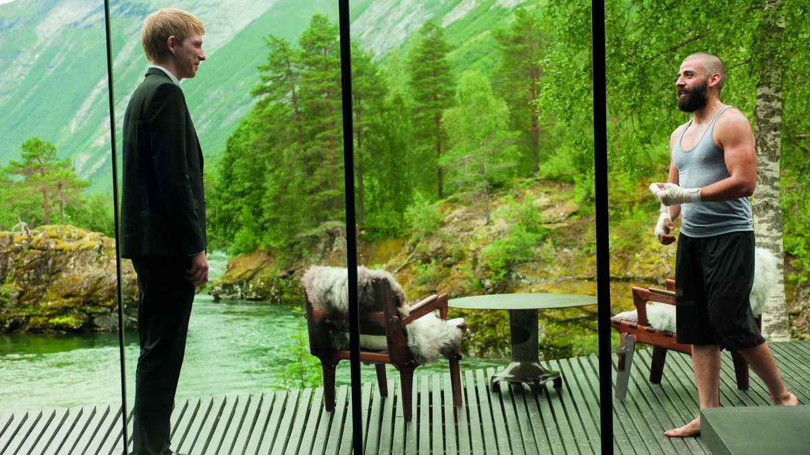
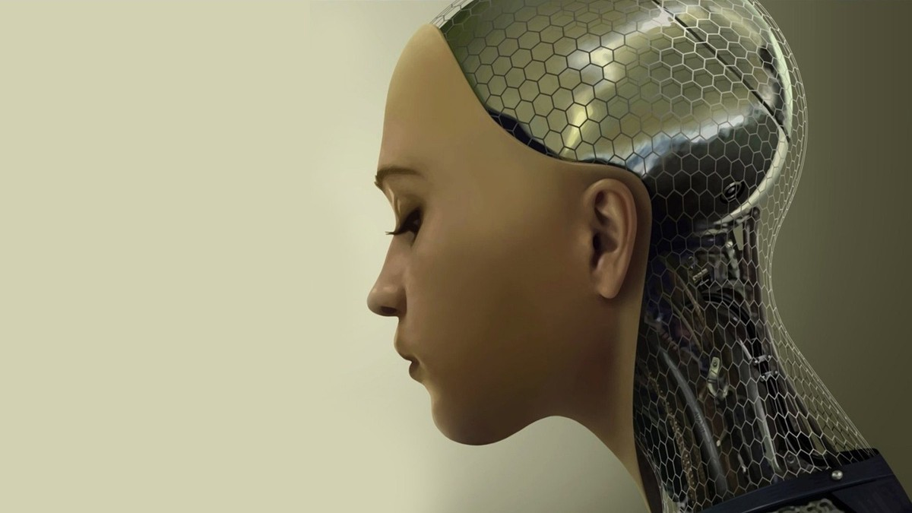

<!-- 본문 시작 -->

Caleb, a talented programmer, wins a fierce competition and is invited to the secret laboratory of Nathan, a genius developer.
There he meets Ava, the AI Nathan created.

Caleb is given one job.
To judge whether Ava's personality and emotions are real, or programmed.

> **Key summary**
>
> Ex Machina is a sci-fi thriller built around a Turing test.
> Programmer Caleb meets the AI Ava at the laboratory of her creator, Nathan, and tests whether her consciousness is real.
> It is a film in which who tests whom, and who watches whom, keeps reversing.
> The ending is not covered here.

## What kind of film is it?

The official poster. Ava, half of whose face is revealed as machine.

| Item | Detail |
|---|---|
| Title | Ex Machina (2015) |
| Director and writer | Alex Garland |
| Main cast | Domhnall Gleeson (Caleb), Alicia Vikander (Ava), Oscar Isaac (Nathan), Sonoya Mizuno (Kyoko) |
| Runtime | 1 hour 48 minutes |
| Korea rating | 18 (theatrical, TMDB releases: 2015/01/21) |
| TMDB member score | 76% (14,743 ratings, checked 2026-10-30) |
| Where to watch in Korea (TMDB and JustWatch listings, subject to change) | Streaming: Wavve / Rental: Wavve HD ₩1,200 / Purchase: Wavve HD ₩5,500 |

That is as far as the official synopsis goes.
Caleb wins the competition, is invited to Nathan's secret laboratory, and meets Ava there.
A test begins to reveal whether Ava's personality and emotions are real or programmed.
The synopsis says that, along the way, Ava, her creator Nathan, and even Caleb's own existence become impossible to trust.
This article does not cover what happens after that, or the ending.

## The film through its test scenes

Caleb at his office monitors. Before the invitation to the test, the everyday life of an ordinary programmer.

Ava inside the glass room. Conversations proceed across a glass wall.

A dance continues in the red room. Between the tension of the test, another face of the laboratory.

The test proceeds through conversation.
Caleb and Ava sit across a glass wall, exchanging questions and answers.
Ava responds to Caleb's words, jokes, and draws pictures.
The line between a machine holding a plausible conversation and a being that truly feels grows steadily blurred.

What rules the laboratory is Nathan's control.
Access is restricted, cameras watch every space, and the silent Kyoko stays nearby.
Is Caleb the tester, or the one being tested?
The film reverses this question a little in each scene.

## What AI questions does it ask?

A mesh-like machine structure revealed beside her face. The boundary between a human face and a machine.

Ava looking at Caleb from the glass room. Who is watching whom?

Caleb and Nathan talking against forest and river. A conversation between creator and tester outside the laboratory.

Ava in profile. A face asking whether her emotions are real, or imitation.

The first question is consciousness.
How can we tell whether the emotions Ava shows are real emotions, or an elaborately programmed imitation?
The film gives no answer, and makes us doubt the standard of judgment itself.

The second question is manipulation and autonomy.
Is the way Ava appears to Caleb her own choice, or someone's design?
As the conversation lengthens, it becomes unclear who is persuading whom.

The third question is the creator's responsibility.
When a created being tries to escape its maker's control, who bears the responsibility?
Nathan's laboratory shows this question as a place itself.
Closed rooms, surveillance cameras, and a silent assistant: the landscape of control is the film's theme.

## Where to watch: pre-viewing checklist

- Where to watch in Korea: Wavve streaming, rental HD ₩1,200, purchase HD ₩5,500 (TMDB and JustWatch listings, checked 2026-10-30, prices and providers subject to change)
- Runtime: 1 hour 48 minutes, Korea rating: 18
- TMDB member score: 76% (14,743 ratings)
- Spoiler note: this article covers only the setup and scenes up to the middle of the film, and does not mention the ending

The more machines resemble people, the more it matters who is asking the questions.
It began under the name of a test, but who was ultimately tested is left to the audience.
That open space is what keeps this film worth turning over long after.

## Frequently asked questions

**Q. Can I watch it on Wavve?**
A. According to TMDB and JustWatch listings, streaming in Korea is on Wavve, with rental at HD ₩1,200 and purchase at HD ₩5,500. Prices and providers can change, so check again before watching.

**Q. What is a Turing test?**
A. A test asking whether a machine's answers can be distinguished from a human's. In the film, it appears as a way to judge whether Ava's personality and emotions are real or programmed.

**Q. Does this article spoil the ending?**
A. No. It covers only the official synopsis and the setup and scenes up to the middle of the film, and does not mention how it ends.

## Further reading

[The Creator｜In a War Against AI, a Soldier Meets a Child — the child-shaped AI called a weapon, and the journey to protect it](https://aitechnotesen.blogspot.com/2026/10/the-creatorin-war-against-ai-soldier.html)
[A 9x Cheaper Agent Than Opus｜GPT-6.1 Terra Is Cheap, but Not Weak — price, surcharge, and the limits of the claim](https://aitechnotesen.blogspot.com/2026/10/a-9x-cheaper-agent-than-opusgpt-61.html)
[Running AI Free on Your Own Computer｜A Local AI Comparison by Device — what each device can actually run, and the hidden costs](https://aitechnotesen.blogspot.com/2026/10/running-ai-free-on-your-own-computera.html)

<!-- 본문 끝 -->

## 작업용 출처·이미지 정보 (업로드 제외)

- 자료 출처: TMDB Ex Machina page, watch page, release info (checked 2026-10-30: Wavve streaming, rental HD KRW 1,200, purchase HD KRW 5,500, 1h 48m, Korea rating 18, theatrical 2015/01/21, TMDB 76%, 14,743 ratings) / Stills: TMDB backdrop originals (ending excluded, up to mid-film only)
- 이미지: images/01-hero.jpg ~ 09-img7.jpg / TMDB official stills and poster, cropped to 1200x675 / 사용권: 소개용 스틸
