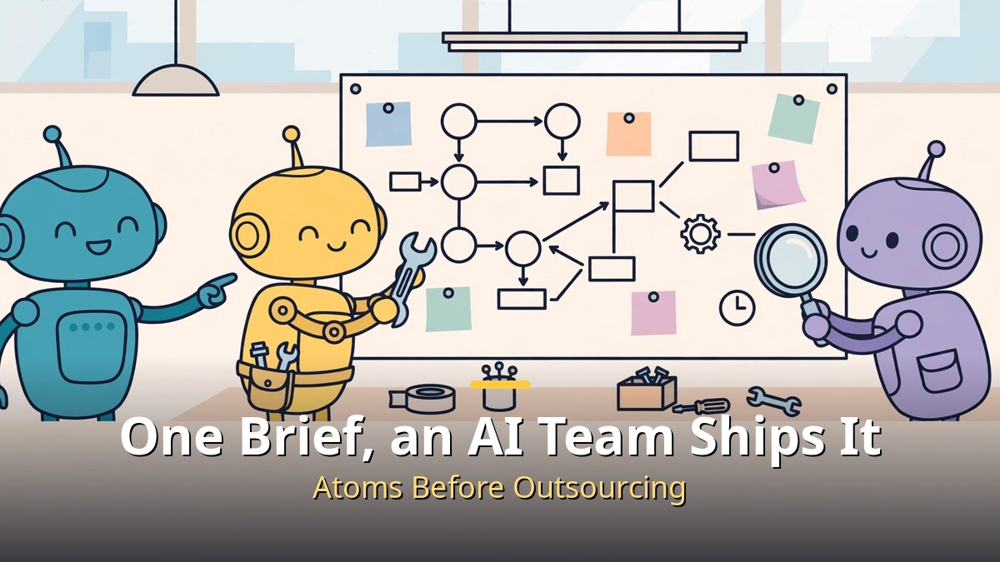
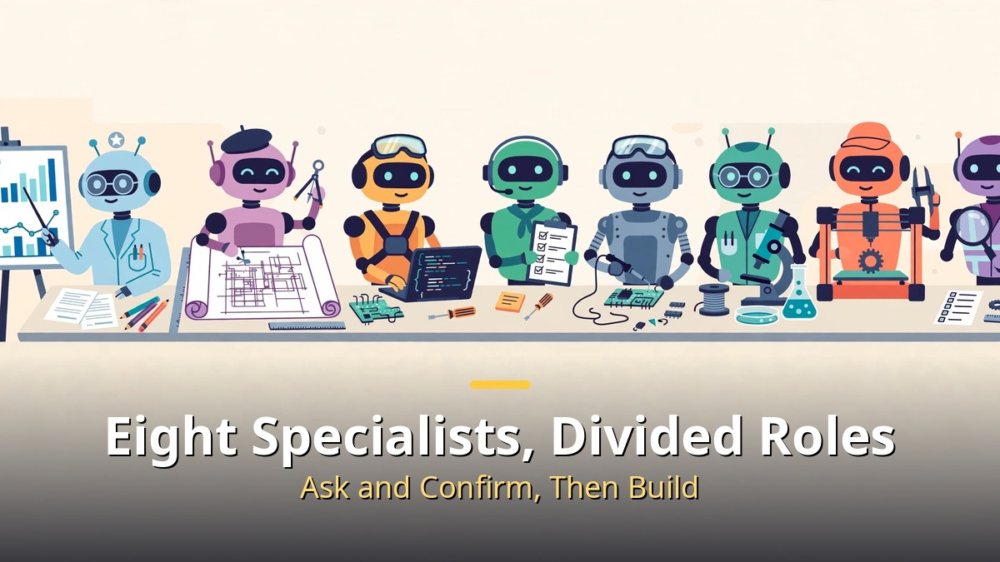
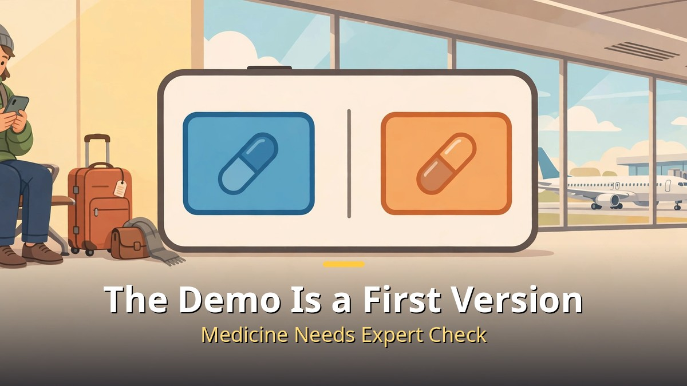
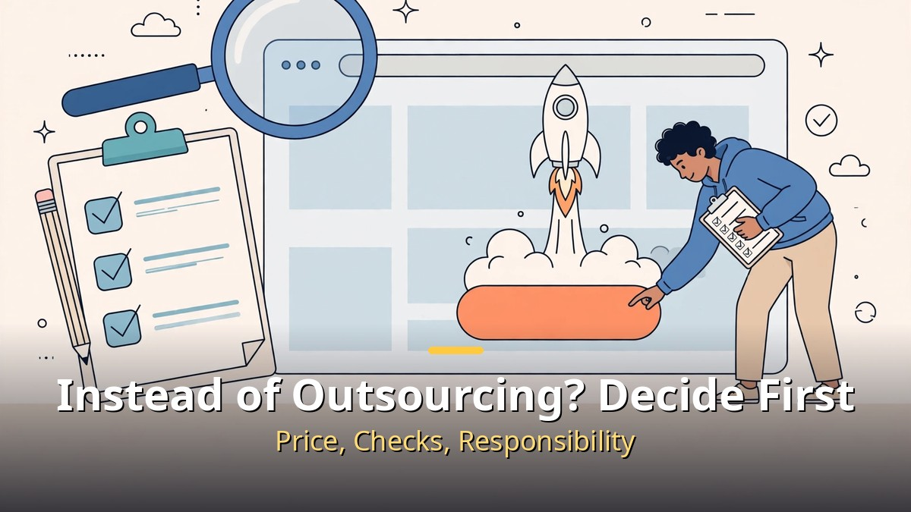

<!-- 본문 시작 -->

Before you hire a developer, it is worth checking how far a single brief can go.
A video published on October 30 by Success Knowledge Encyclopedia shows Atoms, an AI agent team, planning and deploying a web service from start to finish.
The short version is this: **Atoms is not one chatbot, but a team with divided roles, and its real point is the flow from brief to deployment.**
The demo, however, is only a first version, and the description does not state exact prices.

> What makes Atoms interesting is not that one model is smart, but that a team takes a brief and carries it through research, design, development, and deployment with roles divided. Whether it replaces outsourcing depends on whether that flow fits your work.

## Who Does What on the Atoms Team?

The official Atoms page presents a team of eight specialist agents.
Iris handles market research, Emma turns ideas into product requirements, Bob draws the system blueprint, and Mike, the team leader, coordinates everything and asks for your approval at key steps.
Alex builds the product, Sarah handles SEO, Adrian handles ads, and a data analyst agent rounds out the team.

That division matters for one reason.
Ask one chatbot to "build a service" and the same model must plan, code, and check its own work until it wears out.
When roles are divided, you can see who should ask again when the plan wobbles, and where to fix things when development stalls.
In the video, the team leader receives a filled-in service brief, then the agents ask back about scope, tech stack, and data.
So the first test against outsourcing is not speed alone, but whether the tool **asks and confirms before it builds**.

## What Was the Demo, and How Far Should You Trust It?

The demo service helps travelers abroad find local medicines with the same or similar ingredients as the ones they take at home in Korea.
It starts with public data and APIs, connects GitHub, Vercel, and Supabase, and deploys a first version.
Using U.S. Food and Drug Administration data, it produced close to 3,000 comparison results, plus a usage guide from the SEO agent.

This is where you should slow down.
The service itself is a first version, and the video description says most comparison results still need to be checked one by one.
Medicine touches the body directly, so demo results are not medical advice, and real choices must be confirmed with a local pharmacist or doctor.
What to take from this is not the accuracy of the medicine service, but **the order of work: attach public data first, and do not flip the order of discomfort, verification, service, and deployment.**
Adding features endlessly is the failure pattern the video warns about; finding a discomfort, verifying it, then building comes first.

## Should You Use It Instead of Outsourcing? Split the Decision

| Item | An AI team like Atoms | Hiring developers |
| --- | --- | --- |
| Starting cost | Free trial, then Pro and Max plans (exact prices not stated in the public description) | Quote and contract based, usually higher |
| Speed | A first version can come quickly from a brief | Scheduling and contracts take longer |
| Checking | The team leader asks for approval at each step | Interim reports and review milestones |
| Responsibility | You must check results and data yourself | Shared by contract scope |
| Good fit | Testing an idea, a small first version | A production service tied to security, medicine, or payments |

The price row deserves the most care.
The description mentions only a free trial, Pro and Max plans, and up to 21% off annual billing. No exact amounts.
So do not pay based on the word "cheap" alone. First check how often you will build and revise in a month, and whether your data connections work with your own accounts.
The travel insurance and airline partnership ideas are also next steps in the demo, not money already earned.
Revenue comes after a service exists; it does not arrive with the deploy button.

I will close honestly.
I used to try a new tool first and keep adding features.
What I learned is that the service without a clear plan at the start takes the longest.
Whether Atoms is useful depends less on the model name and more on how firmly your brief states the discomfort and the verification order.
If that one page is weak, no team size will steady the result.
If that page is clear, it is worth trying as a way to test an idea before outsourcing.

## Frequently asked questions

**Q. Can I really build a service without coding?**
A. The demo shows a brief leading to connections and deployment. You still must check data and results yourself.

**Q. How much does it cost?**
A. From the public description, only a free trial, Pro and Max plans, and up to 21% off annual billing are confirmed. Check exact prices on the signup page.

**Q. Can I monetize the result right away?**
A. The demo is a first version. Sensitive information, especially medicine, needs verification steps, disclaimers, and expert review before publication.

## Further reading

[Google's Gemini 4 Carbon｜Before the No. 1 Score, Note This: You Cannot Use It Yet — what the composite score of 59 means and who gets Fairwind early access](https://aitechnotesen.blogspot.com/2026/10/googles-gemini-4-carbonbefore-no-1.html)
[A 9x Cheaper Agent Than Opus｜GPT-6.1 Terra Is Cheap, but Not Weak — price, surcharge, and the limits of the claim](https://aitechnotesen.blogspot.com/2026/10/a-9x-cheaper-agent-than-opusgpt-61.html)
[The Creator｜In a War Against AI, a Soldier Meets a Child — the child-shaped AI called a weapon, and the journey to protect it](https://aitechnotesen.blogspot.com/2026/10/the-creatorin-war-against-ai-soldier.html)

<!-- 본문 끝 -->

## 작업용 출처·이미지 정보 (업로드 제외)

- 자료 출처: 성공지식백과 '개발 외주 주지 마세요.. 기획서 하나면 Atoms 에이전트 팀이 배포까지 끝냅니다.. ㄷㄷ' (2026-10-30, 영상 설명 전문 브라우저 확인: 24분 28초, 여행 약 성분 비교 시연·FDA 자료 약 3,000개 비교 결과·대부분 확인 필요·무료 체험/Pro·Max/연간 최대 21% 할인) / Atoms 공식 페이지 웹 리서치 (2026-10-31 확인: 8명 전문팀 역할, 단계별 승인, 깃허브·버셀·수파베이스 연결)
- 이미지: images/01-hero-en.jpg ~ 04-img3-en.jpg / 직접 제작 (AI 생성 + 영어 오버레이) / 사용권: 자작
