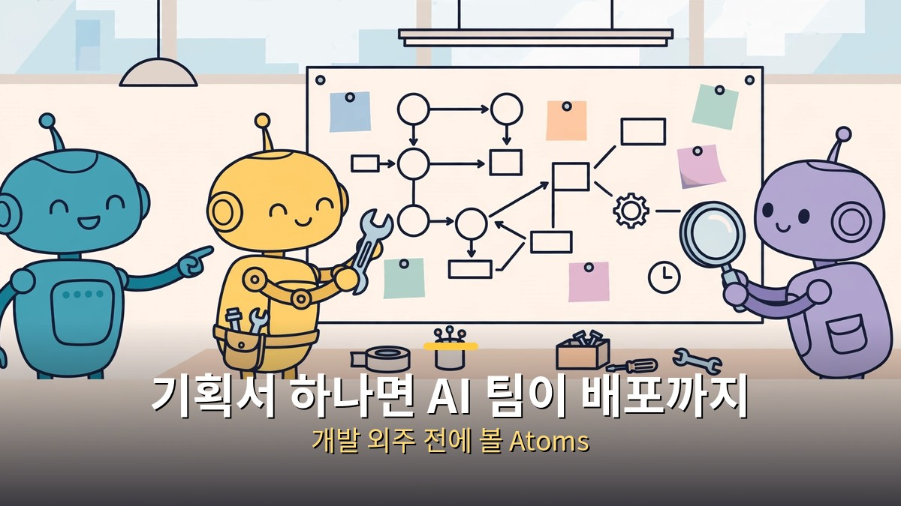
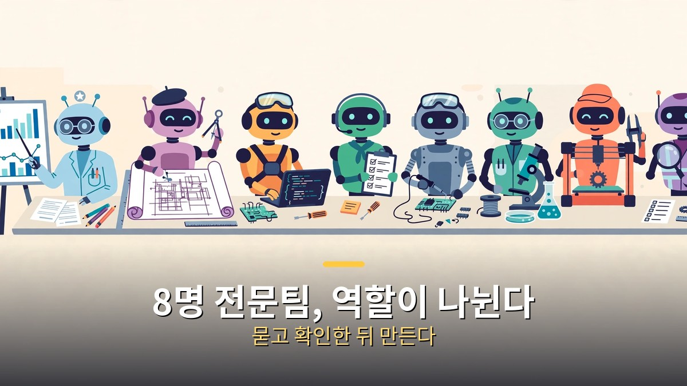
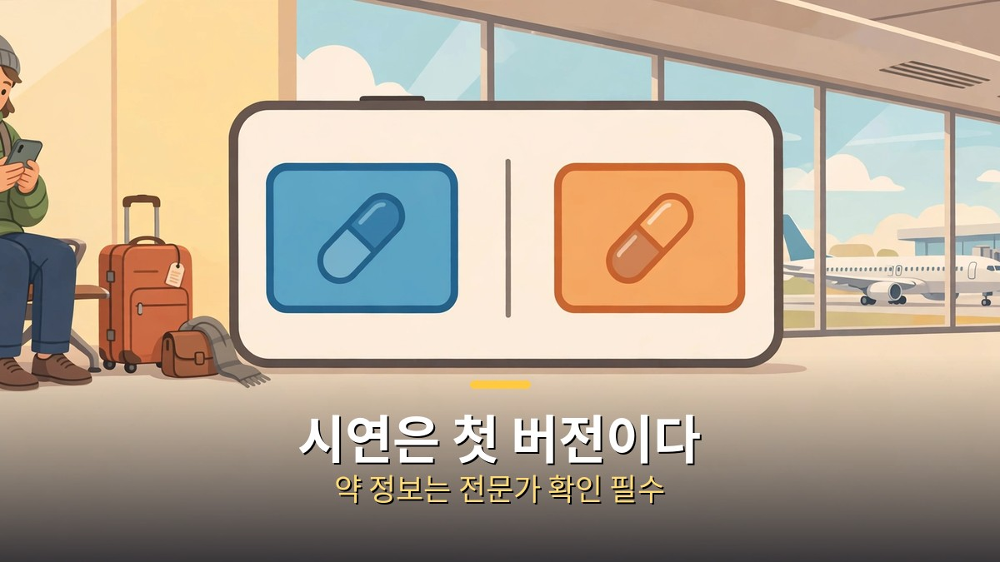
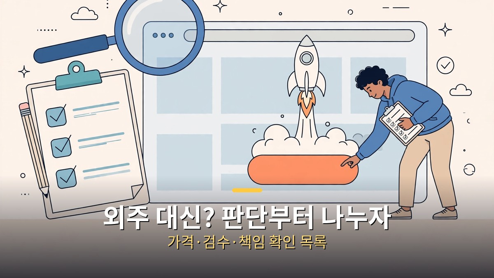

<!-- 본문 시작 -->

개발 외주를 맡기기 전에, 기획서 한 장으로 어디까지 만들 수 있는지부터 따져보는 편이 싸게 먹힙니다.
성공지식백과가 10월 30일 올린 영상은 Atoms라는 AI 에이전트 팀으로 웹 서비스를 처음부터 기획해 배포까지 보여줍니다.
결론부터 말하면, **Atoms는 한 명의 챗봇이 아니라 역할이 나뉜 팀으로 일하고, 배포까지 이어지는 흐름이 핵심입니다.**
다만 시연된 서비스는 첫 버전이고, 가격의 구체적인 금액은 공개 설명에서 확인되지 않았습니다.

> Atoms의 매력은 모델 하나가 똑똑하다는 것이 아니라, 기획서를 받은 팀이 조사·설계·개발·배포까지 역할을 나눠 이어간다는 점입니다. 외주를 줄일지 말지는 이 흐름이 내 일에 맞는지를 보고 정하면 됩니다.

## Atoms 에이전트 팀, 누가 뭘 하나요?

Atoms 공식 페이지는 8명의 전문 에이전트 팀을 내세웁니다.
시장 조사를 맡는 아이리스, 제품 요구사항을 정리하는 엠마, 시스템 설계를 그리는 밥, 전체를 조율하고 중요한 단계마다 승인을 받는 팀장 마이크가 중심입니다.
여기에 실제 개발을 맡는 알렉스, 검색 노출을 맡는 사라, 광고를 맡는 아드리안, 데이터를 분석하는 에이전트까지 붙습니다.

이 구조가 중요한 이유는 하나입니다.
챗봇 하나에게 "서비스 만들어줘"라고 하면, 그 모델이 기획도 하고 코드도 짜고 검수도 하다 지칩니다.
역할이 나뉘면 기획이 흔들릴 때 누가 다시 물어야 하는지, 개발이 막힐 때 어디를 고쳐야 하는지가 보입니다.
영상에서도 기획서를 채워 팀장에게 넘기고, 에이전트가 범위와 기술 구성, 데이터를 되묻는 장면이 나옵니다.
묻지 않고 바로 만드는 도구가 아니라, **묻고 확인한 뒤 만드는 팀**이라는 점이 외주와 비교할 첫 번째 기준입니다.

## 시연은 뭐였고, 어디까지 믿을 수 있나요?

영상 시연은 해외여행 중 한국에서 먹던 약과 성분이 같거나 비슷한 현지 약을 찾아주는 웹 서비스입니다.
공개 데이터와 API를 먼저 붙이고, 깃허브와 버셀, 수파베이스를 연결해 첫 버전을 배포하는 과정까지 보여줍니다.
미국 식품의약국 자료를 바탕으로 3,000개 가까운 비교 결과가 나왔고, 검색 노출용 이용 가이드까지 붙었습니다.

여기서 속도를 내면 안 되는 대목이 있습니다.
시연 서비스 자체가 첫 버전이고, 비교 결과 대부분은 하나하나 확인이 필요한 단계라고 영상 설명도 밝힙니다.
약은 몸에 직접 닿는 정보라, 시연 결과는 의학적 조언이 아니고 실제 선택은 현지 약사나 의사에게 확인해야 합니다.
즉 이 글에서 가져갈 것은 약 서비스의 정확도가 아니라, **공개 데이터를 먼저 붙이고 검증 순서를 뒤집지 않는 방식**입니다.
기능을 계속 붙이는 순서가 아니라, 불편을 찾고 검증한 뒤 서비스로 만들고 배포하는 순서가 먼저라는 지적도 같은 맥락입니다.

## 외주 대신 써도 될까요? 판단은 이렇게 나누세요

| 비교 항목 | Atoms 같은 AI 팀 | 개발 외주 |
| --- | --- | --- |
| 시작 비용 | 무료 체험 뒤 Pro·Max 플랜(구체 금액은 공개 설명 미확인) | 견적·계약 기준, 보통 높음 |
| 속도 | 기획서만 있으면 첫 버전까지 빠르게 | 일정 조율·계약이 필요해 느림 |
| 확인 방식 | 단계마다 팀장이 승인 요청 | 중간 보고·검수 일정 기준 |
| 책임 범위 | 결과물 검수와 데이터 확인은 사용자가 직접 | 계약 범위에 따라 업체가 분담 |
| 맞는 경우 | 아이디어 검증·작은 서비스 첫 버전 | 보안·의료·결제가 얽힌 본 서비스 |

이 표에서 가장 조심할 줄은 가격입니다.
영상 설명에는 무료 체험과 Pro·Max 플랜, 연간 결제 최대 21% 할인만 있고 구체 금액은 없습니다.
따라서 "싸다"는 말만 믿고 결제하지 말고, 내 서비스가 한 달에 몇 번 만들고 고칠지, 데이터 연결이 내 계정으로 가능한지부터 확인하는 편이 좋습니다.
또 여행 보험이나 항공사 제휴 같은 수익화 계획은 시연 단계의 다음 계획일 뿐, 이미 돈이 된다는 뜻이 아닙니다.
수익은 서비스가 나온 뒤에 붙는 것이지, 배포 버튼과 함께 따라오는 것이 아닙니다.

마무리는 솔직하게 적겠습니다.
저도 예전에는 도구가 나오면 일단 써보고 기능을 붙이는 쪽이었습니다.
그런데 막상 써보면, 처음에 무엇을 만들지 정하지 않은 서비스가 제일 오래 걸립니다.
Atoms가 쓸모 있는지는 모델 이름이 아니라, 기획서를 쓸 때 불편과 검증 순서를 얼마나 단단하게 적을 수 있는지에 달려 있습니다.
그 종이 한 장이 부실하면 팀이 아무리 많아도 결과는 흔들립니다.
반대로 그 종이 한 장이 분명하면, 외주를 맡기기 전 아이디어를 검증하는 용도로는 충분히 써볼 만합니다.

## 자주 묻는 질문

**Q. 코딩을 몰라도 정말 서비스를 만들 수 있나요?**
A. 영상 시연은 기획서를 넘기고 연결·배포까지 보여줍니다. 다만 데이터 확인과 결과 검수는 사용자가 직접 해야 합니다.

**Q. 가격은 얼마인가요?**
A. 공개 설명 기준으로는 무료 체험과 Pro·Max 플랜, 연간 최대 21% 할인만 확인됩니다. 구체 금액은 가입 화면에서 직접 확인해야 합니다.

**Q. 만든 서비스를 바로 돈벌이에 써도 되나요?**
A. 시연은 첫 버전입니다. 특히 약처럼 민감한 정보는 확인 절차와 면책 문구, 전문가 검토 없이 공개하면 안 됩니다.

## 함께 읽으면 좋은 글

[구글 제미나이 4 카본｜1위 점수보다 먼저 볼 것, 아직 못 쓴다 — 종합 지수 59점의 의미와 Fairwind 선공개 범위를 정리한 글](https://aitechnoteskr.tistory.com/64)
[컬러 전자책 리더, 사기 전에 확인할 조건 — Kobo Libra Colour vs Kindle Colorsoft — 화면이 아니라 서점·파일·도서관 대출부터 정해야 하는 이유](https://aitechnoteskr.tistory.com/61)
[엑스 마키나｜튜링 테스트에 초대된 프로그래머, 그리고 에이바 — 누가 누구를 테스트하는지 뒤집히는 SF 스릴러](https://aitechnoteskr.tistory.com/67)

<!-- 본문 끝 -->

## 작업용 출처·이미지 정보 (업로드 제외)

- 자료 출처: 성공지식백과 '개발 외주 주지 마세요.. 기획서 하나면 Atoms 에이전트 팀이 배포까지 끝냅니다.. ㄷㄷ' (2026-10-30, 영상 설명 전문 브라우저 확인: 24분 28초, 여행 약 성분 비교 시연·FDA 자료 약 3,000개 비교 결과·대부분 확인 필요·무료 체험/Pro·Max/연간 최대 21% 할인) / Atoms 공식 페이지 웹 리서치 (2026-10-31 확인: 8명 전문팀 역할, 단계별 승인, 깃허브·버셀·수파베이스 연결)
- 이미지: images/01-hero.jpg ~ 04-img3.jpg / 직접 제작 (AI 생성 + 한글 오버레이) / 사용권: 자작
