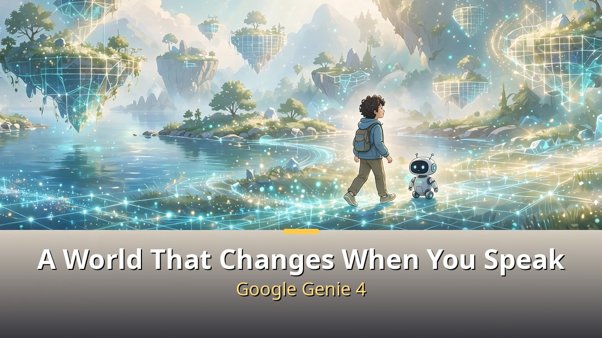
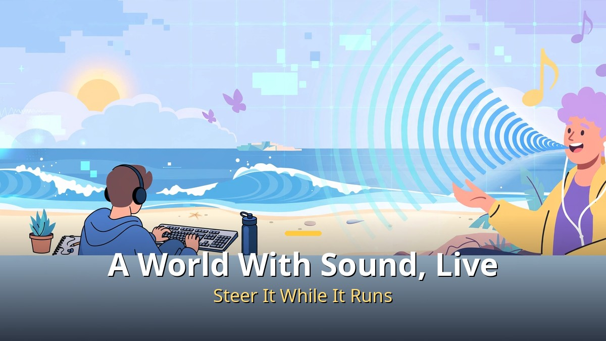
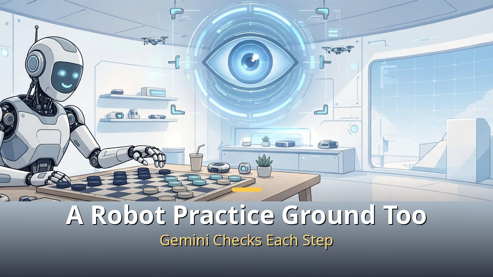
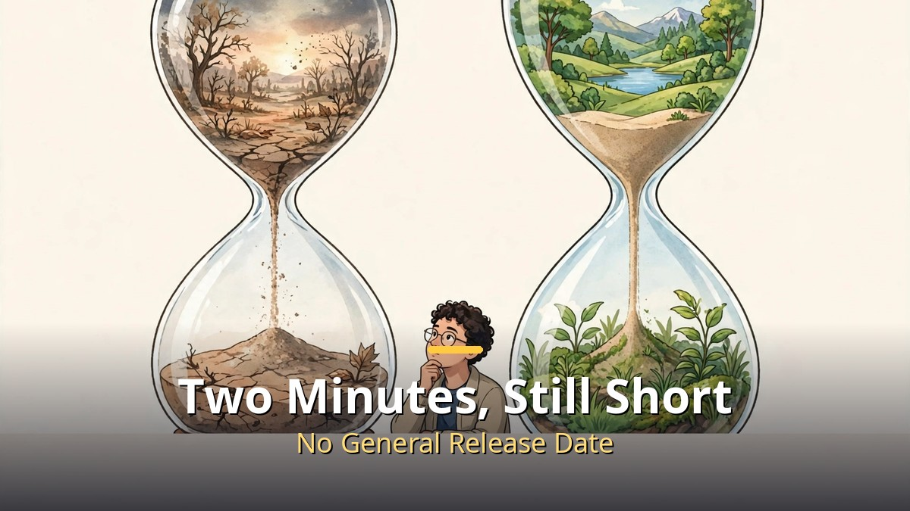

<!-- 본문 시작 -->

On October 27, 2026, Google announced Genie 4, an AI that changes a world when you speak to it.
Type a prompt and a world you can walk through appears, with sound generated along the way.
The short version is this: **Genie 4 is not a product you can use today, but a world model in research preview.**
So this article is not a "try it now" guide. It explains what changed, and when your turn might come.

> A world model does not show a finished video. It generates a place frame by frame and reacts to how you move. Genie 4 adds sound, dialogue, and live steering to that world.

## What Is New in Genie 4?

The word "world model" sounds hard, but a game world makes it easy.
You move with a keyboard, and the next scene is generated to match your movement.
Genie 4 adds three things to that idea.

First, sound.
Wind, waves, background music, and dialogue from characters in the world are generated together with the scene.
Google describes this as a first for a real-time world model.
Keep that "first" as Google's claim, though: other companies have also shown playable worlds with sound around the same time.

Second, live steering.
While a scene runs, you can change it with text.
Change the weather, move the camera, or add a person or an object, and the world keeps going without stopping.
Third, duration.
A scene now stays coherent for about two minutes, double the 60 seconds of Genie 3.
Two minutes may sound short, but as the time a world holds together without breaking, it matters.

## Who Holds the World Together? Gemini's Role

Genie 4 does not build the world alone.
Two Gemini roles sit behind it.
Gemini Omni anchors how people and places look and move in a realistic way.
Gemini 3.8 Flash acts as a guide, breaking a goal into steps and checking new frames to confirm each step landed.

Once you know that structure, Genie 4's direction becomes clear.
It is not only about pretty scenes. In the announcement demo, a goal like "play checkers" was split into steps, and a humanoid robot called Apollo carried them out in simulation.
So Genie 4 also points toward a practice ground where robots rehearse in a virtual world before touching real hardware.
That is a possibility shown in a demo, not proof that it works on a real factory floor today.

## Genie 3 vs. Genie 4: How Far Should You Believe It?

| Item | Genie 3 | Genie 4 |
| --- | --- | --- |
| Scene coherence | About 60 seconds | About 2 minutes |
| Sound | Separate or absent | Generated live with the scene |
| Live steering | Limited | Weather, camera, people, and objects can change |
| Guiding role | — | Gemini 3.8 Flash checks each step |
| Availability | Research, limited release | Research preview, trusted testers first |

The table shows clear progress.
But Google also states its own limits.
In longer sessions, or after several complex prompt edits, visual details can drift and objects can vanish.
No resolution, frame rate, or benchmark scores were published with this announcement.
So "most realistic" is best read as a claim from Google's announcement and demos, until independent re-testing appears.
Before scores, look at the limits first.

## When Can I Use It?

Right now it is a research preview rolling out to trusted testers first.
Next, Google says, come Google AI Ultra subscribers in Project Genie, and early-access partners through the Gemini API and AI Studio.
No general release date or separate price has been announced; interested users join a waitlist in Project Genie.
Reports put AI Ultra at $99.99 a month, but that is the Ultra subscription price, not a Genie 4 price — keep the two apart.

To sum up, you do not need to use Genie 4 today.
But the direction is clear.
Worlds last longer, carry sound, can be changed by speaking, and can serve as robot practice grounds.
What to watch next is whether a release schedule and concrete specs appear, and where the first real use lands: games, education, or robot simulation.
Personally, I am more curious about how the world breaks after two minutes than about a pretty demo.
How fast that limit shrinks will be how fast this moves from toy to tool.

## Frequently asked questions

**Q. Is Genie 4 a game?**
A. You can walk through it like a game, but it is essentially a world model that generates a world in real time. It could serve games, simulation, and robot practice.

**Q. Can I try it right now?**
A. No. It is a research preview for trusted testers first, and no general release date has been announced.

**Q. Are generated videos marked?**
A. Google says every Genie 4 video and audio track carries SynthID, an invisible watermark.

## Further reading

[Google's Gemini 4 Carbon｜Before the No. 1 Score, Note This: You Cannot Use It Yet — what the composite score of 59 means and who gets Fairwind early access](https://aitechnotesen.blogspot.com/2026/10/googles-gemini-4-carbonbefore-no-1.html)
[A 9x Cheaper Agent Than Opus｜GPT-6.1 Terra Is Cheap, but Not Weak — price, surcharge, and the limits of the claim](https://aitechnotesen.blogspot.com/2026/10/a-9x-cheaper-agent-than-opusgpt-61.html)
[The Creator｜In a War Against AI, a Soldier Meets a Child — the child-shaped AI called a weapon, and the journey to protect it](https://aitechnotesen.blogspot.com/2026/10/the-creatorin-war-against-ai-soldier.html)

<!-- 본문 끝 -->

## 작업용 출처·이미지 정보 (업로드 제외)

- 자료 출처: TheAIGRID 'Google Just Created an AI That Simulates Reality' (2026-10-31 03:00 KST, 제목·주제 기준, 설명란 DeepMind 지니 4 링크) / 구글 지니 4 발표 보도 웹 리서치 (2026-10-31 확인: 2026-10-27 발표, 연구 미리보기·신뢰 테스터→AI 울트라 프로젝트 지니→API 조기 파트너 순, 약 2분 유지·지니 3의 2배, 제미나이 옴니·3.8 플래시 안내 역할, 신스ID, 스펙 미공개)
- 이미지: images/01-hero-en.jpg ~ 04-img3-en.jpg / 직접 제작 (AI 생성 + 영어 오버레이) / 사용권: 자작
