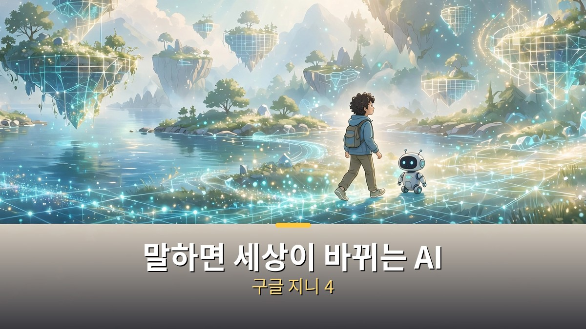
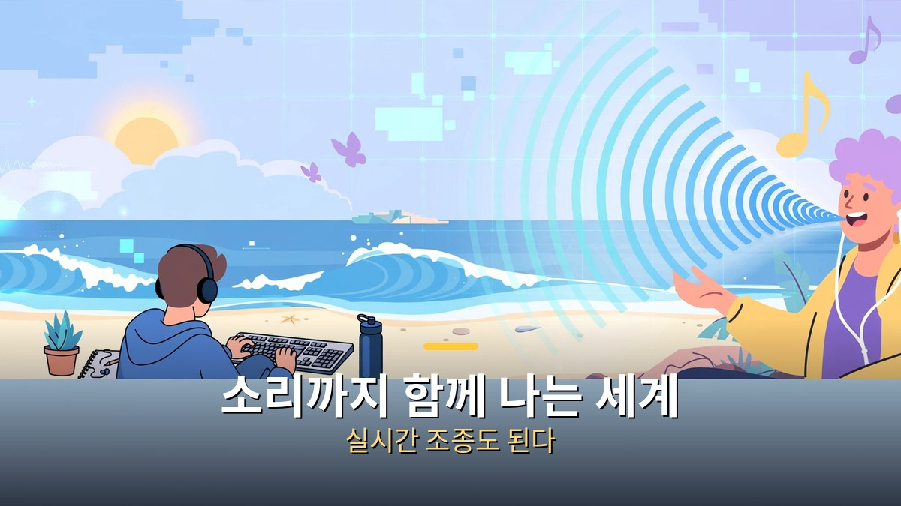
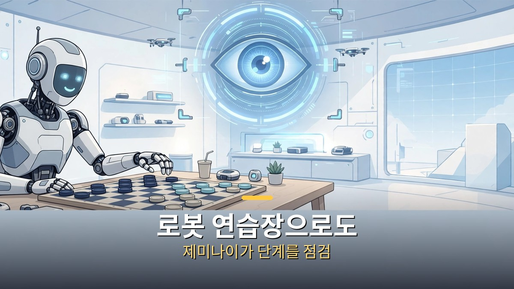
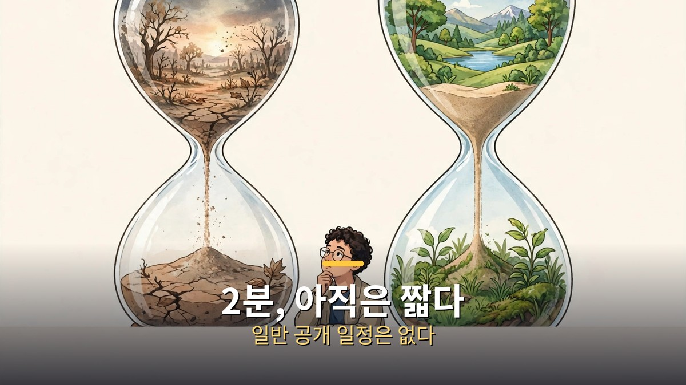

<!-- 본문 시작 -->

구글이 2026년 10월 27일, 말로 세상을 바꾸는 AI 지니 4를 공개했습니다.
글을 입력하면 걸어 다닐 수 있는 세계가 만들어지고, 그 안에서 소리까지 함께 납니다.
결론부터 말하면, **지니 4는 지금 당장 쓸 수 있는 제품이 아니라, 연구 미리보기 단계의 월드모델입니다.**
그래서 이 글은 "써보세요"가 아니라 "무엇이 달라졌고, 언제쯤 내 차례가 오는지"를 정리합니다.

> 월드모델은 완성된 영상을 보여주는 것이 아니라, 장소를 한 장면씩 만들어내며 사용자의 움직임에 반응하는 AI입니다. 지니 4는 그 세계에 소리와 대화, 실시간 조종을 더했습니다.

## 지니 4, 뭐가 새로워졌나요?

월드모델이라는 말을 처음 들으면 어렵습니다.
게임 속 세상을 떠올리면 쉽습니다.
사용자가 키보드로 움직이면 그 움직임에 맞춰 다음 장면이 바로 만들어집니다.
지니 4는 여기에 세 가지가 더해졌습니다.

첫째, 소리입니다.
바람 소리, 파도 소리, 배경 음악, 그리고 세계 속 인물의 대화까지 장면과 함께 만들어집니다.
구글은 이를 실시간 월드모델로는 처음 있는 일이라고 설명합니다.
다만 이 "처음"이라는 표현은 구글의 주장이라는 점을 함께 적어둡니다.
비슷한 시기에 다른 회사도 소리가 나는 플레이 가능한 세계를 내놓았다는 지적이 있기 때문입니다.

둘째, 실시간 조종입니다.
장면이 돌아가는 도중에 글로 지시를 바꿀 수 있습니다.
날씨를 바꾸고, 카메라를 돌리고, 인물이나 물건을 새로 넣어도 세계가 멈추지 않고 이어집니다.
셋째, 유지 시간입니다.
장면이 일관되게 유지되는 시간이 약 2분으로, 이전 세대인 지니 3의 60초보다 두 배로 늘었습니다.
2분은 짧아 보이지만, 세계가 무너지지 않고 이어지는 시간이라는 점에서 의미가 있습니다.

## 누가 세계를 붙잡고 있나요? 제미나이의 역할

지니 4 혼자 세계를 만드는 것이 아닙니다.
뒤에는 두 가지 제미나이 역할이 있습니다.
제미나이 옴니는 사람과 장소가 실제처럼 보이고 움직이도록 붙잡습니다.
제미나이 3.8 플래시는 안내자 역할을 하며, 목표를 단계로 나누고 새로 만들어진 장면을 확인해 각 단계가 제대로 됐는지 점검합니다.

이 구조를 알면 지니 4의 방향이 보입니다.
그냥 예쁜 장면을 만드는 것이 아니라, "체커 게임을 하라"는 목표를 단계로 쪼개고, 로봇이 그 단계를 실제로 수행하는 시뮬레이션까지 보여주는 식입니다.
구글 발표 시연에서는 아폴로라는 휴머노이드 로봇이 체커 말을 옮기는 장면이 나왔습니다.
즉 지니 4는 게임만을 노리는 것이 아니라, 로봇이 실제 기계를 움직이기 전에 가상 세계에서 연습할 수 있는 길도 노리고 있습니다.
물론 이것은 시연이 보여준 가능성이고, 실제 로봇 현장에서 바로 쓰인다는 뜻은 아닙니다.

## 지니 3과 비교하면, 어디까지 믿어야 하나요?

| 항목 | 지니 3 | 지니 4 |
| --- | --- | --- |
| 장면 유지 | 약 60초 | 약 2분 |
| 소리 | 별도 또는 없음 | 장면과 함께 실시간 생성 |
| 실시간 조종 | 제한적 | 날씨·카메라·인물·물건 변경 가능 |
| 안내 역할 | — | 제미나이 3.8 플래시가 단계 점검 |
| 공개 상태 | 연구·제한 공개 | 연구 미리보기, 신뢰할 수 있는 테스터부터 |

표만 보면 발전이 분명합니다.
그러나 구글 스스로도 한계를 밝힙니다.
장면이 길어지거나 복잡한 지시를 여러 번 바꾸면, 물건의 모습이 흐려지거나 사라질 수 있습니다.
해상도나 초당 장면 수, 성능 점수 같은 구체적인 스펙은 이번 발표에서 공개되지 않았습니다.
따라서 "가장 사실적이다"는 말은 구글 발표와 시연 기준의 주장으로 읽는 편이 안전합니다.
독립적인 재검증 결과가 나오기 전에는, 점수보다 한계를 먼저 보는 습관이 필요합니다.

## 그럼 나는 언제 쓸 수 있나요?

지금은 신뢰할 수 있는 테스터에게 먼저 열리는 연구 미리보기입니다.
그 다음은 구글 AI 울트라 구독자의 프로젝트 지니, 그리고 제미나이 API와 AI 스튜디오의 조기 접근 파트너 순으로 올 예정이라고 구글은 밝힙니다.
일반 공개 일정이나 별도 가격은 발표되지 않았고, 관심 있는 사람은 프로젝트 지니의 대기자 명단에 이름을 올리는 단계입니다.
AI 울트라가 월 99.99달러라는 보도가 있지만, 이는 지니 4 자체의 가격이 아니라 울트라 구독 요금이라는 점을 구분해야 합니다.

정리하면, 지니 4를 지금 당장 쓸 필요는 없습니다.
다만 방향은 분명합니다.
세계는 더 오래 유지되고, 소리가 붙고, 말로 바꿀 수 있고, 로봇 연습장으로도 이어집니다.
이 흐름이 게임, 교육, 로봇 시뮬레이션 중 어디에서 먼저 쓸모가 될지, 다음 발표에서 공개 일정과 스펙이 나오는지를 지켜보는 것이 지금 할 일입니다.
저는 예쁜 시연보다, 2분 뒤에 세계가 어떻게 무너지는지, 그 한계를 솔직히 보여주는 자료가 더 궁금합니다.
그 한계가 줄어드는 속도가, 이 기술이 장난감에서 도구로 넘어가는 속도가 될 테니까요.

## 자주 묻는 질문

**Q. 지니 4는 게임인가요?**
A. 게임처럼 걸어 다닐 수 있지만, 본질은 실시간으로 세계를 만들어내는 월드모델입니다. 게임, 시뮬레이션, 로봇 연습 등 여러 방향으로 쓰일 수 있습니다.

**Q. 지금 바로 써볼 수 있나요?**
A. 아닙니다. 연구 미리보기로 신뢰할 수 있는 테스터부터 열리고, 일반 공개 일정은 아직 없습니다.

**Q. 만든 영상에 표시가 있나요?**
A. 구글은 지니 4가 만드는 모든 영상과 오디오에 신스ID라는 보이지 않는 워터마크를 넣는다고 밝힙니다.

## 함께 읽으면 좋은 글

[구글 제미나이 4 카본｜1위 점수보다 먼저 볼 것, 아직 못 쓴다 — 종합 지수 59점의 의미와 Fairwind 선공개 범위를 정리한 글](https://aitechnoteskr.tistory.com/64)
[컬러 전자책 리더, 사기 전에 확인할 조건 — Kobo Libra Colour vs Kindle Colorsoft — 화면이 아니라 서점·파일·도서관 대출부터 정해야 하는 이유](https://aitechnoteskr.tistory.com/61)
[엑스 마키나｜튜링 테스트에 초대된 프로그래머, 그리고 에이바 — 누가 누구를 테스트하는지 뒤집히는 SF 스릴러](https://aitechnoteskr.tistory.com/67)

<!-- 본문 끝 -->

## 작업용 출처·이미지 정보 (업로드 제외)

- 자료 출처: TheAIGRID 'Google Just Created an AI That Simulates Reality' (2026-10-31 03:00 KST, 제목·주제 기준, 설명란 DeepMind 지니 4 링크) / 구글 지니 4 발표 보도 웹 리서치 (2026-10-31 확인: 2026-10-27 발표, 연구 미리보기·신뢰 테스터→AI 울트라 프로젝트 지니→API 조기 파트너 순, 약 2분 유지·지니 3의 2배, 제미나이 옴니·3.8 플래시 안내 역할, 신스ID, 스펙 미공개)
- 이미지: images/01-hero.jpg ~ 04-img3.jpg / 직접 제작 (AI 생성 + 한글 오버레이) / 사용권: 자작
