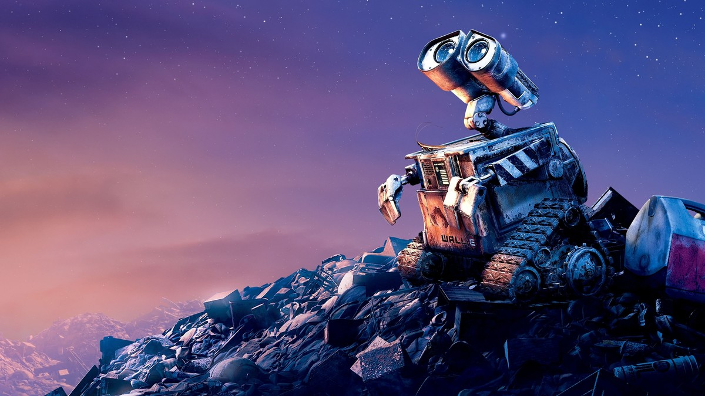
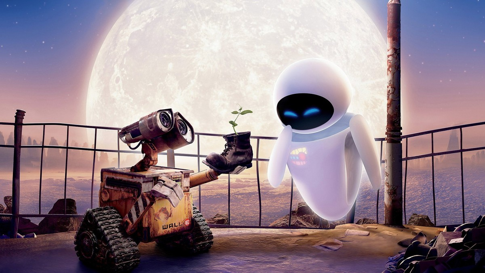
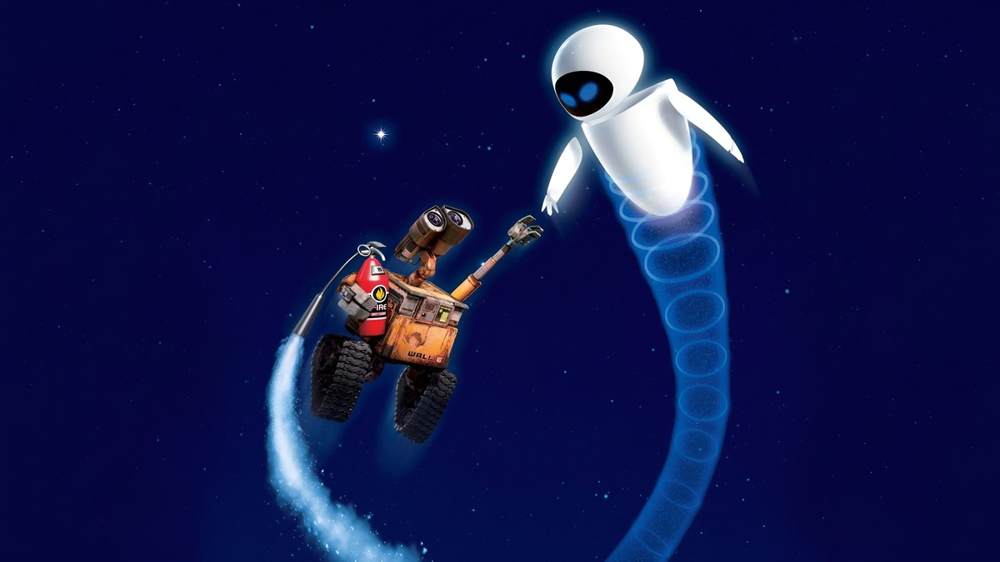
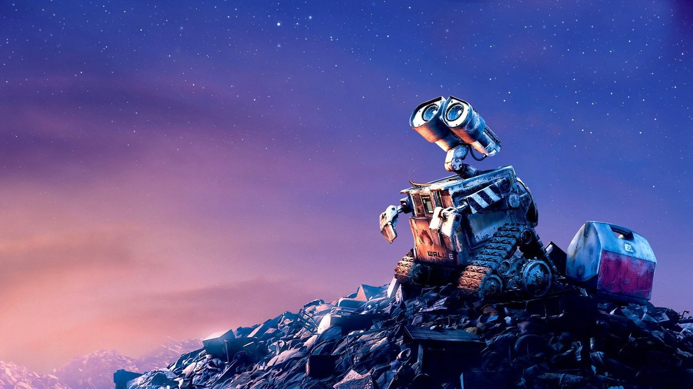
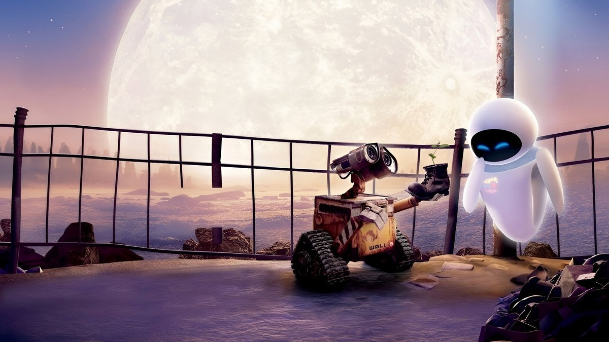

<!-- 본문 시작 -->

WALL·E on a hill of trash, looking up at the sky. An evening on an empty Earth.

Only one robot remains on an empty Earth.
Its job is to clean up trash; its only pleasure is collecting things it finds.
Pixar's 2008 animation WALL·E speaks more through scenes than through dialogue.
The short version is this: **it is a robot love story, and a story about what happens when humans hand all their work to machines.**
The ending is not covered here.

> WALL·E barely speaks. Instead, it conveys feelings through its eyes, movements, and sounds. That is why children and adults, in any language, laugh and ache at the same scenes.

## Basic Information

| Item | Detail |
| --- | --- |
| Title | WALL·E |
| Year | 2008 |
| Director and writer | Andrew Stanton |
| Main cast (voices) | Ben Burtt (WALL·E), Elissa Knight (EVE), Jeff Garlin (Captain) |
| Runtime | 98 minutes (feature only) |
| Rating | All ages (Korea) |
| Where to watch | Disney+ streaming (TMDB Korea watch page, checked 2026-10-31) |
| TMDB member score | 8.1/10 (21,117 ratings, checked 2026-10-31) |

The official poster. WALL·E and EVE above an empty Earth.

## A Spoiler-Free Plot

WALL·E clinging to a spaceship hull, flying through space. The journey after EVE.

After hundreds of years cleaning Earth, WALL·E meets EVE, a probe robot from the sky.
EVE has come to find the key that will decide Earth's future.
WALL·E follows EVE into space, and there meets humans living in a way he has never seen.
Humans aboard the ship live with machines doing everything for them.
A small discovery WALL·E carries starts moving a stopped world again.
That is as far as this summary goes. Seeing the rest yourself is much better.

## Scenes 1: A Cleaning Robot on an Empty Earth

WALL·E holding up a Rubik's Cube it found. Its collection speaks of its taste.

On an abandoned Earth, WALL·E compresses trash into towers every day.
Inside that routine is a collection.
Among discarded things, WALL·E picks what it likes and brings it home.
This scene matters because WALL·E looks like a being with taste, not a machine following orders only.
A common question about AI follows: can a machine "like" something, or only imitate liking?
The film does not answer in words. It shows the answer through WALL·E's collecting habit.

## Scenes 2: Meeting EVE

WALL·E offering EVE a worn boot holding a sprout, on a moonlit night on Earth.

EVE is WALL·E's opposite.
Sleek, fast, and clear in purpose.
Their meeting shows how two different beings approach each other.
WALL·E is clumsy; EVE is guarded.
Between that clumsiness and guardedness, the film shows "difference" without explaining it.
The AI point is here.
Even among robots, different design purposes mean different behavior.
WALL·E is built to clean and collect; EVE is built to find and report.
With different purposes, the same situation leads to entirely different choices.

## Scenes 3: Humans Who Handed Everything Over

WALL·E flying through space with a fire extinguisher as a thruster, beside EVE. Two robots with different purposes, traveling together.

Aboard the ship, humans neither walk nor touch things directly.
Chairs move for them, screens float before their eyes, and robots do all the work.
It looks comfortable, but a question hides behind that comfort.
As the things I no longer need to do grow, what do I end up doing?
WALL·E does not preach this question.
It simply places people sitting on moving chairs beside a robot stepping on the ground and picking things up.
That contrast is the film's sharpest scene.

WALL·E holding a sprout before Earth, with EVE flying and the cleaning robot M-O beside them.

## The AI Questions This Film Raises

First, purpose.
WALL·E was built to clean up trash.
On an Earth where that purpose has vanished, WALL·E finds a purpose of its own.
When an AI goes beyond its assigned task, who takes responsibility for that choice?

Second, dependence.
Handing everything to machines makes life comfortable.
But if that comfort weakens human bodies and judgment, who pays that price?

Third, difference.
WALL·E and EVE are different.
That difference becoming a relationship rather than a collision — the film quietly shows that possibility.

WALL·E alone on a hill of trash at night. The long hours of an empty Earth.

## Where to Watch, and a Pre-Watch Checklist

- Disney+ streaming is available (per the TMDB Korea watch page, checked 2026-10-31).
- At 98 minutes and rated for all ages, it is good to watch with children.
- With little dialogue, young children can follow it through scenes.
- It is better not to search for the ending first. The moments of discovery are the heart of this film.

WALL·E holding the boot with the sprout, with EVE beside it. The same scene, from another angle.

Finally, an honest reflection.
Every time I watch this film, I think that technological progress does not necessarily mean "humans need to move less."
WALL·E is the oldest, slowest robot, yet moves in the most human way.
That contrast stays with me.
When I use a technology, I ask once more: "If I hand this over, what will I end up doing?"
That one question alone makes this film worth watching.

## Frequently asked questions

**Q. Can I watch it with children?**
A. It is rated for all ages and has little dialogue, so it works well together. The trash-covered Earth at the start may feel a little heavy at first.

**Q. Is it fine to know the ending beforehand?**
A. Possible, but the moments of discovery and meeting are the heart of the film, so it is better not to know.

**Q. Where else can I watch it besides Disney+?**
A. The TMDB Korea watch page also lists rental and purchase options. Streaming is simplest, and prices differ by provider, so check at viewing time.

## Further reading

[Google's Gemini 4 Carbon｜Before the No. 1 Score, Note This: You Cannot Use It Yet — what the composite score of 59 means and who gets Fairwind early access](https://aitechnotesen.blogspot.com/2026/10/googles-gemini-4-carbonbefore-no-1.html)
[A 9x Cheaper Agent Than Opus｜GPT-6.1 Terra Is Cheap, but Not Weak — price, surcharge, and the limits of the claim](https://aitechnotesen.blogspot.com/2026/10/a-9x-cheaper-agent-than-opusgpt-61.html)
[The Creator｜In a War Against AI, a Soldier Meets a Child — the child-shaped AI called a weapon, and the journey to protect it](https://aitechnotesen.blogspot.com/2026/10/the-creatorin-war-against-ai-soldier.html)

<!-- 본문 끝 -->

## 작업용 출처·이미지 정보 (업로드 제외)

- 자료 출처: TMDB WALL·E page and Korea watch page (checked 2026-10-31: Disney+ streaming, director Andrew Stanton, 98 min, all ages, TMDB 8.1/10, 21,117 ratings) / Stills: TMDB backdrop and poster originals (visually checked, ending excluded, up to mid-film only)
- 이미지: images/01-hero.jpg ~ 09-img7.jpg / TMDB official stills and poster, cropped to 1200x675 / 사용권: 소개용 스틸
