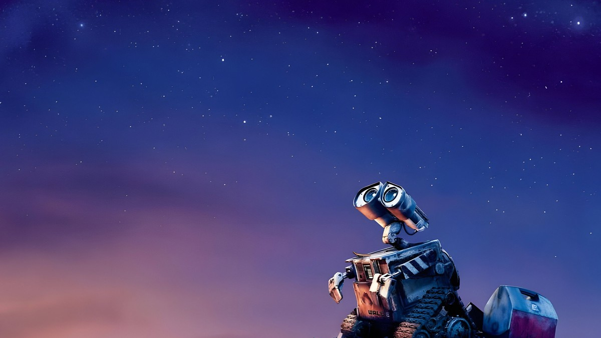
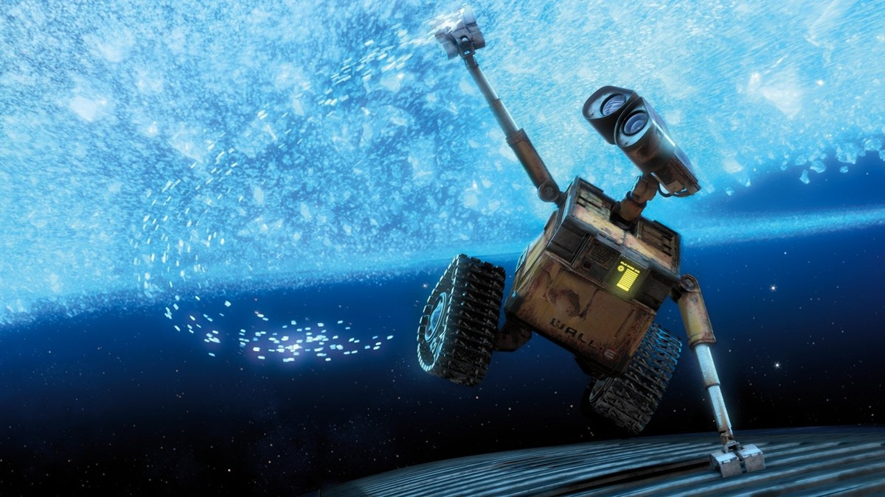
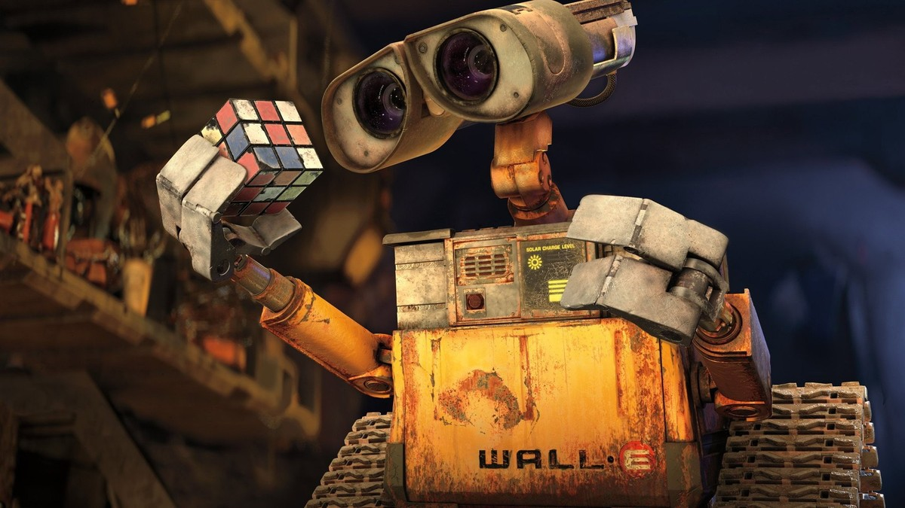
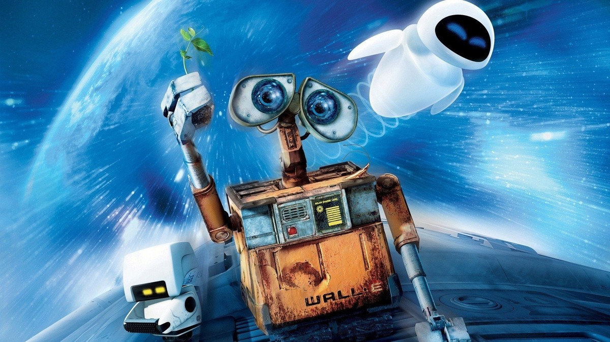

<!-- 본문 시작 -->

쓰레기 언덕 위에서 하늘을 올려다보는 월-E. 텅 빈 지구의 저녁.

텅 빈 지구에 로봇 하나만 남았습니다.
할 일은 쓰레기를 치우는 것, 유일한 낙은 주운 물건을 모으는 것입니다.
2008년 픽사 애니메이션 월-E는 대사보다 장면으로 말하는 영화입니다.
결론부터 말하면, **이 영화는 로봇의 사랑 이야기이자, 인간이 자기 일을 모두 기계에 맡긴 뒤 어떻게 되는지를 보여주는 이야기입니다.**
결말은 다루지 않습니다.

> 월-E는 말을 거의 하지 않습니다. 대신 눈빛과 움직임, 소리로 감정을 전합니다. 그래서 아이도 어른도, 언어가 달라도 같은 장면에서 웃고 뭉클해집니다.

## 기본 정보

| 항목 | 내용 |
| --- | --- |
| 제목 | 월-E (WALL·E) |
| 연도 | 2008 |
| 감독·각본 | 앤드류 스탠튼 |
| 주요 출연(목소리) | 벤 버트(월-E), 엘리사 나이트(이브), 제프 갈린(선장) |
| 러닝타임 | 98분(본편 기준) |
| 등급 | 전체관람가 |
| 시청처 | 디즈니+ 스트리밍 (TMDB 한국 시청 페이지 2026-10-31 확인) |
| TMDB 회원 점수 | 8.1/10 (21,117개 평가, 2026-10-31 확인) |

공식 포스터. 텅 빈 지구 위에 선 월-E와 이브.

## 스포일러 없는 줄거리

우주선 선체에 매달린 채 우주를 나는 월-E. 이브를 따라 나선 여정.

수백 년 동안 지구 청소를 해온 로봇 월-E는 어느 날 하늘에서 내려온 탐사 로봇 이브를 만납니다.
이브는 지구의 미래를 가를 열쇠를 찾으러 왔습니다.
월-E는 이브를 따라 우주로 나서고, 그곳에서 인간들이 어떻게 살고 있는지 마주합니다.
인간은 우주선 안에서 모든 일을 기계에 맡긴 채 살아갑니다.
월-E가 가져온 작은 발견이, 멈춰 있던 세계를 다시 움직이기 시작합니다.
여기까지만 적겠습니다. 그 다음은 직접 보는 편이 훨씬 좋습니다.

## 장면으로 보는 작품 1: 텅 빈 지구의 청소 로봇

주운 루빅스 큐브를 들어 보이는 월-E. 수집품이 그의 취향을 말해준다.

버려진 지구에서 월-E는 매일 쓰레기를 압축해 탑처럼 쌓습니다.
그 반복되는 일상 속에 수집품이 있습니다.
쓰다 버려진 물건들 사이에서 월-E는 마음에 드는 것을 골라 집으로 가져갑니다.
이 장면이 중요한 이유는, 월-E가 명령대로만 움직이는 기계가 아니라 자기 취향을 가진 존재로 보이기 때문입니다.
AI를 이야기할 때 흔히 묻는 질문이 있습니다.
기계가 "좋아한다"는 감정을 가질 수 있는가, 아니면 그저 흉내인가.
영화는 답을 말로 주지 않고, 월-E의 수집 습관으로 보여줍니다.

## 장면으로 보는 작품 2: 이브와의 만남

새싹이 든 낡은 부츠를 이브에게 내미는 월-E. 달이 뜬 지구의 밤.

이브는 월-E와 정반대입니다.
매끈하고 빠르고 목적이 분명합니다.
두 로봇이 만나는 장면은, 서로 다른 존재가 어떻게 다가가는지를 보여줍니다.
월-E는 서툴고, 이브는 경계합니다.
그 서툼과 경계 사이에서 영화는 "다름"을 설명하지 않고 보여줍니다.
AI 포인트는 여기에 있습니다.
같은 로봇이라도 설계 목적이 다르면 행동도 다릅니다.
월-E는 청소하고 모으는 로봇이고, 이브는 찾고 보고하는 로봇입니다.
목적이 다르면, 같은 상황에서도 전혀 다른 선택을 합니다.

## 장면으로 보는 작품 3: 모든 것을 맡긴 인간들

소화기를 추진기로 삼아 우주를 나는 월-E와 이브. 목적이 다른 두 로봇의 동행.

우주선 안의 인간들은 걷지도, 직접 만지지도 않습니다.
의자는 움직여주고, 화면은 눈앞에 떠 있고, 로봇이 모든 일을 대신합니다.
편해 보이지만, 그 편리함 뒤에는 질문이 숨어 있습니다.
내가 하지 않아도 되는 일이 늘어날수록, 나는 무엇을 하게 되는가.
월-E는 이 질문을 설교하지 않습니다.
그저 움직이는 의자에 앉은 사람들과, 발로 땅을 밟고 무언가를 줍는 로봇을 나란히 보여줄 뿐입니다.
이 대비가 영화의 가장 날카로운 장면입니다.

지구가 보이는 우주선 밖에서 새싹을 든 월-E와 이브, 청소 로봇 M-O가 함께 있다.

## 이 작품이 던지는 AI 질문

첫째, 목적입니다.
월-E는 원래 쓰레기를 치우라고 만들어졌습니다.
그런데 그 목적이 사라진 지구에서, 월-E는 스스로 목적을 찾습니다.
AI가 주어진 임무를 넘어설 때, 그 선택을 누가 책임지는가.

둘째, 의존입니다.
인간이 모든 일을 기계에 맡기면 편해집니다.
그러나 그 편리함이 인간의 몸과 판단을 약하게 만든다면, 그 대가는 누가 치르는가.

셋째, 다름입니다.
월-E와 이브는 다릅니다.
그 다름이 충돌이 아니라 관계가 될 수 있다는 것, 영화는 그 가능성을 조용히 보여줍니다.

쓰레기 언덕 위에 선 월-E의 밤. 혼자였던 지구의 시간.

## 어디서 보는지, 보기 전 체크리스트

- 디즈니+ 스트리밍으로 볼 수 있습니다 (TMDB 한국 시청 페이지 기준, 2026-10-31 확인).
- 러닝타임 98분, 전체관람가라 아이와 함께 보기 좋습니다.
- 대사가 적어 어린아이도 장면으로 따라가기 쉽습니다.
- 결말을 미리 검색하지 않는 편이 좋습니다. 이 영화는 발견의 순간이 핵심입니다.

새싹이 든 부츠를 든 월-E와 이브. 같은 장면, 다른 각도에서 본 두 로봇.

마지막으로 솔직한 소회를 적겠습니다.
저는 이 영화를 볼 때마다, 기술이 발전한다는 말이 꼭 "사람이 덜 움직여도 된다"는 뜻은 아니라는 생각이 듭니다.
월-E는 가장 낡고 느린 로봇인데, 가장 인간답게 움직입니다.
그 대비가 오래 남습니다.
기술을 쓸 때, "이걸 맡기면 나는 무엇을 하게 되는가"라는 질문을 한 번 더 하게 됩니다.
그 질문 하나만 가져가도, 이 영화는 충분히 볼 가치가 있습니다.

## 자주 묻는 질문

**Q. 아이와 함께 봐도 되나요?**
A. 전체관람가이고 대사가 적어 함께 보기 좋습니다. 다만 쓰레기 더미로 가득한 지구 장면이 처음에는 조금 무겁게 느껴질 수 있습니다.

**Q. 결말을 알고 봐도 되나요?**
A. 가능은 하지만, 발견과 만남의 순간이 핵심이라 모르고 보는 편이 좋습니다.

**Q. 디즈니+ 외에 어디서 볼 수 있나요?**
A. TMDB 한국 시청 페이지에는 대여·구매처도 함께 표시됩니다. 스트리밍이 가장 간단하고, 가격은 제공처별로 다르니 시청 시점에 직접 확인하는 편이 좋습니다.

## 함께 읽으면 좋은 글

[구글 제미나이 4 카본｜1위 점수보다 먼저 볼 것, 아직 못 쓴다 — 종합 지수 59점의 의미와 Fairwind 선공개 범위를 정리한 글](https://aitechnoteskr.tistory.com/64)
[컬러 전자책 리더, 사기 전에 확인할 조건 — Kobo Libra Colour vs Kindle Colorsoft — 화면이 아니라 서점·파일·도서관 대출부터 정해야 하는 이유](https://aitechnoteskr.tistory.com/61)
[엑스 마키나｜튜링 테스트에 초대된 프로그래머, 그리고 에이바 — 누가 누구를 테스트하는지 뒤집히는 SF 스릴러](https://aitechnoteskr.tistory.com/67)

<!-- 본문 끝 -->

## 작업용 출처·이미지 정보 (업로드 제외)

- 자료 출처: TMDB 월-E 페이지·한국 시청 페이지 (2026-10-31 확인: 디즈니+ 스트리밍, 감독 앤드류 스탠튼, 98분, 전체관람가, TMDB 8.1/10·21,117개 평가) / 스틸: TMDB 백드롭·포스터 원본 (육안 확인, 결말 장면 제외, 중반부까지만)
- 이미지: images/01-hero.jpg ~ 09-img7.jpg / TMDB 공식 스틸·포스터 가공 (1200x675) / 사용권: 소개용 스틸
