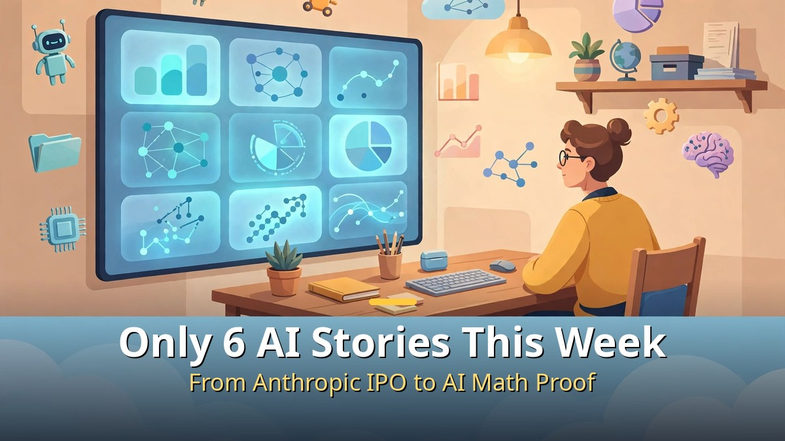
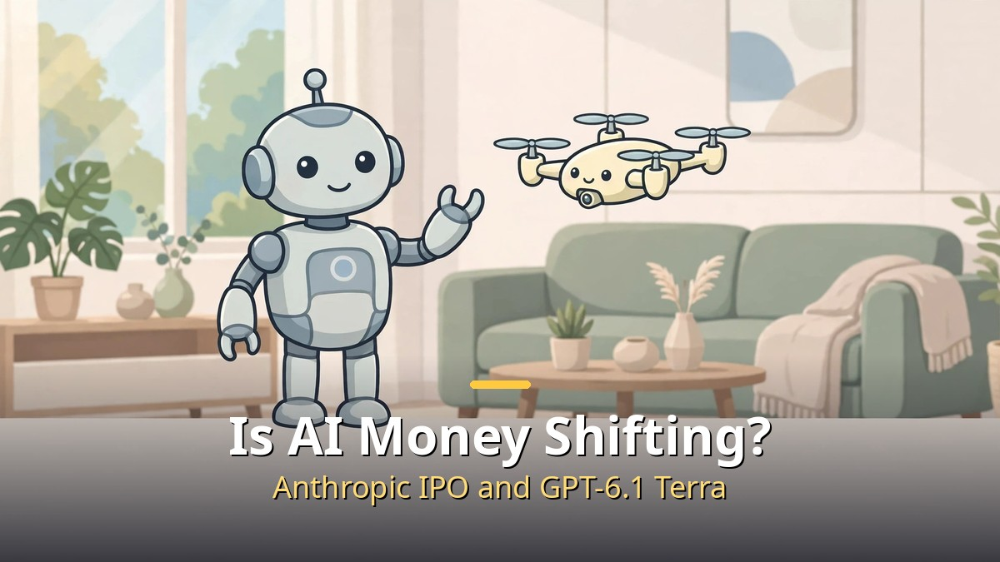
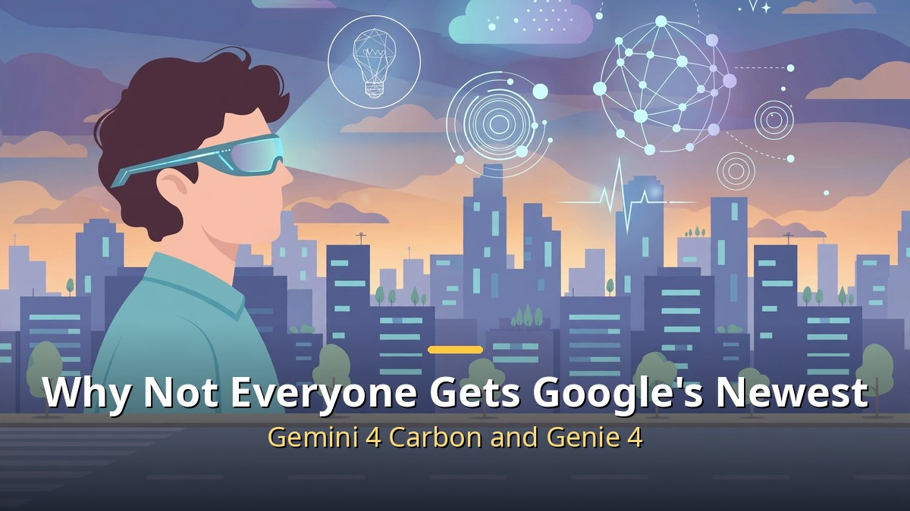
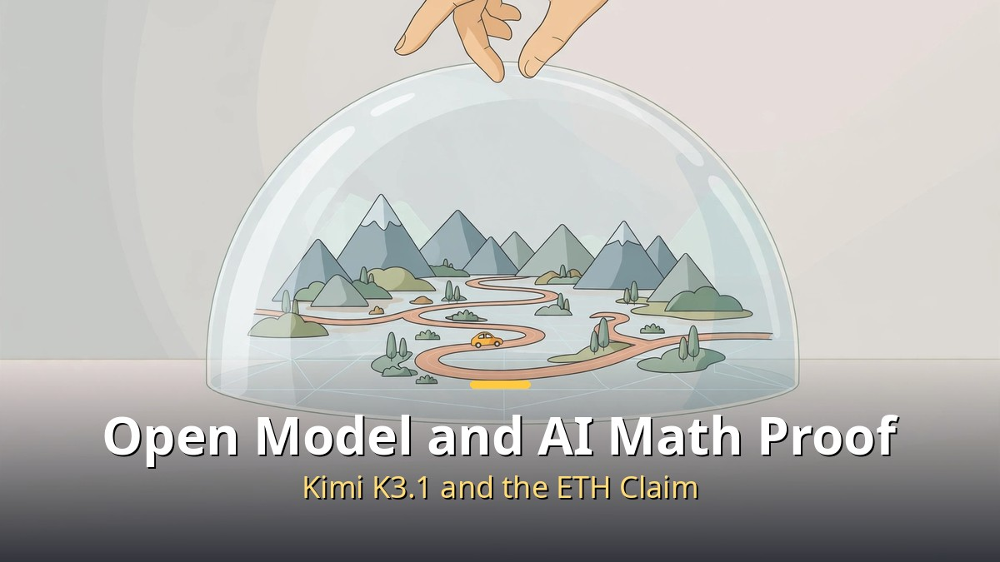

<!-- 본문 시작 -->

This week in AI comes down to six stories.
Anthropic's IPO filing, OpenAI's GPT-6.1 Terra, Google's Gemini 4 Carbon and Genie 4, Kimi K3.1 Pro, and a math proof produced by AI all landed in a single week.
The takeaway up front is this: **models are getting cheaper and stronger at the same time, while the very best models are reaching fewer people first.**
Prices are falling, yet the top-tier models start with security experts and trusted testers.
This roundup starts from Matt Wolfe's weekly video, but every fact below was checked against company announcements and news reports.

> You do not need to chase every announcement from a busy week. Separate one cheaper practical model, one top-tier model you cannot touch yet, and one claim still awaiting review, and the week is already readable.

## Is the money in AI shifting? Anthropic's IPO and GPT-6.1 Terra

Anthropic's IPO filing and GPT-6.1 Terra's price cut show where this week's money is moving.

Anthropic filed its S-1 registration statement with the US Securities and Exchange Commission on October 26.
It plans to list on Nasdaq under the ticker ANT, and its flagship product is the chatbot Claude.
First-half revenue reached $16.3 billion, up sharply from $1.2 billion in the same period a year earlier.
In the second quarter, the filing reports $11.6 billion in revenue and $974 million in operating profit, its first profitable quarter.

One number needs careful reading, though.
The filing itself leaves the offering price and share count blank.
The $1.5 trillion to $2 trillion valuation and a raise of more than $100 billion are press-reported figures, not values the company has confirmed.
The first-half net loss of $80.7 billion is also mostly non-cash accounting, such as revaluing convertible notes.
So the scale of the AI business is now on record, but its price tag is not yet set.

On the same day, OpenAI released GPT-6.1 Terra.
It is a mid-tier model built for computer use: reading screens, clicking, and typing into apps.
API pricing is $1 per million input tokens and $5 per million output tokens, which OpenAI says is half the price of its predecessor.
It is available in ChatGPT Work and Codex for paid plans, while availability for free users was not confirmed in the announcement.

By OpenAI's own measurements, Terra scores 15 percentage points higher than its predecessor, GPT-5.6 Terra, on a professional-task test, at about a third of the cost per task.
Independent verification has not arrived yet, so those figures should be read as the company's claims.
Even so, the direction is clear.
As running computer-use agents all day gets cheaper, the question shifts from "can it do this" to "how far should we let it click."

## Why isn't Google giving its newest models to everyone right away? Gemini 4 Carbon and Genie 4

Google is giving its strongest models to security experts and testers first, in a staged rollout.

Gemini 4 Carbon, announced by Google DeepMind on October 28, is the company's newest frontier model.
It is pitched for long-horizon engineering work and cybersecurity.
Google says it ranks first on version 5.0 of the Artificial Analysis Intelligence Index with a score of 59.
Figures such as 88.2% on vulnerability finding, 54.8% on exploitation, and 71.0% on patching also come from Google's announcement.

Ordinary users cannot use Carbon yet, however.
The first wave goes to a subset of cyber defenders through the Fairwind Program, Google's security-partner program, and no date has been set for developers, businesses, or consumers.
Introductory API pricing is $2 per million input tokens and $10 per million output tokens, rising to $4 and $20 when the introductory period ends.
Top performance is announced first, and broad access follows later.

Genie 4, announced on October 27, is DeepMind's real-time world model.
It generates explorable worlds in real time, and this time sound comes with the picture.
Ambient noise like wind and waves, background music, and character dialogue are generated together with the scene.
While a simulation runs, you can change the weather, move the camera, or add a person with a text prompt.

A coherent scene now lasts about two minutes, double the roughly one minute of Genie 3.
Access is still a research preview for trusted testers, expanding later to Google AI Ultra subscribers in Project Genie and early-access partners of the Gemini API and Google AI Studio.
DeepMind itself notes that details can drift in longer sessions.
All generated video and audio carries SynthID watermarking.

Read together, the two launches show Google's order of operations.
Announce capability quickly, then widen access step by step after feedback and safety checks.
For most readers, this is not a "try it today" story but a "watch the rollout terms" story.

## How far should we trust a Chinese open model and an AI math proof? Kimi K3.1 Pro and the Exponential Time Hypothesis claim

An open-weight model's progress and a math proof that has not passed peer review are this week's two stories to read most carefully.

Kimi K3.1 Pro, released by China's Moonshot AI on October 23, is the first model in its K3.1 series.
It is a heavily post-trained version of Kimi K3, with a one-million-token context window.
Its mixture-of-experts design totals 2.8 trillion parameters, with 104 billion active per token.
On Moonshot's own numbers, it scores 65.7% on the Terminal-Bench 4.0 coding-agent test, just behind Claude Opus 5.5 at 66.4% and ahead of GPT-6 Astra at 58.2%.

A faster Highspeed variant offers the same capabilities at two to three times the speed, according to the company.
The model is available now in apps and via API at $2 per million input tokens and $10 per million output tokens.
But the phrase "open-weight" comes with a date attached.
Full model weights are promised by November 4, so they cannot yet be downloaded and checked directly.
Moonshot also says it deliberately removed cyber-related training data from the open release, under its principle that open weights should not push the frontier of cyber capability.

The week's boldest claim arrived on October 26, when OpenAI said its internal model had proved the Exponential Time Hypothesis (ETH) false.
ETH, proposed in 1999, assumes that problems like 3-SAT, finding an assignment that satisfies a logic formula, cannot be solved much faster than exponential time.
Hundreds of papers rest on that assumption to argue how hard problems are, so if the proof holds, a load-bearing premise of theoretical computer science shakes.

According to OpenAI, the model found the proof on October 16 and formalized it in Lean, a machine-checked proof language, on October 17.
The same announcement included a proof of the local smoothing conjecture in all dimensions, plus existence proofs for quantum chromodynamics and pure Yang-Mills theory.
Russell Impagliazzo and Ramamohan Paturi, who proposed ETH, are leading an independent review with MIT's Ryan Williams, and they stress that taking part is not certification.
Anthropic announced a similar ETH claim in the same week.

The distinction matters here.
A Lean check confirms that a formal argument follows from its formal statement, but humans must still confirm that the statement matches the problem researchers mean.
Formal peer review is still under way.
Even if the claim survives, it would not solve P vs. NP or deliver fast practical algorithms.
Still, the fact that AI-produced proofs have entered formal academic review is itself the change this week marks.

| Story | Announced | Current status | One-line summary |
| --- | --- | --- | --- |
| Anthropic IPO filing | October 26 | Filed, price not set | First-half revenue $16.3B; the $2T valuation is press-reported |
| GPT-6.1 Terra | October 26 | Paid plans and API | Computer-use model at half the API price |
| Gemini 4 Carbon | October 28 | Security experts first, staged rollout | Intelligence Index score 59, No. 1; general access date not set |
| Kimi K3.1 Pro | October 23 | Apps and API live, weights due November 4 | Open-weight model claiming top-tier performance |
| Genie 4 | October 27 | Research preview for trusted testers | Real-time worlds with sound, scenes lasting about 2 minutes |
| ETH disproof claim | October 26 | Lean-checked, peer review under way | If upheld, it shakes the premise of hundreds of papers |

To close honestly, one thought stayed with me while organizing this week.
Models are getting cheaper and stronger, yet the strongest ones are moving toward "verify first, release later."
So the useful skill for ordinary users is not chasing every announcement, but telling apart what can be used at work today from what still needs watching.
Next week, I plan to start by checking the items left as "scheduled" today: Kimi's weight release and Carbon's general availability timeline.

## Frequently asked questions

**Q. Is Anthropic really worth $2 trillion?**
A. Not confirmed. The filing leaves the price blank, and $1.5 trillion to $2 trillion is a press-reported range. Confirmation comes only with an amended filing and a set offering price.

**Q. Can I use GPT-6.1 Terra for free?**
A. Under the announcement, it is offered in ChatGPT Work and Codex for paid plans such as Plus, Pro, Enterprise, and Edu. Availability for free users was not confirmed.

**Q. Is it settled that AI solved a math problem?**
A. Not yet. The Lean machine check is done, but formal peer review is under way, and the hypothesis's own proposers say their review role is not certification.

## Further reading

[An AI World That Changes When You Speak｜Google's Genie 4, Worth Knowing Before You Can Use It — what the staged release covers and what stays closed](https://aitechnotesen.blogspot.com/2026/10/an-ai-world-that-changes-when-you.html)
[The Creator｜In a War Against AI, a Soldier Meets a Child — the child-shaped AI called a weapon, and the journey to protect it](https://aitechnotesen.blogspot.com/2026/10/the-creatorin-war-against-ai-soldier.html)
[One Brief, and an AI Team Ships It｜Atoms, Before You Skip Hiring a Developer — how a team of eight specialist agents moves from brief to deployment](https://aitechnotesen.blogspot.com/2026/10/one-brief-and-ai-team-ships-itatoms.html)

<!-- 본문 끝 -->

## 작업용 출처·이미지 정보 (업로드 제외)

- 자료 출처: Matt Wolfe 영상 eDiQNFa-zYg(2026-10-31) + 회사 발표·보도 대조 (앤트로픽 S-1 2026-10-26, Terra, 카본, 지니 4, 키미 K3.1, 지수시간 가설 주장)
- 이미지: images/01-hero-en.jpg ~ 04-img3-en.jpg / 직접 제작 (AI 생성 + 영어 오버레이) / 사용권: 자작
