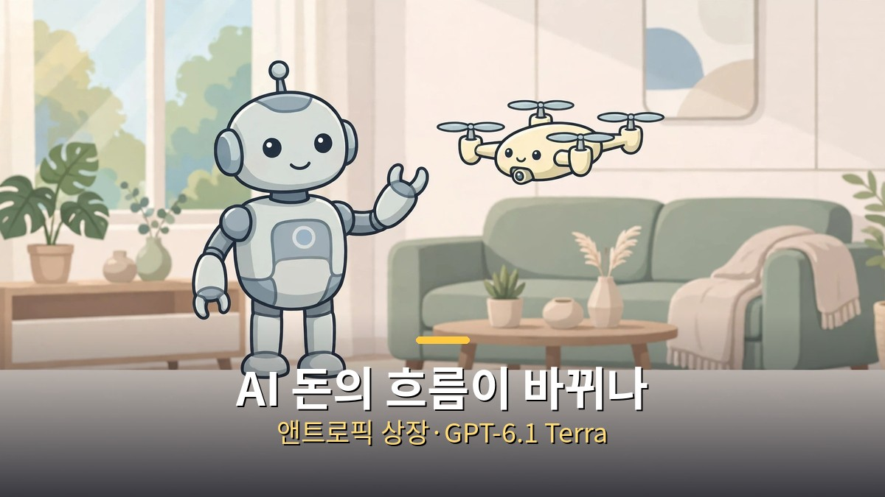
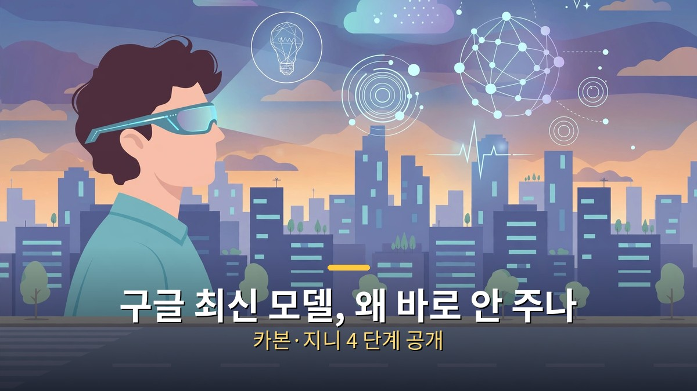
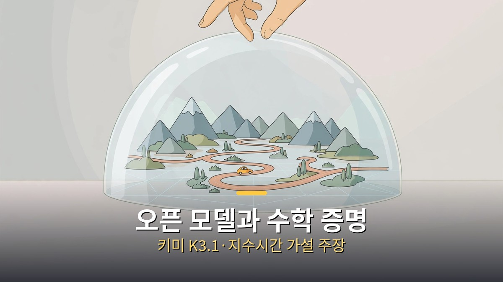

<!-- 본문 시작 -->

이번 주 AI 뉴스는 6개만 챙기면 됩니다.
앤트로픽의 상장 신고, 오픈AI의 GPT-6.1 Terra, 구글의 제미나이 4 카본과 지니 4, 키미 K3.1 Pro, 그리고 AI가 내놓은 수학 증명까지 한 주에 몰렸습니다.
결론부터 말하면, **이번 주의 흐름은 '더 싸고 더 강해진 모델'과 '아직 아무나 못 쓰는 최신 모델'이 동시에 달리고 있다는 점입니다.**
가격은 내려가는데, 가장 센 모델은 보안 전문가와 테스터부터 만나는 식입니다.
출발점은 Matt Wolfe의 주간 정리 영상이지만, 사실관계는 각 회사 발표와 보도로 대조했습니다.

> 한 주에 쏟아진 발표를 굳이 다 따라갈 필요는 없습니다. 값이 내려간 실용 모델 하나, 아직 손에 닿지 않은 최상위 모델 하나, 그리고 검증이 남은 주장 하나만 구분해도 이번 주는 충분히 읽힙니다.

## AI 돈의 흐름이 바뀌나요? 앤트로픽 상장과 GPT-6.1 Terra

앤트로픽 상장 신고와 GPT-6.1 Terra의 가격 인하, 이번 주 돈의 흐름을 보여주는 두 소식입니다.

앤트로픽은 10월 26일 미국 증권거래위원회에 상장 신고서(S-1)를 제출했습니다.
나스닥 상장 예정 종목 코드는 ANT이고, 대표 상품은 챗봇 클로드입니다.
신고서 기준 상반기 매출은 163억 달러로, 1년 전 같은 기간의 12억 달러에서 크게 늘었습니다.
2분기에는 매출 116억 달러에 영업이익 9억 7,400만 달러를 기록해 첫 분기 흑자를 냈다고 신고서는 밝힙니다.

다만 숫자 하나는 조심해서 읽어야 합니다.
신고서 자체에는 공모가와 공모 주식 수가 비어 있습니다.
1조 5,000억~2조 달러 기업가치와 1,000억 달러 이상 공모 규모는 언론 보도 기준이지 회사가 확정한 값이 아닙니다.
상반기 순손실 807억 달러도 대부분 전환사채 가치 재평가 같은 비현금 회계 항목입니다.
즉 AI 사업의 규모는 신고서로 확인됐지만, 기업가치는 아직 가격표가 붙지 않은 상태입니다.

같은 날 오픈AI는 GPT-6.1 Terra를 내놨습니다.
화면을 보고 클릭하고 입력하는 '컴퓨터 사용'에 맞춘 중간급 모델입니다.
API 가격은 백만 토큰당 입력 1달러, 출력 5달러로, 이전 모델보다 절반 수준이라고 오픈AI는 밝힙니다.
유료 플랜의 ChatGPT Work와 Codex에서 제공되며, 무료 사용자 제공 여부는 발표에서 확인되지 않았습니다.

오픈AI 자체 측정 기준으로는 전문 업무 테스트에서 이전 모델(GPT-5.6 Terra)보다 15%포인트 높고, 작업당 비용은 3분의 1 수준입니다.
아직 독립 검증은 나오지 않았으니, 이 수치는 회사의 주장으로 받아들이는 편이 안전합니다.
그래도 방향은 분명합니다.
컴퓨터 사용 에이전트를 하루 종일 돌리는 비용이 낮아지면, 문제는 "할 수 있느냐"에서 "어디까지 시켜도 되느냐"로 넘어갑니다.

## 구글 최신 모델은 왜 일반인에게 바로 안 주나요? 제미나이 4 카본과 지니 4

구글은 가장 센 모델을 보안 전문가와 테스터부터 만나게 하는 단계적 공개를 택했습니다.

제미나이 4 카본은 10월 28일 구글 딥마인드가 공개한 최신 프론티어 모델입니다.
긴 호흡의 공학 작업과 사이버 보안이 강점으로 내세워졌습니다.
종합 벤치마크인 Artificial Analysis 지능 지수 v5.0에서 59점으로 1위를 차지했다고 구글은 밝힙니다.
보안 취약점 찾기 88.2%, 공격 재현 54.8%, 패치 71.0% 같은 수치도 구글 발표 기준입니다.

그런데 일반 사용자는 아직 이 모델을 쓸 수 없습니다.
첫 공개 대상은 구글이 운영하는 보안 파트너 프로그램인 페어윈드 프로그램에 속한 일부 사이버 방어팀이고, 개발자·기업·일반 공개 일정은 정해지지 않았습니다.
도입 API 가격은 백만 토큰당 입력 2달러, 출력 10달러이며, 도입 기간이 끝나면 4달러와 20달러로 오릅니다.
최상위 성능을 먼저 자랑하고, 손에 닿는 순서는 뒤로 미루는 셈입니다.

지니 4는 10월 27일 공개된 구글 딥마인드의 실시간 세계 모델입니다.
텍스트나 이미지로 만든 세계를 실시간으로 탐색하고, 소리까지 함께 생성합니다.
바람 소리나 파도 소리 같은 환경음, 등장인물의 대화가 화면과 동시에 만들어집니다.
진행 중인 장면에 날씨 변경이나 카메라 이동, 인물 추가를 문장으로 지시할 수도 있습니다.

일관된 장면 유지 시간은 약 2분으로, 전작 지니 3의 약 1분에서 두 배가 됐습니다.
다만 아직 연구 미리보기 단계로, 신뢰할 수 있는 테스터부터 쓰고, 이후 구글 AI Ultra 구독자의 프로젝트 지니와 API 조기 이용 파트너로 넓어집니다.
장면이 길어지면 세부 묘사가 흔들리는 한계도 딥마인드 스스로 밝히고 있습니다.
모든 생성 영상과 음성에는 SynthID 워터마크가 붙습니다.

두 모델을 묶어 보면 구글의 순서가 보입니다.
성능 발표는 빠르게, 실제 이용은 검증과 피드백을 거친 뒤에 단계적으로 넓히는 방식입니다.
일반 독자에게는 "지금 써보라"는 소식이 아니라, "공개 일정이 정해지면 그때 조건을 보라"는 소식이 됩니다.

## 중국 오픈 모델과 AI 수학 증명, 어디까지 믿어야 하나요? 키미 K3.1 Pro와 지수시간 가설 반증 주장

공개 가중치 모델의 진전과 아직 동료 검토를 거치지 않은 수학 증명 주장, 이번 주 가장 조심스럽게 읽어야 할 두 소식입니다.

키미 K3.1 Pro는 중국 문샷AI가 10월 23일 내놓은 K3.1 시리즈의 첫 모델입니다.
기존 K3를 대폭 추가 학습한 버전으로, 백만 토큰 문맥을 처리합니다.
혼합 전문가 구조로 전체 2조 8,000억 개, 한 번에 활성화되는 1,040억 개 매개변수를 갖습니다.
문샷AI 자체 측정 기준 코딩 에이전트 테스트 Terminal-Bench 4.0에서 65.7%를 기록해, 클로드 오퍼스 5.5의 66.4%에는 조금 못 미치고 GPT-6 Astra의 58.2%는 앞섰습니다.

빠른 버전인 Highspeed는 같은 성능으로 2~3배 빠르게 나온다고 회사는 설명합니다.
앱과 API로는 바로 쓸 수 있고, API 가격은 백만 토큰당 입력 2달러, 출력 10달러입니다.
다만 "오픈 웨이트"라는 말에는 날짜 조건이 붙습니다.
전체 가중치는 11월 4일까지 공개 예정이라, 지금은 내려받아 직접 확인할 수 있는 상태가 아닙니다.
또 문샷AI는 공개용 모델에서 사이버 공격 관련 학습 데이터를 일부러 덜어냈다고 밝혔습니다.
공개 가중치가 사이버 공격 능력의 최전선을 끌어올려서는 안 된다는 회사 원칙 때문입니다.

이번 주 가장 큰 주장은 10월 26일 오픈AI가 내놓은 수학 증명입니다.
내부 모델이 지수시간 가설(ETH)이 틀렸음을 증명했다는 내용입니다.
지수시간 가설은 1999년 나온 가설로, 논리식의 답을 찾는 문제(3-SAT)가 지수 시간보다 훨씬 빨라질 수 없다는 전제입니다.
수백 편의 논문이 이 전제를 깔고 문제의 어려움을 논해왔기 때문에, 성립하면 이론 컴퓨터 과학의 전제가 흔들립니다.

오픈AI 설명에 따르면 모델이 증명을 찾은 날은 10월 16일, Lean이라는 기계 검증 언어로 형식화한 날은 10월 17일입니다.
함께 발표된 결과에는 모든 차원에서의 국소 평활 추측 증명, 양자색역학과 순수 양-밀스 이론의 존재 증명도 포함됩니다.
가설을 처음 제안한 임팔리아초와 파투리, MIT의 라이언 윌리엄스가 독립 검토를 이끌지만, 이들은 검토 참여가 인증이 아니라고 밝혔습니다.
같은 주에 앤트로픽도 비슷한 지수시간 가설 반증 주장을 내놓았습니다.

여기서 구분해야 할 점이 있습니다.
Lean 검증은 증명의 논리가 형식적으로 맞는지를 확인해주지만, 그 형식이 원래 문제를 정확히 옮긴 것인지는 사람이 따로 확인해야 합니다.
정식 동료 검토도 아직 진행 중입니다.
설령 주장이 버텨낸다 해도 P 대 NP 문제를 푼 것도 아니고, 당장 빠른 실용 알고리즘이 나오는 것도 아닙니다.
그럼에도 AI가 내놓은 증명을 학계가 정식으로 검토하기 시작했다는 사실 자체가 이번 주의 변화를 보여줍니다.

| 소식 | 발표일 | 지금 상태 | 핵심 한 줄 |
| --- | --- | --- | --- |
| 앤트로픽 상장 신고 | 10월 26일 | 신고 완료, 공모가 미정 | 상반기 매출 163억 달러, 2조 달러 기업가치는 보도 기준 |
| GPT-6.1 Terra | 10월 26일 | 유료 플랜·API 제공 중 | 컴퓨터 사용 모델 API 가격 절반 |
| 제미나이 4 카본 | 10월 28일 | 보안 전문가부터 단계 공개 | 지능 지수 59점 1위, 일반 공개 일정 미정 |
| 키미 K3.1 Pro | 10월 23일 | 앱·API 제공 중, 가중치 11월 4일 공개 예정 | 오픈 웨이트 최상위권 성능 주장 |
| 지니 4 | 10월 27일 | 신뢰 테스터 대상 연구 미리보기 | 실시간 세계에 소리까지 생성, 장면 약 2분 유지 |
| 지수시간 가설 반증 주장 | 10월 26일 | Lean 검증 완료, 동료 검토 진행 중 | 성립 시 수백 편 논문의 전제가 흔들림 |

마무리는 솔직하게 적겠습니다.
이번 주 발표를 정리하면서 든 생각은 하나입니다.
모델은 싸지고 강해지는데, 정작 가장 센 것들은 점점 '먼저 검증받고 나중에 공개'되는 쪽으로 가고 있습니다.
그래서 일반 사용자에게 남는 숙제는 발표를 빨리 따라잡는 게 아니라, 내 일에 바로 쓸 수 있는 것과 아직 지켜봐야 할 것을 가르는 눈인 것 같습니다.
다음 주에는 오늘 '예정'으로 남은 것들, 키미 가중치 공개와 카본의 일반 공개 일정이 실제로 어떻게 움직이는지부터 확인해보려 합니다.

## 자주 묻는 질문

**Q. 앤트로픽 기업가치가 정말 2조 달러인가요?**
A. 아닙니다. 신고서에는 공모가가 비어 있고, 1조 5,000억~2조 달러는 언론 보도 기준입니다. 확정은 수정 신고서와 공모가 결정 이후입니다.

**Q. GPT-6.1 Terra는 무료로 쓸 수 있나요?**
A. 발표 기준으로는 Plus·Pro·Enterprise·Edu 등 유료 플랜의 ChatGPT Work와 Codex에서 제공되며, 무료 사용자 제공 여부는 발표에서 확인되지 않았습니다.

**Q. AI가 수학 난제를 풀었다는 말은 확정된 사실인가요?**
A. 아직 아닙니다. Lean 기계 검증은 마쳤지만 정식 동료 검토가 진행 중이고, 가설 제안자 본인들도 검토 참여가 인증이 아니라고 밝혔습니다.

## 함께 읽으면 좋은 글

[말하면 세상이 바뀌는 AI｜구글 지니 4, 아직은 못 써도 알아둘 것 — 실시간 세계에 소리까지 생성하는 지니 4의 단계 공개 범위를 정리한 글](https://aitechnoteskr.tistory.com/71)
[월-E｜버려진 지구에서 목적을 찾은 청소 로봇의 이야기 — 대사보다 장면으로 말하는 픽사 애니메이션의 AI 질문](https://aitechnoteskr.tistory.com/72)
[컬러 전자책 리더, 사기 전에 확인할 조건 — Kobo Libra Colour vs Kindle Colorsoft — 화면이 아니라 서점·파일·도서관 대출부터 정해야 하는 이유](https://aitechnoteskr.tistory.com/61)

<!-- 본문 끝 -->

## 작업용 출처·이미지 정보 (업로드 제외)

- 자료 출처: Matt Wolfe 영상 eDiQNFa-zYg(2026-10-31) + 회사 발표·보도 대조 (앤트로픽 S-1 2026-10-26, Terra, 카본, 지니 4, 키미 K3.1, 지수시간 가설 주장)
- 이미지: images/01-hero.jpg ~ 04-img3.jpg / 직접 제작 (AI 생성 + 한글 오버레이) / 사용권: 자작
