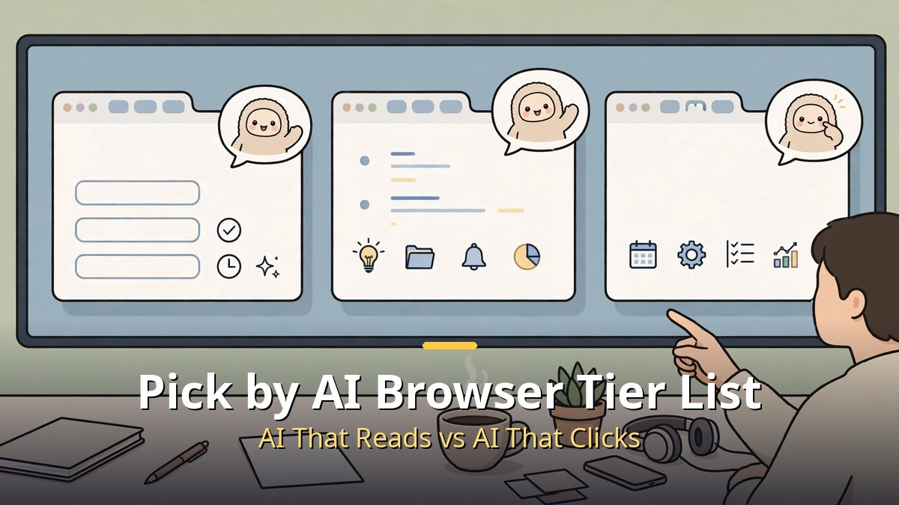
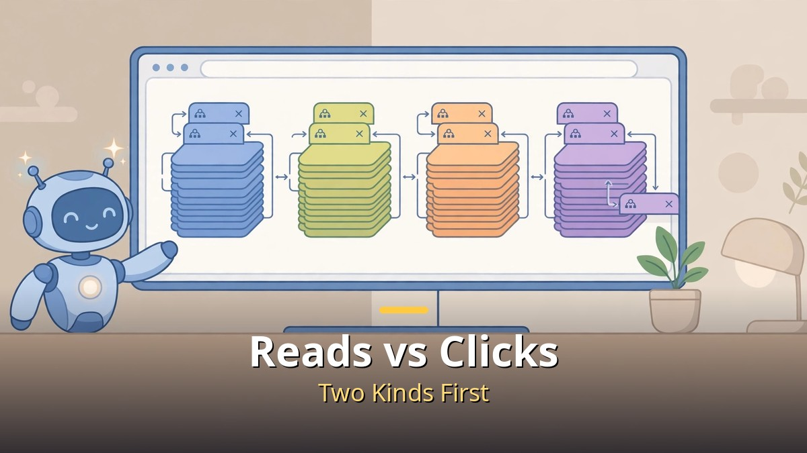
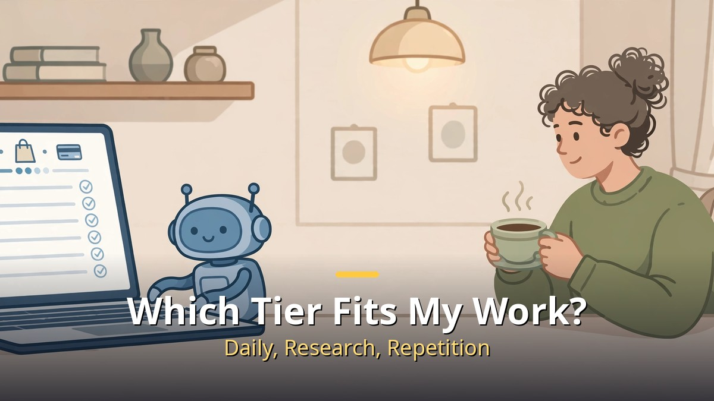
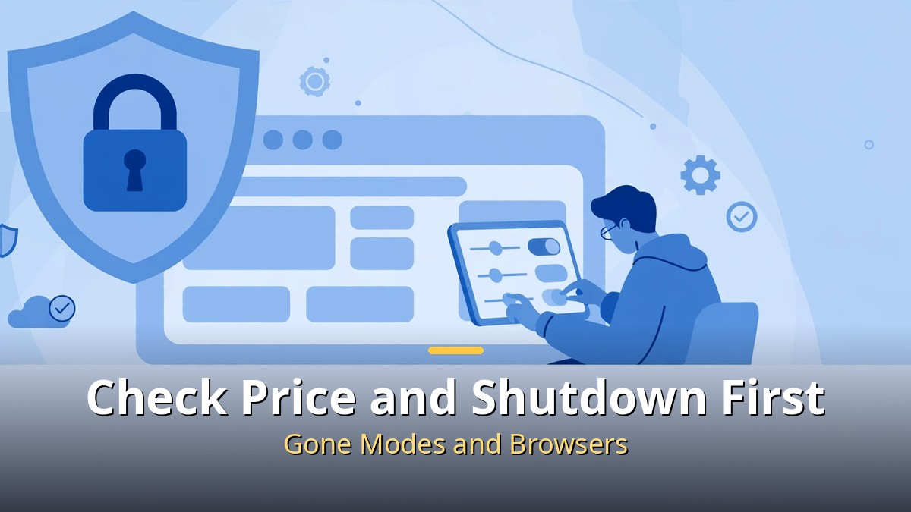

<!-- 본문 시작 -->

When you pick a browser now, one question comes before address-bar speed.
Does its AI only read for you, or does it also click and get work done for you?
The short answer is this: **a free browser is enough for everyday use, and you only need an agent browser when research and repeated web work pile up.**
A browser tier rundown published on October 31, 2026 ranked 15 browsers from Tier 1 (top rank) to Tier 5, but there is no need to memorize that order as it stands.
What each tier means changes with what you actually do every day.

> A tier list ranks browsers by use, not by absolute quality. Split your work first, then decide whether you need an AI that reads or an agent that acts, and the choice gets much easier.

## What Is the Difference Between an AI That Reads and an AI That Clicks?

A reading AI stops at summarizing what you see and answering questions about it.
An agent browser goes further: it opens sites, searches, fills in forms, and organizes results.
If you lump both together as just an "AI browser," you can end up paying an agent subscription for summaries alone, or feeling let down when a summary tool does not automate anything.

One rule should come first with an agent browser.
Do not hand over payments, logins, or deletions wholesale, and check before the AI runs anything hard to undo.
The risk that an agent mistakes on-screen text for an instruction and takes the wrong action has already been pointed out.
So the safe order is to start with summaries and questions, then widen the scope once you are used to it.
The more a feature asks for your logged-in account, the more you should check what permission you are handing over, rather than how generous its free credits look.

## Which Tier Fits My Kind of Work?

If your daily sites are fixed and documents and email are the center of your work, there is little reason to switch browsers.
Chrome pairs everyday browsing with a Gemini side panel for summaries and questions, Edge now carries Copilot inside the browser, and Whale, whose AI Chat launched officially on October 1, 2026, connects page summaries and translation with tab organizing and schedule management.
Brave blocks ads and tracking by default, which makes it a good first pick if you want a quieter screen more than AI.
All four can be started free as browsers, which keeps the cost of trying them low.

If research is the center of your work, Perplexity Comet stands out first.
The browser itself is free and runs on Windows, Mac, iOS, and Android, and its strength is answers with sources plus summaries.
Its free range, however, limits agent features, so full automation means looking at a paid plan.
For repeated web work, Aside, Dia, and Opera Neon belong on the same scale.
Aside starts with 500 free credits a month (credits are the unit deducted when you ask the AI to do work), Dia is known for Skills that save a repeated sequence and run it again, and Opera Neon splits its agents into chat, action, and creation.

| Browser | Good for | Price (checked November 1, 2026) | Platforms and status |
| --- | --- | --- | --- |
| Chrome | Everyday use, Google services | Browser free; Auto Browse needs Google AI Pro at $19.99 a month (US price, Korea availability not verified) | Desktop and mobile |
| Comet | Sourced research, summaries | Browser free; Pro $20 a month, Max $200 a month, Plus $5 a month | Windows, Mac, iOS, Android |
| Aside | Repeated work on sites you are signed into | 500 free credits a month; paid price and platform details not verified | Not verified |
| Edge | Windows and Office-centered work | Browser free; the separate Copilot Mode was retired in May 2026 and its features are built into Edge | Windows, Mac, mobile |
| Whale | Naver services, page summaries and schedules | Browser price and any separate AI Chat charge not verified | Not verified |
| Brave | Ad blocking, privacy-first browsing | Browser free; Leo Premium $14.99 a month | Windows, Mac, Linux, iOS, Android |
| Dia | Turning repeated work into Skills, writing on Mac and Windows | Browser free; recent summaries list AI at $10 and $100 a month, but $20-a-month listings also exist, so check the official page before paying | Mac and Windows, no mobile version |
| Opera Neon | Automation split into chat, action, and creation | Base download free; agent subscription $19.90 a month | Windows and Mac |

A lower tier in the rundown does not mean a bad browser.
Safari is most comfortable inside Apple devices, and Samsung Internet is a light option that also has a Windows version.
Zen is a free, open-source browser strong at tab organization, and Vivaldi suits people who want a multi-feature browser without AI.
Ego Lite is a Mac-only agent tool, and a free base does not mean free AI use, so its token (AI usage unit) costs need a separate check.

## Why Check Prices and Shutdown Dates Before Installing?

In AI browsers, the browser price and the AI price move separately.
A browser can be free while its agent features are limited by credits or a subscription, and a paid plan does not make every task unlimited.
Dia is the clearest example: different summaries list its AI price as $10 and $20 a month.
Before tapping pay, check the official pricing page for the price and usage limit that applies to your own account.

Shutdown dates matter even more than prices.
ChatGPT Atlas ended as a standalone browser on August 9, 2026, and its features moved into the ChatGPT desktop app and an extension.
Arc is scheduled to stop working on December 22, 2026, so anyone still on Arc should move bookmarks and passwords to Dia or another browser before then.
Edge's Copilot Mode was also retired as a separate mode in May 2026, with its features built into Edge itself.
Judging by names alone can lead you to install a mode or a browser that no longer exists, so first check whether it can still be downloaded today.

I will close honestly, from the position of someone who organized published material rather than reviewed these browsers hands-on.
This article is not a first-person review; it compares a published tier rundown with checked price and platform material.
That is why I cannot say "this one ends the search."
The rule, though, is clear.
Start free when you only need summaries, pay for an agent only when repeated work piles up, and keep checking payments and logins with your own eyes.
With that rule, a tier list stops being a trend list and becomes a set of choices fitted to you.

## Frequently Asked Questions

**Q. Are AI browsers all paid?**
A. No. Chrome, Comet, Edge, Brave, and Whale can all be started free as browsers. Agent features and usage limits, however, change on paid plans, so check the free range first.

**Q. Is it safe to hand my logins to an agent browser?**
A. Convenience and risk grow together. An agent using a signed-in account can reach payments and deletions, so start with unimportant tasks and check payments and deletions yourself before they run.

**Q. Do I have to switch from the browser I use now?**
A. Not necessarily. If you only need summaries and questions, turning on the AI feature in your current browser is often enough. Switch for a reason that matters daily, namely whether it cuts repeated work, not for an AI name.

## Further reading

[One Brief, and an AI Team Ships It｜Atoms, Before You Skip Hiring a Developer — how a team of eight specialist agents moves from brief to deployment](https://aitechnotesen.blogspot.com/2026/10/one-brief-and-ai-team-ships-itatoms.html)
[The Creator｜In a War Against AI, a Soldier Meets a Child — the child-shaped AI called a weapon, and the journey to protect it](https://aitechnotesen.blogspot.com/2026/10/the-creatorin-war-against-ai-soldier.html)
[An AI World That Changes When You Speak｜Google's Genie 4, Worth Knowing Before You Can Use It — what the staged release covers and what stays closed](https://aitechnotesen.blogspot.com/2026/10/an-ai-world-that-changes-when-you.html)

<!-- 본문 끝 -->

## 작업용 출처·이미지 정보 (업로드 제외)

- 자료 출처: honjobs 영상 8QEMpUnsujQ(2026-10-31) + 브라우저별 가격·플랫폼 공개 자료 대조 (미확인 항목은 미확인으로 명시)
- 이미지: images/01-hero-en.jpg ~ 04-img3-en.jpg / 직접 제작 (AI 생성 + 영어 오버레이) / 사용권: 자작
