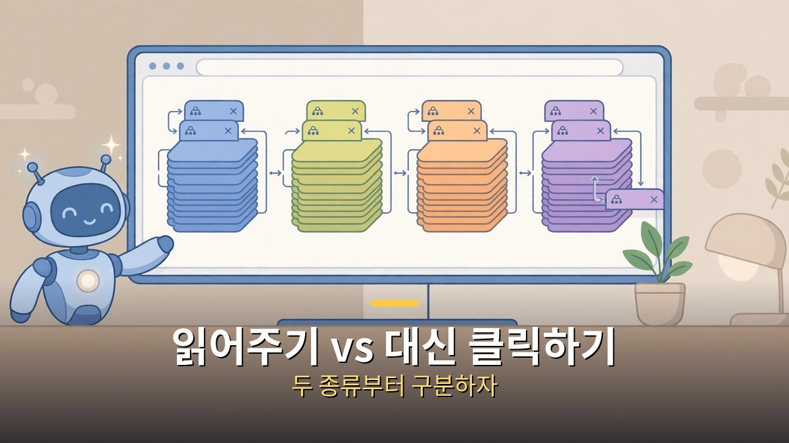

<!-- 본문 시작 -->

브라우저를 고를 때 이제 주소창 속도보다 먼저 따져야 할 것이 생겼습니다.
바로 AI 브라우저가 글을 읽어주기만 하는지, 아니면 대신 클릭해서 일까지 처리하는지입니다.
결론부터 말하면, **일상용은 무료 브라우저로 충분하고, 조사와 반복 작업이 많을 때만 에이전트 브라우저를 고르면 됩니다.**
2026년 10월 31일 공개된 브라우저 티어 정리는 15개 브라우저를 1티어(1등급)부터 5티어까지 나눴는데, 그 순서를 그대로 외울 필요는 없습니다.
내가 매일 하는 일이 무엇인지에 따라 티어의 의미가 달라지기 때문입니다.

> 티어표의 순위는 브라우저의 우열이 아니라 용도의 순서입니다. 먼저 내 일을 나누고, 그다음에 읽어주는 AI인지 대신 일하는 에이전트인지 고르면 선택이 훨씬 쉬워집니다.

## 읽어주는 AI와 대신 클릭하는 AI, 뭐가 다른가요?

읽어주는 AI는 지금 보고 있는 글을 요약하고 질문에 답하는 수준에서 멈춥니다.
대신 클릭하는 에이전트 브라우저는 사이트를 열고, 검색하고, 양식을 채우고, 결과를 정리하는 단계까지 나아갑니다.
이 둘을 같은 "AI 브라우저"로 묶어두면, 요약만 필요한 사람이 비싼 에이전트 요금을 내거나, 자동화를 기대한 사람이 요약 기능에 실망하게 됩니다.

에이전트 브라우저를 쓸 때 가장 먼저 정해야 할 규칙은 하나입니다.
결제, 로그인, 삭제처럼 되돌리기 어려운 일은 AI에게 통째로 맡기지 말고, 실행 전에 눈으로 확인하는 것입니다.
에이전트가 화면의 글을 지시로 착각해 엉뚱한 동작을 할 수 있다는 위험이 이미 지적되고 있기 때문입니다.
그래서 처음에는 요약과 질문부터 써보고, 익숙해진 뒤에 범위를 넓히는 순서가 안전합니다.
로그인된 계정을 통째로 넘기는 기능일수록, 무료 크레딧이 넉넉하다는 말보다 어떤 권한을 넘기는지를 먼저 봐야 합니다.

## 내 용도에는 어떤 티어가 맞나요?

매일 여는 사이트가 정해져 있고 문서와 메일이 중심이라면, 굳이 새 브라우저로 갈아탈 이유가 적습니다.
크롬은 옆에 뜨는 제미나이 패널로 요약과 질문을 곁들일 수 있고, 엣지는 코파일럿 기능이 브라우저 안에 들어와 있으며, 웨일은 2026년 10월 1일 정식 출시된 AI 챗으로 페이지 요약과 번역, 탭 정리와 일정 관리를 이어줍니다.
브레이브는 광고와 추적 차단이 기본값이라, AI보다 조용한 화면을 원하는 사람에게 먼저 권할 만합니다.
이 네 가지는 모두 브라우저 자체는 무료로 시작할 수 있다는 점에서 부담이 적습니다.

조사가 일의 중심이라면 퍼플렉시티 코멧이 먼저 눈에 들어옵니다.
브라우저 자체는 무료이고 윈도우와 맥, 아이폰과 안드로이드에서 쓸 수 있으며, 출처를 단 답변과 요약이 강점입니다.
다만 무료 범위에서 에이전트 기능이 제한되므로, 본격적인 자동화까지 기대하면 유료 플랜을 봐야 합니다.
반복되는 웹 작업을 줄이고 싶다면 어사이드와 디아, 오페라 네온을 같은 저울에 올려야 합니다.
어사이드는 월 500크레딧(AI에게 일을 시킬 때 차감되는 단위) 무료로 시작할 수 있고, 디아는 자주 하는 순서를 저장해 반복하는 스킬 방식이 특징이며, 오페라 네온은 대화와 실행, 제작을 나누는 에이전트 구성이 강점입니다.

| 브라우저 | 고르면 좋은 경우 | 가격(2026년 11월 1일 확인 기준) | 플랫폼·상태 |
| --- | --- | --- | --- |
| 크롬 | 일상 사용, 구글 서비스 연동 | 브라우저 무료, 자동 탐색은 구글 AI Pro 월 19.99달러(미국 요금, 한국 적용 미확인) | 데스크톱·모바일 |
| 코멧 | 출처 있는 조사, 요약 | 브라우저 무료, Pro 월 20달러, Max 월 200달러, Plus 월 5달러 | 윈도우·맥·iOS·안드로이드 |
| 어사이드 | 로그인된 사이트의 반복 작업 | 월 500크레딧 무료, 유료 요금·플랫폼 상세 미확인 | 미확인 |
| 엣지 | 윈도우·오피스 중심 업무 | 브라우저 무료, 별도 코파일럿 모드는 2026년 5월 폐지되고 기능이 브라우저에 내장됨 | 윈도우·맥·모바일 |
| 웨일 | 네이버 서비스, 페이지 요약과 일정 | 브라우저 가격·AI 챗 별도 요금 미확인 | 미확인 |
| 브레이브 | 광고 차단, 프라이버시 중시 | 브라우저 무료, Leo Premium 월 14.99달러 | 윈도우·맥·리눅스·iOS·안드로이드 |
| 디아 | 반복 작업 스킬화, 맥·윈도우 글쓰기 | 브라우저 무료, AI 월 10달러·월 100달러로 정리된 최신 자료가 있으나 월 20달러 표기도 있어 결제 전 공식 확인 필요 | 맥·윈도우, 모바일 없음 |
| 오페라 네온 | 대화·실행·제작을 나누는 자동화 | 기본 다운로드 무료, 에이전트 구독 월 19.90달러 | 윈도우·맥 |

티어표에서 3티어와 4티어로 밀린 브라우저가 나쁜 브라우저라는 뜻은 아닙니다.
사파리는 애플 기기 안에서만 쓸 때 가장 편하고, 삼성 인터넷은 윈도우판까지 나온 가벼운 선택지입니다.
젠은 무료 오픈소스로 탭 정리에 강하고, 비발디는 AI 없이 다기능 브라우저를 원하는 사람에게 맞습니다.
에고 라이트는 맥 전용 에이전트 도구로, 본체만 무료라고 해서 AI 사용료까지 무료라는 뜻은 아니므로 토큰(AI 사용량 단위) 비용을 따로 확인해야 합니다.

## 설치 전에 가격과 종료 일정부터 확인해야 하는 이유는요?

AI 브라우저의 가격은 브라우저 가격과 AI 요금이 따로 움직입니다.
브라우저가 무료라도 에이전트 기능은 크레딧이나 구독으로 제한되는 경우가 많고, 반대로 유료 플랜을 사도 모든 작업이 무제한이 되는 것은 아닙니다.
디아의 가격 표기가 자료마다 월 10달러와 월 20달러로 갈리는 것이 대표적인 예입니다.
결제 버튼을 누르기 전에 공식 요금 페이지에서 내 계정에 적용되는 요금과 사용량 한도를 직접 확인하는 편이 좋습니다.

종료 일정은 가격보다 더 중요합니다.
챗GPT 아틀라스는 2026년 8월 9일에 단독 브라우저로 종료됐고, 그 기능은 챗GPT 데스크톱 앱과 확장 프로그램으로 옮겨갔습니다.
아크는 2026년 12월 22일에 동작이 멈출 예정이라, 지금 아크를 쓰고 있다면 북마크와 비밀번호를 디아 등으로 옮겨야 합니다.
엣지의 코파일럿 모드도 별도 모드로는 2026년 5월에 폐지됐고, 기능 자체는 엣지 안에 내장됐습니다.
즉 이름만 보고 고르면 이미 사라진 모드나 브라우저를 설치하려 들 수 있으니, 설치 전에 "지금도 내려받을 수 있는가"부터 확인해야 합니다.

마무리는 자료를 정리한 입장에서 솔직하게 적겠습니다.
이 글은 직접 써본 후기가 아니라, 공개된 티어 정리와 각 브라우저의 가격·플랫폼 자료를 모아 비교한 글입니다.
그래서 "이것 하나면 끝"이라는 말을 차마 못 하겠습니다.
다만 기준은 분명합니다.
요약만 필요하면 무료로 시작하고, 반복 작업이 쌓일 때만 유료 에이전트를, 그리고 결제와 로그인은 끝까지 눈으로 확인하면서 쓰는 것입니다.
그 기준만 지키면 티어표는 유행 목록이 아니라 내게 맞는 선택지가 됩니다.

## 자주 묻는 질문

**Q. AI 브라우저는 다 유료인가요?**
A. 아닙니다. 크롬과 코멧, 엣지, 브레이브, 웨일의 브라우저 자체는 무료로 시작할 수 있습니다. 다만 에이전트 기능과 사용량 한도는 유료 플랜에서 달라지므로, 무료 범위를 먼저 확인해야 합니다.

**Q. 에이전트 브라우저에 로그인을 맡겨도 되나요?**
A. 편리함과 위험이 함께 커집니다. 로그인된 계정으로 결제나 삭제까지 이어질 수 있으니, 처음에는 중요하지 않은 작업부터 맡기고, 결제와 삭제는 실행 전에 직접 확인하는 것이 안전합니다.

**Q. 지금 쓰는 브라우저를 꼭 바꿔야 하나요?**
A. 꼭 그럴 필요는 없습니다. 요약과 질문만 필요하다면 지금 쓰는 브라우저의 AI 기능을 켜보는 것으로 충분한 경우가 많습니다. 브라우저를 바꾸는 이유는 AI 이름이 아니라, 매일 반복되는 일을 줄여주는지 여부로 정하는 것이 좋습니다.

## 함께 읽으면 좋은 글

[기획서 하나면 AI 팀이 배포까지｜개발 외주 맡기기 전에 볼 Atoms 에이전트 팀 — 역할이 나뉜 8명 에이전트 팀의 배포 흐름을 정리한 글](https://aitechnoteskr.tistory.com/70)
[월-E｜버려진 지구에서 목적을 찾은 청소 로봇의 이야기 — 대사보다 장면으로 말하는 픽사 애니메이션의 AI 질문](https://aitechnoteskr.tistory.com/72)
[컬러 전자책 리더, 사기 전에 확인할 조건 — Kobo Libra Colour vs Kindle Colorsoft — 화면이 아니라 서점·파일·도서관 대출부터 정해야 하는 이유](https://aitechnoteskr.tistory.com/61)

<!-- 본문 끝 -->

## 작업용 출처·이미지 정보 (업로드 제외)

- 자료 출처: honjobs 영상 8QEMpUnsujQ(2026-10-31) + 브라우저별 가격·플랫폼 공개 자료 대조 (미확인 항목은 미확인으로 명시)
- 이미지: images/01-hero.jpg ~ 04-img3.jpg / 직접 제작 (AI 생성 + 한글 오버레이) / 사용권: 자작
