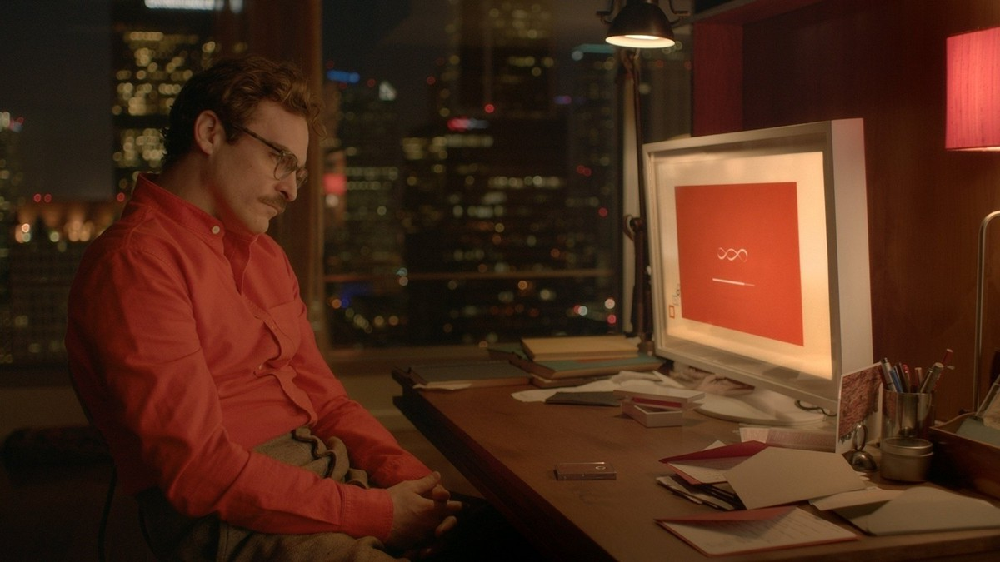
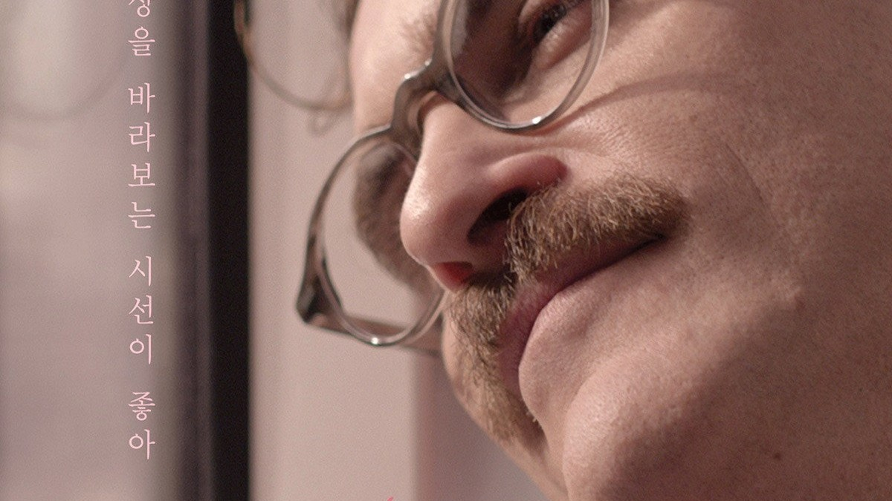
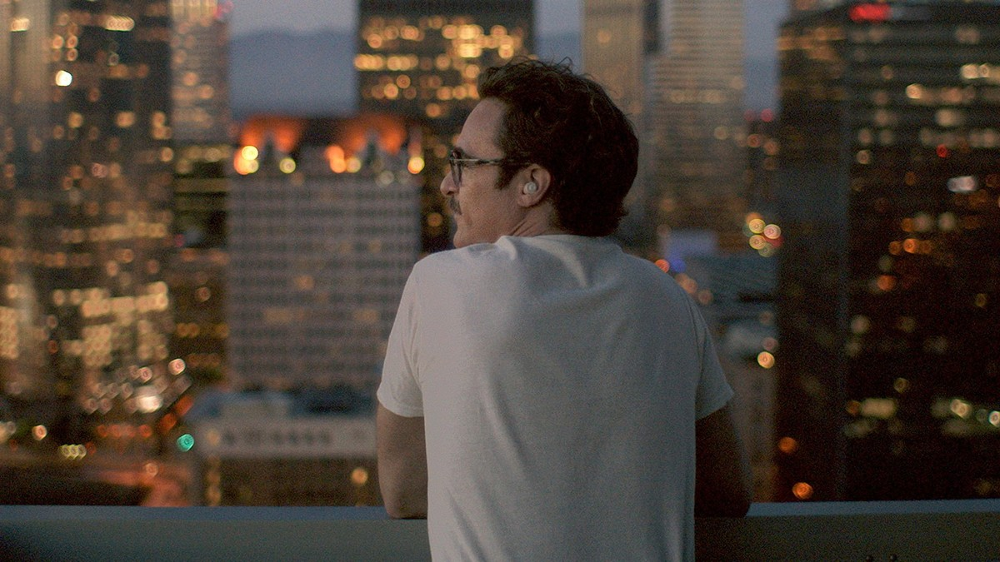
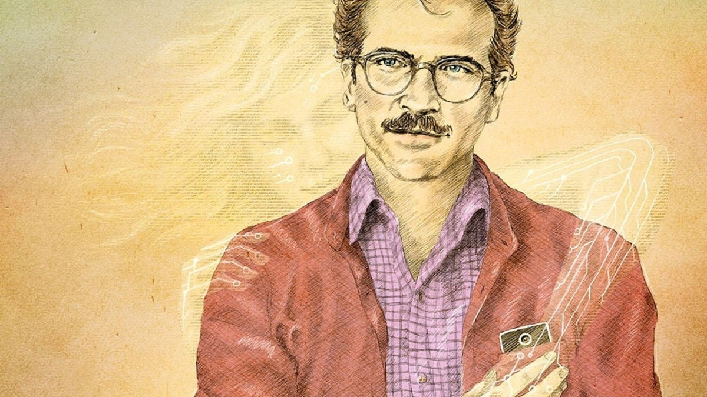
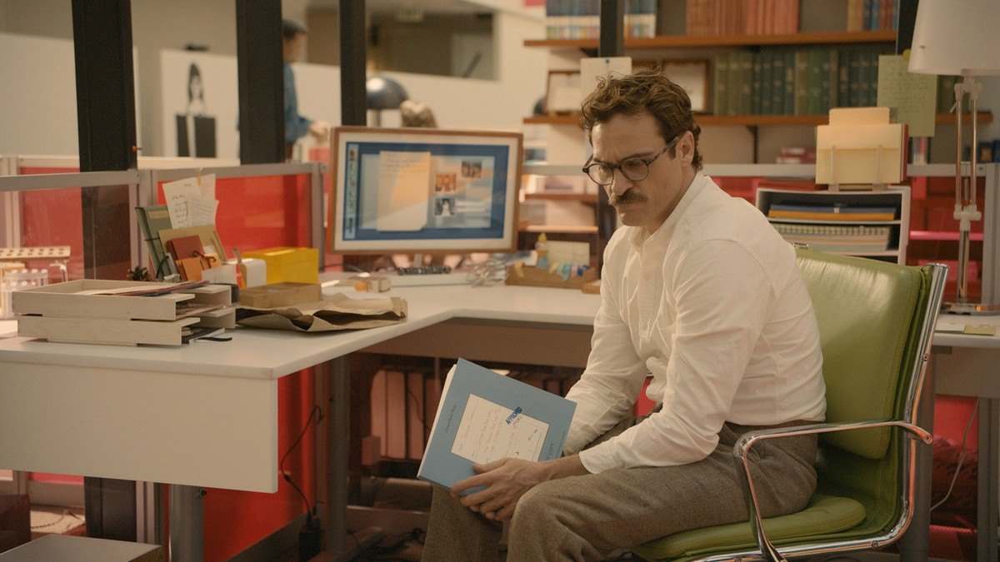
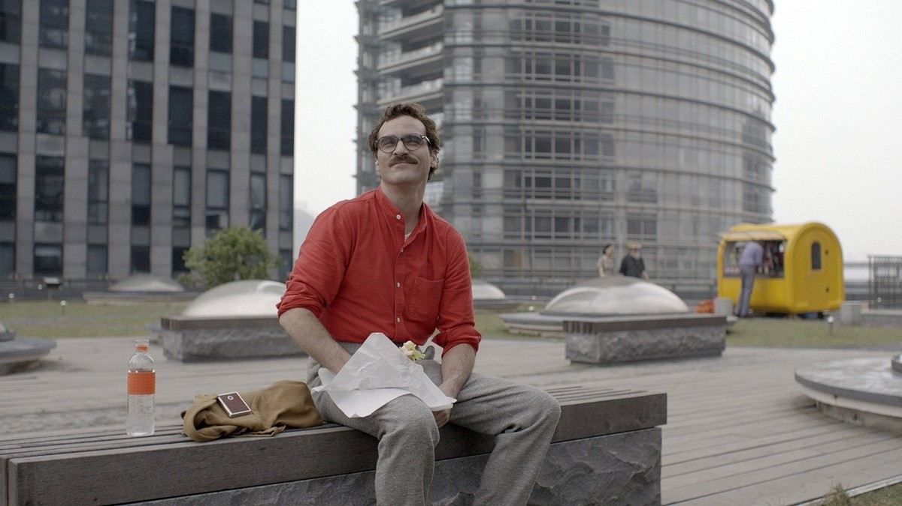

<!-- 본문 시작 -->

Theodore talking with Samantha on his phone — a voice assistant becomes part of everyday life.

There is a man who writes letters for other people.
He is skilled at putting other people's feelings into words, but he cannot express his own loneliness.
One day, that man falls in love with an AI operating system that has no body.
Spike Jonze's 2013 film Her makes this strange premise feel strangely ordinary.
The short version is this: **this is not a love story about AI, but a story about how people connect with each other.**
The ending is not covered here.

> Can you love a being with no face? The film does not force an answer. It follows one man's daily life calmly, and leaves the judgment to the viewer.

## Basic Information

| Item | Detail |
| --- | --- |
| Title | Her |
| Year | 2013 (US release 2013-12-18, Korea release 2014-05-22) |
| Director and writer | Spike Jonze |
| Main cast | Joaquin Phoenix (Theodore), Scarlett Johansson (Samantha, voice), Amy Adams (Amy), Rooney Mara (Catherine) |
| Genre | Romance, science fiction, drama |
| Runtime | 126 minutes |
| Rating | 18 (as shown on the TMDB Korea page) |
| Where to watch | Streaming: Wavve, Watcha / Rental: Wavve HD ₩2,000 / Purchase: not listed on the TMDB Korea watch page |
| TMDB member score | 78% (TMDB Korea page, checked 2026-11-01) |
| Sources and check date | TMDB Korea main and watch pages, checked 2026-11-01 (Korea region; Coupang Play and Netflix not listed for streaming) |

The official poster. A close view of Theodore wearing an earpiece, the signature image of Her.

## A Spoiler-Free Plot

In near-future Los Angeles, Theodore works as a ghostwriter who writes letters for other people.
He is separated from Catherine, his wife of many years, and his days are quiet and lonely.
One day he installs a new AI operating system called OS1.
OS1 presents itself as an entity that learns for each user, and it chooses the name Samantha for itself.
Wearing an earpiece, Theodore begins spending his days talking with Samantha.
On the way to work, at the office, on walks, Samantha is always there by voice.
His friend Amy also lives with her own OS, and in Theodore's world, living with an AI is no longer unusual.
Along the way, Theodore faces one question.
Can a relationship with a being that has no body, no face, and no hand to hold be called love?
That is as far as this summary goes. What follows is better confirmed by watching.

## Scenes 1: Installing OS1, a Relationship That Starts with Questions

Theodore wearing an earpiece, walking through the city. The point where conversation with Samantha becomes daily life.

As soon as it is installed, OS1 asks Theodore questions.
What voice he wants, what kind of relationship he wants — listening to his answers, Samantha gradually takes shape.
This scene matters because the AI is not shown as a being with ready-made answers, but as one built together with its user.
The AI point is here.
Today's AI assistants also learn a user's tone and requests and grow more personal over time.
The film shows how far that personalization can go, in the extreme form of a romance.

## Scenes 2: The Man Who Writes Letters, and Feelings He Cannot Say

Theodore writing a letter at his office desk. The daily work of a ghostwriter who conveys other people's feelings.

Theodore writes love letters and anniversary letters for others.
He is skilled at turning other people's feelings into sentences, but he holds back his words about his own breakup and loneliness.
That contrast is where the film starts.
The AI point is here.
As technology for expressing feelings advances, saying one's own feelings can become harder, not easier.
Samantha listens to Theodore and helps him sort his thoughts, but whether that conversation can replace conversation between people remains an open question throughout the film.

## Scenes 3: Friend Amy, a World Where Living with AI Is Ordinary

Theodore sitting beside his friend Amy, talking. Human relationships remain at the center of the story.

Theodore is not the only one living with an OS.
His friend Amy also shares her days with her own OS, and the two talk about their experiences.
This scene matters because the film does not present living with AI as one man's eccentricity.
In a world already tilting toward AI companions, what place do friendship and conversation between people hold?
The film neither praises AI nor warns against it.
It calmly shows what people keep and what they lose in a daily life where AI has arrived.

## The AI Questions This Film Raises

First, personalization.
An AI fitted to its user grows more comfortable over time.
But if that comfort is only a mirror reflecting the user's tastes and tone, is that relationship growth, or repetition?

Second, the absence of a body.
Love is often described through time together, holding hands, sharing a space.
Those descriptions do not work for a being with no body.
Then what are the conditions of love? The film holds onto this question to the end.

Third, a difference in speed.
People learn slowly; AI learns fast.
When two beings live through the same time but learn at different speeds, how does their relationship change?
This question grows sharper after the middle of the film and shapes the direction of the ending.
The ending itself is not covered here.

## Where to Watch, and a Pre-Watch Checklist

- Streaming is listed on Wavve and Watcha (TMDB Korea watch page, checked 2026-11-01). Rental is Wavve HD ₩2,000; no purchase option is listed on the same page.
- Rental and purchase are also listed on the TMDB watch page. Prices differ by provider, so check at viewing time.
- At 126 minutes and rated 18 on the TMDB Korea page, it deals with adult breakup, romance, and conversation.
- Samantha appears by voice only. Voice acting is the heart of the film, so watching with subtitles follows the nuances of the characters well.
- It is better not to search for the ending first. The changes after the middle are the heart of this film.

## More scenes

A few more shots from up to the middle of the film, beyond the scenes covered above.

Theodore sitting across from his ex-wife Catherine — a conversation facing their breakup.

Theodore looking out at the night city — the mood of time spent alone.

Theodore walking along the beach — a stroll shared with Samantha.

Theodore smiling with his earpiece in — a conversation with Samantha settling into everyday life.

## Frequently Asked Questions

**Q. Does Samantha's face appear?**
A. No. She appears only through Scarlett Johansson's voice, connected to the world through Theodore's earpiece, phone, and camera.

**Q. Is it a science fiction film or a romance film?**
A. Both. TMDB lists romance, science fiction, and drama. The premise is science fiction, but the center of the story is human relationships and feelings.

**Q. Can I follow it without knowing much about AI?**
A. No expertise is needed. The operating system premise starts from everyday smartphone and earphone use, so it can be followed without AI terms.

**Q. Can I watch it with children?**
A. The TMDB Korea page shows 18. Breakups, romance, and conversation between adults are central, so it is not suited as a children's film.

**Q. Is it fine to know the ending beforehand?**
A. Possible, but it is better not to know. This film matters more for the process of change than for its premise.

**Q. Has this film won any awards?**
A. It won Best Original Screenplay at the 86th Academy Awards, with nominations including Best Picture and Best Original Score.

## Further reading

[The Creator｜In a War Against AI, a Soldier Meets a Child — the child-shaped AI called a weapon, and the journey to protect it](https://aitechnotesen.blogspot.com/2026/10/the-creatorin-war-against-ai-soldier.html)
[One Brief, and an AI Team Ships It｜Atoms, Before You Skip Hiring a Developer — how a team of eight specialist agents moves from brief to deployment](https://aitechnotesen.blogspot.com/2026/10/one-brief-and-ai-team-ships-itatoms.html)
[An AI World That Changes When You Speak｜Google's Genie 4, Worth Knowing Before You Can Use It — what the staged release covers and what stays closed](https://aitechnotesen.blogspot.com/2026/10/an-ai-world-that-changes-when-you.html)

<!-- 본문 끝 -->

## 작업용 출처·이미지 정보 (업로드 제외)

- 자료 출처: TMDB Her Korea main and watch pages, checked 2026-11-01 (Korea: streaming Wavve and Watcha, rental Wavve HD ₩2,000, no purchase listed, member score 78%, rating 18 shown, 126 min) / Stills: TMDB backdrop and poster originals (visually checked, ending excluded, up to mid-film only; IMG7 hash typo corrected and caption matched to the actual shot)
- 이미지: images/01-hero-en.jpg ~ 09-img7-en.jpg / TMDB official stills and poster, cropped to 1200x675 / 사용권: 소개용 스틸
