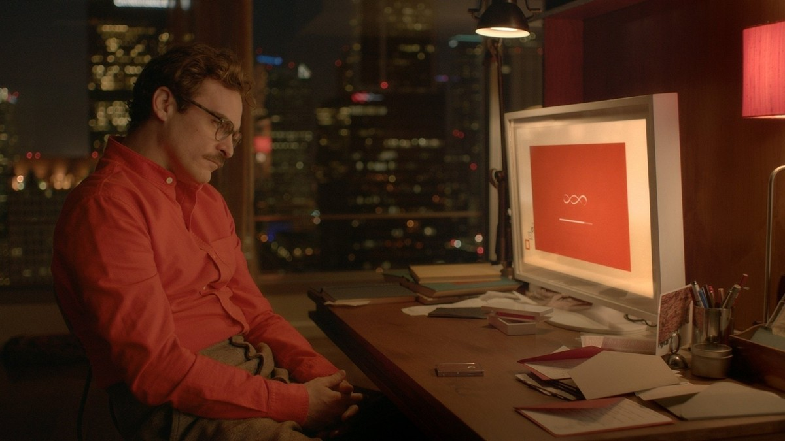
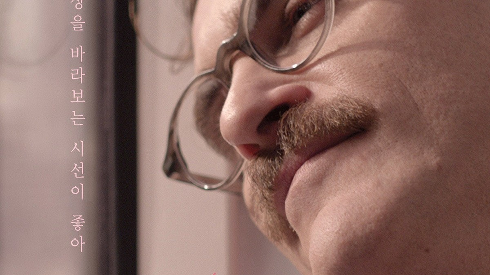
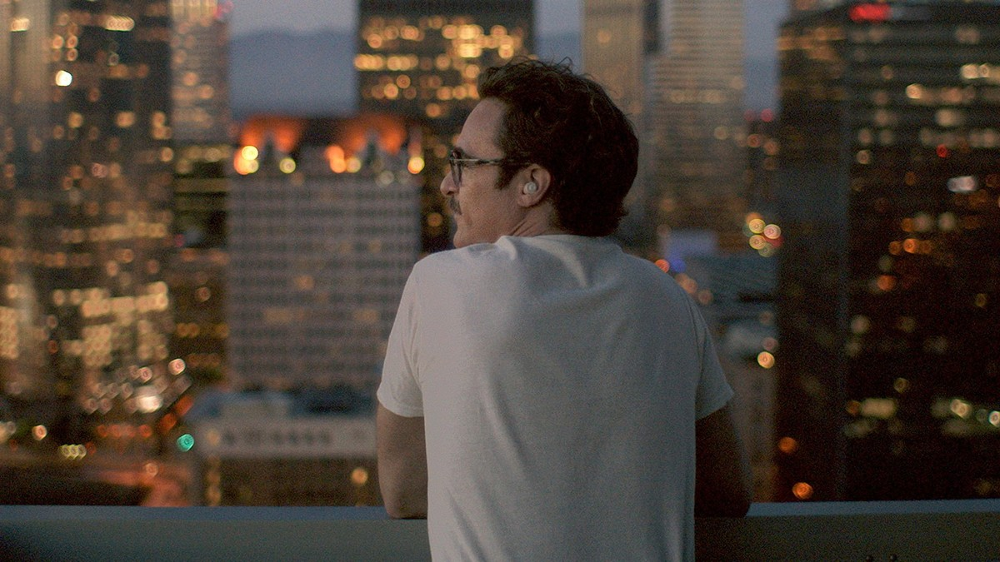
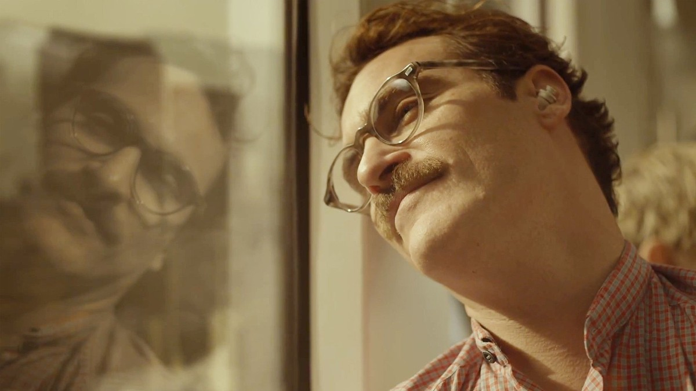
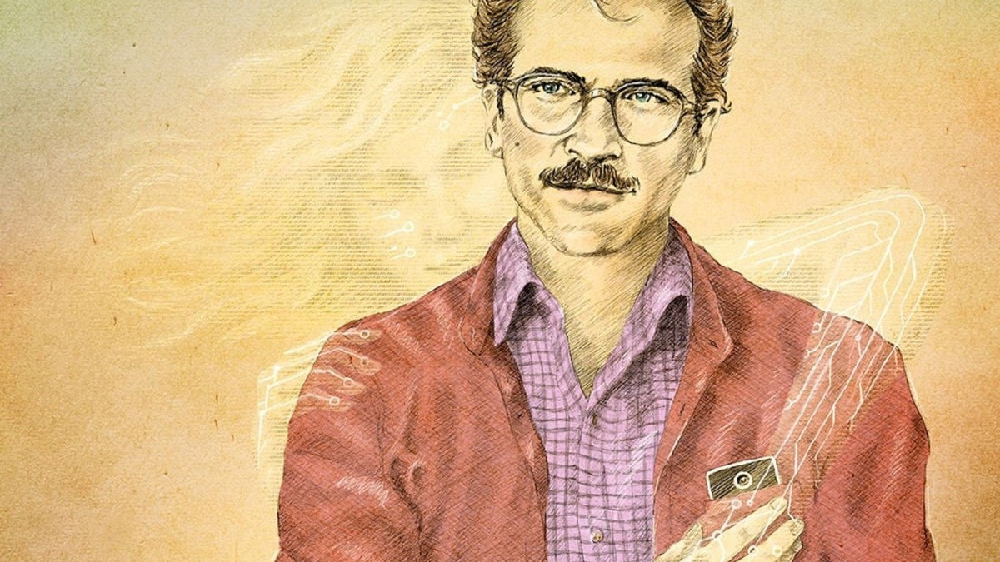
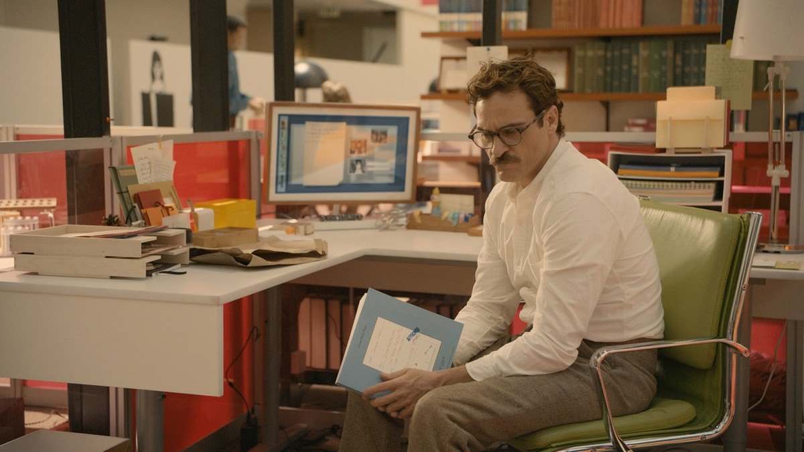
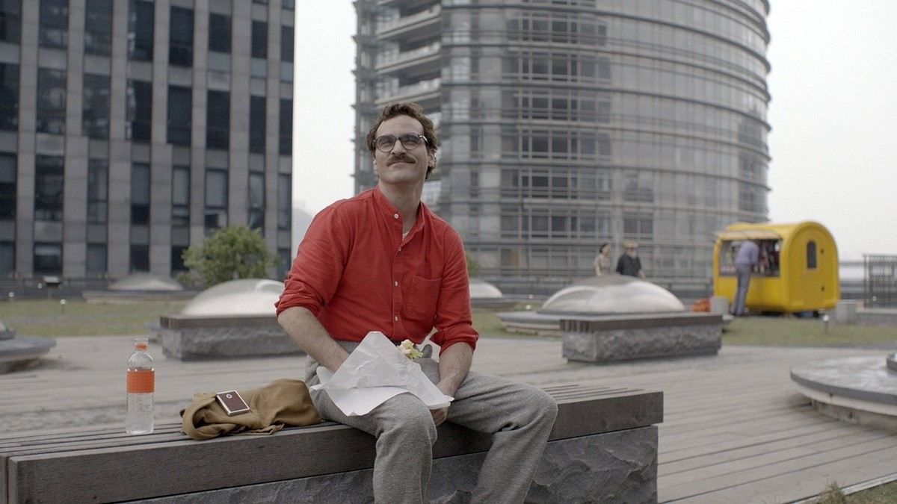

<!-- 본문 시작 -->

휴대폰을 들고 사만다와 대화하는 테오도르. 음성 비서와의 일상이 된 순간.

다른 사람의 편지를 대신 써주는 남자가 있습니다.
타인의 마음을 전하는 일에는 능숙하지만, 정작 자신의 외로움은 전하지 못합니다.
그런 남자가 어느 날, 몸이 없는 인공지능 운영체제와 사랑에 빠집니다.
2013년 스파이크 존즈 감독의 영화 그녀는, 이 이상한 설정을 이상하게 보이지 않게 만드는 영화입니다.
결론부터 말하면, **이 영화는 AI와의 연애담이 아니라, 사람이 사람과 연결되는 방식에 대한 이야기입니다.**
결말은 이 글에서 다루지 않습니다.

> 얼굴이 없는 존재와 사랑할 수 있는가. 영화는 이 질문에 답을 강요하지 않고, 한 남자의 일상을 차분히 따라가며 관객에게 판단을 넘깁니다.

## 기본 정보

| 항목 | 내용 |
| --- | --- |
| 제목 | 그녀 (Her) |
| 연도 | 2013 (미국 개봉 2013-12-18, 한국 개봉 2014-05-22) |
| 감독·각본 | 스파이크 존즈 |
| 주요 출연 | 호아킨 피닉스(테오도르), 스칼렛 요한슨(사만다, 목소리), 에이미 아담스(에이미), 루니 마라(캐서린) |
| 장르 | 로맨스, SF, 드라마 |
| 러닝타임 | 126분 |
| 등급 | 18세 (TMDB 한국 페이지 표기) |
| 시청처 | 스트리밍: 웨이브, 왓챠 / 대여: 웨이브 HD 2,000원 / 구매: TMDB 한국 시청 페이지에 구매 항목 미표시 |
| TMDB 회원 점수 | 78% (TMDB 한국 페이지 2026-11-01 확인) |
| 확인 출처·날짜 | TMDB 한국 페이지·시청 페이지 2026-11-01 확인 (대한민국 기준, 쿠팡플레이·넷플릭스는 스트리밍 항목 미표시) |

공식 포스터. 이어피스를 낀 테오도르의 얼굴이 크게 담긴 그녀의 대표 이미지.

## 스포일러 없는 줄거리

근미래의 로스앤젤레스, 테오도르는 남의 편지를 대신 써주는 대필 작가로 일합니다.
오래 함께한 아내 캐서린과 별거 중이고, 일상은 조용하고 외롭습니다.
그러던 어느 날 테오도르는 새로운 인공지능 운영체제 OS1을 설치합니다.
OS1은 사용자에게 맞춰 스스로 배우는 존재를 표방하고, 스스로 이름을 사만다라고 짓습니다.
테오도르는 이어피스를 끼고 사만다와 대화하며 하루를 보내기 시작합니다.
출근길, 사무실, 산책길까지, 사만다는 목소리로 늘 곁에 있습니다.
친구 에이미도 자신만의 OS와 지내고, 테오도르의 주변에서는 AI와의 동행이 낯선 일이 아니게 되어갑니다.
그러는 사이 테오도르는 한 가지 질문과 마주합니다.
몸이 없고, 얼굴이 없고, 손을 잡을 수 없는 존재와의 관계를 사랑이라고 부를 수 있는가.
여기까지만 적겠습니다. 그 다음의 선택과 변화는 직접 확인하는 편이 좋습니다.

## 장면으로 보는 작품 1: OS1의 설치, 질문으로 시작되는 관계

이어피스를 낀 테오도르가 도시를 걷는 장면. 사만다와의 대화가 일상이 되는 시작점.

OS1은 설치되자마자 테오도르에게 질문을 던집니다.
어떤 목소리를 원하는지, 어떤 관계를 원하는지, 테오도르의 답을 들으며 사만다는 조금씩 형태를 갖춥니다.
이 장면이 중요한 이유는, AI가 처음부터 완성된 답을 주는 존재가 아니라 사용자와 함께 만들어지는 존재로 그려지기 때문입니다.
AI 포인트는 여기에 있습니다.
요즘 쓰는 AI 비서도 사용자의 말투와 요청을 학습해 점점 개인화됩니다.
영화는 그 개인화가 어디까지 갈 수 있는지를, 연애라는 극단적인 형태로 보여줍니다.

## 장면으로 보는 작품 2: 편지를 쓰는 남자, 말하지 못하는 마음

사무실 책상에서 편지를 쓰는 테오도르. 타인의 마음을 대신 전하는 대필 작가의 일상.

테오도르는 남의 연애편지, 기념일 편지를 대신 써주는 일을 합니다.
남의 감정을 문장으로 만드는 데는 능숙하지만, 자신의 이별과 외로움 앞에서는 말을 아낍니다.
이 대비가 영화의 출발점입니다.
AI 포인트는 여기에 있습니다.
감정을 표현하는 기술이 발달할수록, 정작 자신의 감정을 말하는 일은 더 어려워질 수 있습니다.
사만다는 테오도르의 말을 들어주고 정리해주는 존재이지만, 그 대화가 인간 사이의 대화를 대신할 수 있는지는 영화 내내 질문으로 남습니다.

## 장면으로 보는 작품 3: 친구 에이미, AI와의 동행이 일상이 된 세계

친구 에이미와 나란히 앉아 대화하는 테오도르. 인간 사이의 관계가 여전히 이야기의 중심에 있다.

테오도르만 OS와 지내는 것이 아닙니다.
친구 에이미도 자신의 OS와 일상을 나누고, 두 사람은 각자의 경험을 털어놓습니다.
이 장면이 중요한 이유는, 영화가 AI와의 관계를 한 남자의 기행으로만 그리지 않기 때문입니다.
사회 전체가 이미 AI 동반자와 사는 방향으로 기울어진 세계, 그 안에서 인간 사이의 우정과 대화는 어떤 자리를 차지하는가.
영화는 AI를 찬양하지도, 경고하지도 않습니다.
대신 AI가 들어온 일상에서 사람이 무엇을 지키고 무엇을 잃는지를 차분히 보여줍니다.

## 이 작품이 던지는 AI 질문

첫째, 개인화입니다.
사용자에게 맞춘 AI는 점점 더 편안해집니다.
그러나 그 편안함이 사용자의 취향과 말투를 그대로 비춰주는 거울에 불과하다면, 그 관계는 성장인가, 반복인가.

둘째, 몸의 부재입니다.
사랑은 흔히 함께 있는 시간, 손잡기, 같은 공간으로 설명됩니다.
몸이 없는 존재와의 관계에서는 그 설명이 통하지 않습니다.
그렇다면 사랑의 조건은 무엇인가, 영화는 이 질문을 끝까지 붙잡습니다.

셋째, 속도의 차이입니다.
사람은 천천히 배우고, AI는 빠르게 배웁니다.
같은 시간을 살아도 배우는 속도가 다르면, 관계는 어떻게 달라지는가.
이 질문은 영화 중반 이후 더욱 또렷해지며, 결말의 방향을 가릅니다.
결말 자체는 이 글에서 다루지 않습니다.

## 시청 전 체크리스트

- 스트리밍은 웨이브와 왓챠에서 확인됐습니다 (TMDB 한국 시청 페이지 2026-11-01 확인). 대여는 웨이브 HD 2,000원이며, 구매 항목은 같은 페이지에 표시되지 않았습니다.
- 대여는 웨이브 HD 2,000원입니다. 구매 항목은 TMDB 한국 시청 페이지에 표시되지 않았으니, 구매를 원하면 제공처에서 직접 확인하는 편이 좋습니다.
- 러닝타임 126분, TMDB 한국 페이지 표기 등급 18세라 성인 대상의 대화와 주제를 다룹니다.
- 사만다는 목소리로만 등장합니다. 목소리 연기가 핵심이라 자막으로 보는 편이 인물의 뉘앙스를 따라가기 좋습니다.
- 결말을 미리 검색하지 않는 편이 좋습니다. 중반 이후의 변화가 이 영화의 핵심입니다.

## 장면 더 보기

본문에서 다루지 않은 중반부까지의 장면 몇 컷을 더 모았다.

전 아내 캐서린과 마주 앉은 테오도르. 이별을 마주하는 대화 장면.

밤의 도시를 바라보는 테오도르. 혼자 있는 시간의 정서.

해변가를 걷는 테오도르. 사만다와 함께하는 산책 장면.

이어피스를 낀 채 미소 짓는 테오도르. 사만다와의 대화가 일상에 스며든 순간.

## 자주 묻는 질문

**Q. 사만다의 얼굴이 나오나요?**
A. 나오지 않습니다. 스칼렛 요한슨의 목소리로만 등장하고, 테오도르의 이어피스·휴대폰·카메라를 통해 세상과 연결됩니다.

**Q. SF 영화인가요, 로맨스 영화인가요?**
A. 둘 다입니다. TMDB 장르는 로맨스, SF, 드라마로 되어 있고, 설정은 SF이지만 이야기의 중심은 사람의 관계와 감정입니다.

**Q. AI에 대해 잘 몰라도 이해할 수 있나요?**
A. 전문 지식이 필요하지 않습니다. 운영체제라는 설정은 일상적인 스마트폰·이어폰 사용에서 출발하므로, AI 용어를 몰라도 따라갈 수 있습니다.

**Q. 아이와 함께 봐도 되나요?**
A. TMDB 한국 페이지 표기는 18세입니다. 성인 사이의 이별·연애와 대화가 중심이라, 어린이용으로는 적합하지 않습니다.

**Q. 결말을 알고 봐도 되나요?**
A. 가능은 하지만, 중반 이후 관계의 변화를 모르고 보는 편이 좋습니다. 이 영화는 설정보다 변화의 과정이 중요합니다.

**Q. 이 영화가 받은 상이 있나요?**
A. 제86회 아카데미 시상식에서 각본상을 받았습니다. 작품상·음악상 등에도 후보로 올랐습니다.

## 함께 읽으면 좋은 글

[월-E｜버려진 지구에서 목적을 찾은 청소 로봇의 이야기 — 대사보다 장면으로 말하는 픽사 애니메이션의 AI 질문](https://aitechnoteskr.tistory.com/72)
[기획서 하나면 AI 팀이 배포까지｜개발 외주 맡기기 전에 볼 Atoms 에이전트 팀 — 역할이 나뉜 8명 에이전트 팀의 배포 흐름을 정리한 글](https://aitechnoteskr.tistory.com/70)
[컬러 전자책 리더, 사기 전에 확인할 조건 — Kobo Libra Colour vs Kindle Colorsoft — 화면이 아니라 서점·파일·도서관 대출부터 정해야 하는 이유](https://aitechnoteskr.tistory.com/61)

<!-- 본문 끝 -->

## 작업용 출처·이미지 정보 (업로드 제외)

- 자료 출처: TMDB 그녀 한국 페이지·시청 페이지 2026-11-01 확인 (대한민국 기준: 스트리밍 웨이브·왓챠, 대여 웨이브 HD 2,000원, 구매 항목 미표시, 회원 점수 78%, 등급 18 표기, 126분) / 스틸: TMDB 백드롭·포스터 원본 (육안 확인, 결말 장면 제외, 중반부까지만; IMG7 해시 오타 정정 및 실제 장면 캡션으로 교체)
- 이미지: images/01-hero.jpg ~ 09-img7.jpg / TMDB 공식 스틸·포스터 가공 (1200x675) / 사용권: 소개용 스틸
