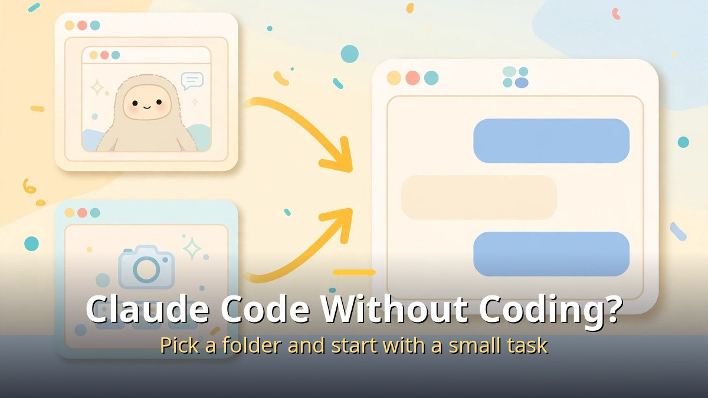
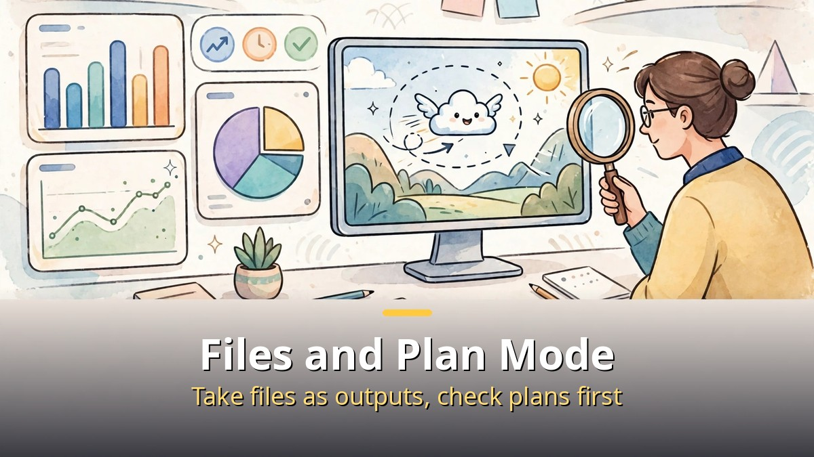

<!-- 본문 시작 -->

Compared with a month ago, how you use Claude has changed noticeably.
It moved from answering questions to handling code, moving through a browser, creating files, and showing a plan first.
Here are the four changes, in the order the source video lays them out.

**The core shift is this: Claude is now closer to a working partner that reads a folder, checks a web page, creates a file, and shows its plan before editing anything.**

> The four changes are: first, Claude Code; second, the Chrome extension; third, file creation; fourth, a change in how prompts are entered (Plan mode). Dates and plan details follow the video's own time frame, as its description notes.

## Claude Code: Can Non-Coders Use It?

Claude Code was known as a developer tool, but the desktop app's Code tab now lets you pick a folder and hand over a job, which makes it easier for non-coders to try.
The point is not writing code yourself, but stating what you want to make and checking the result.
Start with a small, newly created folder and one small task.

In the Code tab, the flow runs from reading a folder to creating files to checking the result.
That can mean a draft deck, an organized document, or a simple web page, delivered as files.
Unlike the terminal route, the desktop Code tab adds a file viewer and editor, plus panels for changed files, plans, and background tasks.

Check permission settings first.
Use manual confirmation if you want to approve every action, or edit approval if you want file changes to proceed together.
For a first test, use a newly created empty folder, not an important one.

## What Does the Chrome Extension Do in the Browser?

Claude in Chrome is an extension that works directly inside the browser.
It understands the page you are signed into and helps by clicking, typing, and filling forms while you decide the next step.
Reported uses include pulling numbers from an analytics dashboard for a summary, or reviewing Drive files to organize a folder structure.

It is available on paid plans, and in Team and Enterprise plans administrators can enable or disable it org-wide and set site allowlists and blocklists.
In planning mode, Claude shows its approach once and moves only after approval.
Irreversible or high-stakes actions, such as purchases or financial work, still require user confirmation.

The cautions are clear.
The extension shares your browser's login state, so it can reach sites you are already signed into.
Allow only the sites a task needs, and check payment or important account screens yourself.
Official guidance also warns that hidden instructions on a page could try to steer Claude's work in another direction.

## File Creation: How Is It Different from a Chat Answer?

The key distinction is between answer text and a result file.
In chat, documents, slides, and designs open beside the conversation for editing, and decks can be downloaded as PowerPoint or PDF.
In the Code tab, the result stays as a real file inside a folder, which you can reopen later or continue in another program.

In practice they split like this.
Docs are documents to edit together, Slides are presentation materials, and Design is visual work.
Share by link when collaborating, and take a file when you need to send an attachment outside.
When taking a file, decide its name, location, and format first to save searching later.

Review matters more once output becomes a file.
Cut-off text or a wrong table number can be less visible than in a chat answer.
Before submitting, open the file itself and check font size, tables, and dates.

| Change | What is different | Check first |
| --- | --- | --- |
| Claude Code | A work tab that reads a folder and creates files | Did you start in a newly created empty folder? |
| Chrome extension | Clicking, typing, and summarizing in the browser | Did you allow only the sites you need? |
| File creation | A real file or artifact, not just an answer | File name, location, and format |
| Plan mode | A plan is shown before any edit | Did you choose manual or auto approval? |

## Plan Mode: What Is the Change in Prompting?

Plan mode is one of Claude Code's permission modes.
In this mode, Claude reads files and draws up a plan, but does not edit files until you approve it.
Official documentation explains the reason: jumping straight to code can solve the wrong problem.

There are three ways to turn it on.
Press Shift+Tab during a conversation to cycle modes, put /plan in front of a prompt, or start with plan permission mode from the beginning.
Once a plan appears, you choose one of three paths: approve and move to auto mode, approve but confirm each edit manually, or stay in planning and say what to fix.
You can also open the plan in an editor and revise it directly before proceeding.

Note that Plan mode does not mean "nothing runs."
Commands needed for reading may run, and some commands may pass under auto-mode inspection settings.
The mode that skips all confirmations is warned for isolated environments only.
For ordinary work, set an approval approach clearly even in Plan mode.

In short, the new way to use Claude is this.
Try the Code tab in a small folder, allow the Chrome extension only on sites you need, take files as real outputs and review them, and check the plan first for large changes.
As tools multiply, deciding what to delegate and what to check yourself is the real skill.

## Frequently Asked Questions

Q. Is Claude Code only for developers?
A. It started as a developer tool, but the desktop Code tab lets non-coders try it by picking a folder and starting with a small task. Use a newly created folder, not an important one.

Q. Is the Chrome extension on the Free plan?
A. Under official guidance it is for paid plans. Availability can vary by account, so check the extension's install screen.

Q. How do I tell file creation apart from a chat answer?
A. A chat answer is text in the conversation; file creation is a result beside the conversation or a real file in a folder. For outside sharing, taking a file is easier to manage.

Q. Does approving in Plan mode run everything at once?
A. It depends on the approval choice. Auto mode reduces later confirmations, while manual approval checks each edit. For large changes, manual confirmation is safer.

## Further reading

[The Only 6 AI Stories Worth Knowing This Week: From Anthropic's IPO to AI-Proved Math — which stories to follow and which to watch](https://aitechnotesen.blogspot.com/2026/10/the-only-6-ai-stories-worth-knowing.html)
[Her｜A Man Who Falls in Love with an AI That Has Only a Voice — how far a relationship with a voice-only AI can go](https://aitechnotesen.blogspot.com/2026/10/hera-man-who-falls-in-love-with-ai-that.html)
[Picking an AI Browser by Tier List: An AI That Reads Is Not an AI That Clicks — 15 browsers sorted by what they are for](https://aitechnotesen.blogspot.com/2026/10/picking-ai-browser-by-tier-list-ai-that.html)

<!-- 본문 끝 -->

## 작업용 출처·이미지 정보 (업로드 제외)

- 자료 출처: Ai-Con Lab 영상 DAGlET9vC_4(2026-11-01, 9:02, 목차: 클로드 코드·크롬 확장·파일 생성·Plan 모드) + 공개 문서 대조
- 이미지: images/01-hero-en.jpg ~ 04-img3-en.jpg / 직접 제작 (AI 생성 + 영어 오버레이) / 사용권: 자작
