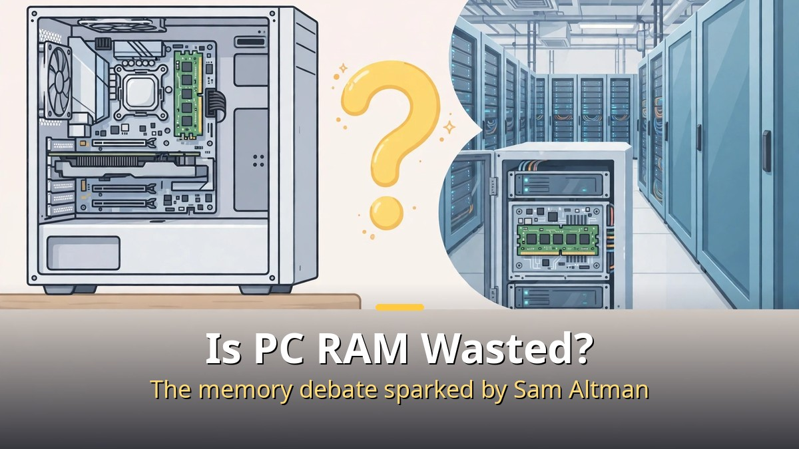
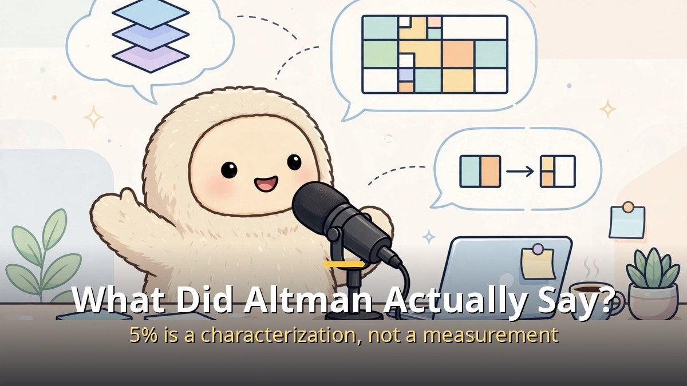
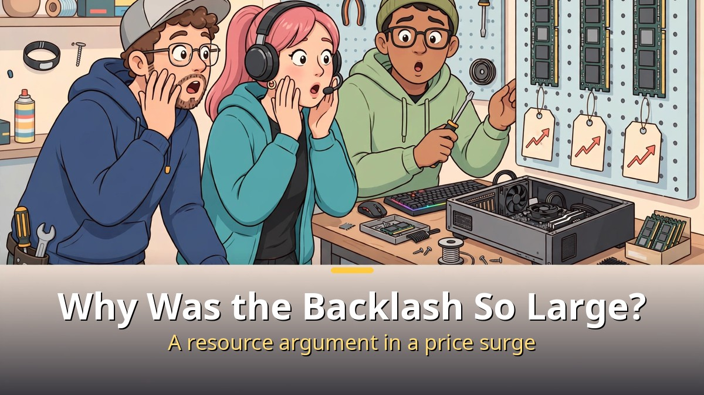
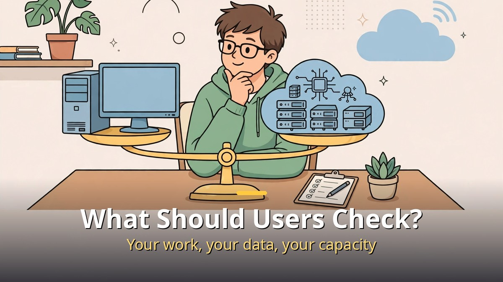

<!-- 본문 시작 -->

One remark from OpenAI CEO Sam Altman drew backlash from PC users.
The gist was that it is "quite terrible" for the world's limited memory to sit in individual computers being used only 5% of the time.
This article does not exaggerate the remark; it separates what was actually said, why the backlash was large, and what ordinary users should check.

**First, the conclusion: Altman did not propose removing RAM from PCs. He made a resource-allocation argument, favoring the cloud side, about where scarce memory should sit.**

> The debate started with the October 29 episode of the podcast "Cheeky Pint." Altman said local inference — running AI directly on your own computer — does not remove the need for data centers, and raised the PC memory question in that context.

## What Did Altman Actually Say?

As reported, Altman's words run like this.
Many people think that once open-source models can run on their own computers, data centers will no longer be needed, but the reality is the opposite.
He said it is "quite terrible to have everybody have a bunch of the world's limited supply of DRAM sitting in their own computer and being used five percent of the time."
In a supply-constrained environment, he argued, memory should be used at maximum utilization in the cloud.

The 5% figure is Altman's characterization, not an independently measured number.
Asked how solutions were going, he also answered briefly: "Bad."
He pointed to the memory industry's history: a business that spent $20 billion building a plant only to earn $19 billion, cycling through booms and busts, so supply does not expand easily.

Note the scope of the remark.
Altman did not single out gaming PCs, developer boxes, or a new MacBook and say "take that RAM out."
It was a general argument about resource allocation, and reading it as a proposal to ban consumer RAM purchases overstates it.

## Why Was the Backlash So Large?

The timing matters.
The remarks landed while memory prices were surging, and critics had already pointed out that data-center demand drives those prices.
From a consumer's view, the sequence can sound like this: data centers push prices up, and now PC memory is called wasteful too.

The counterarguments are strong.
Cars and kitchens also sit unused most of the day, and that does not make them waste.
More importantly, local AI exists for a reason: keeping personal data off external servers, working offline, and avoiding subscription rate limits.
Creative work, gaming, and development environments need RAM too. RAM is not just storage; it is the workspace where current work lives.

Market forecasts added fuel.
Citing a TrendForce projection, reports said conventional DRAM contract prices could climb 10–15% quarter over quarter in the fourth quarter of 2026, as suppliers prioritize higher-value server memory.
That is a forecast, not a confirmed price, and the distinction matters.

| Claim | What was cited | What to check |
| --- | --- | --- |
| Cloud concentration is more efficient | Data centers use memory almost continuously | Whether your work can move to the cloud |
| Local memory is needed | Privacy, offline use, rate limits | Whether your AI use runs locally |
| Prices may keep rising | Server memory prioritized in forecasts | The actual selling price at purchase time |

## What Should Ordinary Users Check?

What users should take from this debate is not "who is right" but a decision checklist.
Three checks are enough.

First, how you use AI.
If you only use cloud AI, choose PC RAM by general work needs.
If you run local AI, check model size against memory first. Small models run on modest memory, but a common rule for local AI guides is to keep a model well under half of available memory.

Second, purchase timing.
In a rising-price period, ask first whether you need it right now.
If it is not urgent, watch prices; if it is urgent, buy exactly the capacity you need and no more.

Third, do not mix in a different remark.
In a November 1 Politico report, Altman was quoted as saying the world should accept that some bad things will happen for the benefits of this technology.
That is a separate interview and a separate topic — about harms such as hacks, scams, and hallucinations — not the memory-allocation argument.
Reading the two together only makes the debate louder and the judgment blurrier.

In short, Altman's remark is a resource-allocation claim that the cloud is more efficient, and the backlash is a question about who pays for that efficiency.
A PC buyer only needs their own answer: where does my work run, where does my data live, and how much capacity do I need right now?
Once that answer is set, the noise gets much smaller.

## Frequently Asked Questions

Q. Did Altman propose banning PC RAM purchases?
A. No such proposal appears in the reported remarks. It was an argument for maximizing utilization in the cloud under scarcity.

Q. Is the 5% figure a fact?
A. It is Altman's expression in the interview. It is not an independent measurement, so it should not be read as a fact that every PC uses only 5%.

Q. Should I buy PC RAM now?
A. If you need it, yes. In a period with rising-price forecasts, first check the capacity you need and how urgent the purchase is.

Q. Which is better, local AI or cloud AI?
A. It depends on the task. Local wins when privacy, offline use, and continuous use matter; cloud wins when large models, collaboration, and maintenance matter.

## Further reading

[The Only 6 AI Stories Worth Knowing This Week: From Anthropic's IPO to AI-Proved Math — which stories to follow and which to watch](https://aitechnotesen.blogspot.com/2026/10/the-only-6-ai-stories-worth-knowing.html)
[Her｜A Man Who Falls in Love with an AI That Has Only a Voice — how far a relationship with a voice-only AI can go](https://aitechnotesen.blogspot.com/2026/10/hera-man-who-falls-in-love-with-ai-that.html)
[Picking an AI Browser by Tier List: An AI That Reads Is Not an AI That Clicks — 15 browsers sorted by what they are for](https://aitechnotesen.blogspot.com/2026/10/picking-ai-browser-by-tier-list-ai-that.html)

<!-- 본문 끝 -->

## 작업용 출처·이미지 정보 (업로드 제외)

- 자료 출처: TheAIGRID 영상 HMA357MXB1o(2026-11-02, 샘 올트먼 RAM 발언 논란) + Cheeky Pint 10-29 인터뷰 보도·TrendForce 전망 대조
- 이미지: images/01-hero-en.jpg ~ 04-img3-en.jpg / 직접 제작 (AI 생성 + 영어 오버레이) / 사용권: 자작
