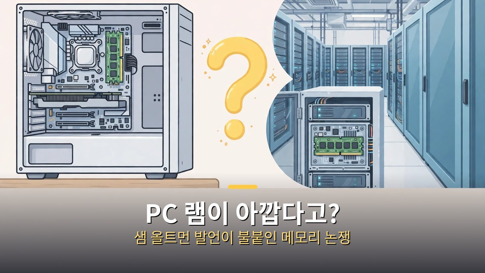
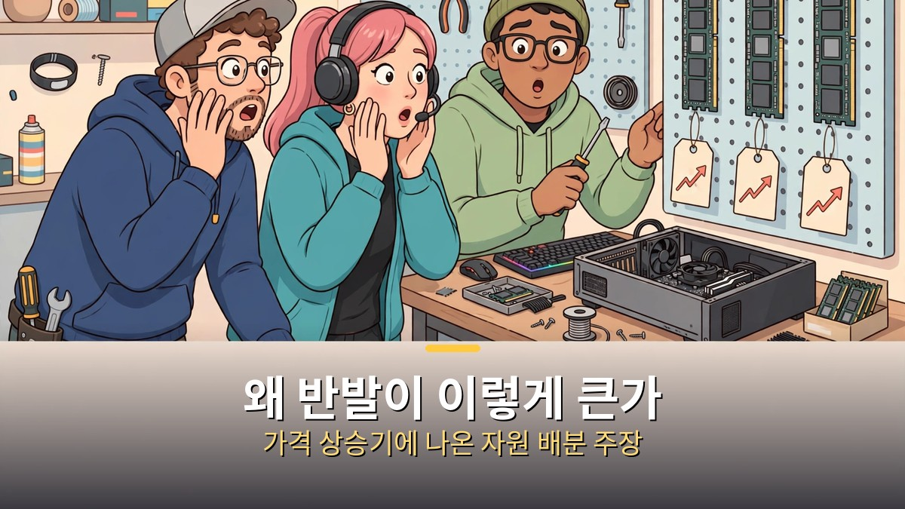
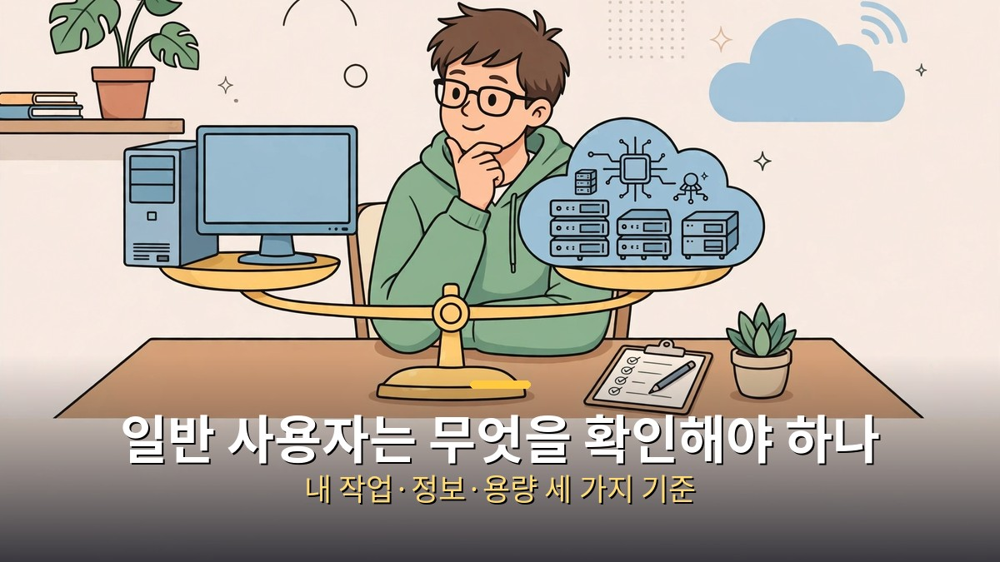

<!-- 본문 시작 -->

오픈AI 최고경영자 샘 올트먼의 한마디가 PC 사용자들의 반발을 불렀다.
"세계의 제한된 메모리가 각자 컴퓨터에 앉아 5%만 쓰이는 것은 끔찍하다"는 취지의 발언이다.
이 글은 발언을 과장하지 않고, 왜 반발이 컸는지, 일반 사용자는 무엇을 확인해야 하는지를 나눠 정리한다.

**먼저 결론부터 말하면, 올트먼은 "PC에서 램을 빼라"고 제안한 것이 아니다. 제한된 메모리를 어디에 두는 것이 효율적인지를 두고, 클라우드 쪽 손을 들어준 자원 배분 주장이다.**

> 논란의 출발점은 10월 29일 공개된 팟캐스트 '치키 핀트' 인터뷰다. 올트먼은 로컬 추론(내 컴퓨터에서 AI를 직접 돌리는 방식)이 데이터센터의 필요성을 없애지 않는다고 말했고, 그 맥락에서 PC 메모리 문제를 꺼냈다.

## 올트먼이 실제로 뭐라고 했나

올트먼의 말을 보도된 그대로 정리하면 이렇다.
많은 사람이 오픈소스 모델을 내 컴퓨터에서 돌릴 수 있게 되면 데이터센터가 필요 없어진다고 생각하지만, 실제로는 반대라는 것이다.
그는 "전 세계의 제한된 DRAM 공급량이 각자의 컴퓨터에 앉아 5%만 쓰이는 것은 꽤 끔찍하다"고 말했다.
공급이 부족한 환경에서는 클라우드에서 최대한 활용하는 것이 낫다는 주장이다.

여기서 5%라는 숫자는 올트먼의 표현이지, 독립적으로 측정된 수치가 아니다.
또 그는 해결책이 어떻게 되고 있냐는 질문에 "나쁘다"고 짧게 답했다.
이유로는 메모리 산업의 역사를 들었다. 200억 달러를 들여 공장을 지어 190억 달러를 버는 식으로, 호황과 불황을 반복해온 사업이라 공급이 쉽게 늘지 않는다는 설명이다.

주의할 점은 발언의 범위다.
올트먼은 게임용 PC인지, 개발용 박스인지, 신형 맥북인지 특정 제품을 지목해 "그 램을 빼라"고 말하지 않았다.
자원 배분에 대한 일반론을 말한 것이고, 이를 "소비자 램 금지 제안"으로 읽는 것은 과장이다.

## 왜 반발이 이렇게 큰가

반발이 큰 이유는 발언이 나온 시점 때문이다.
메모리 가격이 치솟고 있는 와중에, 메모리 수요를 키운 쪽이 데이터센터라는 지적이 먼저 있었다.
소비자 입장에서는 "데이터센터가 가격을 올리고, 이제는 PC 메모리까지 아깝다고 한다"는 순서로 들릴 수 있다.

반론도 만만치 않다.
자동차나 부엌도 하루 대부분 쓰지 않는데, 그것이 낭비라는 뜻은 아니라는 비유다.
더 중요한 반론은 로컬 AI의 존재 이유다. 개인정보를 외부에 보내지 않고, 인터넷이 없어도 쓰고, 요금제 제한 없이 돌리려면 내 컴퓨터의 메모리가 필요하다는 것이다.
창작 작업, 게임, 개발 환경도 마찬가지다. 램은 단순한 저장 공간이 아니라, 지금 돌리고 있는 작업을 올려두는 일터다.

시장 전망도 논쟁에 불을 붙였다.
시장조사업체 트렌드포스의 전망을 인용한 보도에 따르면, 2026년 4분기 일반 DRAM 계약 가격은 전 분기보다 10~15% 오를 것으로 전망됐다.
서버용 메모리가 우선 공급되는 구조에서, 소비자용 가격 부담이 커질 수 있다는 우려다.
이 수치는 전망이지 확정 가격이 아니라는 점을 구분해야 한다.

| 주장 | 근거로 제시된 것 | 확인해야 할 것 |
| --- | --- | --- |
| 클라우드 집중이 효율적이다 | 데이터센터는 메모리를 거의 계속 쓴다 | 내 작업이 클라우드에 맡길 수 있는가 |
| 로컬 메모리가 필요하다 | 개인정보·오프라인·요금제 제한 | 내 AI 사용이 로컬에서 돌아가는가 |
| 가격이 계속 오를 수 있다 | 서버 메모리 우선 공급 전망 | 구매 시점의 실제 판매가 |

## 일반 사용자는 무엇을 확인해야 하나

이 논쟁에서 일반 사용자가 가져갈 것은 "누가 옳냐"가 아니라 선택 기준이다.
다음 세 가지만 확인해도 충분하다.

첫째, 내 AI 사용 방식이다.
클라우드 AI만 쓴다면 PC 램 용량은 일반 작업 기준으로 고르면 된다.
로컬 AI를 돌린다면 모델 크기와 메모리 용량을 먼저 확인해야 한다. 작은 모델은 적은 메모리로도 되지만, 큰 모델은 메모리 절반 이하를 쓰는 것이 안전하다는 것이 로컬 AI 가이드의 일반 원칙이다.

둘째, 구매 시점이다.
가격이 오르는 시기에는 "지금 당장 필요한가"를 먼저 묻는 것이 좋다.
급하지 않다면 가격 추이를 보고, 급하다면 필요한 용량만 정확히 사는 것이 낭비를 줄인다.

셋째, 다른 발언과 섞지 않는 것이다.
11월 1일 폴리티코 보도에서는 올트먼이 "AI의 혜택을 위해 나쁜 일이 어느 정도 일어나는 것을 받아들여야 한다"는 취지로 말했다고 전해졌다.
이는 램 발언과는 별개의 인터뷰·별개의 주제다. 해킹·사기·환각 같은 부작용을 어디까지 감수할 것인지에 대한 논쟁이지, 메모리 배분 주장과 같은 말이 아니다.
두 발언을 한 묶음으로 읽으면 논쟁이 더 커질 뿐, 판단은 흐려진다.

정리하면, 올트먼의 발언은 "클라우드가 더 효율적이다"는 자원 배분 주장이고, 반발은 "그 효율의 대가를 누가 치르느냐"는 질문이다.
PC를 사는 사람은 이 질문에 자기 답을 갖고 있으면 된다. 내 작업은 어디에서 돌아가고, 내 정보는 어디에 두며, 지금 사야 할 용량은 얼마인지.
그 답이 정해지면, 논쟁의 소음은 훨씬 작아진다.

## 자주 묻는 질문

Q. 올트먼이 PC 램 구매를 금지하자고 했나요?
A. 보도된 발언에서는 그런 제안이 확인되지 않는다. 제한된 메모리를 클라우드에서 최대한 활용하는 것이 낫다는 자원 배분 주장이었다.

Q. 5%라는 숫자는 사실인가요?
A. 올트먼이 인터뷰에서 쓴 표현이다. 독립 측정치가 아니므로, 모든 PC가 5%만 쓴다는 사실로 받아들이면 안 된다.

Q. 지금 PC 램을 사도 되나요?
A. 필요하면 사도 된다. 다만 가격 상승 전망이 있는 시기이므로, 필요한 용량과 급한 정도를 먼저 확인하는 것이 좋다.

Q. 로컬 AI와 클라우드 AI 중 어느 쪽이 나은가요?
A. 정답은 작업마다 다르다. 개인정보·오프라인·지속 사용이 중요하면 로컬, 큰 모델·협업·유지보수가 중요하면 클라우드가 유리한 경우가 많다.

## 함께 읽으면 좋은 글

[이번 주 AI 뉴스 6개만 보면 됩니다｜앤트로픽 상장부터 AI의 수학 증명까지 — 이번 주 쏟아진 소식 중 챙길 것과 지켜볼 것을 가른 글](https://aitechnoteskr.tistory.com/75)
[그녀｜목소리만 있는 인공지능과 사랑에 빠진 남자의 이야기 — 목소리만 있는 AI와의 관계가 어디까지 갈 수 있는지 묻는 영화 소개](https://aitechnoteskr.tistory.com/81)
[월-E｜버려진 지구에서 목적을 찾은 청소 로봇의 이야기 — 대사보다 장면으로 말하는 픽사 애니메이션의 AI 질문](https://aitechnoteskr.tistory.com/72)

<!-- 본문 끝 -->

## 작업용 출처·이미지 정보 (업로드 제외)

- 자료 출처: TheAIGRID 영상 HMA357MXB1o(2026-11-02, 샘 올트먼 RAM 발언 논란) + Cheeky Pint 10-29 인터뷰 보도·TrendForce 전망 대조
- 이미지: images/01-hero.jpg ~ 04-img3.jpg / 직접 제작 (AI 생성 + 한글 오버레이) / 사용권: 자작
