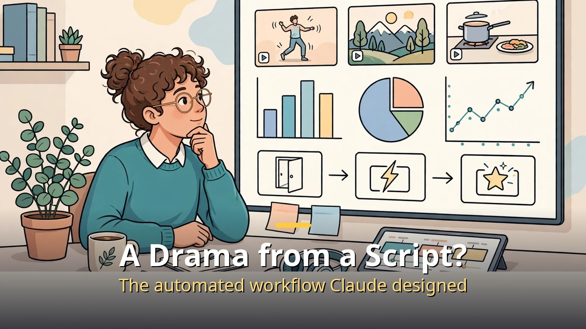
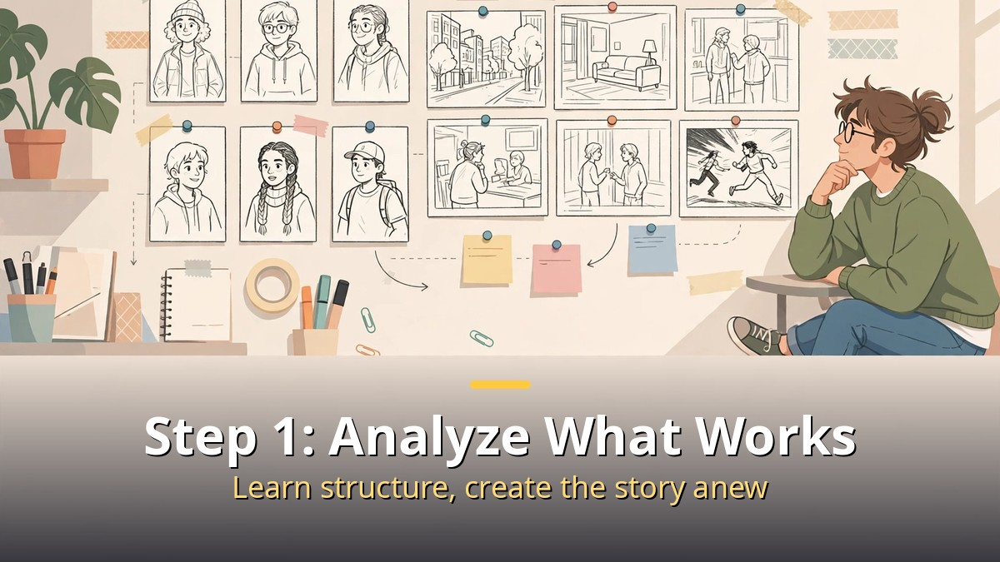
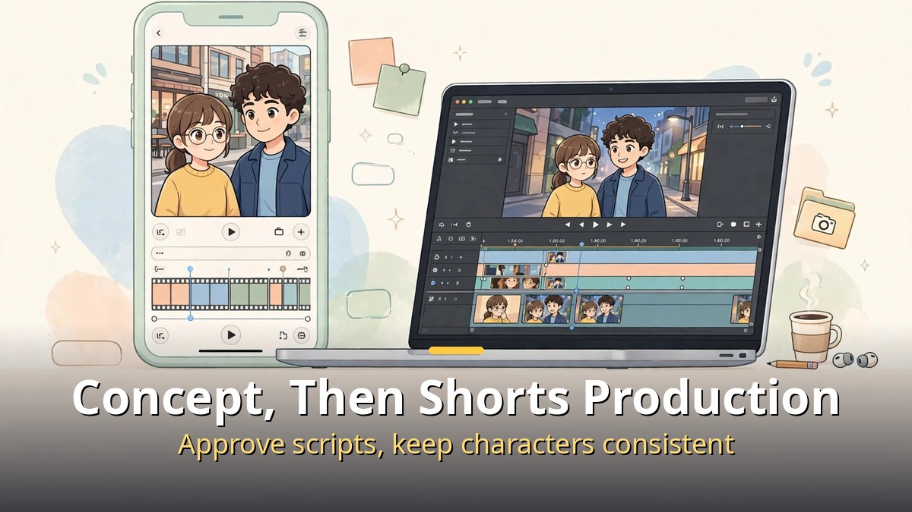
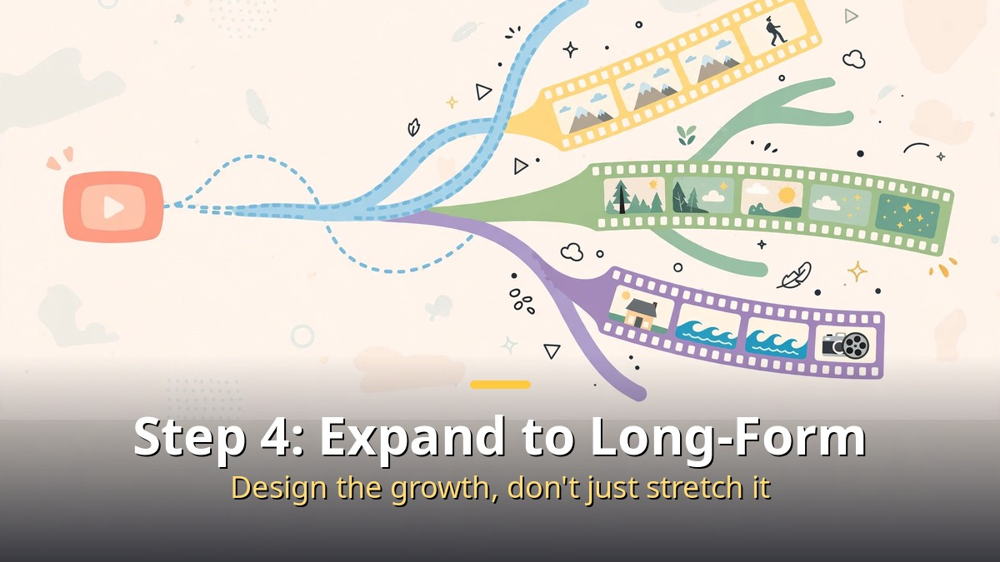

<!-- 본문 시작 -->

To make an AI drama, a creator asked Claude to design the automated workflow itself.
It runs from video analysis to concept design, Shorts production, and then long-form expansion.
This article strips away the "one button and done" exaggeration and lays out those four steps in order.

**The core point is this: Claude is not a camera that shoots the drama. It is a workflow designer that connects analysis, concept, production, and expansion. Connected tools make the scenes and voices, and humans do the final review.**

> This article summarizes one creator's workflow. It is not a universal recipe with the same tools and prices for everyone; check each tool's current terms before producing.

## Step 1: Analyze Successful Videos and Benchmark Them

The first step is not to start making, but to analyze videos that already work.
Look at the story structure, how scenes break into short units, and what hook — an opening line or scene — starts the video.
Note who the characters are, and where the conflict starts and where it bursts.

Claude's job here is to turn that analysis into a reusable form.
For example, ask for the analyzed structure as a scene list, not just a reaction.
A plain "analyze this" tends to produce appreciation; specifying scene lists, dialogue length, and transition points makes the result usable in the next step.

The caution here is to separate benchmarking from copying.
You can learn from a popular video's structure and rhythm, but taking its dialogue, characters, or scenes as-is is plagiarism.
Use the analysis to learn structure and rhythm, and create the story itself anew.

## Step 2: Design the Concept and Write the Scenario

The second step is concept design.
Decide first who the story is for, how long one episode is, and whether it can continue as a series.
Character settings belong here too: who the lead is, what personality they have, and what conflict they face, in short form.

Then come scenario and prompt design.
A scenario is not dialogue alone; it is a blueprint that states, for each scene, who is where and doing what.
Prompt design turns that blueprint into instructions that image and video tools can understand.
Calling up a saved character setting instead of re-describing a face each time helps keep characters consistent.

The human job at this stage is script approval.
Read Claude's script draft and check whether the story makes sense, whether characters stay consistent, and whether any facts in it are correct.
A problem not fixed at the script stage returns later as the cost of remaking scenes.

## Step 3: Make a Shorts AI Drama

The third step is full production.
Because Shorts are short, one episode should carry one conflict and one twist.
The order runs from scene images, to turning images into video, to adding voices, music, and subtitles.

The most common failure in production is character consistency.
If a face changes from scene to scene, viewers get confused about who is who.
Saving a character's portrait, description, and voice once and calling them up in later scenes reduces this.
It is not perfect. A scene with a drifted face must be remade, and remakes can cost extra credits.

Editing and uploading belong here too.
Check subtitle timing, voice levels, and scene transitions in a preview, then watch the whole cut from start to finish.
Claude cannot listen to sound itself, so a human must listen and fix awkward parts.
Whether an AI-made label is required depends on the platform, so check that platform's labeling rules before uploading.

| Step | What Claude and tools do | What humans do |
| --- | --- | --- |
| Analysis and benchmarking | Organize a popular video's structure into a scene list | Learn structure only; create the story anew |
| Concept and scenario | Character settings, script draft, prompt design | Approve the script, check facts |
| Shorts production | Generate images, video, voices, music, subtitles | Check consistency, listen to voices, watch the final cut |
| Long-form expansion | Expand the Shorts structure into a longer story | Check completeness, repetition, cost |

## Step 4: Expand Shorts into Long-Form

Once a Short gains traction, the next step is to widen the same world and characters into a longer video.
If a Short was "one conflict," long-form is "a conflict that grows and resolves."
Bring over the tested characters and hook, but design the story from the beginning again.
Simply stretching a Short makes the middle sag and viewers leave.

Three new checks matter for long-form.
First, completeness within one episode. Even as part of a series, an episode needs its own beginning and end.
Second, repetition. Repeating the same conflict every episode gets stale; change character relationships or settings a little at a time.
Third, production cost and time. More scenes mean more consistency checks and more remake costs.

In short, the AI drama workflow lets a scriptwriter also act as a video producer.
The advantages are speed and repeatability; the costs are character consistency, credit spending, and review burden.
Start with one complete Short, run a checklist over faces, voices, subtitles, and facts, and only then widen into a series and long-form.

## Frequently Asked Questions

Q. Does a drama come out directly from the Claude chat window?
A. The reported flow asks Claude to design the workflow and connects each step to tools. The chat window alone does not automatically finish every scene, voice, and edit.

Q. Is benchmarking a popular video plagiarism?
A. Learning structure and rhythm is different from taking dialogue, characters, or scenes as-is. The story itself should be newly created.

Q. What if a character's face changes from scene to scene?
A. Save the character and call it up, and remake awkward scenes. Remakes can cost credits, so keep the scene count small at first.

Q. What changes when Shorts become long-form?
A. Do not just stretch the conflict; design anew how it grows and resolves. Check completeness, repetition, and cost together.

## Further reading

[The Only 6 AI Stories Worth Knowing This Week: From Anthropic's IPO to AI-Proved Math — which stories to follow and which to watch](https://aitechnotesen.blogspot.com/2026/10/the-only-6-ai-stories-worth-knowing.html)
[Her｜A Man Who Falls in Love with an AI That Has Only a Voice — how far a relationship with a voice-only AI can go](https://aitechnotesen.blogspot.com/2026/10/hera-man-who-falls-in-love-with-ai-that.html)
[Picking an AI Browser by Tier List: An AI That Reads Is Not an AI That Clicks — 15 browsers sorted by what they are for](https://aitechnotesen.blogspot.com/2026/10/picking-ai-browser-by-tier-list-ai-that.html)

<!-- 본문 끝 -->

## 작업용 출처·이미지 정보 (업로드 제외)

- 자료 출처: 성공지식백과 영상 EXFD2VzpXso(2026-11-01, 14:10, 구성: 분석·벤치마킹→콘셉트→쇼츠 제작→롱폼 전환) + 공개 도구 사례 대조
- 이미지: images/01-hero-en.jpg ~ 04-img3-en.jpg / 직접 제작 (AI 생성 + 영어 오버레이) / 사용권: 자작
