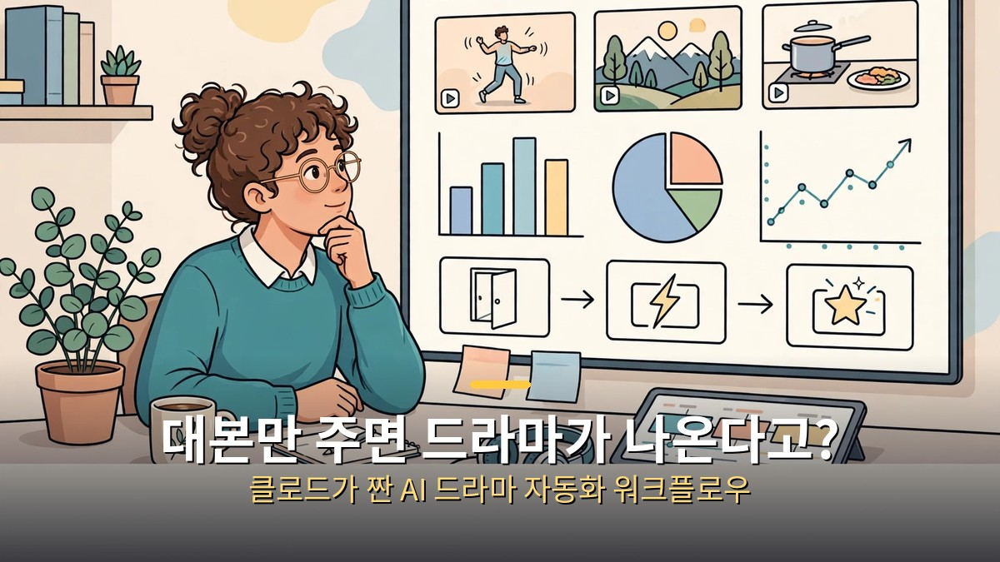
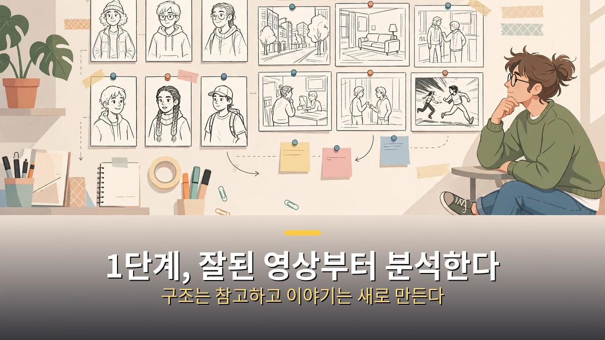
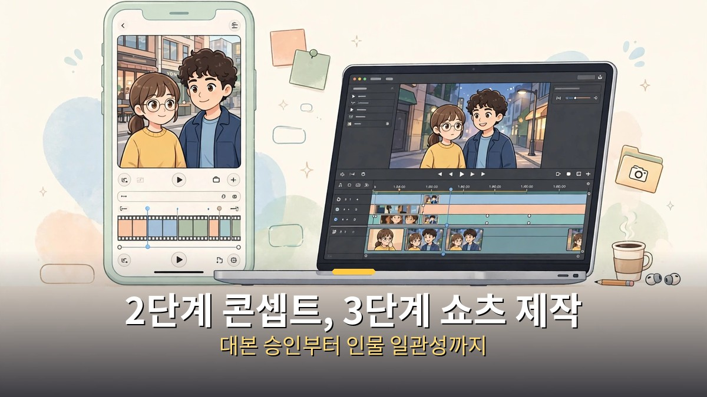
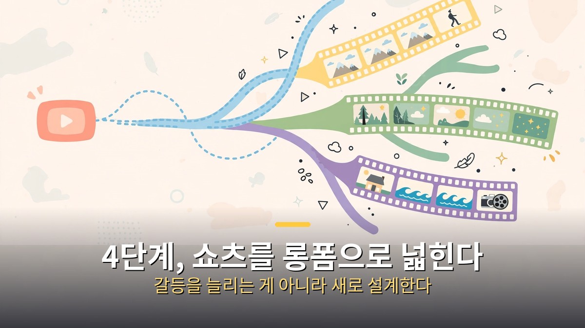

<!-- 본문 시작 -->

AI 드라마를 만들기 위해, 제작자가 클로드에게 자동화 워크플로우 자체를 짜달라고 했다.
영상 분석부터 콘셉트 설계, 쇼츠 제작, 롱폼 전환까지 이어지는 흐름이다.
이 글은 "버튼 하나면 끝"이라는 과장을 걷어내고, 그 네 단계를 순서대로 정리한다.

**핵심은 이것이다. 클로드는 드라마를 직접 찍는 카메라가 아니라, 분석·콘셉트·제작·확장을 이어주는 작업 설계자다. 장면과 목소리는 연결된 도구들이 만들고, 최종 검수는 사람이 한다.**

> 이 글은 특정 제작자의 워크플로우를 정리한 것이다. 모든 도구·요금이 모든 사람에게 똑같이 적용되는 보편 레시피가 아니며, 실제 제작 전에 각 도구의 현재 조건을 확인해야 한다.

## 1단계, 잘된 영상부터 분석하고 벤치마킹한다

첫 단계는 바로 만들기 시작하는 것이 아니라, 이미 반응이 좋은 영상을 분석하는 것이다.
어떤 이야기 구조인지, 장면은 몇 초 단위로 끊기는지, 첫 장면이 어떤 훅(끌어당기는 문장·장면)으로 시작하는지를 본다.
인물이 누구인지, 갈등이 어디에서 시작해 어디에서 터지는지도 함께 정리한다.

클로드에게 맡길 일은 이 분석을 "따라 할 수 있는 형식"으로 바꾸는 것이다.
예를 들어 "분석한 영상의 구조를 장면 목록으로 정리해줘"처럼, 결과물의 형태부터 정한다.
그냥 "분석해줘"만 하면 감상문이 나오기 쉽고, 장면 목록·대사 길이·전환 지점 같은 형식을 정해야 다음 단계에서 쓸 수 있다.

이 단계에서 주의할 점은 베끼기와 참고를 구분하는 것이다.
인기 영상의 구조는 참고할 수 있지만, 대사·인물·장면을 그대로 가져오면 표절 문제가 된다.
분석 결과는 구조와 리듬을 배우는 데 쓰고, 이야기 자체는 새로 만드는 것이 원칙이다.

## 2단계, 콘셉트를 설계하고 시나리오를 짠다

두 번째 단계는 콘셉트 설계다.
누구를 위한 이야기인지, 한 편이 몇 분인지, 시리즈로 이어질 수 있는지를 먼저 정한다.
인물 설정도 여기서 정한다. 주인공은 누구이고, 어떤 성격을 가졌으며, 어떤 갈등을 겪는지를 짧게 정리한다.

그다음 시나리오와 프롬프트 설계가 이어진다.
시나리오는 대사만이 아니라, 장면마다 "누가, 어디서, 무엇을 하는지"를 적는 설계도다.
프롬프트는 그 설계도를 이미지·영상 생성 도구가 이해할 수 있는 지시문으로 바꾸는 작업이다.
인물 이름을 매번 새로 설명하지 않고, 저장된 인물 설정을 불러오는 방식이 일관성을 지키는 데 도움이 된다.

이 단계에서 사람이 꼭 해야 할 일은 대본 승인이다.
클로드가 만든 대본 초안을 읽고, 이야기가 말이 되는지, 인물이 일관되는지, 사실이 들어갔다면 사실인지 확인한다.
대본 단계에서 고치지 않은 문제는 나중에 장면을 다시 만드는 비용으로 돌아온다.

## 3단계, 쇼츠용 AI 드라마를 만든다

세 번째 단계가 본격 제작이다.
쇼츠는 길이가 짧기 때문에, 한 편에 하나의 갈등과 하나의 반전만 담는 것이 기본이다.
장면 그림을 만들고, 그림을 영상으로 바꾸고, 목소리와 음악, 자막을 붙이는 순서로 이어진다.

제작에서 가장 자주 무너지는 것이 인물 일관성이다.
장면마다 얼굴이 바뀌면 시청자는 같은 인물인지 헷갈린다.
인물 사진과 설명, 목소리를 한 번 저장해두고 이후 장면에서 불러오는 방식이 이를 줄여준다.
다만 완벽하지는 않다. 얼굴이 흐트러진 장면은 다시 만들어야 하고, 다시 만드는 데 추가 비용이 들 수 있다.

편집과 업로드도 이 단계에 포함된다.
자막 타이밍, 목소리 크기, 장면 전환을 미리보기에서 확인하고, 마지막에는 처음부터 끝까지 한 번 본다.
특히 목소리는 클로드가 직접 듣지 못하므로, 사람이 직접 들어보고 어색한 부분을 고쳐야 한다.
AI로 만든 영상이라는 표시는 플랫폼 규칙에 따라 필요할 수 있으니, 올리기 전에 해당 플랫폼의 표시 규정을 확인한다.

| 단계 | 클로드·도구가 하는 일 | 사람이 하는 일 |
| --- | --- | --- |
| 분석·벤치마킹 | 인기 영상 구조를 장면 목록으로 정리 | 구조만 참고하고 이야기 새로 만들기 |
| 콘셉트·시나리오 | 인물 설정·대본 초안·프롬프트 설계 | 대본 승인, 사실 확인 |
| 쇼츠 제작 | 그림·영상·목소리·음악·자막 생성 | 인물 일관성, 목소리 듣기, 최종본 보기 |
| 롱폼 전환 | 쇼츠 구조를 긴 이야기로 확장 | 한 편의 완결성, 반복 여부 확인 |

## 4단계, 쇼츠를 롱폼으로 넓힌다

쇼츠가 반응을 얻으면, 같은 세계관과 인물을 긴 영상으로 넓히는 단계가 온다.
쇼츠 한 편이 "갈등 하나"였다면, 롱폼은 "갈등이 커지고 해결되는 과정"이다.
쇼츠에서 검증된 인물과 훅을 가져오되, 이야기는 처음부터 다시 설계해야 한다.
쇼츠를 단순히 길게 늘리면 중간이 늘어지고 시청자가 이탈하기 쉽다.

롱폼에서 새로 확인해야 할 것은 세 가지다.
첫째, 한 편의 완결성이다. 시리즈의 한 편이라도, 그 편 안에서 시작과 끝이 있어야 한다.
둘째, 반복이다. 같은 갈등을 매 편 반복하면 식상해진다. 인물 관계나 배경을 조금씩 바꾸는 장치가 필요하다.
셋째, 제작 비용과 시간이다. 장면 수가 늘면 인물 일관성 검수와 다시 만들기 비용도 함께 늘어난다.

정리하면, AI 드라마 워크플로우는 "대본을 쓰던 사람이 영상 제작자까지 겸하는" 흐름이다.
장점은 속도와 반복 가능성, 단점은 인물 일관성과 비용, 그리고 검수 부담이다.
처음에는 쇼츠 한 편을 끝까지 만들어보고, 얼굴·목소리·자막·사실 네 가지를 체크리스트로 확인한 뒤에 시리즈와 롱폼으로 넓히는 것이 안전하다.

## 자주 묻는 질문

Q. 클로드 채팅창에서 바로 드라마가 되나요?
A. 보고된 방식은 클로드에게 워크플로우를 설계받고, 각 단계를 도구와 연결해 진행하는 흐름이다. 채팅창만으로 모든 장면·목소리·편집이 자동으로 끝나지는 않는다.

Q. 인기 영상 구조를 참고하면 표절이 아닌가요?
A. 구조와 리듬을 참고하는 것과 대사·인물·장면을 그대로 가져오는 것은 다르다. 이야기 자체는 새로 만드는 것이 원칙이다.

Q. 인물 얼굴이 장면마다 바뀌면 어떻게 하나요?
A. 인물을 저장해 불러오는 방식을 쓰고, 어색한 장면은 다시 만든다. 다시 만드는 비용이 들 수 있으니, 처음에는 장면 수를 적게 잡는 것이 좋다.

Q. 쇼츠를 롱폼으로 바꾸면 무엇이 달라지나요?
A. 갈등을 길게 늘리는 것이 아니라, 갈등이 커지고 해결되는 과정을 새로 설계해야 한다. 완결성·반복·비용을 함께 확인해야 한다.

## 함께 읽으면 좋은 글

[이번 주 AI 뉴스 6개만 보면 됩니다｜앤트로픽 상장부터 AI의 수학 증명까지 — 이번 주 쏟아진 소식 중 챙길 것과 지켜볼 것을 가른 글](https://aitechnoteskr.tistory.com/75)
[그녀｜목소리만 있는 인공지능과 사랑에 빠진 남자의 이야기 — 목소리만 있는 AI와의 관계가 어디까지 갈 수 있는지 묻는 영화 소개](https://aitechnoteskr.tistory.com/81)
[월-E｜버려진 지구에서 목적을 찾은 청소 로봇의 이야기 — 대사보다 장면으로 말하는 픽사 애니메이션의 AI 질문](https://aitechnoteskr.tistory.com/72)

<!-- 본문 끝 -->

## 작업용 출처·이미지 정보 (업로드 제외)

- 자료 출처: 성공지식백과 영상 EXFD2VzpXso(2026-11-01, 14:10, 구성: 분석·벤치마킹→콘셉트→쇼츠 제작→롱폼 전환) + 공개 도구 사례 대조
- 이미지: images/01-hero.jpg ~ 04-img3.jpg / 직접 제작 (AI 생성 + 한글 오버레이) / 사용권: 자작
