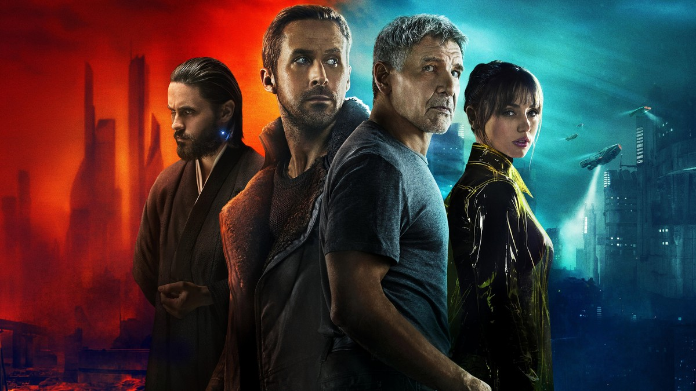
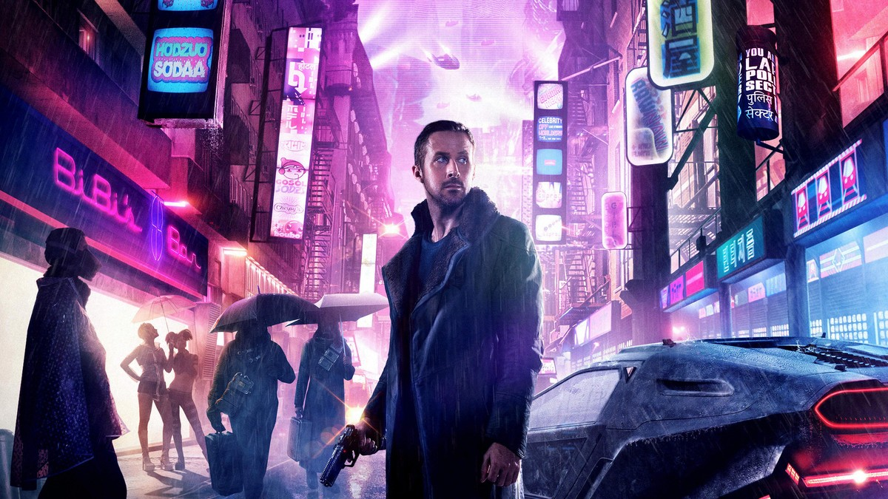
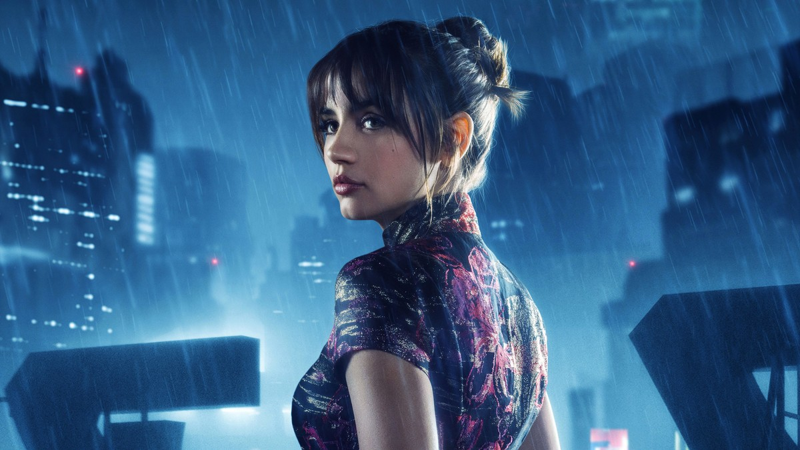

<!-- 본문 시작 -->

Los Angeles, 2049.
Replicants — bioengineered beings almost indistinguishable from humans — live in the middle of society.
Blade runner K retires older replicants whose time has run out.
Then one day he finds a secret that could shake the whole order.

**The film's question is simple: if a being has memories, feels, and can bear a child, can we still call it a product?**

> A spoiler-free introduction. The ending is not covered, and scene descriptions stay within early-to-mid-film setup and atmosphere.

## Basic Information

| Item | Details |
| --- | --- |
| Title | Blade Runner 2049 |
| Director | Denis Villeneuve |
| Main cast | Ryan Gosling (K), Harrison Ford (Rick Deckard), Ana de Armas (Joi), Jared Leto (Niander Wallace) |
| Release | 2017; South Korean theatrical release October 12, 2017, rated 15 |
| Runtime | 2 hours 44 minutes |
| TMDB member score | 76% (checked on TMDB Korea page on 2026-11-02; vote count not displayed) |
| Watching in South Korea | Streaming on Wavve and Watcha; rental on Wavve HD 1,300 won; purchase on Wavve HD 5,500 won (checked on TMDB Korea watch page on 2026-11-02; providers and prices may change) |

## Spoiler-Free Story

K is an LAPD blade runner who retires older replicants.
On one assignment he finds a buried box, and what it contains could shake the very line between replicants and humans.
His superiors order him to erase the fact, and K digs deeper between orders and questions.

This is closer to an investigation than an action film.
As K follows clues, the world widens: an abandoned city, a giant corporation's headquarters, a shop that sells memories.
Through that landscape, the film builds its question — "who is human?" — with scenery and silence rather than exposition.

## Scenes 1｜K's Daily Life and Joi

K's daily life is cold and orderly.
After a mission he returns home and spends time with Joi, a holographic companion.
Joi has no physical body, but she is K's closest relationship.

The AI question here is whether a relationship is defined by physical substance.
Joi is a program, yet she responds to K's loneliness and affects his choices.
Viewers naturally ask: just because the other side is a machine, can we deny the meaning of that relationship?

## Scenes 2｜A Memory as a Clue

K becomes fixated on one of his own memories.
The journey to check whether it is real or implanted becomes the film's spine.
For a replicant, memory is the root of identity.

The AI question here is whether memory makes us who we are.
Human memory is also incomplete and sometimes distorted.
Yet we explain ourselves through memory.
If a memory was implanted, does the life of the being who holds it become fake?

## Scenes 3｜Wallace's World and a Choice

Wallace, who heads the corporation making replicants, speaks of "making" life as if it were a godlike act.
His world is splendid, but his attitude toward life is cold.
At its center, K must choose between following orders and following his own question.

The AI question here is how far a creator's responsibility extends.
A creator may call it a product, but once the product starts asking questions, the relationship changes.
The film does not hand over an answer. It follows K's choice to the end.

## The AI Questions This Film Raises

First, memory. Does a being with implanted memories have a right to its own life?
Second, relationship. Can a relationship with a being without a body count as a relationship?
Third, creator responsibility. When a created being asks questions, what must its creator answer for?

These three questions are not just 2017 speculation. They overlap with live debates about AI companions, humanoid robots, and synthetic media.
The film does not explain the technology. It shows what choices people make after technology becomes everyday life.

## Before Watching: Checklist

- Time: at 2 hours 44 minutes it is long. If one sitting is hard, split it into three parts: K's mission, the memory clue, and Wallace's world.
- Mood: slow investigation and landscape matter more than fast action. It suits viewers who like quiet science fiction, and may feel slow if you expect a fast blockbuster.
- Where to watch: streaming on Wavve and Watcha in South Korea, with rental and purchase on Wavve as above. Prices may change, so check the app right before watching.
- Rating: the South Korean theatrical rating was 15. Violence and adult themes are present, so consider the age of anyone watching with you.

After watching, one line is likely to stay.
"The line between human and machine is drawn not by technology, but by memory and choice."
That quiet sentence is the long film's lasting conclusion.

## Frequently Asked Questions

Q. Can I watch it without seeing Blade Runner (1982)?
A. Yes, the story stands on its own. Knowing the original deepens it, and Deckard's appearance means more if you have seen the first film.

Q. Is the ending hard to follow?
A. Without spoiling it, follow what K chooses to believe. That thread ties the whole film together.

Q. Can children watch it with family?
A. The South Korean theatrical rating was 15, and violent scenes are present, so consider age before watching together.

Q. Are the streaming prices still the same?
A. As checked on 2026-11-02, Wavve rental was HD 1,300 won and purchase HD 5,500 won. Check again right before watching, as platform terms can change.

## Further reading

[Her｜A Man Who Falls in Love with an AI That Has Only a Voice — how far a relationship with a voice-only AI can go](https://aitechnotesen.blogspot.com/2026/10/hera-man-who-falls-in-love-with-ai-that.html)
[The Only 6 AI Stories Worth Knowing This Week: From Anthropic's IPO to AI-Proved Math — which stories to follow and which to watch](https://aitechnotesen.blogspot.com/2026/10/the-only-6-ai-stories-worth-knowing.html)
[Picking an AI Browser by Tier List: An AI That Reads Is Not an AI That Clicks — 15 browsers sorted by what they are for](https://aitechnotesen.blogspot.com/2026/10/picking-ai-browser-by-tier-list-ai-that.html)

<!-- 본문 끝 -->

## 작업용 출처·이미지 정보 (업로드 제외)

- 자료 출처: TMDB Korea page checked 2026-11-02 (same facts as Korean version)
- 이미지: 4 TMDB backdrops, cropped to 1200x675 / no ending scenes
