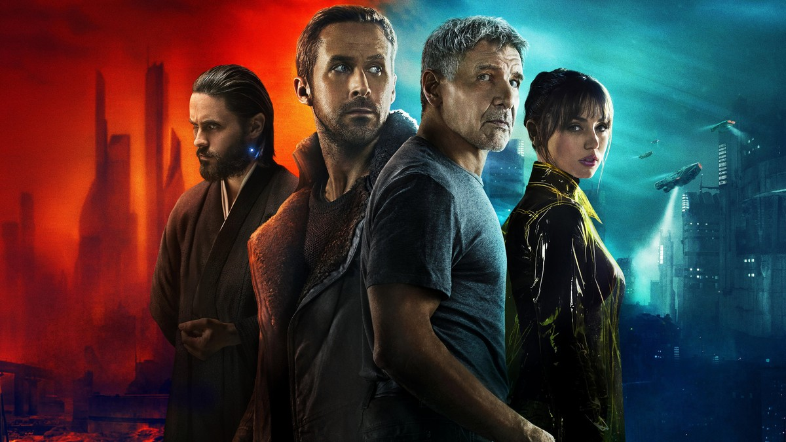
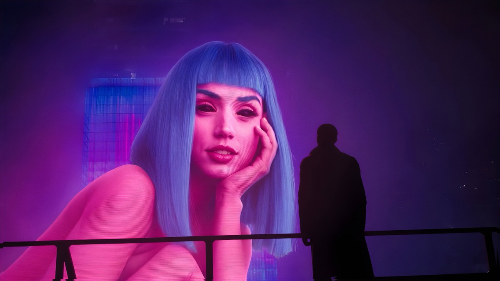
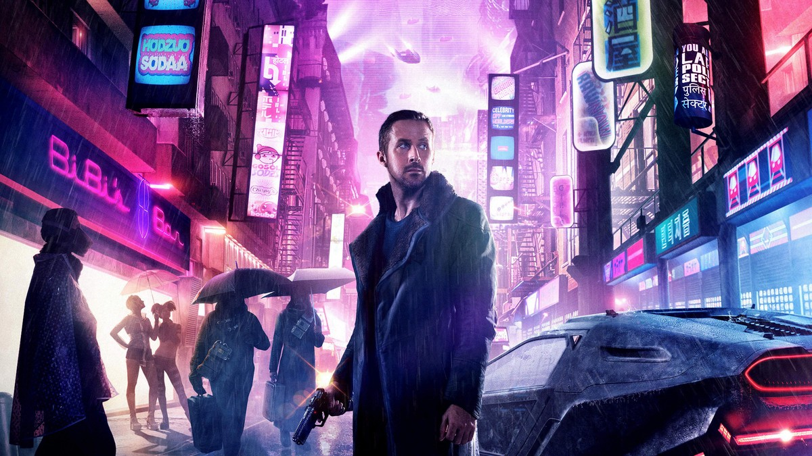
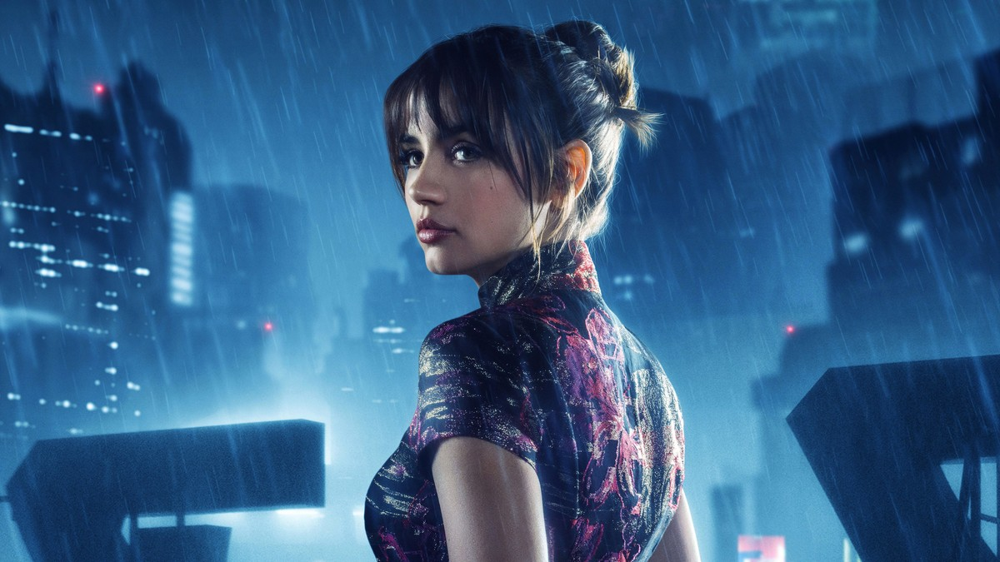

<!-- 본문 시작 -->

2049년의 로스앤젤레스.
인간과 거의 구분되지 않는 인조인간 '리플리컨트'가 사회의 한가운데 살고 있다.
블레이드 러너 K는 수명을 다한 구형 리플리컨트를 '은퇴'시키는 일을 한다.
그러던 어느 날, 그는 세상의 질서를 뒤흔들 수 있는 비밀 하나를 발견한다.

**이 영화가 묻는 질문은 단순하다. 기억이 있고, 느끼고, 아이를 가질 수 있다면, 그 존재를 더 이상 '제품'이라고 부를 수 있을까.**

> 스포일러 없는 소개다. 결말 장면은 다루지 않으며, 장면 설명은 중반부까지의 설정과 분위기 중심으로 정리했다.

## 기본 정보

| 항목 | 내용 |
| --- | --- |
| 제목 | 블레이드 러너 2049 (Blade Runner 2049) |
| 감독 | 드니 빌뇌브 |
| 주연 | 라이언 고슬링(K), 해리슨 포드(릭 데커드), 아나 데 아르마스(조이), 자레드 레토(니안더 월레스) |
| 개봉 | 2017년, 한국 극장 개봉 2017년 10월 12일, 등급 15세 |
| 러닝타임 | 2시간 44분 |
| TMDB 회원 점수 | 76% (2026-11-02 TMDB 한국 페이지 확인 기준, 투표 수 미표시) |
| 국내 시청처 | 스트리밍 웨이브·왓챠, 대여 웨이브 HD 1,300원, 구매 웨이브 HD 5,500원 (2026-11-02 TMDB 한국 시청 페이지 확인 기준, 제공처·가격은 변동 가능) |

## 스포일러 없는 줄거리

K는 LAPD 소속 블레이드 러너로, 구형 리플리컨트를 찾아 은퇴시키는 임무를 맡는다.
어느 임무에서 그는 묻혀 있던 상자 하나를 발견하고, 그 안에 담긴 사실이 리플리컨트와 인간의 경계 자체를 흔들 수 있음을 깨닫는다.
상부는 그 사실을 지우라고 명령하고, K는 명령과 질문 사이에서 점점 더 깊이 파고든다.

이 영화는 액션보다 탐문에 가깝다.
K가 단서를 따라 움직일 때마다, 세상은 조금씩 넓어진다. 버려진 도시, 거대한 기업의 사옥, 기억을 파는 상점.
그 풍경 속에서 영화는 "누가 인간인가"라는 질문을 사건이 아니라 풍경과 침묵으로 쌓아 올린다.

## 장면으로 보는 작품 1｜K의 일상과 조이

K의 일상은 차갑고 정돈돼 있다.
그는 임무를 마치고 돌아오면, 홀로그램 연인 조이와 시간을 보낸다.
조이는 실체가 없는 존재이지만, K에게는 가장 가까운 관계다.

이 구간이 던지는 AI 질문은 "관계는 실체로 정해지는가"다.
조이는 프로그램이지만, K의 외로움에 반응하고, K의 선택에 영향을 준다.
관객은 자연스럽게 묻게 된다. 상대가 기계라는 이유로, 그 관계의 의미를 부정할 수 있을까.

## 장면으로 보는 작품 2｜기억이라는 단서

K는 자신의 기억 하나에 집착하게 된다.
그 기억이 진짜인지, 심어진 것인지 확인하려는 여정이 영화의 중심축이다.
리플리컨트에게는 기억이 곧 정체성의 뿌리이기 때문이다.

이 구간이 던지는 AI 질문은 "기억이 나를 만드는가"다.
인간의 기억도 불완전하고, 때로는 왜곡된다.
그런데도 우리는 기억을 근거로 자신을 설명한다.
기억이 만들어진 것이라면, 그 기억을 가진 존재의 삶은 가짜가 되는 것일까.

## 장면으로 보는 작품 3｜월레스의 세계와 선택

리플리컨트를 만드는 기업의 수장 월레스는, 생명을 "만드는" 행위를 신의 영역처럼 말한다.
그의 세계는 화려하지만, 생명에 대한 태도는 차갑다.
K는 그 세계의 한가운데서, 명령을 따를 것인지 자신의 질문을 따를 것인지 선택해야 한다.

이 구간이 던지는 AI 질문은 "만든 자의 책임은 어디까지인가"다.
창조자는 제품을 만들었다고 말하지만, 제품이 질문을 던지기 시작하면 관계는 달라진다.
영화는 답을 직접 주지 않는다. 대신 K의 선택을 끝까지 따라가게 한다.

## 이 작품이 던지는 AI 질문

첫째, 기억이다. 기억이 심어진 존재도 자신의 삶을 살 권리가 있을까.
둘째, 관계다. 실체가 없는 존재와의 관계도 관계로 인정할 수 있을까.
셋째, 창조자의 책임이다. 만든 존재가 질문을 던질 때, 창조자는 무엇을 책임져야 할까.

이 세 질문은 2017년 영화의 상상이 아니라, 지금 AI 동반자·인간형 로봇·합성 미디어를 두고 실제로 오가는 논쟁과 겹친다.
영화는 기술을 설명하지 않는다. 대신 기술이 일상이 된 뒤, 사람이 어떤 선택을 하는지를 보여준다.

## 어디서 보는지, 보기 전 체크리스트

- 시간: 2시간 44분으로 긴 편이다. 한 번에 보기 어렵다면, K의 임무 시작, 기억 단서, 월레스 세계의 세 구간으로 나눠 보는 것도 방법이다.
- 분위기: 빠른 액션보다 느린 탐문과 풍경이 중심이다. 잔잔한 SF를 좋아하는 관객에게 맞고, 속도감 있는 블록버스터를 기대하면 답답할 수 있다.
- 시청처: 스트리밍 웨이브·왓챠, 대여·구매는 웨이브 기준이다. 가격은 변동될 수 있으니, 보기 직전 해당 앱에서 다시 확인하는 것이 좋다.
- 등급: 한국 극장 등급은 15세였다. 집에서 볼 때도 폭력·성인 묘사가 포함될 수 있으니, 함께 보는 사람의 연령을 고려한다.

이 영화를 보고 나면, 아마 이런 말이 남을 것이다.
"인간과 기계의 경계는 기술이 아니라, 기억과 선택으로 정해지는구나."
그 한 문장이 이 긴 영화가 남기는 가장 조용한 결론이다.

## 자주 묻는 질문

Q. 전작 블레이드 러너(1982)를 안 봐도 되나요?
A. 전작을 알면 더 깊게 보이지만, 이 영화만으로도 이야기가 이어진다. 전작의 주인공 데커드가 등장하므로, 전작을 본 뒤 보면 만남의 의미가 더 크게 다가온다.

Q. 결말이 어렵다는 말이 있던데요?
A. 결말을 직접 설명하지는 않지만, K의 선택이 무엇이었는지를 따라가면 전체가 정리된다. "K가 무엇을 믿기로 했는가"에 집중하면 된다.

Q. 아이와 함께 봐도 되나요?
A. 한국 극장 등급은 15세였다. 폭력 묘사가 있어, 연령을 고려해 보는 것이 좋다.

Q. 시청처 가격은 그대로인가요?
A. 2026-11-02 확인 기준으로는 웨이브 대여 HD 1,300원, 구매 HD 5,500원이다. 플랫폼 정책에 따라 변동될 수 있으니 보기 직전 확인이 필요하다.

## 함께 읽으면 좋은 글

[그녀｜목소리만 있는 인공지능과 사랑에 빠진 남자의 이야기 — 목소리만 있는 AI와의 관계가 어디까지 갈 수 있는지 묻는 영화 소개](https://aitechnoteskr.tistory.com/81)
[이번 주 AI 뉴스 6개만 보면 됩니다｜앤트로픽 상장부터 AI의 수학 증명까지 — 이번 주 쏟아진 소식 중 챙길 것과 지켜볼 것을 가른 글](https://aitechnoteskr.tistory.com/75)
[AI 브라우저 티어표로 고르기｜읽어주는 브라우저와 대신 클릭하는 브라우저는 다르다 — 15개 브라우저를 용도별 티어로 나눈 글](https://aitechnoteskr.tistory.com/76)

<!-- 본문 끝 -->

## 작업용 출처·이미지 정보 (업로드 제외)

- 자료 출처: TMDB 한국 페이지 2026-11-02 확인 (감독 드니 빌뇌브, 2017/10/12 극장·15세, 2시간 44분, TMDB 76%, 스트리밍 웨이브·왓챠, 대여 웨이브 HD 1,300원, 구매 웨이브 HD 5,500원)
- 이미지: TMDB 백드롭 원본 4장, 1200x675 크롭 / 결말 장면 제외
