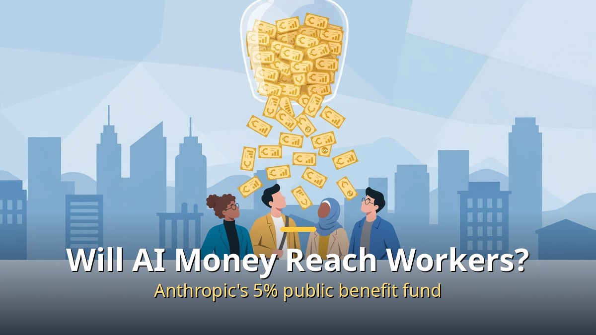
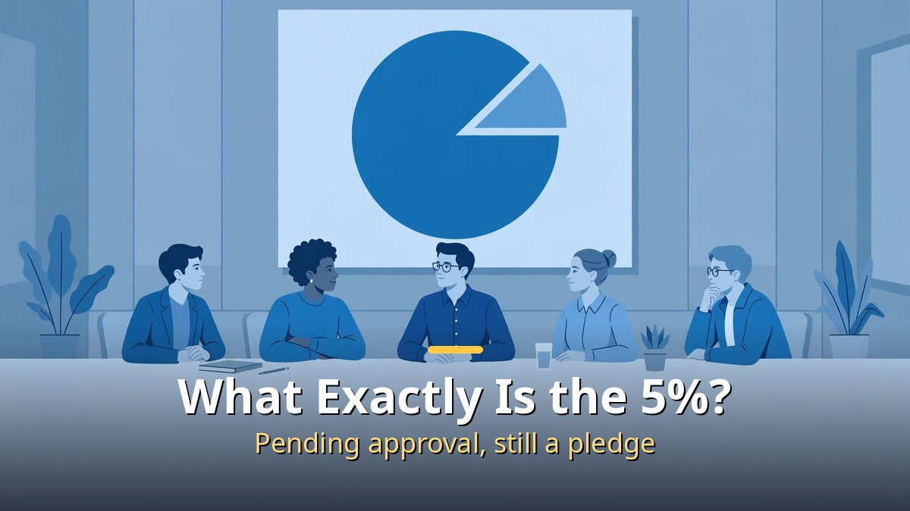
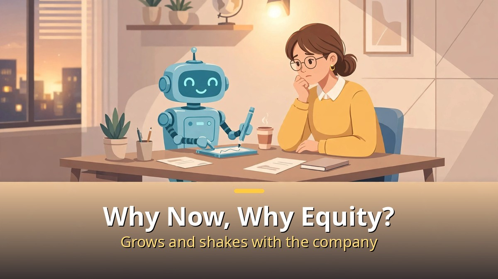

<!-- 본문 시작 -->

AI company Anthropic says it will put 5% of its shares into a public benefit fund.
The announcement came on October 18, 2026.
No money has been paid to anyone yet.

**The key point is this. This is not just a promise to donate. It is a structure that places the company's own equity into a vehicle for public benefit. But when, to whom, and by what rules the money will flow are still undecided.**

> On October 18, 2026, Anthropic announced the Anthropic Public Benefit Fund. Subject to stockholder approval, 5% of the company's shares would go to the fund, with more shares added at the board's discretion as the company's value rises. The fund is a limited liability company wholly owned by Anthropic, and its equity may not be used for lobbying or political donations.

## What exactly is the 5%?

The starting point is 5% of the company's shares.
Stockholder approval is a precondition.
Before approval, it is a pledge, not a done deal.

The value is still a paper figure.
At the $965 billion valuation set in the Series H round announced May 28, 2026, 5% works out to about $48 billion.
Once shares trade publicly, that number will move with the stock price.
Equity pays no one's bills until it is sold for cash.

A growth mechanism was announced alongside it.
For every 50% rise in value above a baseline, the board may add another 2% of equity at its discretion.
The IPO prospectus (S-1) made public on October 26 reportedly sets the first baseline at the IPO price, with 846,840,960 shares going to the fund.
Publishing the baseline is progress, but the top-up is a board decision, not an automatic transfer.

The fund's form also matters.
It is not a traditional nonprofit foundation but an LLC wholly owned by Anthropic.
Its equity is barred from lobbying and political donations.
Yet the body that decides who qualifies stays close to the company.
Whether the criteria are published and auditable from outside will decide what this pledge becomes.

## Why now, and why equity?

The background is a warning from Anthropic CEO Dario Amodei.
In May 2025, he warned that AI could wipe out half of all entry-level white-collar jobs within five years.
The concern is that technology changes jobs faster than institutions can cushion the blow.

Anthropic has already put $200 million into research on this problem through its Economic Futures Research Fund, covering topics such as modernizing income support for displaced workers and giving workers a stake in AI-driven growth before disruption arrives.
The new fund goes further: it prepares a vehicle that can actually distribute money.

Equity was chosen for a simple reason.
If the company grows, the fund grows with it.
A fixed cash donation stops at its amount, while shares move with the company's value.
The reverse is also true: if the company stumbles, the fund's resources shrink with it.
A resource that is large in good times and small in bad times should not be described as a guaranteed safety net.

The founders' personal pledges add context.
Anthropic's seven co-founders have already pledged to give away 80% of their personal shares.
Together with the company's 5% and an employee donation-matching program, roughly 20% of the company's total shares are reportedly earmarked for public benefit.
That 20% is a sum of separate commitments under different conditions, not a statement that the whole company has become a public-benefit entity.

## When, to whom, and what to watch

Almost nothing is settled yet.
Eligibility, timing, and payment methods are all undisclosed.
Anthropic says more details will come in the next few months.
Direct payments to specific populations were named as a possible use, alongside donations and nonprofit support — possible, not confirmed.

The IPO timetable is moving in parallel.
Anthropic published its IPO filing in early November, and on November 2 a filing showed up to 552.9 billion yen (about $3.5 billion) in shares for Japanese investors.
Reports say formal IPO marketing could start in the week of November 9, aiming to list before Thanksgiving in the United States.
As the listing advances, the fund pledge will face two gates in turn: the stockholder vote and the market's reaction.

The filing also revealed the governance design.
The seven co-founders reportedly hold 50.1% of ordinary shareholder voting power through a single special share held by an LLC.
Outside money comes in, but control stays with the founders.
How that board, which decides the fund's top-ups, interacts with this control structure is something to watch.

| What to watch | Current status | Why it matters |
| --- | --- | --- |
| Stockholder approval | Precondition, not yet approved | Without it, the pledge stays a promise |
| Eligibility and timing | Undisclosed, details expected within months | The company decides who counts |
| Additional shares | 2% per 50% rise, at board discretion | Not automatic |
| Fund form | Company-owned LLC, lobbying and political donations barred | Outside auditing is the open question |
| Resource type | Equity, moves with the share price | Unlike cash, it fluctuates |

There is no application page and no application process right now.
So the conclusion of this article is not "should we hope?" but "what must be confirmed before hoping?"
Stockholder approval, published eligibility criteria, and a first actual distribution — when those three arrive in order, the promise becomes an institution.
Until then, the accurate description is not that capitalism has been changed, but that a new vessel for sharing money inside capitalism has been built.

## Frequently asked questions

Q. How much money is 5%?
A. About $48 billion at the Series H valuation. That is the paper value of unsold shares and will change with the share price after listing.

Q. Can I apply now?
A. No. Eligibility and timing have not been published, and there is no application process.

Q. Is the fund a nonprofit foundation?
A. No. It is a limited liability company wholly owned by Anthropic, barred from lobbying and political donations.

Q. Does the fund grow automatically as the company grows?
A. Only partly. Another 2% may be added for each 50% rise in value, but that is at the board's discretion, not automatic.

Q. Is this different from the founders' personal pledges?
A. Yes. The seven founders' pledge of 80% of their personal shares is separate. The roughly 20% figure combines that with the company's 5% and employee matching.

## Recommended reading

[Blade Runner 2049｜A Replicant with Memories Asks What Makes Us Human — a film about a replicant with memories questioning the standard of humanity](https://aitechnotesen.blogspot.com/2026/11/blade-runner-2049a-replicant-with.html)
[Hand Claude a Script and a Drama Comes Out?｜The Automated AI Drama Workflow Claude Designed — from script to Shorts to long-form AI drama production](https://aitechnotesen.blogspot.com/2026/11/hand-claude-script-and-drama-comes.html)
[How to Use Claude Changed｜Four Updates: Code, Browser, Files, and Plan Mode — four changes in code, browser, files, and plan mode](https://aitechnotesen.blogspot.com/2026/11/how-to-use-claude-changedfour-updates.html)

If you want to keep following this story, subscribe. Stockholder approval, published eligibility criteria, and the first distribution will be covered here as they arrive.

<!-- 본문 끝 -->

## 작업용 출처·이미지 정보 (업로드 제외)

- 자료 출처: TheAIGRID 영상 zadg3dWaMts(2026-11-02, 24:57, 설명 기준) + 앤트로픽 공익기금 보도(S-1·시리즈H 기준) 대조
- 이미지: images/01-hero-en.jpg ~ 04-img3-en.jpg / 자작 일러스트 + 영어 배너 오버레이 (1200x675)
