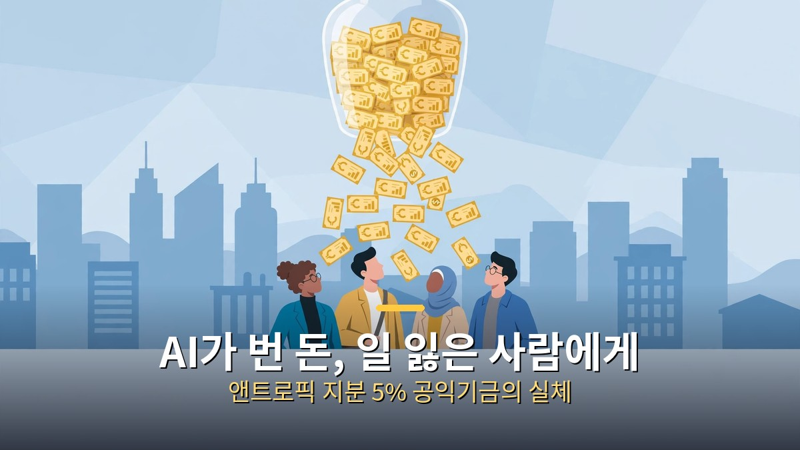
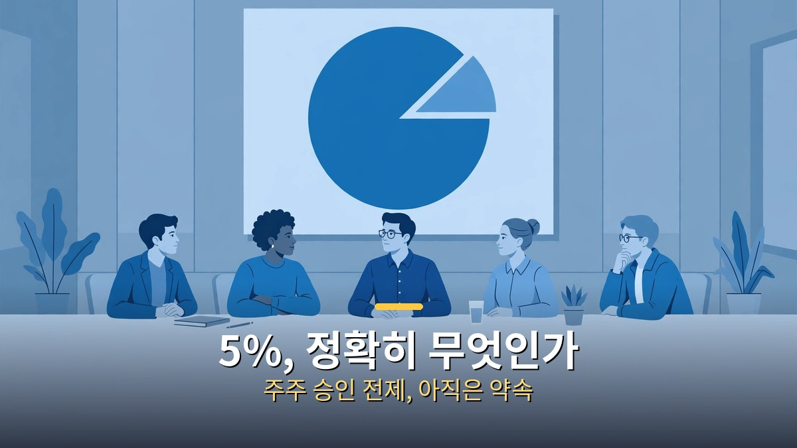
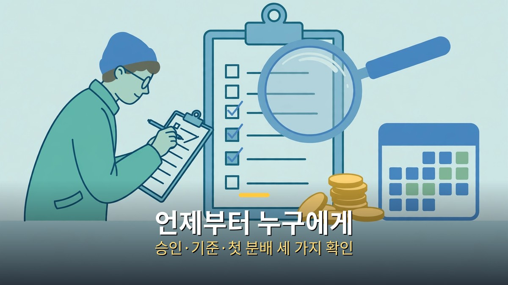

<!-- 본문 시작 -->

AI 회사 앤트로픽이 자사 지분 5%를 공익기금에 내놓겠다고 발표했다.
발표일은 2026년 10월 18일이다.
아직 돈이 누군가에게 지급된 것은 아니다.

**핵심은 이것이다. 이번 발표는 "기부하겠다"는 말이 아니라, 회사 지분 자체를 공익 목적의 그릇에 넣어두겠다는 구조다. 다만 그 그릇이 언제, 누구에게, 어떤 기준으로 돈을 줄지는 아직 정해지지 않았다.**

> 앤트로픽은 2026년 10월 18일 앤트로픽 공익기금(Anthropic Public Benefit Fund)을 만들었다고 밝혔다. 주주 승인을 전제로 회사 지분 5%를 이 기금에 넘기고, 회사 가치가 오르면 이사회 재량으로 지분을 더 보태는 방식이다. 기금은 앤트로픽이 전적으로 소유한 유한책임회사(LLC)이며, 로비나 정치 헌금에는 쓸 수 없다고 했다.

## 앤트로픽이 내놓은 5%, 정확히 무엇인가

기금의 출발점은 지분 5%다.
주주 승인이 전제 조건이다.
승인이 나기 전에는 약속 단계로 봐야 한다.

지분 가치는 아직 종이에 적힌 숫자다.
2026년 5월 28일 발표된 시리즈 H 라운드의 기업가치 9,650억 달러를 기준으로 계산하면 5%는 약 480억 달러가 된다.
상장 후 주가가 오르내리면 이 숫자도 함께 움직인다.
지분을 팔아 현금으로 바꾸기 전에는 누구의 생활비도 되지 않는다.

기금이 커지는 장치도 함께 발표됐다.
회사 가치가 기준선보다 50% 오를 때마다 이사회 재량으로 지분 2%를 추가로 보탤 수 있다.
10월 26일 공개된 상장 서류(S-1)에서는 첫 기준선이 상장 가격이며, 기금에 들어갈 주식 수가 8억 4,684만 960주로 적혀 있다고 전해졌다.
기준선을 공개했다는 점은 진전이지만, 추가분이 자동으로 쌓이는 것이 아니라 이사회 결정에 달렸다는 점은 분명히 해둘 필요가 있다.

기금의 형태도 눈여겨볼 대목이다.
전통적인 비영리 재단이 아니라 앤트로픽이 전적으로 소유한 LLC다.
로비와 정치 헌금에는 기금 지분을 쓸 수 없도록 못 박았다.
대신 수급 대상과 기준을 정하는 주체도 결국 회사 쪽에 가깝다.
"누가 도움을 받을 자격이 있는가"를 회사가 정한다면, 그 기준이 공개되고 외부에서 검증될 수 있는지가 관건이 된다.

## 왜 지금, 왜 지분인가

배경에는 앤트로픽 최고경영자 다리오 아모데이의 경고가 있다.
그는 2025년 5월, AI가 5년 안에 초급 사무직 일자리의 절반을 없앨 수 있다고 경고했다.
회사가 만드는 기술이 일자리를 바꾸는 속도가, 그 피해를 메우는 제도보다 빠를 수 있다는 문제의식이다.

앤트로픽은 이미 일자리 문제에 2억 달러를 연구 기금으로 내놓은 바 있다.
경제 미래 연구 기금(Economic Futures Research Fund)으로, AI로 일자리를 잃은 사람을 위한 소득 지원 현대화와 사전적 지분 참여 같은 주제를 다룬다고 한다.
이번 공익기금은 그 연구를 넘어, 실제 돈을 나눌 수 있는 그릇을 미리 만들어두겠다는 성격이 강하다.

지분을 택한 이유는 단순하다.
회사가 커지면 기금도 함께 커지기 때문이다.
현금으로 일정 금액을 기부하면 그 액수에서 멈추지만, 지분은 회사 가치와 함께 움직인다.
반대로 회사가 흔들리면 기금의 재원도 함께 줄어든다는 뜻이기도 하다.
좋을 때는 크고, 나쁠 때는 작아지는 재원이라는 점을 빼놓고 말하면 안 된다.

창업자들의 개인 약속도 함께 보면 그림이 넓어진다.
앤트로픽 창업자 7명은 개인 지분의 80%를 기부하겠다고 이미 약속한 바 있다.
여기에 회사 지분 5%와 직원 기부 매칭 프로그램을 합치면, 공익 목적으로 묶인 지분이 전체의 약 20%에 이른다고 전해졌다.
이 20%라는 숫자는 "회사 전체가 공익이 됐다"는 뜻이 아니다.
개인 약속과 회사 약속, 매칭 프로그램이 각자 다른 조건으로 묶인 합산이라는 점을 구분해서 봐야 한다.

## 언제부터 누구에게, 무엇을 확인해야 하나

지금 단계에서 확정된 것은 거의 없다.
수급 자격, 지급 시기, 지급 방식은 모두 미공개다.
앤트로픽은 세부 내용이 앞으로 몇 달 안에 나올 것이라고 밝혔다.
직접 지급이 거론된 것은 맞지만, "직접 지급을 한다"고 확정된 것은 아니다.
기부금, 비영리 단체 지원, 특정 집단에 대한 직접 분배 등이 가능한 용도로 함께 언급됐다.

상장 일정도 함께 움직이고 있다.
앤트로픽은 11월 초 미국 증권거래위원회에 상장 서류를 공개했고, 11월 2일에는 일본 투자자에게 최대 5,529억 엔(약 35억 달러) 규모의 주식을 판매한다는 서류가 나왔다.
11월 9일 주부터 본격적인 상장 마케팅이 시작돼 추수감사절 전에 상장하는 것을 목표로 한다는 보도도 있다.
상장이 진행될수록 기금 약속은 주주 승인과 시장 반응이라는 두 관문을 차례로 만나게 된다.

상장 서류에서 또 하나 확인된 것은 지배 구조다.
창업자 7명은 특수 주식 1주를 통해 보통주 의결권의 50.1%를 쥐는 구조로 알려졌다.
외부 자금은 받되 경영권은 창업자에게 남기는 설계다.
공익기금의 기준을 정하는 이사회와 이 지배 구조가 어떻게 맞물리는지는 앞으로 지켜볼 대목이다.

| 확인할 것 | 현재 상태 | 왜 중요한가 |
| --- | --- | --- |
| 주주 승인 | 전제 조건, 아직 승인 전 | 승인 없으면 약속에 머문다 |
| 수급 기준·시기 | 미공개, 수개월 내 발표 예고 | 누가 받는지 회사가 정한다 |
| 추가 지분 | 가치 50% 상승마다 이사회 재량 2% | 자동이 아니라 결정 사항이다 |
| 기금 형태 | 회사 소유 LLC, 로비·정치 헌금 금지 | 외부 감시 장치가 있는지가 관건 |
| 재원 성격 | 지분이라 주가와 함께 변동 | 현금 기부와 달리 흔들린다 |

독자가 지금 할 수 있는 일은 많지 않다.
신청 페이지도, 수급 신청 방법도 없다.
그래서 이 글의 결론은 "기대해도 되는가"가 아니라 "무엇이 정해지면 기대해도 되는가"다.
주주 승인이 났는지, 수급 기준이 공개됐는지, 첫 분배가 실제로 이뤄졌는지, 세 가지가 차례로 확인될 때 비로소 약속은 제도가 된다.
그전까지는 자본주의를 바꾼다는 제목보다, 자본주의 안에서 돈을 나누는 새로운 그릇을 만들었다는 사실 자체가 정확한 표현이다.

## 자주 묻는 질문

Q. 5%면 얼마나 큰돈인가요?
A. 시리즈 H 기업가치 기준으로 약 480억 달러라는 계산이 나온다. 다만 아직 팔지 않은 지분의 종이 가치이며, 상장 후 주가에 따라 달라진다.

Q. 지금 신청하면 받을 수 있나요?
A. 아니다. 수급 자격과 지급 시기는 아직 공개되지 않았다. 신청 방법도 나와 있지 않다.

Q. 기금은 비영리 재단인가요?
A. 아니다. 앤트로픽이 전적으로 소유한 유한책임회사(LLC)다. 로비와 정치 헌금에는 쓸 수 없도록 했다.

Q. 회사 가치가 오르면 기금도 자동으로 커지나요?
A. 절반만 맞다. 가치 50% 상승마다 지분 2%를 더 보탤 수 있지만, 이사회 재량 사항이라 자동 적립이 아니다.

Q. 창업자 개인 기부와는 다른 건가요?
A. 다르다. 창업자 7명의 개인 지분 80% 기부 약속은 별개이며, 회사 지분 5%와 직원 기부 매칭을 합쳐 약 20%라는 합산 수치가 전해졌을 뿐이다.

## 함께 읽으면 좋은 글

[기억을 가진 인조인간｜블레이드 러너 2049가 묻는 인간의 기준 — 기억을 가진 인조인간이 인간의 기준을 묻는 영화 소개](https://aitechnoteskr.tistory.com/87)
[대본만 주면 드라마가 나온다고?｜클로드가 짠 AI 드라마 자동화 워크플로우 — 대본부터 쇼츠, 롱폼까지 이어지는 AI 드라마 제작 흐름](https://aitechnoteskr.tistory.com/86)
[클로드 한 달 업데이트 4가지｜코드·브라우저·파일·계획 모드, 뭐가 달라졌나 — 코드·브라우저·파일·계획 모드 네 가지 변화 정리](https://aitechnoteskr.tistory.com/84)

이 주제를 계속 따라가려면 이웃 추가를 눌러두세요. 주주 승인, 수급 기준 공개, 첫 분배 소식이 나올 때마다 같은 자리에서 이어서 정리하겠습니다.

<!-- 본문 끝 -->

## 작업용 출처·이미지 정보 (업로드 제외)

- 자료 출처: TheAIGRID 영상 zadg3dWaMts(2026-11-02, 24:57, 설명 기준) + 앤트로픽 공익기금 보도(S-1·시리즈H 기준) 대조
- 이미지: images/01-hero.jpg ~ 04-img3.jpg / 자작 일러스트 + 한글 배너 오버레이 (1200x675)
