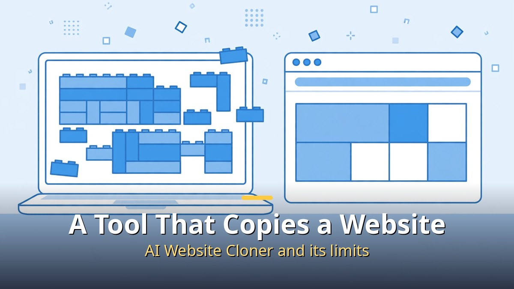
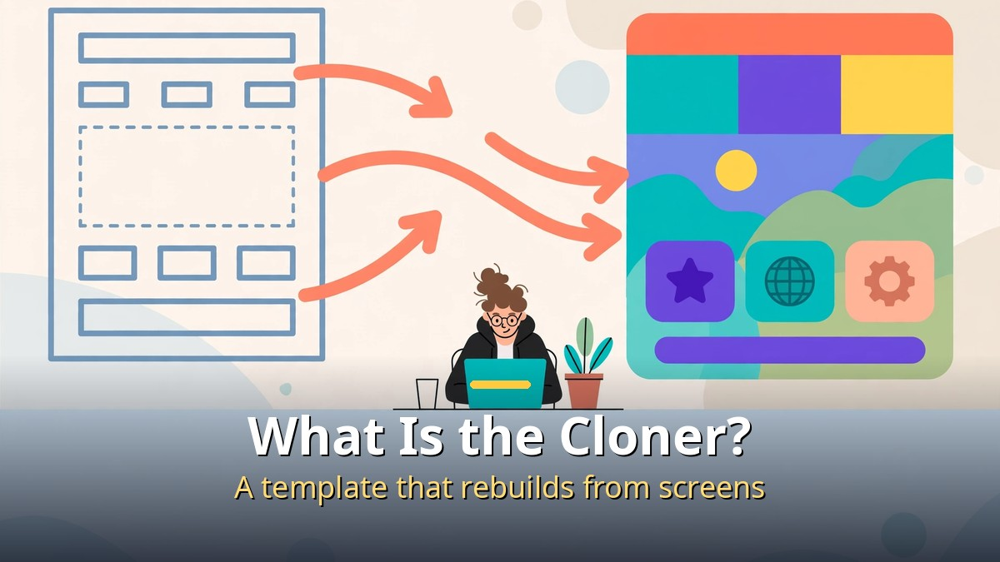
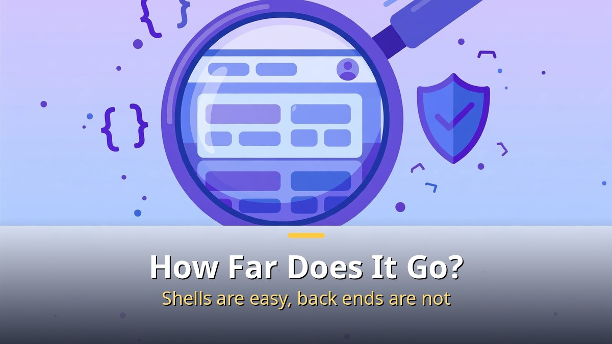
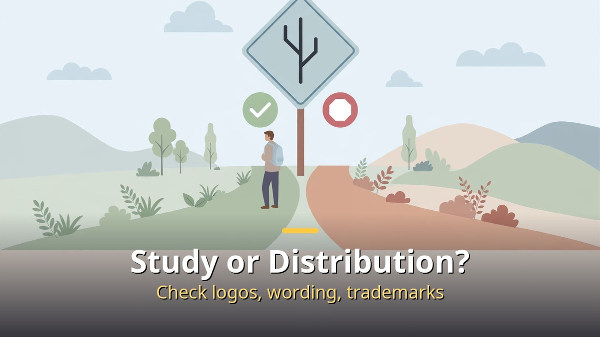

<!-- 본문 시작 -->

Give it one website address, and an AI coding agent builds a new website that looks like it.
The tool is called the AI Website Cloner Template.
News of its 37,000-plus GitHub stars spread with a 48-second short video.

**The key point is this. This tool does not "copy and take" someone else's site. It is a template that shows how to rebuild what you can see. If you miss the line between studying and distributing, a convenient tool can become an infringement.**

> The AI Website Cloner Template is an open source template that lets an AI coding agent recreate a website as a clean Next.js app from a URL. According to its repository description, it uses Next.js 16, App Router, React 19, and TypeScript strict mode, and includes an agent skill readable by Claude Code, Codex, Cursor, and OpenCode.

## What is the AI Website Cloner?

The workflow is simple to describe.
You take the template repository and give an AI coding agent a target website address.
The agent studies the site's layout, structure, and flows, then writes new code that performs the same functions.
It does not take the original site's code. It looks at what is visible and rebuilds it.

The result is a Next.js app.
That is a common modern web stack, so the result fits naturally into editing and deployment workflows.
The template includes a skill file with the procedure the agent should follow.
So the quality of the result depends less on which agent you use and more on which procedure it follows.

The example in the video is a recreation of the Supabase homepage.
Supabase is an open source backend platform built around Postgres, offering authentication, APIs, and realtime features.
Recreating the homepage means reproducing its appearance, not cloning its database or authentication servers.
Confusing appearance with the real service leads to overestimating what the tool can do.

Star counts need care too.
The video cites 37,000 stars, while a repository listing shows 38,420.
Stars change with time, so either number is only a snapshot of the moment.
Many stars mean much attention, not a guarantee of quality or legality.

## How it works, and how far it goes

Broken into steps, the flow is this.
First, pick a target site.
Second, the agent analyzes the screens and organizes components and flows.
Third, it writes new code in a Next.js project structure.
Fourth, you run the result and fix broken layouts or flows.

What works well and what does not are easy to separate.
Static landing pages, dashboard-style layouts, buttons, and input fields are relatively easy to reproduce.
Back-end functions such as logged-in personal data, payments, and realtime collaboration cannot be reproduced from appearance alone.
A screen-based rebuild starts as a similar-looking shell, and functions must be added one by one.

The license must be checked in the repository itself.
The video description mentions the Apache license, while a repository listing mentions MIT.
This article does not settle the question because the repository's license file is the final authority.
Before using the tool, open the license file and check the terms for commercial use and redistribution.

It should also be distinguished from REA.
REA is a reverse-engineering tool that analyzes a program's inner workings and hands them to an AI agent, mainly for desktop apps or executables.
The AI Website Cloner is a template for rebuilding web apps from website screens.
Both get described as "copying an app whole," but their targets and methods differ.
Change the tool's name, and what it can do changes too.

## Study versus distribution: where is the line?

The most important question is this.
"Can I publish it because I made it?" The answer depends on what you made.
Recreating your own site, an openly licensed site, or a site you have permission to study is close to study.
Publishing a copy of someone else's service, with its logos, wording, and photos, or distributing it as if it were that service, is a different matter.

A checklist helps.
First, is the target yours or permitted?
Second, did you avoid copying logos, trademarks, photos, and wording as they are?
Third, does your name or domain avoid confusion with the original?
Fourth, did you touch no real user accounts, payments, or personal data?
If any answer is no, stop before public distribution and check again.

| Category | Fine for study | Stop before distributing |
| --- | --- | --- |
| Target | Your site, open license, permitted site | Commercial service without permission |
| Screen elements | Structure and flows rewritten anew | Logos, photos, wording copied as they are |
| Name and domain | A name not confused with the original | A name that looks like the original |
| Functions | Appearance recreated with dummy data | Real accounts, payments, personal data connected |

The template still has a genuinely useful place.
When rebuilding your own service's landing page, it can help to study a well-made site's structure and rewrite it with your own wording and design.
For a portfolio, you can document the process: "I saw this screen and implemented it this way."
Even then, do not capture the original screen and present it as your own work.
State what you referenced and keep your work visibly separate from the original.

In short, the AI Website Cloner is closer to a "practice workbook for rebuilding" than a "copy machine."
Behind the convenience of a single command lies a responsibility: to be clear about what you referenced and what you created anew.
With that responsibility clear, the tool becomes a good textbook for learning web development.

## Frequently asked questions

Q. Does it take the original site's code as it is?
A. No. It writes new code from what is visible on screen. Back-end functions are not reproduced.

Q. Can I publish the result right away?
A. It depends on the target and the elements. If it is not your site or a permitted site, remove logos, wording, and photos, avoid confusion with the original, and judge again.

Q. Can I use it without knowing how to code?
A. Starting is easy, but fixing and deploying the result requires Next.js and basic web structure. Practice running and editing first.

Q. Is it the same tool as REA?
A. No. REA analyzes a program's internals, while this template rebuilds web apps from website screens.

Q. How do I check the license?
A. Open the license file in the repository. When the video description and a listing disagree, the original file wins.

## Recommended reading

[Blade Runner 2049｜A Replicant with Memories Asks What Makes Us Human — a film about a replicant with memories questioning the standard of humanity](https://aitechnotesen.blogspot.com/2026/11/blade-runner-2049a-replicant-with.html)
[Hand Claude a Script and a Drama Comes Out?｜The Automated AI Drama Workflow Claude Designed — from script to Shorts to long-form AI drama production](https://aitechnotesen.blogspot.com/2026/11/hand-claude-script-and-drama-comes.html)
[How to Use Claude Changed｜Four Updates: Code, Browser, Files, and Plan Mode — four changes in code, browser, files, and plan mode](https://aitechnotesen.blogspot.com/2026/11/how-to-use-claude-changedfour-updates.html)

If you want to keep following this topic, subscribe. New AI tools and the standards for using them safely will be covered here as they arrive.

<!-- 본문 끝 -->

## 작업용 출처·이미지 정보 (업로드 제외)

- 자료 출처: 성공지식백과 영상 VFuBfbgz2No(2026-11-02, 48초, 설명 기준: AI Website Cloner, 수파베이스 홈페이지 재현, 별 3.7만) + 저장소 목록 대조(라이선스 표기 상이로 원문 확인 명시)
- 이미지: images/01-hero-en.jpg ~ 04-img3-en.jpg / 자작 일러스트 + 영어 배너 오버레이 (1200x675)
