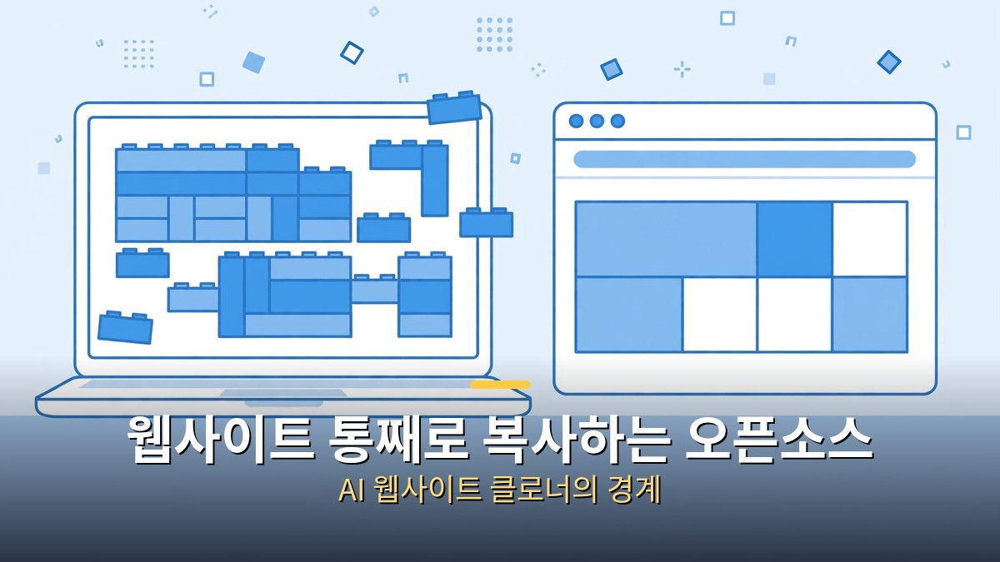
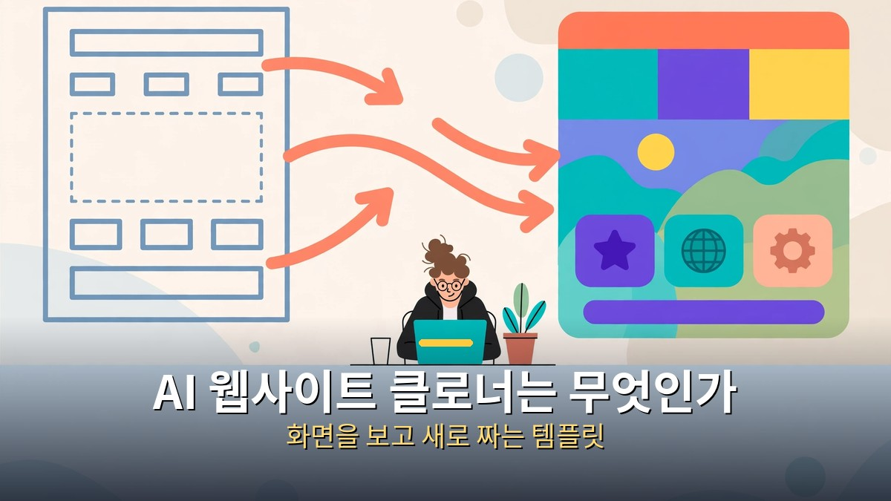
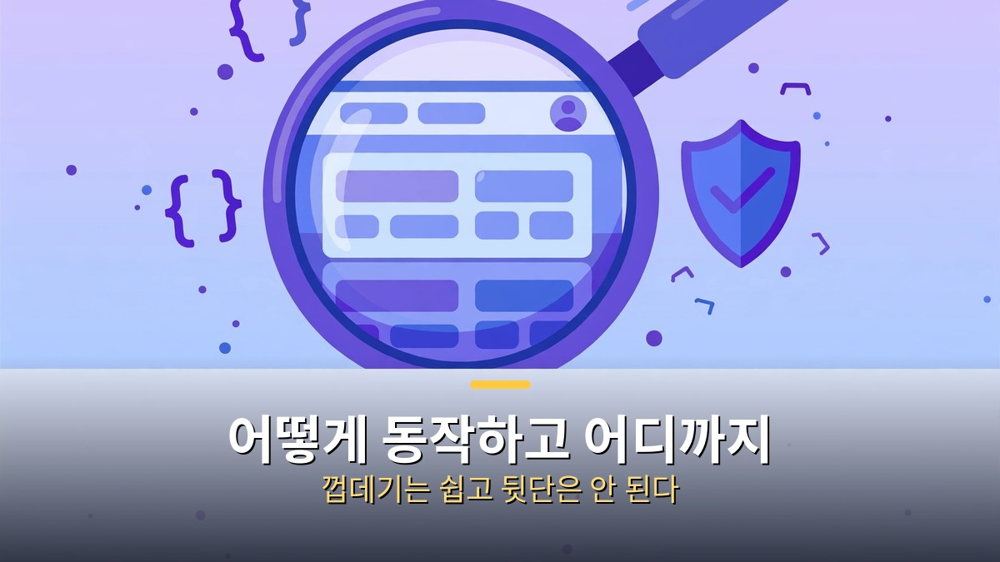
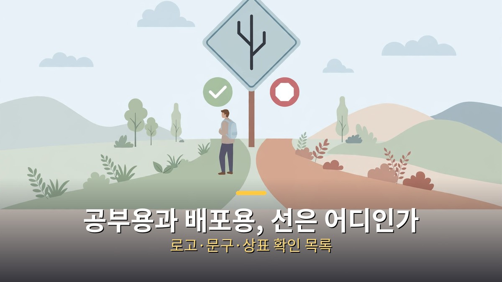

<!-- 본문 시작 -->

웹사이트 주소를 하나 주면, AI 코딩 에이전트가 그 사이트를 닮은 새 웹사이트를 만들어준다.
이 도구의 이름은 AI 웹사이트 클로너 템플릿이다.
깃허브 별이 3만 7천 개를 넘었다는 소식이 48초짜리 짧은 영상과 함께 퍼졌다.

**핵심은 이것이다. 이 도구는 남의 사이트를 "복사해 가져오는" 도구가 아니라, 보이는 화면을 보고 새로 짜는 방법을 알려주는 템플릿이다. 공부용과 배포용의 경계를 모르면, 편리한 도구가 권리 침해로 이어질 수 있다.**

> AI 웹사이트 클로너 템플릿은 AI 코딩 에이전트에게 웹사이트 주소를 주고, 그 사이트를 깨끗한 Next.js 앱으로 다시 만드는 오픈소스 템플릿이다. 저장소 설명에 따르면 Next.js 16, 앱 라우터, 리액트 19, 타입스크립트 엄격 모드를 쓰며, 클로드 코드, 코덱스, 커서, 오픈코드에서 바로 읽을 수 있는 에이전트 스킬을 포함한다.

## AI 웹사이트 클로너는 무엇인가

작동 방식은 단순하게 설명할 수 있다.
사용자가 템플릿 저장소를 가져와 AI 코딩 에이전트에게 목표 사이트 주소를 준다.
에이전트는 그 사이트의 화면 구조, 배치, 흐름을 파악한 뒤, 같은 기능을 하는 새 코드를 처음부터 작성한다.
원본 사이트의 코드를 그대로 가져오는 것이 아니라, 보이는 것을 보고 다시 만드는 방식이다.

결과물은 Next.js 앱이다.
요즘 웹 개발에서 많이 쓰는 조합이라, 만든 뒤에 직접 고치거나 배포하는 흐름과도 잘 맞는다.
템플릿에는 에이전트가 따라야 할 절차를 담은 스킬 파일이 들어 있다.
그래서 "어떤 에이전트를 쓰느냐"보다 "어떤 절차로 만들게 하느냐"가 결과물의 질을 좌우한다.

영상에서 소개된 사례는 수파베이스(Supabase) 홈페이지 재현이다.
수파베이스는 오픈소스 백엔드 플랫폼으로, 포스트그레스 데이터베이스를 중심으로 인증, API, 실시간 기능을 제공한다.
홈페이지의 겉모습을 재현했다는 것이지, 수파베이스의 데이터베이스나 인증 서버까지 복제한 것은 아니다.
화면과 실제 서비스는 다르다는 점을 구분하지 않으면 도구의 능력을 과대평가하게 된다.

별 개수에도 주의가 필요하다.
영상에서는 3만 7천 개, 저장소 목록에서는 3만 8,420개로 소개됐다.
시점에 따라 숫자가 달라지는 지표라, 어느 쪽이든 "지금 이 순간"의 숫자로 받아들여야 한다.
별이 많다는 것은 관심이 많다는 뜻이지, 품질이나 합법성을 보증한다는 뜻이 아니다.

## 어떻게 동작하고, 어디까지 만들 수 있나

과정을 단계로 나누면 이렇다.
첫째, 목표 사이트를 정한다.
둘째, 에이전트가 화면을 분석해 구성 요소와 흐름을 정리한다.
셋째, Next.js 프로젝트 구조에 맞춰 코드를 새로 작성한다.
넷째, 결과를 실행해보고 화면이 깨지거나 흐름이 어긋난 부분을 고친다.

이 흐름에서 잘 되는 것과 잘 안 되는 것이 갈린다.
정적인 소개 페이지, 대시보드 형태의 배치, 버튼과 입력창 같은 화면 요소는 재현이 비교적 쉽다.
반대로 로그인 뒤의 개인 데이터, 결제, 실시간 협업 같은 뒷단 기능은 겉모습만으로는 재현할 수 없다.
화면을 보고 만든 결과물은 "비슷하게 보이는 껍데기"에서 시작해, 기능을 하나씩 붙여야 하는 출발점이다.

라이선스도 저장소 원문으로 직접 확인해야 한다.
영상 설명에서는 아파치 라이선스라고 안내됐지만, 저장소 목록에서는 MIT 라이선스로 소개된 자료도 있다.
어느 쪽이든, 이 글에서 단정하지 않는 이유는 라이선스 문구는 저장소의 라이선스 파일이 최종 근거이기 때문이다.
쓰기 전에 저장소에서 라이선스 파일을 열어보고, 상업적 이용과 재배포 조건을 확인하는 것이 순서다.

REA와도 구분해야 한다.
REA는 프로그램의 내부 동작을 분석해 AI 에이전트에게 넘기는 역설계 도구로, 주로 데스크톱 앱이나 실행 파일을 다룬다.
AI 웹사이트 클로너는 웹사이트 화면을 보고 웹 앱을 다시 만드는 템플릿이다.
"앱을 통째로 복사한다"는 말로 묶이지만, 다루는 대상과 방법이 다르다.
도구 이름을 바꾸어 말하면, 무엇을 할 수 있는지도 달라진다.

## 공부용과 배포용, 선은 어디인가

가장 중요한 질문은 이것이다.
"내가 만든 것이니까 올려도 되는가"에 대한 답은 "무엇을 만들었느냐"에 따라 달라진다.
내 사이트, 오픈 라이선스로 공개된 사이트, 허락을 받은 사이트를 연습 삼아 재현하는 것은 공부의 범위에 가깝다.
남의 서비스 화면, 로고, 문구, 사진을 그대로 옮겨 공개하거나, 그 서비스인 것처럼 배포하는 것은 다른 문제다.

확인 목록은 이렇게 정리할 수 있다.
첫째, 목표가 내 소유이거나 허락을 받았는지.
둘째, 로고와 상표, 사진, 문구를 그대로 쓰지 않았는지.
셋째, 원본 서비스와 혼동될 이름이나 도메인을 쓰지 않았는지.
넷째, 로그인·결제 같은 실제 사용자 데이터에 손대지 않았는지.
이 중 하나라도 "아니오"면, 공개 배포 전에 멈추고 다시 확인해야 한다.

| 구분 | 공부용으로 괜찮은 경우 | 배포 전에 멈춰야 하는 경우 |
| --- | --- | --- |
| 대상 | 내 사이트, 오픈 라이선스, 허락 받은 사이트 | 허락 없는 상용 서비스 |
| 화면 요소 | 구조와 흐름을 참고해 새로 작성 | 로고·사진·문구 그대로 복사 |
| 이름·도메인 | 원본과 혼동되지 않는 이름 | 원본인 것처럼 보이는 이름 |
| 기능 | 겉모습 재현, 가짜 데이터로 연습 | 실제 계정·결제·개인 데이터 연결 |

실무에서 이 템플릿이 유용한 자리도 분명하다.
내 서비스의 소개 페이지를 새로 만들 때, 잘 만든 사이트의 구조를 참고해 내 문구와 내 디자인으로 다시 짜는 연습이 될 수 있다.
포트폴리오를 만들 때, "이 화면을 보고 이렇게 구현했다"는 과정을 정리해 보여주는 것도 가능하다.
다만 그 경우에도 원본 화면을 그대로 캡처해 내 것처럼 올리는 것은 피해야 한다.
참고했다는 사실을 밝히고, 내 작업물과 원본을 구분해 보여주는 것이 안전하다.

정리하면, AI 웹사이트 클로너는 "복사기"가 아니라 "따라 만들기 연습장"에 가깝다.
한 번의 명령으로 시작할 수 있다는 편리함 뒤에는, 무엇을 참고했고 무엇을 새로 만들었는지를 가리는 책임이 따른다.
그 책임만 분명하면, 이 도구는 웹 개발을 배우는 사람에게 꽤 좋은 교재가 된다.

## 자주 묻는 질문

Q. 원본 사이트 코드를 그대로 가져오는 건가요?
A. 아니다. 화면을 보고 새 코드를 작성하는 방식이다. 그래서 뒷단 기능은 재현되지 않는다.

Q. 만든 결과물을 바로 공개해도 되나요?
A. 대상과 요소에 따라 다르다. 내 사이트나 허락 받은 사이트가 아니라면, 로고·문구·사진을 빼고 원본과 혼동되지 않게 바꾼 뒤에 공개 여부를 다시 판단해야 한다.

Q. 코딩을 몰라도 쓸 수 있나요?
A. 시작은 쉽지만, 결과를 고치고 배포하려면 Next.js와 기본적인 웹 구조를 알아야 한다. 처음에는 실행과 수정부터 연습하는 것이 좋다.

Q. REA와 같은 도구인가요?
A. 아니다. REA는 프로그램 내부를 분석하는 역설계 도구이고, 이 템플릿은 웹사이트 화면을 보고 웹 앱을 다시 만드는 절차다.

Q. 라이선스는 어떻게 확인하나요?
A. 저장소의 라이선스 파일을 직접 열어보는 것이 최종 근거다. 영상 설명과 목록 정보가 다르게 보일 때는 원문을 우선한다.

## 함께 읽으면 좋은 글

[기억을 가진 인조인간｜블레이드 러너 2049가 묻는 인간의 기준 — 기억을 가진 인조인간이 인간의 기준을 묻는 영화 소개](https://aitechnoteskr.tistory.com/87)
[대본만 주면 드라마가 나온다고?｜클로드가 짠 AI 드라마 자동화 워크플로우 — 대본부터 쇼츠, 롱폼까지 이어지는 AI 드라마 제작 흐름](https://aitechnoteskr.tistory.com/86)
[클로드 한 달 업데이트 4가지｜코드·브라우저·파일·계획 모드, 뭐가 달라졌나 — 코드·브라우저·파일·계획 모드 네 가지 변화 정리](https://aitechnoteskr.tistory.com/84)

이 주제를 계속 따라가려면 이웃 추가를 눌러두세요. 새로 나오는 AI 도구와 그 도구를 안전하게 쓰는 기준을 같은 자리에서 이어서 정리하겠습니다.

<!-- 본문 끝 -->

## 작업용 출처·이미지 정보 (업로드 제외)

- 자료 출처: 성공지식백과 영상 VFuBfbgz2No(2026-11-02, 48초, 설명 기준: AI Website Cloner, 수파베이스 홈페이지 재현, 별 3.7만) + 저장소 목록 대조(라이선스 표기 상이로 원문 확인 명시)
- 이미지: images/01-hero.jpg ~ 04-img3.jpg / 자작 일러스트 + 한글 배너 오버레이 (1200x675)
