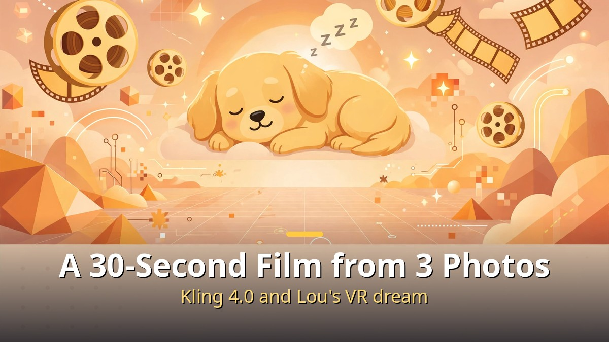
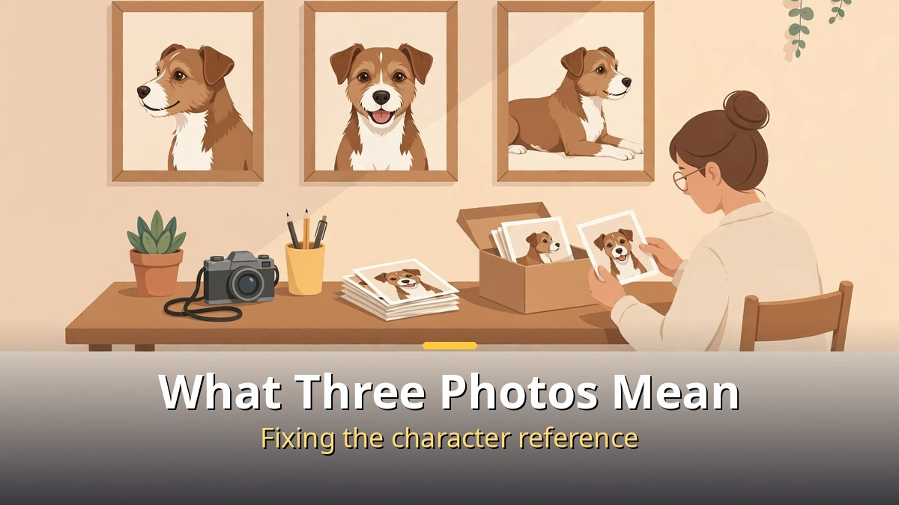
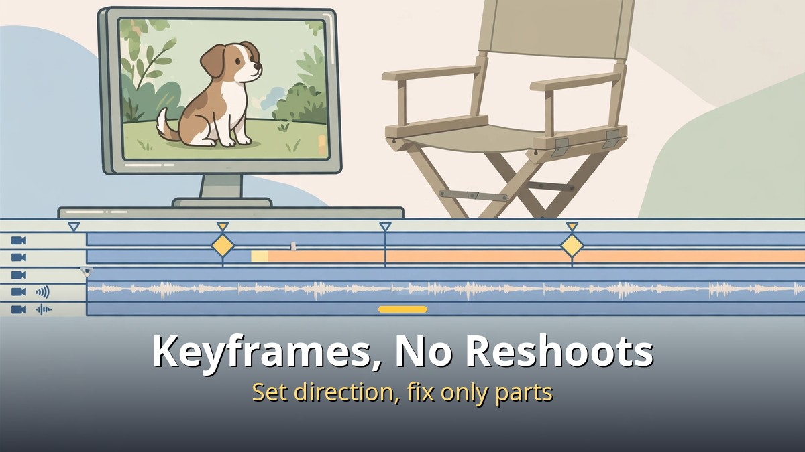
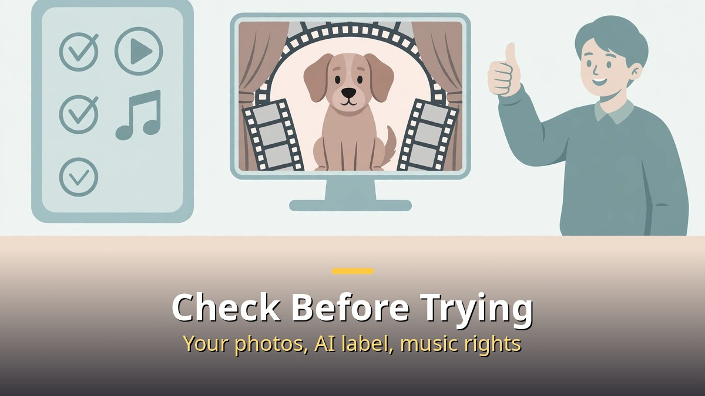

<!-- 본문 시작 -->

Three photos of a pet dog became a 30-second film.
The star of the video is a dog named Lou.
It retells a dream from inside virtual reality (VR) in 2017, shot again with the AI video tool Kling 4.0.

**The key point is this. Three photos did not make the film. Deciding the scenes in advance, fixing the character, and refining with keyframes made the film. It is not magic that completes itself when you drop photos in.**

> The video from Afternoon Five (Mr. 5pm) turns Lou's 2017 dream inside VR into a 30-second film with Kling 4.0. An AI assistant named Bella takes the director's role, and the flow of keyframes and edits without reshooting is presented in eight sections (0:00–8:42). Kling 4.0's maximum length is 30 seconds, twice the 15 seconds of version 3.0, according to the video.

## What "starting with three photos" really means

The starting point is three photos.
Photos of the same dog from several angles set the reference for "this dog."
An AI video tool reads them and fixes the character's identity.
With a single photo, the appearance wobbles as the angle changes. With three, that wobble shrinks.

Next comes the story.
The video's premise is a dream inside VR in 2017.
Because it is a dream, unrealistic scenes do not feel out of place.
For realistic scenes, the opposite applies: realistic detail matters more.
Without setting the premise first and only dropping photos in, each scene can tell a different story.

Fixing the character is the precondition of this work.
If the same dog looks different in every scene, the result is a photo collection, not a film.
That is why photos with clear features — expression, fur color, size — matter at the selection stage.
In the video, setting this reference is presented as the starting point of the whole flow.

## What keyframes and edits without reshooting change

One of Kling 4.0's features is keyframes.
You set a start scene and an end scene, and the AI connects them.
Before, you had to generate again and again until the scene you wanted appeared.
With keyframes, you can set the direction: "from this scene to that scene."

Edits without reshooting work the same way.
Instead of remaking a part you dislike from scratch, you fix only that part.
If the dog's movement looks awkward, fix that section; if the background looks off, fix the background.
That saves time and cost compared with regenerating the whole video.

But "editing" is not unlimited.
Each fix can slightly shift the character's appearance or the scene's mood.
So setting the start and end of a scene clearly at first matters more than increasing the number of edits.
That is why keyframes and editing sections are treated separately in the video's table of contents.

Length has changed too.
Where Kling 3.0 topped out at 15 seconds, version 4.0 can make 30 seconds in one go, according to the video.
Thirty seconds is about one short ad or one Short.
It is still short for a long story, but enough to complete a single scene.
Joining several 30-second clips makes a longer video, but a person must then connect the scenes.

## What to check before trying it yourself

For readers who want to try this after watching the video, the first advice is to start with your own photos.
Using someone else's pet photos or other people's photos without permission can raise portrait-rights problems.
Your own pet's photos are free to use, but other people's photos need permission.

Second is how to present the result.
An AI-made video is not real footage.
Posting it without an AI-generated label, as if it were real, misleads viewers.
Animal and human videos are especially easy to mistake for real footage, so the AI label should be clear.

Third is music and sound.
When adding music, use tracks whose rights are cleared.
Even music provided by a video tool should be checked for commercial-use terms.
One track can take down an otherwise good video.

| Step | What to decide | Common mistake |
| --- | --- | --- |
| Pick photos | Three photos that clearly show the same character | Starting with one photo, appearance wobbles |
| Set the story | Dream or reality, start and end of scenes | Dropping photos in with no premise |
| Keyframes | Start scene and end scene | Regenerating many times with no direction |
| Edit | Fix only the awkward section | Character drifts as edits pile up |
| Publish | AI label, music rights checked | Posting as if it were real footage |

In short, the lesson of this video is the order of the process, not the tool's power.
Pick photos, set the story, fix the character, set direction with keyframes, and refine with partial edits — that order makes the film.
The tool has improved, but the order set by the person using it still decides the result.

## Frequently asked questions

Q. Can I do it with one photo?
A. You can, but the appearance wobbles easily. The video chose three photos to fix the reference.

Q. Can I make a film longer than 30 seconds in one go?
A. Kling 4.0's maximum is 30 seconds by the video's account. Longer videos require joining sections and connecting them yourself.

Q. What is a keyframe?
A. A way to set a start scene and an end scene and let the AI connect them. You can set the direction yourself.

Q. Can I post the video on social media?
A. Yes, if you used your own photos, labeled it as AI-generated, and checked music rights. Do not present it as real footage.

Q. Is this different from the Kling 4.0 launch article?
A. Yes. The launch article covered the model's features; this article covers the actual process of making a film from three photos.

## Recommended reading

[Blade Runner 2049｜A Replicant with Memories Asks What Makes Us Human — a film about a replicant with memories questioning the standard of humanity](https://aitechnotesen.blogspot.com/2026/11/blade-runner-2049a-replicant-with.html)
[Hand Claude a Script and a Drama Comes Out?｜The Automated AI Drama Workflow Claude Designed — from script to Shorts to long-form AI drama production](https://aitechnotesen.blogspot.com/2026/11/hand-claude-script-and-drama-comes.html)
[How to Use Claude Changed｜Four Updates: Code, Browser, Files, and Plan Mode — four changes in code, browser, files, and plan mode](https://aitechnotesen.blogspot.com/2026/11/how-to-use-claude-changedfour-updates.html)

If you want to keep following this topic, subscribe. AI videos made from photos, and the standards for publishing them safely, will be covered here as they arrive.

<!-- 본문 끝 -->

## 작업용 출처·이미지 정보 (업로드 제외)

- 자료 출처: 오후다섯씨 영상 90mnINyTJ3g(2026-11-01, 9:49, 목차 8구간 0:00~8:42, 클링 4.0 최대 30초) + 클링 4.0 공개 정보 대조
- 이미지: images/01-hero-en.jpg ~ 04-img3-en.jpg / 자작 일러스트 + 영어 배너 오버레이 (1200x675)
