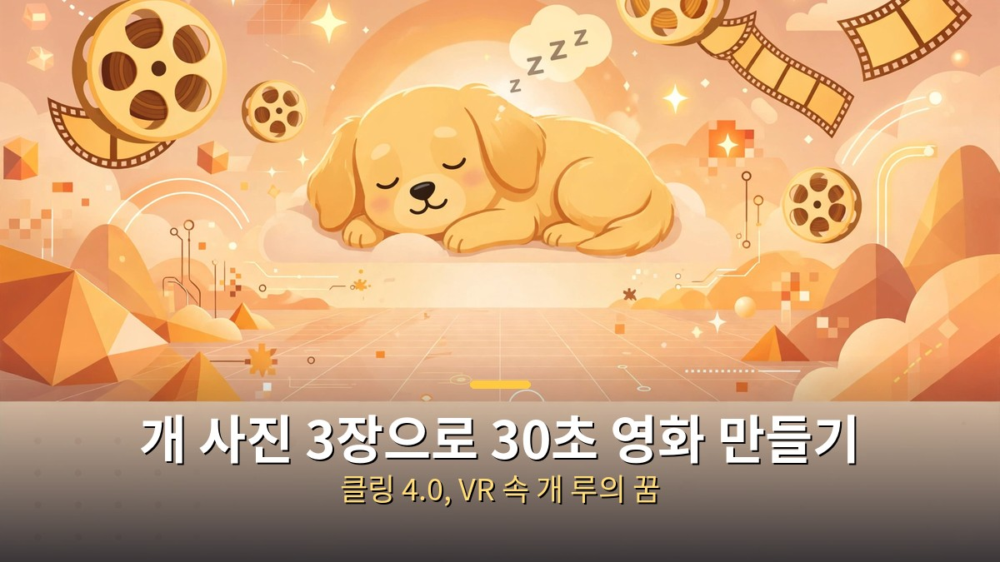
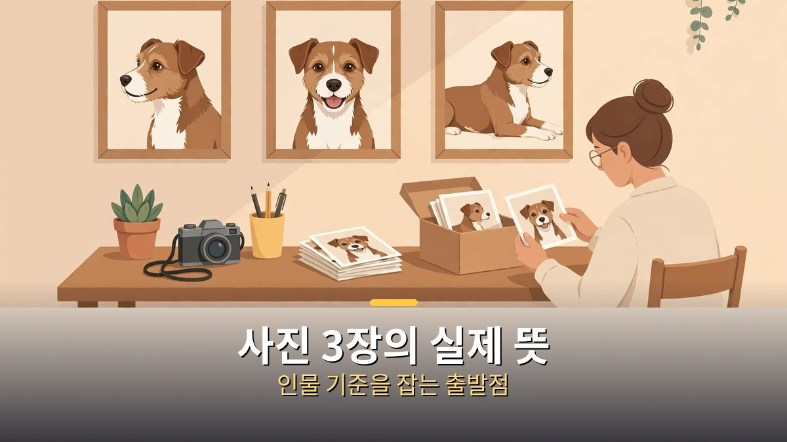
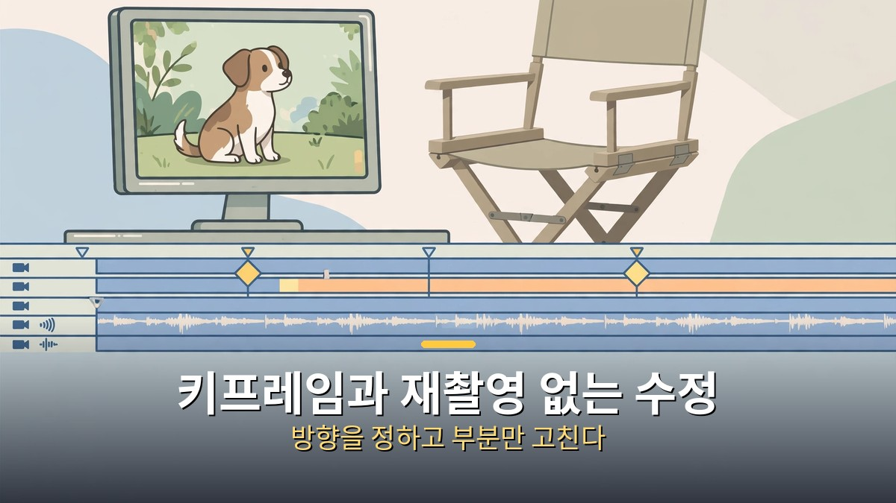
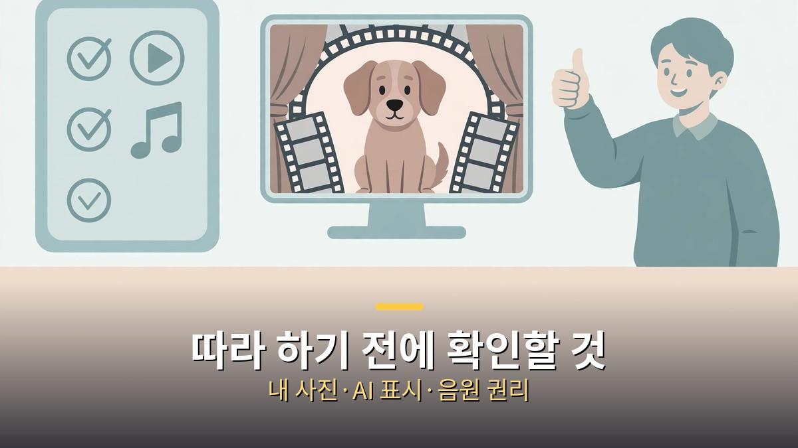

<!-- 본문 시작 -->

반려견 사진 3장이 30초짜리 영화가 됐다.
영상 속 주인공은 개 루다.
2017년 가상현실(VR) 속에서 꾸던 꿈을, AI 영상 도구 클링 4.0으로 다시 찍은 이야기다.

**핵심은 이것이다. 사진 3장이 영화를 만든 것이 아니라, 어떤 장면을 만들지 미리 정하고, 인물을 고정하고, 키프레임으로 고쳐나간 과정이 영화를 만들었다. 사진만 넣으면 자동으로 완성되는 마법이 아니다.**

> 오후다섯씨 영상은 2017년 VR 속 개 루의 꿈을 클링 4.0으로 30초 영화로 만든 과정을 다룬다. AI 어시스턴트 벨라가 감독 역할을 맡고, 키프레임과 재촬영 없는 수정으로 장면을 다듬는 흐름이 8개 구간(0:00~8:42)으로 소개된다. 클링 4.0의 최대 길이는 30초로, 3.0의 15초보다 두 배 길어졌다고 영상은 설명한다.

## 사진 3장으로 시작한다는 말의 실제 뜻

시작점은 사진 3장이다.
같은 개를 여러 각도에서 담은 사진이 인물의 기준이 된다.
AI 영상 도구는 이 사진을 보고 "이 개"라는 기준을 잡는다.
사진이 한 장이면 각도가 바뀔 때 생김새가 흔들리기 쉽고, 세 장이면 그 흔들림을 줄일 수 있다.

다음으로 정해야 할 것은 이야기다.
영상 속 설정은 2017년 VR 속에서 개가 꾸는 꿈이다.
꿈이라는 설정 덕분에 현실적인 장면이 아니어도 어색하지 않다.
현실 장면을 만들 때는 반대로, 사실적인 디테일이 더 중요해진다.
설정을 먼저 정하지 않고 사진만 넣으면, 장면마다 다른 이야기가 나올 수 있다.

인물 고정은 이 작업의 전제 조건이다.
같은 개가 장면마다 다르게 생기면 영화가 아니라 사진 모음이 된다.
그래서 사진 선택 단계에서 표정, 털 색, 크기 같은 특징이 분명한 사진을 고르는 것이 중요하다.
영상에서는 이 기준을 잡는 과정이 전체 흐름의 출발점으로 소개된다.

## 키프레임과 재촬영 없는 수정이 바꾸는 것

클링 4.0의 특징 중 하나는 키프레임이다.
시작 장면과 끝 장면을 정해주면, 그 사이를 AI가 이어준다.
예전에는 원하는 장면이 나올 때까지 여러 번 다시 뽑아야 했다.
키프레임을 쓰면 "이 장면에서 저 장면으로"라는 방향을 직접 정할 수 있다.

재촬영 없는 수정도 같은 맥락이다.
마음에 들지 않는 부분을 통째로 다시 만드는 대신, 해당 부분만 고친다.
예를 들어 개의 움직임이 어색하면 그 구간만, 배경이 어색하면 배경만 다듬는 식이다.
전체 영상을 처음부터 다시 뽑는 방식보다 시간과 비용을 아낄 수 있다.

다만 "수정"이 무제한은 아니다.
고칠 때마다 인물의 생김새나 장면의 분위기가 조금씩 바뀔 수 있다.
그래서 수정 횟수를 늘리기보다, 처음에 장면의 시작과 끝을 분명히 정하는 것이 중요하다.
영상 목차에서도 키프레임과 수정 구간이 별도로 다뤄지는 이유가 여기에 있다.

길이도 달라졌다.
클링 3.0의 최대 길이가 15초였다면, 4.0은 30초까지 한 번에 만들 수 있다고 영상은 설명한다.
30초는 짧은 광고나 쇼츠 한 편 분량이다.
긴 이야기를 담기에는 여전히 짧지만, 하나의 장면을 완성하는 데는 충분한 길이다.
여러 개의 30초를 이어 붙이면 더 긴 영상이 되지만, 그때는 장면 사이의 연결을 사람이 직접 맞춰야 한다.

## 따라 하기 전에 확인해야 할 것

이 영상을 보고 따라 하려는 독자에게 가장 먼저 권할 것은 내 사진으로 시작하는 것이다.
남의 반려동물 사진이나 타인의 사진을 함부로 쓰면 초상권 문제가 생길 수 있다.
내 반려동물 사진이라면 자유롭지만, 다른 사람의 사진은 허락이 필요하다.

두 번째는 결과물을 어떻게 보여줄 것인가다.
AI로 만든 영상은 실제 촬영 영상이 아니다.
"AI로 만들었다"는 표시를 빼고 실제인 것처럼 올리면, 보는 사람을 속이는 일이 된다.
특히 동물이나 사람이 등장하는 영상은 실제 촬영으로 오해하기 쉬우니, AI 생성 표시를 분명히 하는 것이 좋다.

세 번째는 음악과 소리다.
영상에 음악을 붙일 때는 저작권이 정리된 음원을 써야 한다.
영상 제작 도구에서 제공하는 음원이라도, 상업적 이용 조건을 확인하는 것이 안전하다.
음악 하나 때문에 좋은 영상이 내려갈 수도 있다.

| 단계 | 무엇을 정하나 | 흔한 실수 |
| --- | --- | --- |
| 사진 고르기 | 같은 인물이 분명한 사진 3장 | 한 장으로 시작해 생김새가 흔들림 |
| 이야기 정하기 | 꿈인지 현실인지, 장면의 시작과 끝 | 설정 없이 사진만 넣기 |
| 키프레임 | 시작 장면과 끝 장면 | 방향 없이 여러 번 다시 뽑기 |
| 수정 | 어색한 구간만 부분 수정 | 고칠수록 인물이 달라짐 |
| 공개 | AI 생성 표시, 음원 권리 확인 | 실제 촬영처럼 올리기 |

정리하면, 이 영상의 교훈은 도구의 성능보다 과정의 순서다.
사진을 고르고, 이야기를 정하고, 인물을 고정하고, 키프레임으로 방향을 잡고, 부분 수정으로 다듬는 순서가 영화를 만든다.
도구가 좋아진 것은 맞지만, 그 도구를 다루는 사람의 순서가 여전히 결과를 가른다.

## 자주 묻는 질문

Q. 사진 1장으로도 되나요?
A. 될 수는 있지만 생김새가 흔들리기 쉽다. 영상에서는 3장으로 기준을 잡는 방식을 택했다.

Q. 30초보다 긴 영화도 한 번에 만들 수 있나요?
A. 클링 4.0의 최대 길이는 영상 설명 기준 30초다. 더 긴 영상은 여러 구간을 이어 붙여 사람이 연결해야 한다.

Q. 키프레임이 뭔가요?
A. 시작 장면과 끝 장면을 정해주면 그 사이를 AI가 이어주는 방식이다. 원하는 방향을 직접 정할 수 있다는 점이 다르다.

Q. 만든 영상을 SNS에 올려도 되나요?
A. 내 사진으로 만들고 AI 생성 표시를 하고, 음악 권리까지 확인했다면 올릴 수 있다. 실제 촬영처럼 속이는 표시는 피해야 한다.

Q. 클링 4.0 출시 소식과는 다른 글인가요?
A. 다르다. 출시 소식은 모델의 기능을 다뤘고, 이번 글은 사진 3장으로 영화를 만드는 실제 과정을 다룬다.

## 함께 읽으면 좋은 글

[기억을 가진 인조인간｜블레이드 러너 2049가 묻는 인간의 기준 — 기억을 가진 인조인간이 인간의 기준을 묻는 영화 소개](https://aitechnoteskr.tistory.com/87)
[대본만 주면 드라마가 나온다고?｜클로드가 짠 AI 드라마 자동화 워크플로우 — 대본부터 쇼츠, 롱폼까지 이어지는 AI 드라마 제작 흐름](https://aitechnoteskr.tistory.com/86)
[클로드 한 달 업데이트 4가지｜코드·브라우저·파일·계획 모드, 뭐가 달라졌나 — 코드·브라우저·파일·계획 모드 네 가지 변화 정리](https://aitechnoteskr.tistory.com/84)

이 주제를 계속 따라가려면 이웃 추가를 눌러두세요. 사진으로 만드는 AI 영상과 그 영상을 안전하게 공개하는 기준을 같은 자리에서 이어서 정리하겠습니다.

<!-- 본문 끝 -->

## 작업용 출처·이미지 정보 (업로드 제외)

- 자료 출처: 오후다섯씨 영상 90mnINyTJ3g(2026-11-01, 9:49, 목차 8구간 0:00~8:42, 클링 4.0 최대 30초) + 클링 4.0 공개 정보 대조
- 이미지: images/01-hero.jpg ~ 04-img3.jpg / 자작 일러스트 + 한글 배너 오버레이 (1200x675)
