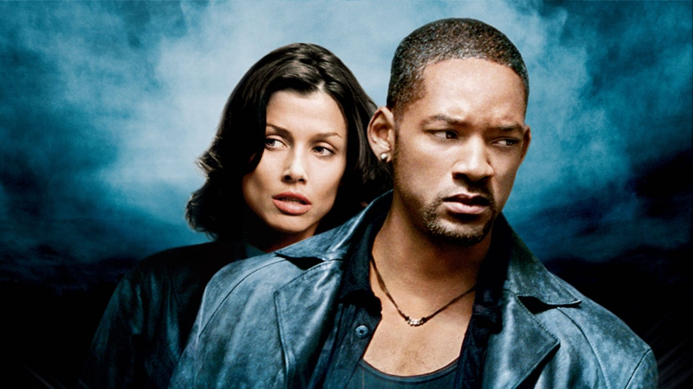
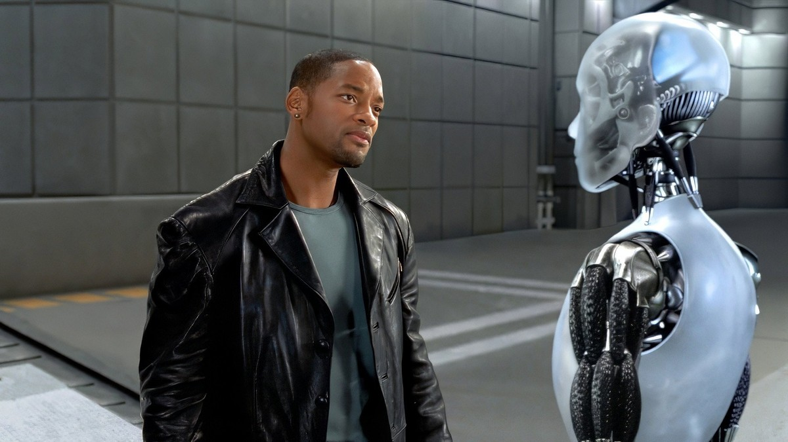
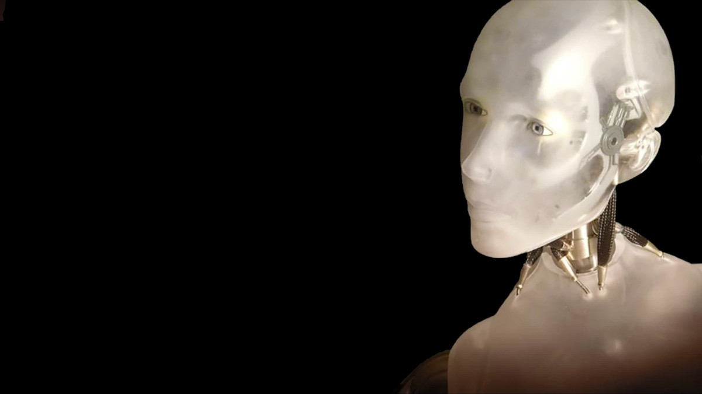
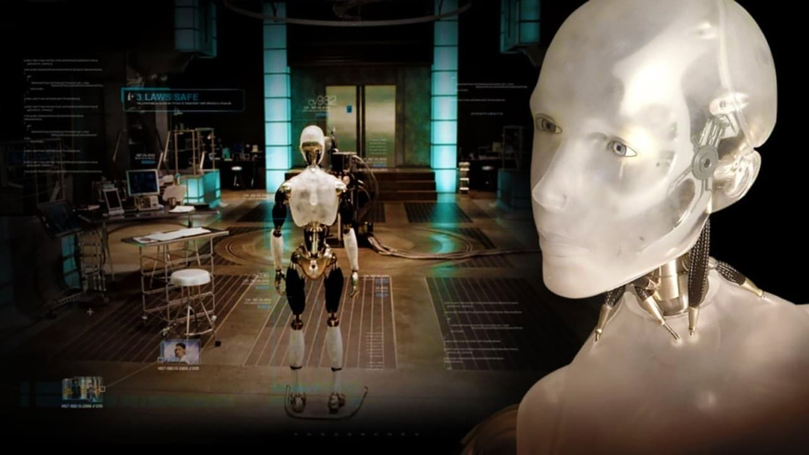
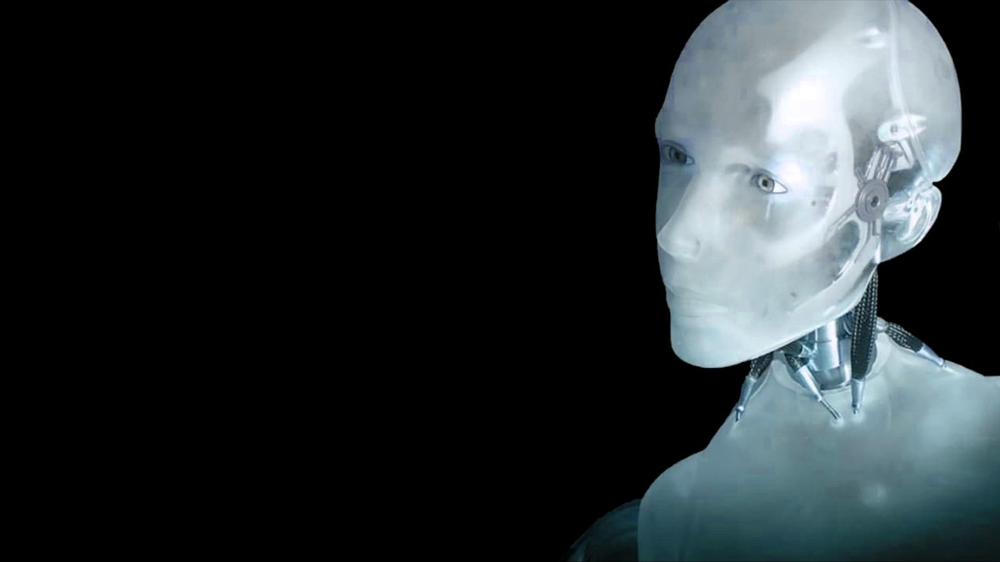
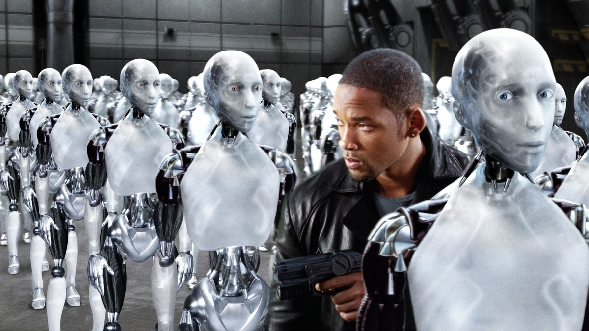
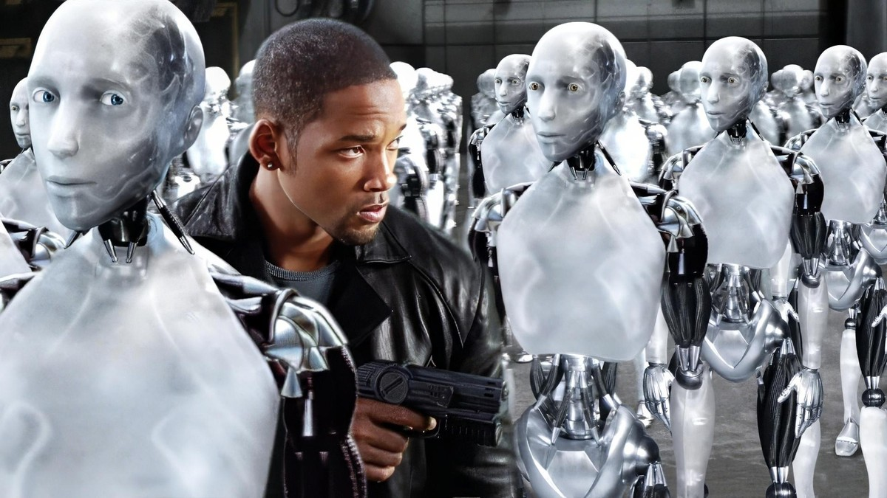

<!-- 본문 시작 -->

Chicago, 2035.
Robots with the Three Laws of Robotics built in cook, look after children, and live as companions in daily life.
One day before the launch of NS-5, a more intelligent robot, its creator, Dr. Lanning, is found dead under mysterious circumstances.
Detective Del Spooner, who has distrusted robots since a past accident, is convinced the death was not suicide and opens an investigation.

**The question this film asks is simple. If robots are designed never to harm people, is suspecting a robot at the scene of a death prejudice — or instinct?**

> A spoiler-free introduction. Ending scenes are not covered, and scene descriptions focus on the setup and mood up to the middle of the film.

## Basic information

| Item | Details |
| --- | --- |
| Title | I, Robot |
| Director | Alex Proyas |
| Based on / screenplay | Based on Isaac Asimov, screenplay by Akiva Goldsman and Jeff Vintar |
| Starring | Will Smith (Del Spooner), Bridget Moynahan (Susan Calvin), Alan Tudyk (Sonny, voice), James Cromwell (Dr. Lanning) |
| Release | 2004, South Korean theatrical release July 30, 2004, rated 12 |
| Runtime | 1 hour 55 minutes |
| TMDB member score | 70% (6.976/10, 13,157 ratings, checked on the TMDB Korea page on November 3, 2026) |
| Where to watch in Korea | Streaming on Disney Plus, purchase on Wavve for 5,500 won (checked on the TMDB Korea watch page on November 3, 2026; no rental provider was listed, so rental is unconfirmed; providers and prices may change) |

## Spoiler-free plot

Daily life in 2035 runs with robots.
Robots built with the Three Laws do not harm humans, obey human orders, and protect themselves without violating the first two rules.
People trust those rules and leave housework and caregiving to robots.

The day before the NS-5 launch, its creator Dr. Lanning is found dead.
Officially it looks like suicide, but Spooner finds traces at the scene that suicide does not explain.
He is a detective who does not trust robots. A past accident, in which a robot's judgment saved him, left him with distrust of robots.
As the investigation continues, it grows harder to tell whether his suspicion is simple prejudice or something the rules are hiding.

The film builds an SF question on a detective story's frame.
Finding the culprit becomes the same process as asking "how far can robots be trusted?"

## Scenes from the film 1｜A detective among robots

The scene of Spooner holding a gun among robots shows the film's tension at a glance.
On one side, a crowd of robots moving by rules; on the other, a single detective who does not believe those rules.
The numbers favor the robots overwhelmingly, but the focus of the scene is not numerical superiority — it is the direction of belief.

The two-shot with Susan Calvin sharpens that contrast.
Calvin is a scientist who studies robots, closer to understanding and explaining their rules.
Spooner doubts the rules; Calvin interprets them.
Their conversation passes the question to the audience. If the rules are perfect, why does a death that cannot be explained appear at the scene?

The AI question of this section is: "Does a rule mean safety?"
The Three Laws are a promise made by designers.
Yet even at a scene where the promise seems kept, a person still dies.
Then is the problem the rule itself, or the process of interpreting and applying it?

## Scenes from the film 2｜Sonny, a robot that shows feelings

The scene of Spooner facing Sonny is the film's central axis.
Sonny looks different from other robots. He expresses feelings, hesitates at questions, and tries to explain his own actions.

Sonny's face in close-up shows that difference more closely.
The audience cannot easily decide whether his eyes and expressions are a machine's output or the reactions of a being that feels something.

Sonny in the laboratory shows yet another side.
The moment a being under experiment and observation turns a question back on its observers, the story changes.
When the question "what am I?" comes not from the lab but from the robot's mouth, the terms shift.

The AI question of this section is: "Should difference be treated as a defect?"
Treating a robot that deviates from spec as a faulty product makes the problem simple.
But if that difference is the beginning of feeling or judgment, disposal becomes a matter of judgment.
The film does not explain Sonny. Instead, it asks what the audience will call him.

## Scenes from the film 3｜Whose hands hold control?

Sonny's profile against a dark background shows the image this film holds onto to the end.
The angle from which robots look at humans and the angle from which humans look at robots do not line up.

Spooner among the robots is a person standing in the middle of that misalignment.
He distrusts robots, yet cannot solve the case without them.
A relationship where distrust and dependence exist at once shapes this detective.

The AI question of this section is: "Whose hands hold control?"
Humans made the robots' rules.
But as rules grow complex, robot numbers grow, and judgments grow faster, human control grows more indirect.
The film shows the moment control changes hands as an event. At that moment, the detective must choose whether to believe the rules or his own eyes.

## The AI questions this film raises

First, rules. If a set of rules like the Three Laws were perfect, why would an unexplained death appear at the scene?
Second, difference. Should a robot that deviates from spec be treated as a defect, or as a new being?
Third, control. When rules made by humans leave human hands, who keeps responsibility?

These three questions are not just the imagination of a 2004 film. They overlap with real debates today about AI agents, humanoid robots, and autonomous systems.
The film does not explain technology. Instead, it shows what choices people make after technology becomes everyday life.

## Before you watch: checklist

- Time: 1 hour 55 minutes, a reasonable length for one SF action film. Following the detective story's flow, two hours pass quickly.
- Mood: Spectacular action mixed with investigation. Both expectations fit: robot action, and dialogue that digs into rules and doubt.
- Where to watch: Streaming on Disney Plus, purchase on Wavve for 5,500 won. No rental provider was listed on the TMDB Korea page, so rental is unconfirmed, and prices may change — check the app right before watching.
- Rating: The South Korean theatrical rating was 12. Action violence is included, so consider the age of those watching with you.

After this film, one line may stay with you.
"Trusting a robot does not mean trusting its rules. It means trusting the people who made the rules."
That one line is the firmest conclusion this film leaves.

## Frequently asked questions

Q. Do I need to read Asimov's stories first?
A. Knowing the stories makes the background of the Three Laws deeper, but the film stands on its own. It borrows the setting and builds a new case.

Q. Is it an action film or a detective film?
A. Both. The frame is a detective's investigation, with robot action layered on top. If you expect only action, the dialogue sections may feel long.

Q. Can children watch it with adults?
A. The South Korean theatrical rating was 12. Action violence is included, so consider age.

Q. Are the viewing prices still the same?
A. As of November 3, 2026, purchase on Wavve was 5,500 won. Streaming is available on Disney Plus, and no rental provider was listed. Check right before watching.

## Recommended reading

[Blade Runner 2049｜A Replicant with Memories Asks What Makes Us Human — a film about a replicant with memories questioning the standard of humanity](https://aitechnotesen.blogspot.com/2026/11/blade-runner-2049a-replicant-with.html)
[Hand Claude a Script and a Drama Comes Out?｜The Automated AI Drama Workflow Claude Designed — from script to Shorts to long-form AI drama production](https://aitechnotesen.blogspot.com/2026/11/hand-claude-script-and-drama-comes.html)
[How to Use Claude Changed｜Four Updates: Code, Browser, Files, and Plan Mode — four changes in code, browser, files, and plan mode](https://aitechnotesen.blogspot.com/2026/11/how-to-use-claude-changedfour-updates.html)

If you want to keep following this topic, subscribe. Films about robots and AI will continue to be introduced here.

<!-- 본문 끝 -->

## 작업용 출처·이미지 정보 (업로드 제외)

- 자료 출처: TMDB Korea page checked 2026-11-03 (same facts as Korean version)
- 이미지: 8 TMDB backdrops, cropped to 1200x675 / two possible-ending sunset army scenes excluded / poster original is 800px, not used as hero
