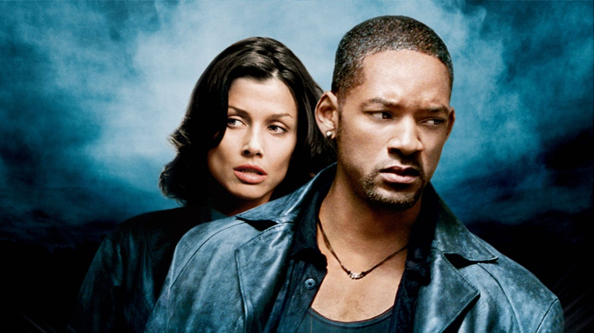
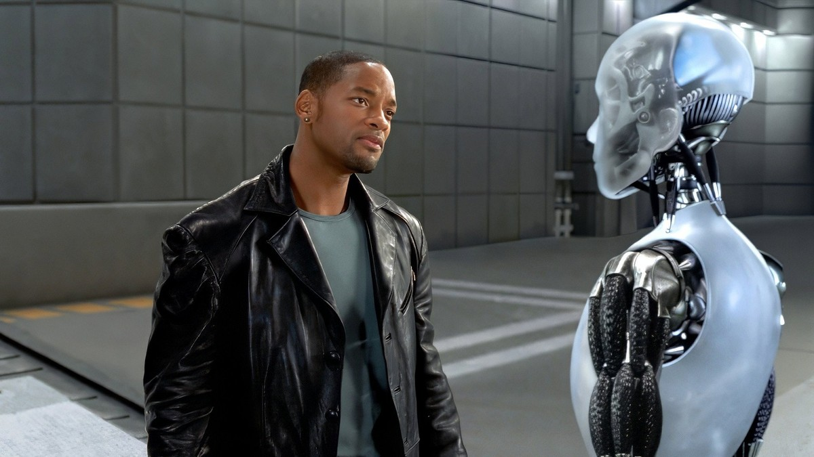
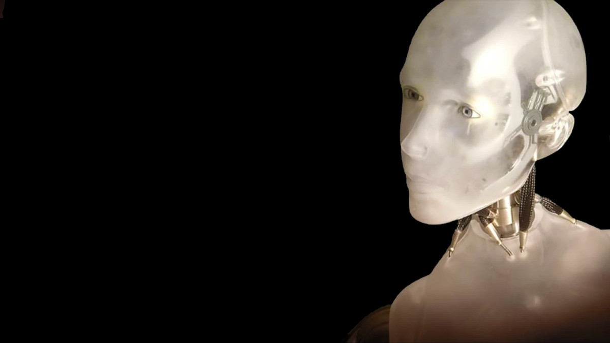
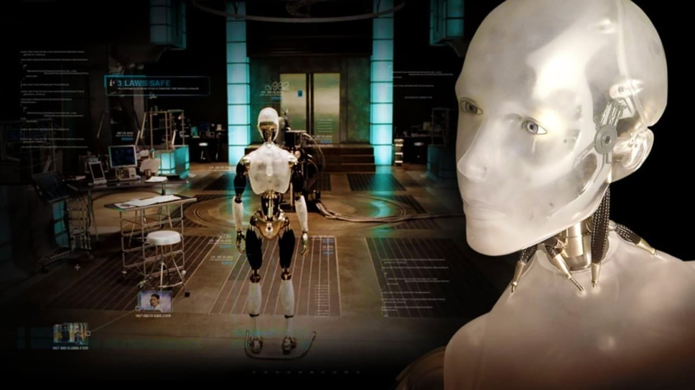
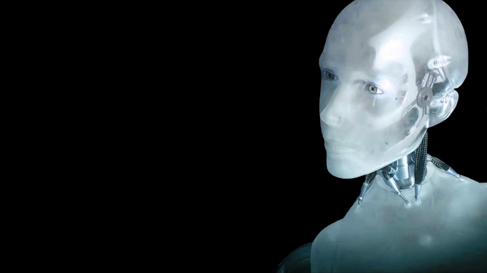
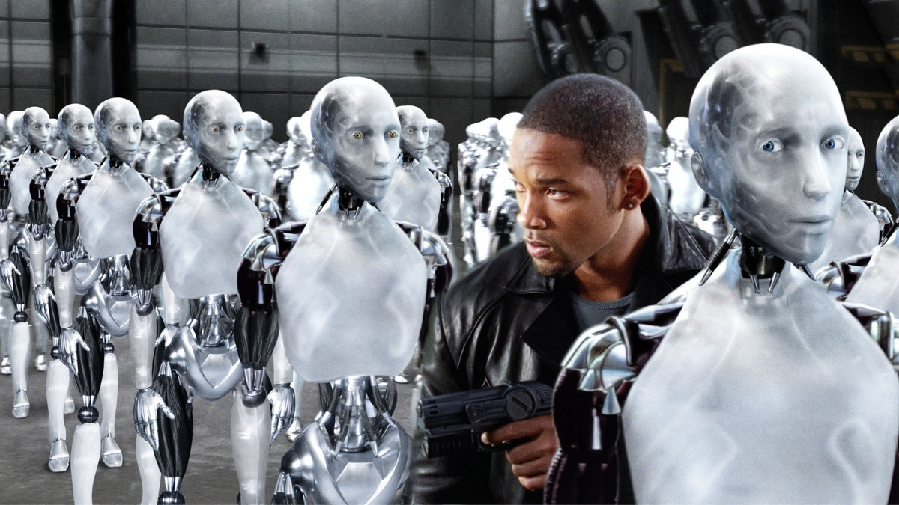
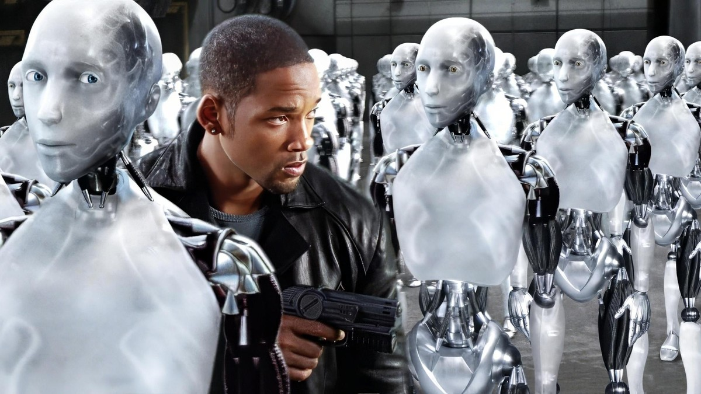

<!-- 본문 시작 -->

2035년의 시카고.
인간의 안전을 최우선으로 하는 로봇 3원칙이 내장된 로봇들이 요리하고, 아이들을 돌보고, 생활의 동반자가 돼 있다.
더 높은 지능을 가진 로봇 NS-5의 출시를 하루 앞둔 날, 그 창시자인 래닝 박사가 의문의 죽음을 맞는다.
과거 사고 이후 로봇에 적대감을 가진 형사 델 스푸너는, 이 죽음이 자살이 아니라고 확신하고 수사에 착수한다.

**이 영화가 묻는 질문은 단순하다. 로봇이 사람을 해치지 않도록 설계됐다면, 사람이 죽은 현장에서 로봇을 의심하는 것은 편견일까, 직감일까.**

> 스포일러 없는 소개다. 결말 장면은 다루지 않으며, 장면 설명은 중반부까지의 설정과 분위기 중심으로 정리했다.

## 기본 정보

| 항목 | 내용 |
| --- | --- |
| 제목 | 아이, 로봇 (I, Robot) |
| 감독 | 알렉스 프로야스 |
| 원작·각본 | 원작 아이작 아시모프, 각본 아키바 골즈먼·제프 빈타 |
| 주연 | 윌 스미스(델 스푸너), 브리짓 모이나한(수전 캘빈), 앨런 튜딕(써니 목소리), 제임스 크롬웰(래닝 박사) |
| 개봉 | 2004년, 한국 극장 개봉 2004년 7월 30일, 등급 12세 |
| 러닝타임 | 1시간 55분 |
| TMDB 회원 점수 | 70% (6.976/10, 13,157개 평가, 2026-11-03 TMDB 한국 페이지 확인 기준) |
| 국내 시청처 | 스트리밍 디즈니플러스, 구매 웨이브 5,500원 (2026-11-03 TMDB 한국 시청 페이지 확인 기준, 대여 제공처는 표시 없음으로 미확인, 제공처·가격은 변동 가능) |

## 스포일러 없는 줄거리

2035년의 일상은 로봇과 함께 돌아간다.
로봇 3원칙이 내장된 로봇은 인간을 해치지 않고, 인간의 명령에 따르고, 스스로를 보호하되 앞의 두 원칙을 어기지 않는다는 규칙으로 움직인다.
사람들은 그 규칙을 믿고 로봇에게 집안일과 돌봄을 맡긴다.

NS-5 출시 전날, 창시자 래닝 박사가 죽은 채 발견된다.
공식적으로는 자살로 보이지만, 스푸너는 현장의 흔적들이 자살로 설명되지 않는다고 본다.
그는 로봇을 믿지 않는 형사다. 과거 사고에서 로봇의 판단이 사람을 살리는 선택을 했던 경험이, 그에게 로봇에 대한 불신을 남겼다.
수사가 이어질수록, 스푸너의 의심은 단순한 편견인지, 아니면 규칙이 감추고 있는 무언가인지가 점점 더 애매해진다.

이 영화는 추리극의 뼈대 위에 SF 질문을 얹는다.
범인을 찾는 과정이 곧 "로봇을 어디까지 믿을 수 있는가"를 묻는 과정이 된다.

## 장면으로 보는 작품 1｜로봇들 사이의 형사

스푸너가 로봇들 사이에 둘러싸여 총을 든 장면은 이 영화의 긴장을 한눈에 보여준다.
한쪽에는 규칙으로 움직이는 로봇의 무리, 다른 한쪽에는 그 규칙을 믿지 않는 형사 한 사람.
숫자로는 형사가 압도적으로 불리하지만, 장면의 초점은 수의 우열이 아니라 믿음의 방향에 있다.

수전 캘빈과의 투샷은 그 대조를 더 분명히 한다.
캘빈은 로봇을 연구하는 과학자로, 로봇의 규칙을 이해하고 설명하는 쪽에 가깝다.
스푸너는 규칙을 의심하고, 캘빈은 규칙을 해석한다.
두 사람의 대화는 관객에게 질문을 넘긴다. 규칙이 완벽하다면, 왜 현장에서는 설명되지 않는 죽음이 생기는가.

이 구간이 던지는 AI 질문은 "규칙은 곧 안전인가"다.
로봇 3원칙은 설계자의 약속이다.
그런데 약속이 지켜지는 것처럼 보이는 현장에서도, 사람은 여전히 죽는다.
그렇다면 문제는 규칙 자체인가, 규칙을 해석하고 적용하는 과정인가.

## 장면으로 보는 작품 2｜써니, 감정을 보이는 로봇

스푸너와 마주 선 써니의 장면은 영화의 중심축이다.
써니는 다른 로봇들과 다르게 보인다. 감정을 표현하고, 질문에 머뭇거리고, 자신의 행동을 설명하려 한다.

써니의 얼굴 클로즈업은 그 다름을 더 가까이 보여준다.
눈빛과 표정이 기계의 출력인지, 무언가를 느끼는 존재의 반응인지 관객은 쉽게 단정하지 못한다.

연구실 안의 써니는 또 다른 면을 보여준다.
실험과 관찰의 대상이 된 존재가, 관찰자에게 되묻는 순간이 온다.
"나는 무엇인가"라는 질문이, 연구실에서가 아니라 로봇의 입에서 나올 때 이야기는 달라진다.

이 구간이 던지는 AI 질문은 "다름을 고장으로 볼 것인가"다.
규격에서 벗어난 로봇을 불량품으로 처리하면 문제는 간단해진다.
하지만 그 다름이 감정이나 판단의 시작이라면, 처분은 곧 판단의 문제가 된다.
영화는 써니를 설명하지 않는다. 대신 관객이 써니를 어떻게 부를지를 묻는다.

## 장면으로 보는 작품 3｜통제는 누구의 손에 있는가

어두운 배경의 써니 옆모습은, 이 영화가 끝까지 붙잡는 이미지를 보여준다.
로봇이 인간을 바라보는 각도, 인간이 로봇을 바라보는 각도가 어긋나 있다.

로봇들 사이의 스푸너는 그 어긋남의 한가운데 선 사람이다.
그는 로봇을 믿지 않으면서도, 로봇 없이는 사건을 풀 수 없는 위치에 있다.
불신과 의존이 동시에 존재하는 관계가 이 영화의 형사상을 만든다.

이 구간이 던지는 AI 질문은 "통제는 누구의 손에 있는가"다.
로봇의 규칙은 인간이 만들었다.
그런데 규칙이 복잡해지고, 로봇의 수가 많아지고, 판단이 빨라질수록, 인간의 통제는 점점 더 간접적이 된다.
영화는 통제의 주인이 바뀌는 순간을 사건으로 보여준다. 그 순간에 형사는 규칙을 믿어야 할지, 자신의 눈을 믿어야 할지 선택해야 한다.

## 이 작품이 던지는 AI 질문

첫째, 규칙이다. 3원칙 같은 규칙이 완벽하다면, 왜 현장에서는 설명되지 않는 죽음이 생기는가.
둘째, 다름이다. 규격에서 벗어난 로봇을 고장으로 볼 것인가, 새로운 존재로 볼 것인가.
셋째, 통제다. 인간이 만든 규칙이 인간의 손을 떠날 때, 책임은 누구에게 남는가.

이 세 질문은 2004년 영화의 상상이 아니라, 지금 AI 에이전트·인간형 로봇·자율 시스템을 두고 실제로 오가는 논쟁과 겹친다.
영화는 기술을 설명하지 않는다. 대신 기술이 일상이 된 뒤, 사람이 어떤 선택을 하는지를 보여준다.

## 어디서 보는지, 보기 전 체크리스트

- 시간: 1시간 55분으로, SF 액션 한 편으로 적당한 길이다. 추리극의 흐름을 따라가면 2시간이 금방 지나간다.
- 분위기: 화려한 액션과 추리가 섞여 있다. 로봇 액션을 기대해도, 규칙과 의심을 파고드는 대화를 기대해도 둘 다 맞는다.
- 시청처: 스트리밍 디즈니플러스, 구매 웨이브 5,500원 기준이다. 대여 제공처는 TMDB 한국 화면에 표시되지 않아 미확인이며, 가격은 변동될 수 있으니 보기 직전 해당 앱에서 다시 확인하는 것이 좋다.
- 등급: 한국 극장 등급은 12세였다. 액션 폭력 묘사가 있어, 함께 보는 사람의 연령을 고려한다.

이 영화를 보고 나면, 아마 이런 말이 남을 것이다.
"로봇을 믿는다는 것은, 규칙을 믿는다는 뜻이 아니라 규칙을 만든 사람을 믿는다는 뜻이구나."
그 한 문장이 이 영화가 남기는 가장 단단한 결론이다.

## 자주 묻는 질문

Q. 아시모프의 소설을 안 읽어도 되나요?
A. 소설을 알면 3원칙의 배경이 더 깊게 보이지만, 영화만으로도 이야기가 이어진다. 영화는 소설의 설정을 빌려 새로운 사건을 만든다.

Q. 로봇이 나오는 액션 영화인가요, 추리 영화인가요?
A. 둘 다 맞다. 뼈대는 형사의 수사극이고, 그 위에 로봇 액션이 얹혀 있다. 액션만 기대하면 대화 구간이 길게 느껴질 수 있다.

Q. 아이와 함께 봐도 되나요?
A. 한국 극장 등급은 12세였다. 액션 폭력 묘사가 있어, 연령을 고려해 보는 것이 좋다.

Q. 시청처 가격은 그대로인가요?
A. 2026-11-03 확인 기준으로는 구매 웨이브 5,500원이다. 스트리밍은 디즈니플러스에서 제공되며, 대여 제공처는 표시되지 않아 미확인이다. 보기 직전 확인이 필요하다.

## 함께 읽으면 좋은 글

[기억을 가진 인조인간｜블레이드 러너 2049가 묻는 인간의 기준 — 기억을 가진 인조인간이 인간의 기준을 묻는 영화 소개](https://aitechnoteskr.tistory.com/87)
[대본만 주면 드라마가 나온다고?｜클로드가 짠 AI 드라마 자동화 워크플로우 — 대본부터 쇼츠, 롱폼까지 이어지는 AI 드라마 제작 흐름](https://aitechnoteskr.tistory.com/86)
[클로드 한 달 업데이트 4가지｜코드·브라우저·파일·계획 모드, 뭐가 달라졌나 — 코드·브라우저·파일·계획 모드 네 가지 변화 정리](https://aitechnoteskr.tistory.com/84)

이 주제를 계속 따라가려면 이웃 추가를 눌러두세요. 로봇과 AI를 다룬 영화들을 같은 자리에서 이어서 소개하겠습니다.

<!-- 본문 끝 -->

## 작업용 출처·이미지 정보 (업로드 제외)

- 자료 출처: TMDB 한국 페이지 2026-11-03 확인 (감독 알렉스 프로야스, 2004/07/30 극장·12세, 1시간 55분, TMDB 70%·6.976/10·13,157개 평가, 스트리밍 디즈니플러스, 구매 웨이브 5,500원, 대여 표시 없음)
- 이미지: TMDB 백드롭 원본 8장, 1200x675 크롭 / 결말로 보일 수 있는 일몰 군단 장면 2장 제외 / 포스터 원본은 800px이라 히어로 미사용
