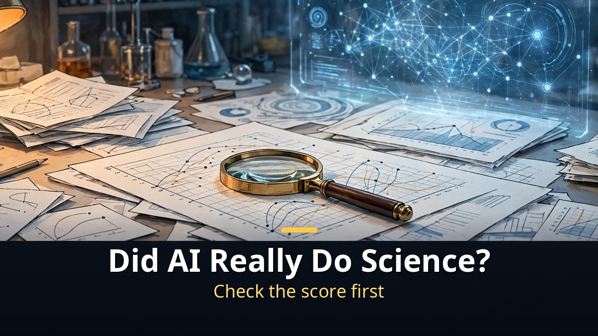
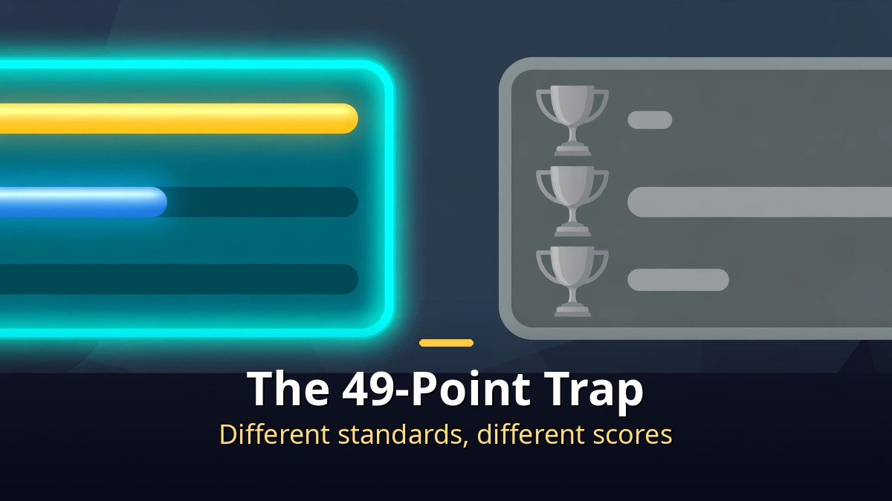
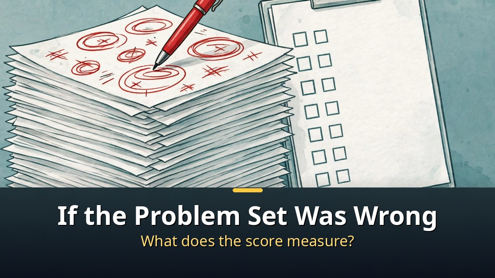
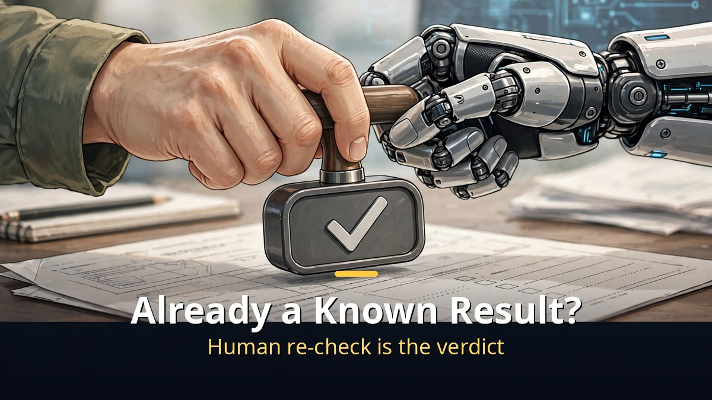

<!-- 본문 시작 -->

News about AI achievements in science keeps pouring in.
It solved nearly every physics problem, it found errors in papers, it proposed a math proof.
But before believing these headlines, one question comes first.
How was the score measured, and who checked it again?

**The key point is this: an AI science result should be read through its verification, not its headline. If the benchmark was wrong, the comparison was skewed, or the idea overlapped with a known result, the achievement is still at the claim stage.**

> TheAIGRID video (November 3, 2026, 25 minutes) does not just list AI science achievements. For each case, it also examines problems with scores, comparisons, and re-checks. This article follows that flow and organizes a reader's standard for judging such announcements without taking them at face value.

## The Trap of 49 Out of 50: Why Scoreboards Go Wrong

The video introduces an evaluation in which a model answered nearly every physics problem correctly.
49 out of 50 looks overwhelming on its own.
But a problem is flagged: within the same scoreboard, one model stood out unusually high.

When comparison standards differ, scores mean different things.
Some problems may have favored one model, or the grading method may have changed.
The video shows a re-grading by actual difficulty alongside the first number, steering viewers away from ranking models on the first number alone.

The reader's standard is simple.
Check whether the score comes with what was tested, against whom, and by what method.
If those three are missing, the score is closer to advertising copy.

## If the Math Problem Set Itself Was Wrong, What Does the Score Measure?

The video also covers a flaw in a math benchmark: some of its answers were wrong.
A substantial share of the problems reportedly contained errors.
If the problem set is wrong, a high score cannot prove high ability.

A paper-audit case shows the same problem from another angle.
An audit feature introduced in the video reportedly reviewed about 800 papers, finding major errors in a small share and minor errors in a larger share.
It also notes how often the flagged major errors turned out to be correct.
Even machine-found errors need a human re-check before a final judgment.

Both cases teach one lesson.
AI output is excellent as a fast first review, but insufficient as a final verdict.
Speed and accuracy are different abilities.

## What If a Math Idea Was Already a Known Result?

A math proof attempt raises a subtler problem.
An idea proposed by AI was challenged as overlapping with an already known result.
What looked like a new discovery turned out to be another expression of a known fact.

The video does not frame this only as failure.
It also shows a flow in which a human refined the AI suggestion into a finished form.
The AI idea becomes a starting point, and the human judges its meaning and completes it.

Coding ability forecasts should be read with the same standard.
Even if a company says its system could take over human software work within a few years, that is a forecast, not a verified fact.
The same applies to lab safety discussions.
Using AI in scientific research raises risks, and safeguards against them are still being discussed.

## Frequently Asked Questions

**Q. Are AI science achievements all false?**
No. The issue is not that there are no achievements, but that different stages carry different weight: early research, claims, forecasts, and results under re-review are not the same.

**Q. What should an ordinary reader check?**
Look for the comparison standard beside the score, independent reproduction, and human re-review. If any of these is missing, it is safer to hold judgment.

**Q. Can benchmark scores be trusted at all?**
They are useful as a fast comparison tool. The key is not to declare a model the best, or beyond human level, on a single score alone.

## Recommended Reading

[Will AI's Money Reach Workers Who Lost Jobs?｜What Anthropic's 5% Public Benefit Fund Really Is — why the 5% equity pledge is still a conditional promise](https://aitechnotesen.blogspot.com/2026/11/will-ais-money-reach-workers-who-lost.html)
[I, Robot｜When Three Laws Shake, What Should a Detective Believe — a film that asks what human judgment is worth when rules wobble](https://aitechnotesen.blogspot.com/2026/11/i-robotwhen-three-laws-shake-what.html)
[Blade Runner 2049｜A Replicant with Memories Asks What Makes Us Human — a film that asks whether memory can be the standard of humanity](https://aitechnotesen.blogspot.com/2026/11/blade-runner-2049a-replicant-with.html)

If every AI science story now makes you look for the verification process before the score, this article has done its job. Follow along for the next story if you want to keep judging them together.

<!-- 본문 끝 -->

## 작업용 출처·이미지 정보 (업로드 제외)

- 자료 출처: TheAIGRID 영상 9FjbFGYKxAc(2026-11-03, 25:00, 스크립트 패널 요약 기준) + 로이터·재팬타임스 2026-11-02 지수시간가설 보도는 이 영상에서 확인되지 않아 주제로 삼지 않음
- 이미지: images/01-hero-en.jpg ~ 04-img3-en.jpg / 자작 일러스트 + 영어 배너 오버레이 (1200x675)
