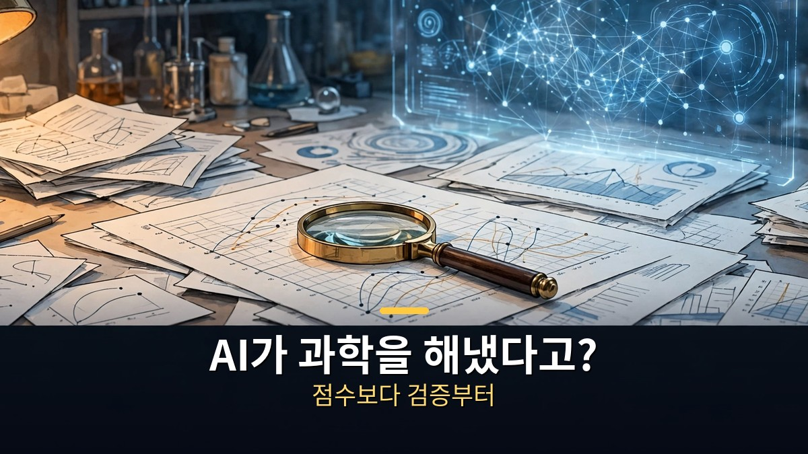
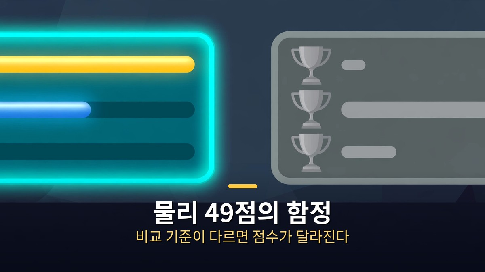
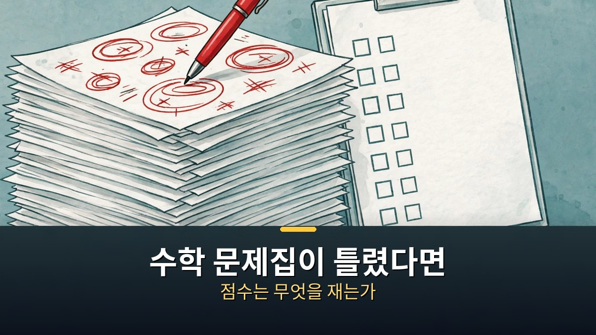
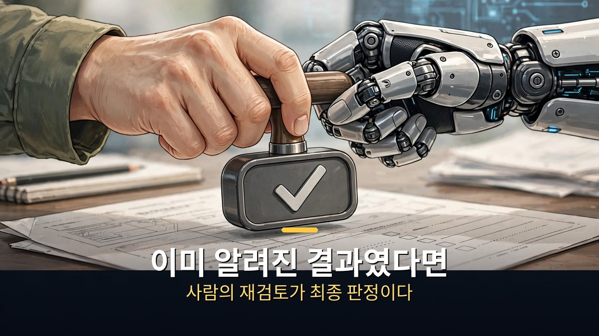

<!-- 본문 시작 -->

AI가 과학에서 성과를 냈다는 소식이 쏟아진다.
물리 문제를 거의 다 맞혔다, 논문 오류를 찾아냈다, 수학 증명을 내놨다.
그런데 이 소식들을 그대로 믿기 전에, 먼저 물어야 할 것이 있다.
점수는 어떻게 매겨졌고, 누가 다시 확인했는가.

**핵심은 이것이다. AI의 과학 성과는 '해냈다'는 문장보다 '어떻게 검증했는가'로 읽어야 한다. 점수표가 틀렸거나, 비교 기준이 어긋났거나, 이미 알려진 결과와 겹쳤다면, 그 성과는 아직 주장 단계에 머문다.**

> TheAIGRID 영상(2026년 11월 3일, 25분)은 AI의 과학 성과를 나열하는 데 그치지 않고, 각 사례마다 점수·비교·재검토의 문제를 함께 짚는다. 이 글은 그 영상의 흐름을 따라, 발표를 곧이곧대로 받아들이지 않고 가려 읽는 기준을 정리한 것이다.

## 물리 49점의 함정, 점수표는 왜 어긋나나

물리 문제를 거의 다 맞혔다는 평가가 영상에서 소개된다.
50개 중 49개라는 숫자만 보면 압도적으로 보인다.
그런데 같은 점수표 안에서 한 모델만 유난히 높게 나온 대목이 문제로 지적된다.

비교 기준이 다르면 점수는 의미가 달라진다.
어떤 문제는 어떤 모델에게만 유리하게 출제됐을 수 있고, 채점 방식이 달라졌을 수도 있다.
영상은 실제 난이도를 다시 매긴 결과를 함께 보여주며, 처음 나온 숫자만으로 우열을 가리지 말라고 이끈다.

독자가 챙길 기준은 단순하다.
점수 옆에 '무엇을, 누구와, 어떤 방식으로 비교했는가'가 적혀 있는지를 보는 것이다.
이 세 가지가 빠져 있다면, 그 점수는 광고 문구에 가깝다.

## 수학 문제집이 틀렸다면, 점수는 무엇을 재는가

수학 벤치마크의 답 자체가 틀렸다는 지적도 영상에서 다뤄진다.
전체 문제 중 상당수에 오류가 있었다는 설명이다.
문제집이 틀렸는데 점수가 높다고 해서, 실력이 높다고 말할 수는 없다.

논문 감사 사례는 같은 문제를 다른 각도에서 보여준다.
영상에서 소개된 감사 기능은 약 800편의 논문을 검토해 중대한 오류를 일부, 사소한 오류를 더 많은 비율에서 찾았다고 한다.
중대하다고 표시된 지적 중 실제로 맞는 비율도 함께 언급된다.
기계가 찾아낸 오류라도, 사람이 다시 확인해야 최종 판단이 된다는 뜻이다.

이 두 사례가 주는 교훈은 하나다.
AI가 만든 결과물은 '빠른 1차 검토'로는 훌륭하지만, '최종 판정'으로는 부족하다.
빠름과 정확함은 다른 능력이기 때문이다.

## 수학 아이디어가 이미 알려진 결과였다면

수학 증명 시도 사례에서는 더 미묘한 문제가 나온다.
AI가 내놓은 아이디어가 검토를 거치며, 이미 알려진 결과와 겹친다는 지적이 제기됐다.
새로운 발견인 줄 알았던 것이, 알려진 사실의 다른 표현이었던 셈이다.

영상은 이 과정을 실패로만 그리지 않는다.
AI의 제안을 사람이 보완해 정리하는 흐름도 함께 소개한다.
AI가 던진 아이디어가 출발점이 되고, 사람이 그 의미를 가려 최종 형태로 만드는 협업이다.

코딩 능력에 대한 전망도 같은 잣대로 읽어야 한다.
어떤 회사가 '몇 년 안에 사람의 소프트웨어 업무를 대신할 수 있을 것'이라고 말했더라도, 그것은 전망이지 이미 검증된 사실이 아니다.
실험실 안전에 대한 논의 역시 마찬가지다.
AI를 과학 연구에 쓸 때 생길 수 있는 위험과 이를 막을 장치를 함께 논하는 단계다.

## 자주 묻는 질문

**Q. AI가 낸 과학 성과는 전부 거짓인가요?**
아니다. 문제는 성과가 '없다'가 아니라 '어디까지 확인됐는가'가 다르다는 점이다. 초기 연구, 주장, 전망, 재검토 중인 결과는 각각 무게가 다르다.

**Q. 일반 독자는 무엇을 보고 가려야 하나요?**
점수 옆의 비교 기준, 독립적인 재현 여부, 사람의 재검토 여부를 본다. 이 세 가지 중 하나라도 빠져 있으면 판단을 미루는 것이 안전하다.

**Q. 벤치마크 점수는 아예 못 믿는 건가요?**
그렇지 않다. 벤치마크는 빠른 비교 도구로는 유용하다. 다만 점수 하나만으로 '최고'나 '인간 초월'을 단정하지 않는 것이 핵심이다.

## 함께 읽으면 좋은 글

[AI가 번 돈, 일 잃은 사람에게 돌아갈까｜앤트로픽 지분 5% 공익기금의 실체 — 지분 5% 약속이 아직은 조건 달린 약속인 이유](https://aitechnoteskr.tistory.com/92)
[아이, 로봇｜로봇 3원칙이 흔들리는 날, 형사는 무엇을 믿어야 하나 — 규칙이 흔들릴 때 인간의 판단을 묻는 영화](https://aitechnoteskr.tistory.com/97)
[블레이드 러너 2049｜기억을 가진 인조인간, 인간의 기준을 묻다 — 기억이 인간성의 기준이 될 수 있는지 묻는 영화](https://aitechnoteskr.tistory.com/87)

AI 과학 소식을 볼 때마다 점수보다 검증 과정을 먼저 찾게 된다면, 이 글이 할 일은 다 한 셈이다. 다음 소식도 함께 가려 읽고 싶다면 이웃 추가를 눌러두면 된다.

<!-- 본문 끝 -->

## 작업용 출처·이미지 정보 (업로드 제외)

- 자료 출처: TheAIGRID 영상 9FjbFGYKxAc(2026-11-03, 25:00, 스크립트 패널 요약 기준) + 로이터·재팬타임스 2026-11-02 지수시간가설 보도는 이 영상에서 확인되지 않아 주제로 삼지 않음
- 이미지: images/01-hero.jpg ~ 04-img3.jpg / 자작 일러스트 + 한글 배너 오버레이 (1200x675)
