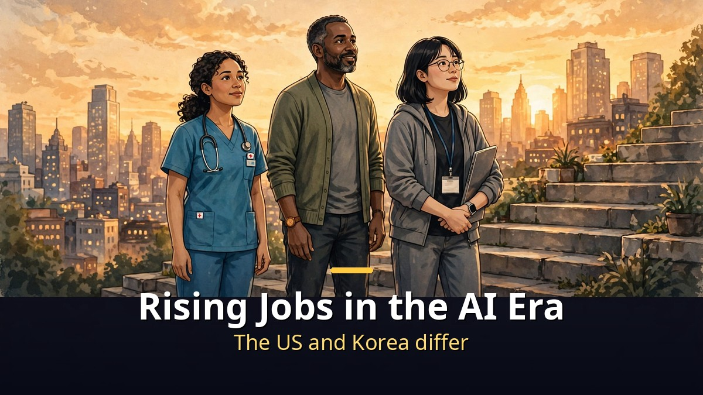
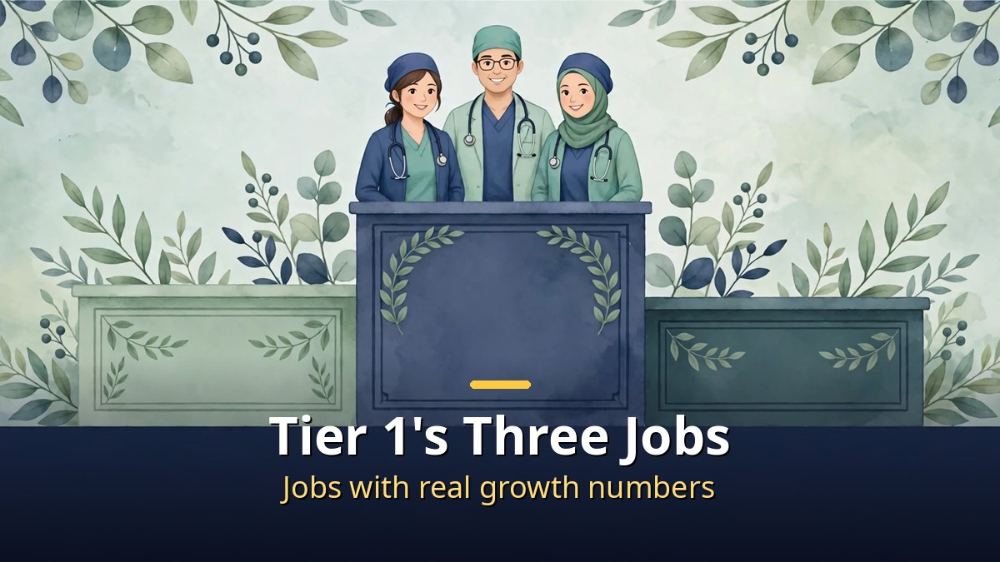
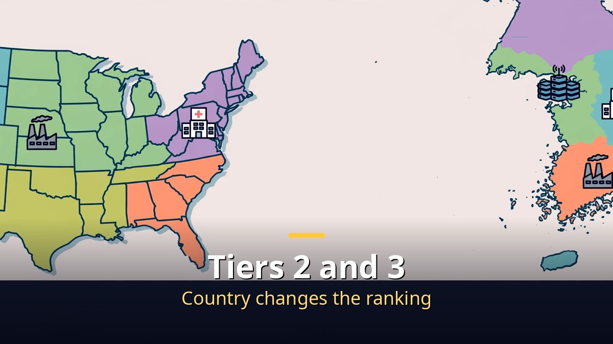

<!-- 본문 시작 -->

That AI is changing jobs is no longer news.
But ask which jobs are rising and which are fading, and the answers vary.
Can US reports alone give the answer?
Korea's reality may differ.

**The key point is this: when judging a job's future, look first at actual growth numbers and whether the same direction holds in Korea, rather than at a favorable forecast. The same tier list changes order when the country changes.**

> The honjobs video (November 3, 2026, 10 minutes 11 seconds) ranks 15 jobs into tiers 1 to 5, based on statements by AI company leaders and researchers, and reports from the World Economic Forum (WEF), the US Bureau of Labor Statistics (BLS), and Korea's employment information service. This article does not copy the tier list as is; it reorganizes it around the evidence and the differences with Korea.

## Tier 1's Three Jobs: Why They Rank Highest

Tier 1 holds AI and machine learning specialists, care workers, and nurses.
Their common feature is actual growth numbers.
These are not jobs with only good forecasts; their growth is already confirmed.

AI and machine learning specialists are backed by both the WEF outlook and Korea's forecast of an AI talent shortage.
But the video adds a condition.
People who build, fix, and judge AI matter more than people who merely use it.
Using a tool and building a tool are valued differently in the market.

Care workers reportedly faced no counter-evidence in the video.
Korea's care worker count rose from about 450,000 in 2020 to 650,000 in 2025.
But the share of certificate holders actually working is low, the average age is high, and pay and working conditions still need to catch up.
A rising headcount does not mean better conditions for workers.

Nurses are introduced as a job named by several prominent figures together.
In the US, registered nurse numbers and median pay have risen, and nurse practitioners rank as a fastest-growing job.
In Korea, the share of license holders actually working is low, so the problem is framed not as a shortage of people but as people leaving.
"There are too few" and "people are leaving" call for different solutions.

## Tiers 2 and 3: Will Jobs Rising in the US Rise in Korea Too?

Tier 2 holds data center technicians, counselors, and electricians.
Tier 3 holds plumbers, cybersecurity specialists, and data scientists.
In this range, the most important variable is the country.

Data center technicians are backed by US data center hiring growth, but operating jobs shrink after construction ends, the video explains.
Electricians are backed by US job and wage growth, but Korea's employment outlook points to decline for electrical and electronics trades, which keeps them in tier 2.
That a job rises in the US does not mean it rises in Korea — the video's most repeated warning.

Cybersecurity is backed by US growth and a global talent shortage, but a Korean company survey found a high share saying no separate security staff was needed.
Data scientists show very high US growth, but experts increasingly warn that AI itself does data analysis, which is why they sit in tier 3.
For each job, it matters whether AI replaces part of the work or makes the work more necessary.

| Tier | Jobs | Key evidence |
|---|---|---|
| Tier 1 | AI/ML specialists, care workers, nurses | Actual growth numbers plus agreement across reports |
| Tier 2 | Data center technicians, counselors, electricians | Strong US growth, variables in Korea |
| Tier 3 | Plumbers, cybersecurity specialists, data scientists | Growth evidence mixed with counter-evidence |
| Tier 4 | Phlebotomists, solar/wind installers, HVAC technicians | Small growth or small markets |
| Tier 5 | Fintech engineers, athletes, construction technicians | Forecasts only, or decline in Korea |

## Tier 5 and Missing Jobs: The Limits of a Tier List

Tier 5 holds fintech engineers, athletes, and construction technicians.
Fintech engineers are backed only by a WEF outlook, with no recent growth numbers found, the video explains.
Construction technicians face a US labor shortage argument, but Korean construction jobs have fallen for several quarters in a row, and Korea's outlook also points to decline.

Jobs missing from the list are also worth noting.
Software developers reportedly saw almost no US employment growth over the past two years, with more reports of decline.
Doctors were left out because no source directly naming them was found.
Absence from the list does not mean a job is not rising; it means there was no evidence to include it under these criteria.

The video groups tier 1 and 2 jobs into three broad kinds.
Work that directly cares for body and mind, work that builds and fixes things on site by hand, and work that directly builds and handles AI.
And it notes that a high tier does not mean easy entry or good conditions.
A tier list shows direction; it does not guarantee entry barriers or pay.

## Frequently Asked Questions

**Q. Is switching to a tier 1 job safe?**
A tier list is a forecast, not a guarantee. Check qualification time, the share actually working, and pay and conditions together. As care workers and nurses show, fields with shortages also lose many workers.

**Q. Can US data be applied directly to a career in Korea?**
No. That is the point the video stresses repeatedly. In Korea, growth points toward care, health, engineering, and IT professionals, while field trades such as electrical and construction still point downward.

**Q. Does using AI well make a job safe?**
Using skill alone is not enough, the video concludes. Moving toward building, fixing, and judging AI matters more.

## Recommended Reading

[Will AI's Money Reach Workers Who Lost Jobs?｜What Anthropic's 5% Public Benefit Fund Really Is — why the 5% equity pledge is still a conditional promise](https://aitechnotesen.blogspot.com/2026/11/will-ais-money-reach-workers-who-lost.html)
[I, Robot｜When Three Laws Shake, What Should a Detective Believe — a film that asks what human judgment is worth when rules wobble](https://aitechnotesen.blogspot.com/2026/11/i-robotwhen-three-laws-shake-what.html)
[Blade Runner 2049｜A Replicant with Memories Asks What Makes Us Human — a film that asks whether memory can be the standard of humanity](https://aitechnotesen.blogspot.com/2026/11/blade-runner-2049a-replicant-with.html)

When judging a job's future, the habit of checking actual numbers and Korean reality behind a tier list matters more than the list itself. Follow along if you want to keep tracking this topic.

<!-- 본문 끝 -->

## 작업용 출처·이미지 정보 (업로드 제외)

- 자료 출처: honjobs 영상 iLh7lDLIh5A(2026-11-03, 10:11, 스크립트 패널 요약 기준, 자동 생성 자막 수치 깨짐 구간은 확정 수치로 쓰지 않음)
- 이미지: images/01-hero-en.jpg ~ 04-img3-en.jpg / 자작 일러스트 + 영어 배너 오버레이 (1200x675)
