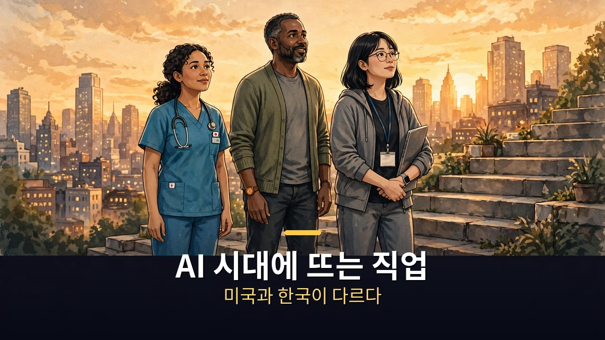
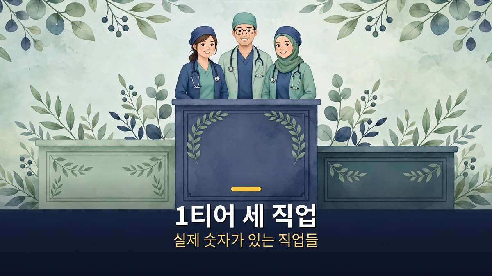
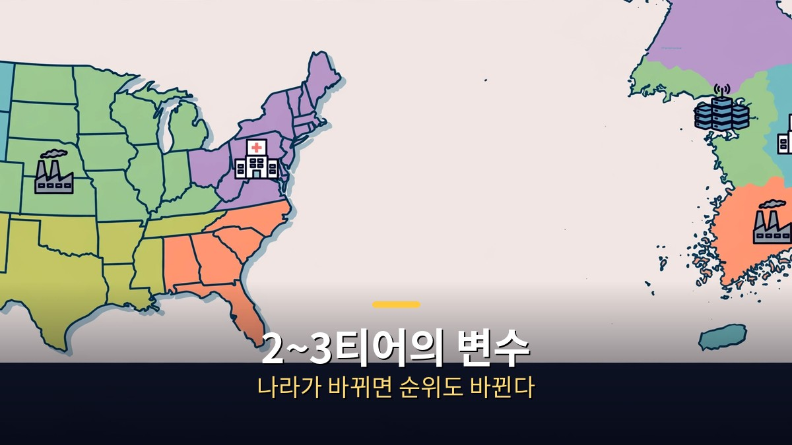

<!-- 본문 시작 -->

AI가 일자리를 바꾼다는 말은 이제 낯설지 않다.
그런데 어떤 직업이 뜨고, 어떤 직업이 지는지 물으면 답은 제각각이다.
미국 보고서만 보면 답이 나올까.
한국 현실은 다를 수 있다.

**핵심은 이것이다. 직업의 미래를 볼 때는 '전망이 좋다'는 말보다 '실제로 늘어난 숫자'와 '한국에서도 같은 방향인가'를 먼저 봐야 한다. 같은 티어표라도 나라가 바뀌면 순위가 바뀐다.**

> honjobs 영상(2026년 11월 3일, 10분 11초)은 AI 기업 대표와 연구자의 발언, 세계경제포럼(WEF)·미국 노동통계국(BLS)·한국고용정보원 보고서를 근거로 15개 직업을 1~5티어로 정리했다. 이 글은 그 티어표를 그대로 옮기지 않고, 근거와 한국과의 차이를 중심으로 다시 정리한 것이다.

## 1티어 세 직업, 왜 가장 위에 올랐나

1티어에는 AI·머신러닝 전문가, 요양보호사, 간호사가 올랐다.
세 직업의 공통점은 '실제로 늘어난 숫자'가 있다는 점이다.
전망만 좋은 직업이 아니라, 이미 증가가 확인된 직업들이다.

AI·머신러닝 전문가는 WEF 상위 전망과 한국 고용노동부의 AI 인력 부족 전망이 함께 꼽힌다.
다만 영상은 한 가지 단서를 단다.
AI를 단순히 쓰는 사람보다, AI를 만들고 고치고 판단하는 쪽이 중요하다는 점이다.
도구를 쓰는 능력과 도구를 만드는 능력은 시장에서 다르게 평가된다.

요양보호사는 반대 근거가 나오지 않았다고 설명된다.
한국 요양보호사 수는 2020년 약 45만 명에서 2025년 65만 명으로 늘었다.
다만 자격증 소지자 중 실제 근무 비율이 낮고 평균 연령이 높으며, 임금과 처우가 따라와야 한다는 지적도 함께 나온다.
숫자가 늘었다고 해서 일하는 사람의 처우까지 좋아진 것은 아니다.

간호사는 여러 유명 인사가 함께 꼽은 직업으로 소개된다.
미국에서는 등록간호사 수와 중위 연봉이 올랐고, 전문간호사가 가장 빠르게 늘어날 직업으로 꼽힌다.
한국에서는 면허 소지자 중 실제 근무 비율이 낮아, 사람이 부족한 것이 아니라 떠나는 사람이 많은 문제도 지적된다.
'부족하다'는 말과 '떠난다'는 말은 대책이 다르다.

## 2~3티어, 미국에서 뜨는 일이 한국에서도 뜰까

2티어에는 데이터센터 기술자, 심리상담사, 전기기사가 올랐다.
3티어에는 배관공, 사이버보안 전문가, 데이터 과학자가 올랐다.
이 구간에서 가장 중요한 변수는 '나라'다.

데이터센터 기술자는 미국 데이터센터 고용 증가가 근거지만, 건설이 끝난 뒤 운영 고용은 줄어든다고 설명된다.
전기기사는 미국 일자리와 임금 증가가 근거지만, 한국고용정보원 전망에서는 전기·전자 기능직이 감소 쪽이라 2티어에 머문다.
미국에서 뜬다고 한국도 뜨는 것이 아니라는, 이 영상의 가장 반복되는 경고다.

사이버보안은 미국 증가와 전 세계 인력 부족이 근거지만, 한국 기업 조사에서는 별도 보안 인력이 필요 없다고 답한 비율이 높다고 한다.
데이터 과학자는 미국 증가율이 매우 크지만, AI가 직접 데이터 분석을 하면서 오히려 위험하다는 목소리가 커 3티어라고 설명된다.
같은 직업이라도, AI가 그 일의 일부를 대신하는지, 그 일을 더 필요하게 만드는지를 나눠 봐야 한다.

| 티어 | 직업 | 핵심 근거 |
|---|---|---|
| 1티어 | AI·머신러닝 전문가, 요양보호사, 간호사 | 실제 증가 숫자 + 여러 보고서 일치 |
| 2티어 | 데이터센터 기술자, 심리상담사, 전기기사 | 미국 증가 강함, 한국은 변수 있음 |
| 3티어 | 배관공, 사이버보안 전문가, 데이터 과학자 | 증가 근거와 반대 근거가 함께 있음 |
| 4티어 | 채혈사, 태양광·풍력 설치 기술자, 냉난방 정비원 | 증가 폭 작거나 시장 작음 |
| 5티어 | 핀테크 엔지니어, 운동선수, 건설 기술자 | 전망만 있거나 한국 감소 쪽 |

## 5티어와 빠진 직업, 티어표의 한계

5티어에는 핀테크 엔지니어, 운동선수, 건설 기술자가 올랐다.
핀테크 엔지니어는 WEF 상위 전망이 유일한 근거로 제시되고, 최근 증가 숫자는 찾지 못했다고 설명된다.
건설 기술자는 미국 인력 부족 주장과 달리, 한국 건설 일자리는 여러 분기 연속 줄었고 한국 전망도 감소 쪽이다.

티어표에서 빠진 직업도 눈여겨볼 만하다.
소프트웨어 개발자는 미국 고용이 최근 2년 동안 거의 늘지 않았고 감소 보고서가 더 많다고 설명된다.
의사는 직접 꼽은 자료를 찾지 못해 넣지 않았다고 한다.
티어표에 없다는 것이 '안 뜬다'는 뜻이 아니라, '이 기준으로는 넣을 근거가 없었다'는 뜻이다.

영상은 1·2티어 직업을 크게 세 갈래로 묶는다.
몸과 마음을 직접 돌보는 일, 현장에서 손으로 짓고 고치는 일, AI를 직접 만들고 다루는 일이다.
그리고 티어가 높다고 해서 진입이 쉽거나 처우가 좋은 것은 아니라고 지적한다.
티어표는 방향을 알려줄 뿐, 개인의 진입 장벽과 처우까지 보장하지 않는다.

## 자주 묻는 질문

**Q. 1티어 직업으로 바꾸면 안전한가요?**
티어표는 전망이지 보장이 아니다. 자격 취득 기간, 실제 근무 비율, 임금과 처우를 함께 봐야 한다. 요양보호사와 간호사 사례가 보여주듯, 인력이 부족한 분야에서도 떠나는 사람이 많다.

**Q. 미국 자료를 한국 진로에 그대로 써도 되나요?**
안 된다. 이 영상이 반복해서 강조하는 점이 바로 그것이다. 한국에서 증가 쪽으로 나온 분야는 돌봄·보건과 공학·정보통신 전문가 쪽이고, 전기·건설 같은 현장 기능직은 아직 감소 쪽이다.

**Q. AI를 잘 쓰면 직업이 안전해지나요?**
쓰는 능력만으로는 부족하다는 것이 영상의 정리다. AI를 만들고, 고치고, 판단하는 쪽으로 역량을 옮기는 것이 중요하다고 설명된다.

## 함께 읽으면 좋은 글

[AI가 번 돈, 일 잃은 사람에게 돌아갈까｜앤트로픽 지분 5% 공익기금의 실체 — 지분 5% 약속이 아직은 조건 달린 약속인 이유](https://aitechnoteskr.tistory.com/92)
[아이, 로봇｜로봇 3원칙이 흔들리는 날, 형사는 무엇을 믿어야 하나 — 규칙이 흔들릴 때 인간의 판단을 묻는 영화](https://aitechnoteskr.tistory.com/97)
[블레이드 러너 2049｜기억을 가진 인조인간, 인간의 기준을 묻다 — 기억이 인간성의 기준이 될 수 있는지 묻는 영화](https://aitechnoteskr.tistory.com/87)

직업의 미래를 볼 때 티어표 한 장보다, 그 뒤에 있는 실제 숫자와 한국 현실을 함께 보는 습관이 더 중요하다. 이 주제를 계속 따라가려면 이웃 추가를 눌러두면 된다.

<!-- 본문 끝 -->

## 작업용 출처·이미지 정보 (업로드 제외)

- 자료 출처: honjobs 영상 iLh7lDLIh5A(2026-11-03, 10:11, 스크립트 패널 요약 기준, 자동 생성 자막 수치 깨짐 구간은 확정 수치로 쓰지 않음)
- 이미지: images/01-hero.jpg ~ 04-img3.jpg / 자작 일러스트 + 한글 배너 오버레이 (1200x675)
