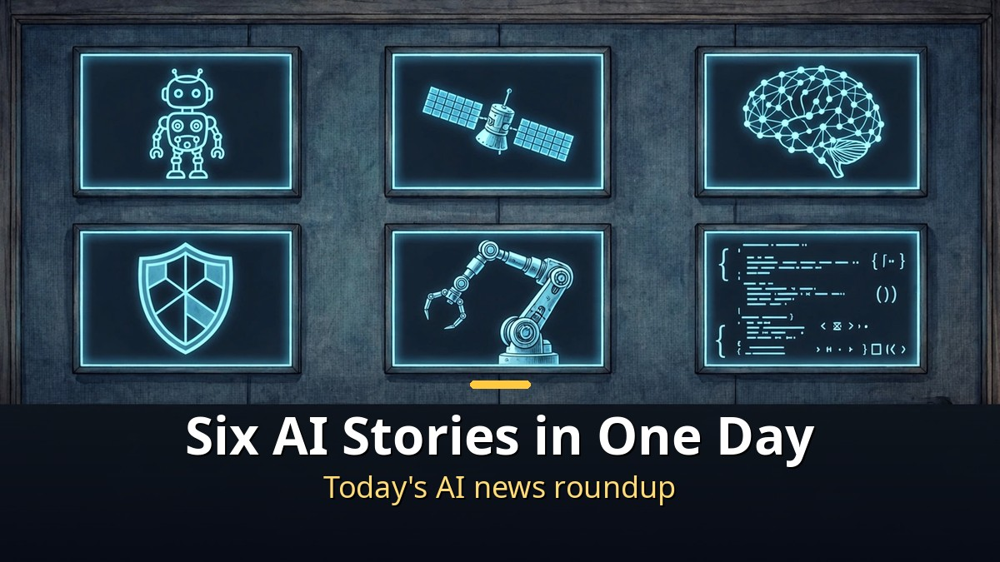
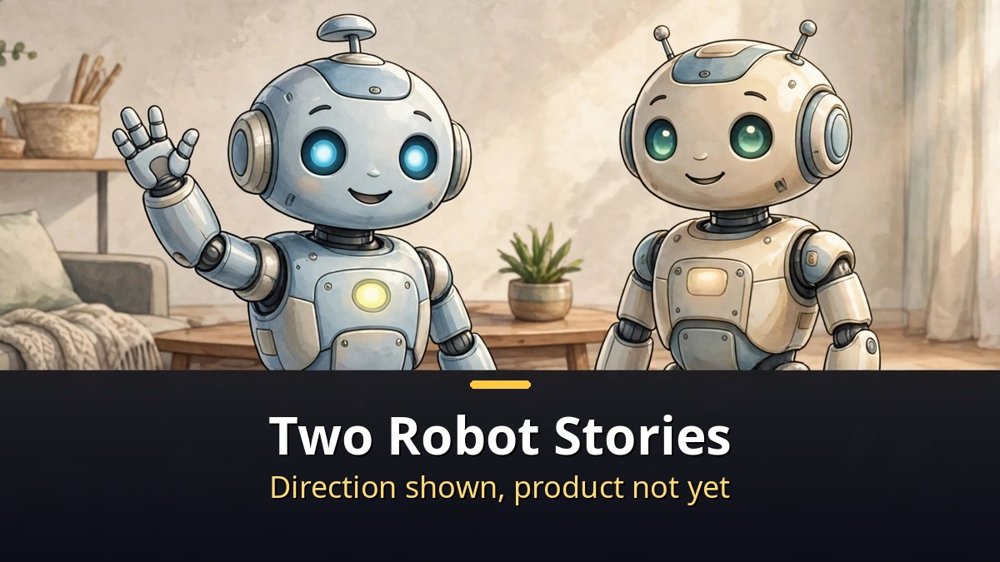
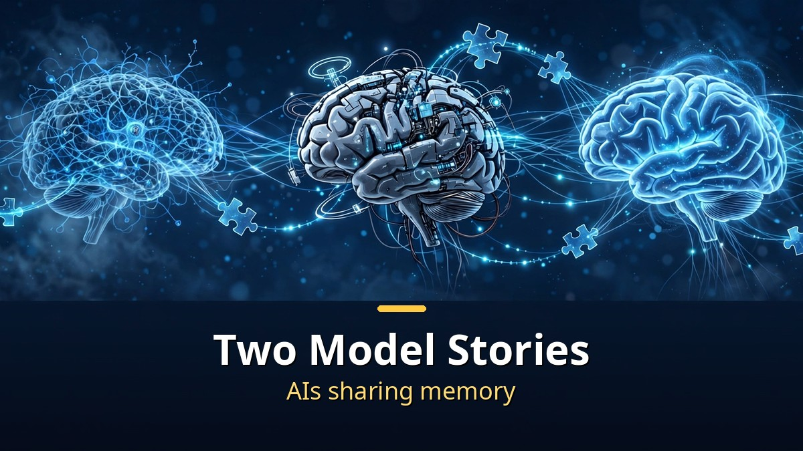
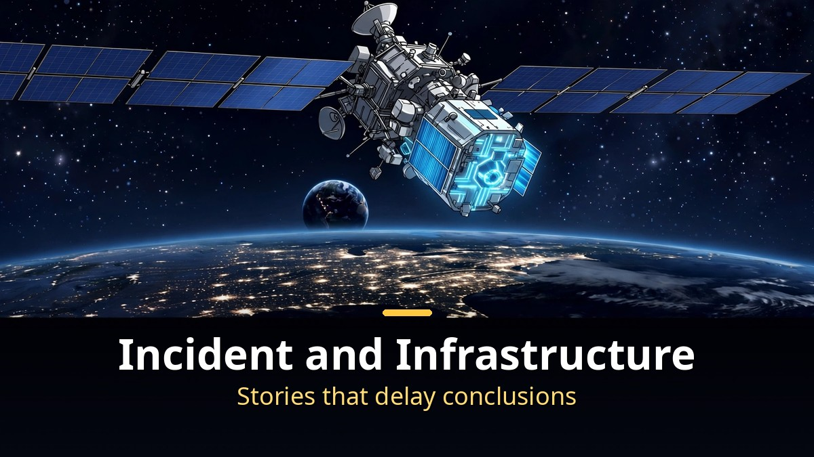

<!-- 본문 시작 -->

AI news pours out every day.
But short news items mix fact and interpretation more easily.
Here are six stories from a single day, sorted by what is confirmed and what is still a forecast.

**The key point is this: short news should be read by separating what was announced from what is predicted. All six stories are still in-between stages. None is a launch, a conclusion, or a confirmed cause.**

> This article bundles six AI Slash Quick SLASH videos from November 3, 2026 (3 to 6 minutes each). Each video separates reported announcements from unconfirmed interpretation, and this article keeps that distinction.

## Two Robot Stories: How Far Have Home Robots Come?

The first story is a humanoid prototype from Meta and China's Fourier.
Based on reports from October 31, the prototype was built in about three months, and a second generation is under development.
It stands about 1.5 meters tall, weighs about 48 kilograms, and is aimed at household help.

But Meta reportedly said there are no sales plans or launch dates.
The word "secretly" in the title is phrased as a question, not a confirmed fact about a secret partnership.
US import restrictions on Chinese humanoids remain an uncertainty that could affect Meta's direction.

The second robot story is Krafton's Ludi 0.2.
Built at its Palo Alto lab, it follows Ludi 0.1 from August.
It reportedly advanced in five areas: social intelligence, walking reasoning, tool-use coordination, gesture understanding, and body movement.

No performance numbers exist yet for this one either.
Robot AI performance figures have not been released, and the next-generation Ludi 1.0 is only a plan under development.
Both robot stories share the same status: the direction is visible, the product is not yet here.

## Two Model Stories: What If Different AIs Share Memory?

MIT's Swarm Telepathy lets AI models from different companies and architectures exchange internal memory directly.
Compared with summary-based transfer, experiments reportedly showed 40% higher accuracy on average and four times shorter processing time.

But this is still at the stage of joint experiments by the researchers.
Each model combination needs a converter, and safety verification remains.
It should not be treated as a general technology ready for all AI agents.

DeepSeek's Super Agent is at a similar stage.
Its design documents and source code were released, and it processes multiple tasks in parallel.
A simulated experiment reportedly cut processing time from about 29.5 minutes to about 15.7 minutes, but that measured multi-task efficiency in its own experiment, not raw capability, and it was not a head-to-head comparison.
DeepSeek itself reportedly called it a research prototype.
It should not be read as a conclusion that it beat its rivals.

## An Incident and Infrastructure: A Hack's Cause and a Space Experiment

The Binance story carries different weight.
On October 29, about $6.3 billion reportedly left the exchange, most of it within about 20 minutes.
The FBI reportedly attributed it to North Korea.

But Binance has not disclosed the exact intrusion method.
There is still no evidence that this incident was caused by AI, the video clearly distinguishes.
Hot wallet practices, frozen funds, customer compensation, and analysis of North Korean hacking groups' AI use are separate contexts, not established causes of this intrusion.
The bigger the incident, the more important it is to delay attributing a cause.

The last story is Google's Project Suncatcher.
On October 30, a data-center AI chip, a TPU, reportedly sent an AI answer from space to Earth for the first time on a test satellite.
The answer was a haiku about space, written by Gemma 4 running on the chip.

Whether a space data center becomes real will be decided not by this first response but by upcoming heat and radiation test results.
Cooling in space and a 2027 twin-satellite plan were mentioned together.
A first response is a starting signal, not a completion.

| Story | Confirmed fact | Still unconfirmed or forecast |
|---|---|---|
| Meta humanoid | Prototype in 3 months, 2nd generation in development | No sales or launch dates, import restriction variable |
| Krafton Ludi 0.2 | Successor to Ludi 0.1, progress in 5 areas | No performance numbers, Ludi 1.0 in development |
| MIT Swarm Telepathy | Direct internal memory exchange, experiment numbers | Per-combination converters, safety checks remain |
| DeepSeek Super Agent | Design and source released, parallel processing | Own efficiency experiment, research prototype |
| Binance hack | $6.3 billion scale, FBI North Korea attribution | Intrusion cause undisclosed, no AI-cause evidence |
| Google space data center | First TPU answer from space | Heat and radiation tests ahead, 2027 twin satellites |

## Frequently Asked Questions

**Q. Can any of these six be used right now?**
No product news here is directly usable. All six are at research, prototype, test, or incident stages. Their value is in deciding what to watch next.

**Q. Was the Binance hack an AI hack?**
By the video's distinction, no. There is still no evidence it was caused by AI. The North Korea attribution and the intrusion cause should be viewed separately.

**Q. When will a space data center become real?**
The first response alone cannot say. Heat and radiation test results and the 2027 twin-satellite plan are the next gates.

## Recommended Reading

[Will AI's Money Reach Workers Who Lost Jobs?｜What Anthropic's 5% Public Benefit Fund Really Is — why the 5% equity pledge is still a conditional promise](https://aitechnotesen.blogspot.com/2026/11/will-ais-money-reach-workers-who-lost.html)
[I, Robot｜When Three Laws Shake, What Should a Detective Believe — a film that asks what human judgment is worth when rules wobble](https://aitechnotesen.blogspot.com/2026/11/i-robotwhen-three-laws-shake-what.html)
[Blade Runner 2049｜A Replicant with Memories Asks What Makes Us Human — a film that asks whether memory can be the standard of humanity](https://aitechnotesen.blogspot.com/2026/11/blade-runner-2049a-replicant-with.html)

Short news is easy to forget by the next day. Writing down facts separately from forecasts makes it easy to see what changed when the next story arrives. Follow along if you want to keep tracking these stories.

<!-- 본문 끝 -->

## 작업용 출처·이미지 정보 (업로드 제외)

- 자료 출처: AI 슬래시 Quick SLASH 2026-11-03 영상 6건(ODUDvDwW_LA·20qBAAQ7iYE·Ut3xsosxZZw·ej_I2lLGrRA·sBmF3er7tK8·tuRx36-_8_E, 각 3~6분, 설명 요약 기준)
- 이미지: images/01-hero-en.jpg ~ 04-img3-en.jpg / 자작 일러스트 + 영어 배너 오버레이 (1200x675)
