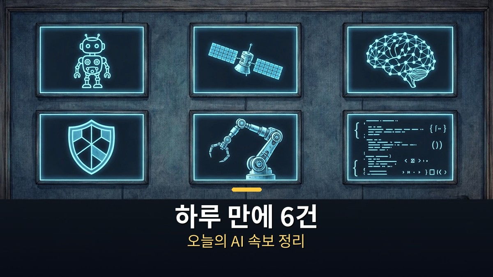
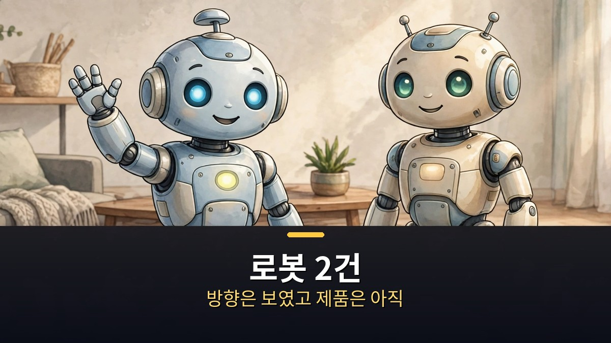
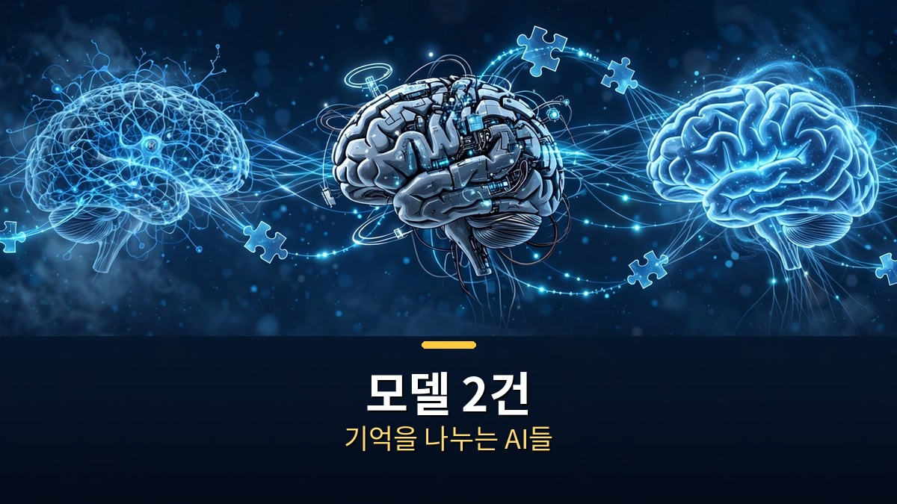
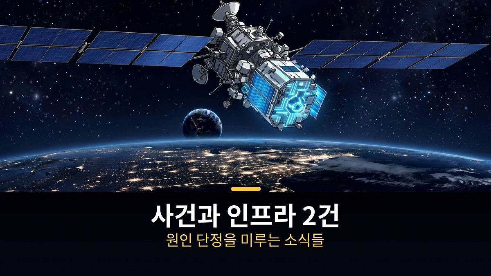

<!-- 본문 시작 -->

하루에 쏟아지는 AI 소식은 많다.
그런데 짧은 소식일수록 사실과 해석이 뒤섞이기 쉽다.
오늘 나온 6건을 한 번에 훑되, 어디까지가 확인된 사실이고 어디부터가 전망인지 가려 보자.

**핵심은 이것이다. 단신은 '발표됐다'는 사실과 '앞으로 이렇다'는 해석을 분리해서 읽어야 한다. 6건 모두 아직은 중간 단계의 소식이다. 출시도, 확정도, 원인 규명도 아니다.**

> AI 슬래시 Quick SLASH 2026년 11월 3일 영상 6건(각 3~6분)을 묶어 정리한 것이다. 각 영상은 보도·발표 내용과 아직 확정되지 않은 해석을 구분해 설명하는 형식을 취하고 있으며, 이 글도 그 구분을 유지한다.

## 로봇 2건, 집안일 로봇은 어디까지 왔나

첫 소식은 메타와 중국 Fourier의 휴머노이드 시제품이다.
10월 31일 여러 매체 보도 기준, 약 3개월 만에 시제품을 만들었고 2세대를 개발 중이라고 한다.
키 약 1.5m, 무게 약 48kg, 집안일을 돕는 가정용 방향이다.

다만 메타는 판매 계획이나 출시 일정이 없다고 밝혔다고 한다.
제목의 '몰래'라는 표현은 의문 형태일 뿐, 비밀 협력이 확정된 사실로 제시되지는 않는다.
미국의 중국산 휴머노이드 수입 제한 변수가 앞으로 방향에 영향을 줄 수 있는 불확실성으로 남아 있다.

두 번째 로봇 소식은 크래프톤의 Ludi 0.2다.
미국 팔로알토 연구소에서 만든 모델로, 8월 공개된 Ludi 0.1의 후속이다.
사회 지능, 보행 추론, 도구 조작 연계, 제스처 이해, 신체 움직임 등 다섯 분야에서 발전했다고 소개된다.

이쪽도 아직 수치가 없다.
로봇 AI의 성능을 보여주는 수치는 나오지 않았고, 차세대 Ludi 1.0은 개발 중이라는 미래 계획일 뿐이다.
두 로봇 소식의 공통점은 '방향은 보였고, 제품은 아직'이라는 점이다.

## 모델 2건, 다른 AI끼리 기억을 나누면

MIT가 공개한 Swarm Telepathy는 서로 다른 회사·구조의 AI 모델 사이에서 내부 기억을 직접 주고받는 방식이다.
요약 전달 방식보다 정확도가 평균 40% 높고, 처리 시간은 4배 짧았다는 실험 결과가 소개된다.

다만 아직 연구진이 함께 실험한 결과 단계다.
모델 조합마다 변환기가 필요하고 안전 검증도 남아 있다.
모든 AI 에이전트에 바로 적용되는 일반 기술로 확정해서는 안 된다는 것이 영상의 구분이다.

딥시크의 Super Agent도 비슷한 단계다.
설계 문서와 소스코드가 공개됐고, 여러 작업을 병렬로 처리하는 방식이다.
모의 실험에서 처리 시간이 약 29.5분에서 약 15.7분으로 줄었다고 소개되지만, 이는 성능 실력을 잰 것이 아니라 다중 작업 효율을 잰 자체 실험이며 직접 비교도 아니다.
딥시크 스스로 연구용 프로토타입이라고 밝혔다고 한다.
'앞섰다'는 결론으로 읽으면 안 되는 소식이다.

## 사건과 인프라 2건, 해킹 원인과 우주 실험

바이낸스 소식은 무게가 다르다.
10월 29일 약 63억 달러 규모의 자금이 대부분 약 20분 안에 빠져나갔다는 집계가 소개된다.
FBI는 북한 소행으로 지목했다고 한다.

그러나 바이낸스는 정확한 침입 원인을 공개하지 않았다.
이번 사건이 AI 때문이라는 근거는 아직 없다고 영상은 분명히 구분한다.
핫월렛 방식, 동결된 자금, 고객 보상, 북한 해킹 조직의 AI 활용 분석은 별개 맥락이며, 이번 침입의 원인으로 단정되지 않는다.
큰 사건일수록 원인 단정을 미루는 것이 정확하다.

마지막 소식은 구글의 Project Suncatcher다.
10월 30일 시험 위성에서 데이터센터용 AI 칩 TPU가 우주에서 처음으로 AI의 답을 지구로 보냈다고 한다.
칩 위에서 돌아간 Gemma 4가 우주를 주제로 쓴 하이쿠 한 편이 그 답이었다.

우주 데이터센터가 현실이 될지는 이번 첫 응답이 아니라, 앞으로 이어질 열과 방사선 시험 결과가 정한다고 한다.
우주에서 열을 식히는 방법 문제와 2027년 쌍둥이 위성 계획이 함께 언급된다.
첫 응답은 출발 신호이지, 완성이 아니다.

| 소식 | 확인된 사실 | 아직 미확인·전망 |
|---|---|---|
| 메타 휴머노이드 | 3개월 만 시제품, 2세대 개발 중 | 판매·출시 일정 없음, 수입 제한 변수 |
| 크래프톤 Ludi 0.2 | Ludi 0.1 후속, 5분야 발전 | 성능 수치 없음, Ludi 1.0은 개발 중 |
| MIT Swarm Telepathy | 내부 기억 직접 교환, 실험 수치 | 조합별 변환기·안전 검증 남음 |
| 딥시크 Super Agent | 설계·소스 공개, 병렬 처리 | 자체 효율 실험, 연구용 프로토타입 |
| 바이낸스 해킹 | 63억 달러 규모, FBI 북한 지목 | 침입 원인 미공개, AI 원인 근거 없음 |
| 구글 우주 데이터센터 | TPU 첫 우주 응답 | 열·방사선 시험 이후 판단, 2027년 쌍둥이 위성 |

## 자주 묻는 질문

**Q. 6건 중 당장 써먹을 수 있는 것은 있나요?**
직접 쓸 수 있는 제품 소식은 없다. 6건 모두 연구·시제품·시험·사건 단계다. 당장 쓸 것보다 '어디를 지켜볼 것인가'를 정하는 데 의미가 있다.

**Q. 바이낸스 해킹은 AI 해킹인가요?**
영상 기준으로 아니다. AI 때문이라는 근거는 아직 없다고 분명히 구분된다. 북한 소행 지목과 침입 원인은 별개로 봐야 한다.

**Q. 우주 데이터센터는 언제쯤 현실이 되나요?**
이번 첫 응답만으로는 알 수 없다. 열과 방사선 시험 결과, 2027년 쌍둥이 위성 계획이 다음 관문이다.

## 함께 읽으면 좋은 글

[AI가 번 돈, 일 잃은 사람에게 돌아갈까｜앤트로픽 지분 5% 공익기금의 실체 — 지분 5% 약속이 아직은 조건 달린 약속인 이유](https://aitechnoteskr.tistory.com/92)
[아이, 로봇｜로봇 3원칙이 흔들리는 날, 형사는 무엇을 믿어야 하나 — 규칙이 흔들릴 때 인간의 판단을 묻는 영화](https://aitechnoteskr.tistory.com/97)
[블레이드 러너 2049｜기억을 가진 인조인간, 인간의 기준을 묻다 — 기억이 인간성의 기준이 될 수 있는지 묻는 영화](https://aitechnoteskr.tistory.com/87)

단신은 하루가 지나면 잊히기 쉽다. 사실과 전망을 가려 적어두는 습관이 쌓이면, 다음 소식이 나왔을 때 무엇이 달라졌는지 바로 보인다. 이 주제를 계속 따라가려면 이웃 추가를 눌러두면 된다.

<!-- 본문 끝 -->

## 작업용 출처·이미지 정보 (업로드 제외)

- 자료 출처: AI 슬래시 Quick SLASH 2026-11-03 영상 6건(ODUDvDwW_LA·20qBAAQ7iYE·Ut3xsosxZZw·ej_I2lLGrRA·sBmF3er7tK8·tuRx36-_8_E, 각 3~6분, 설명 요약 기준)
- 이미지: images/01-hero.jpg ~ 04-img3.jpg / 자작 일러스트 + 한글 배너 오버레이 (1200x675)
