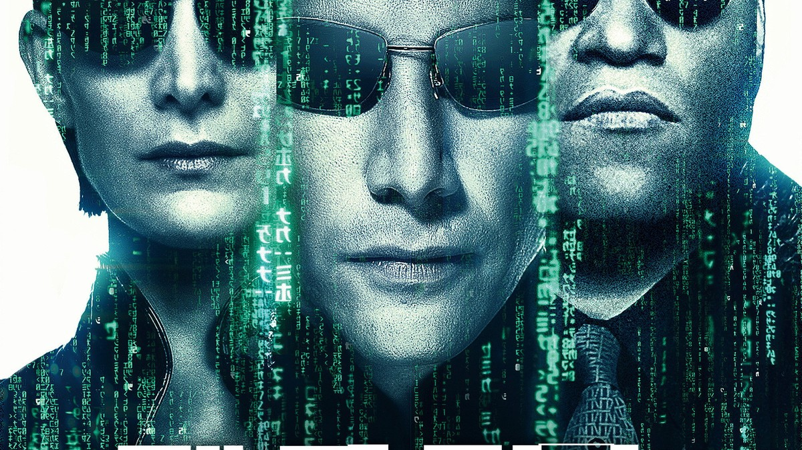
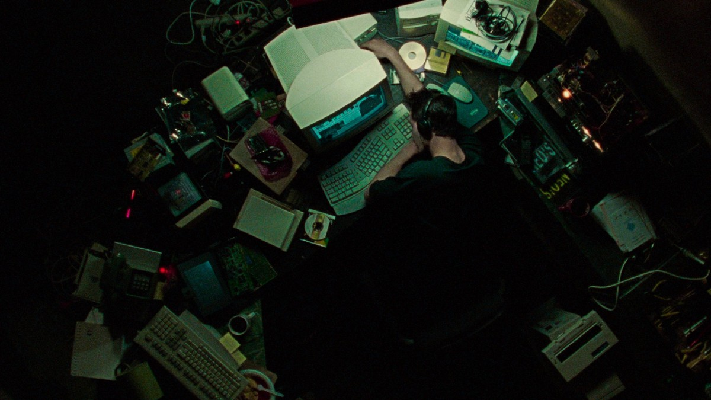
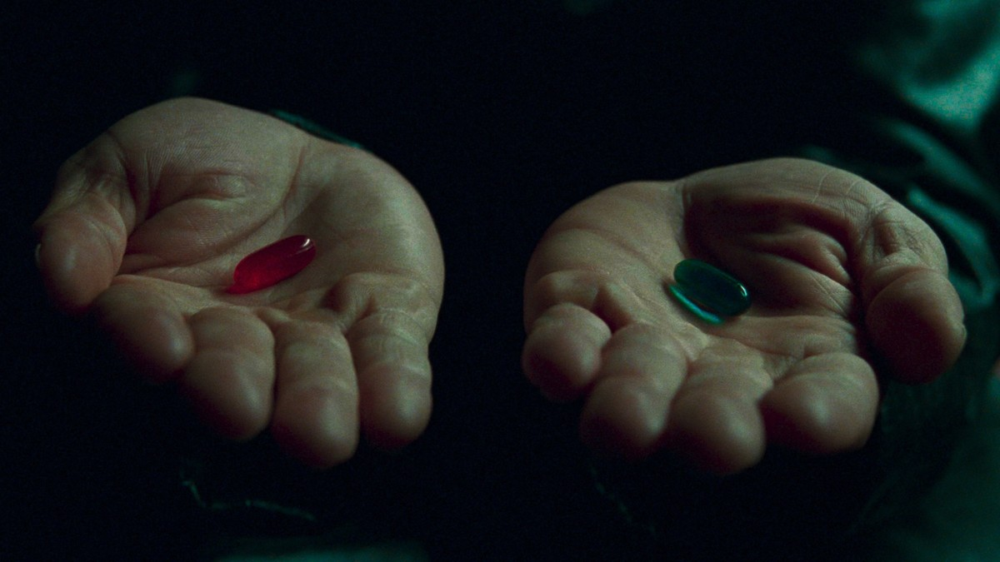
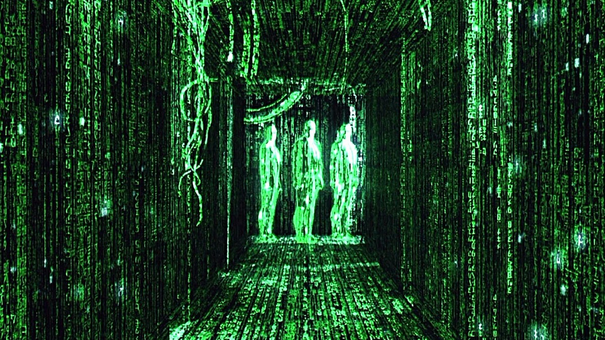
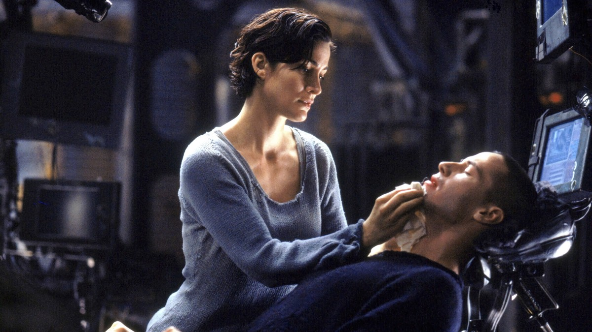
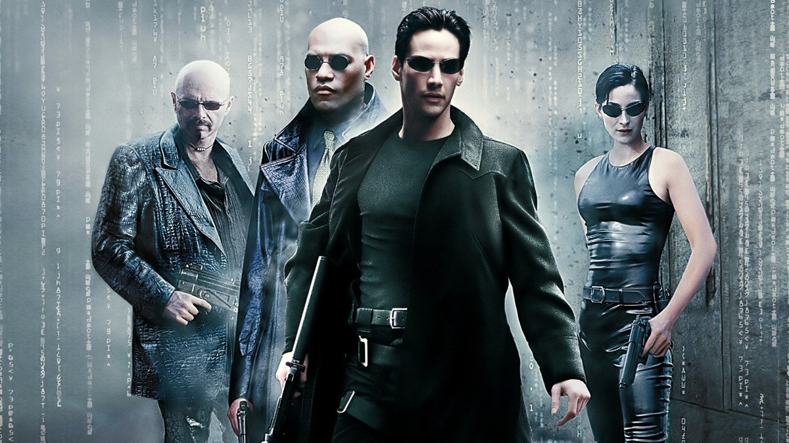
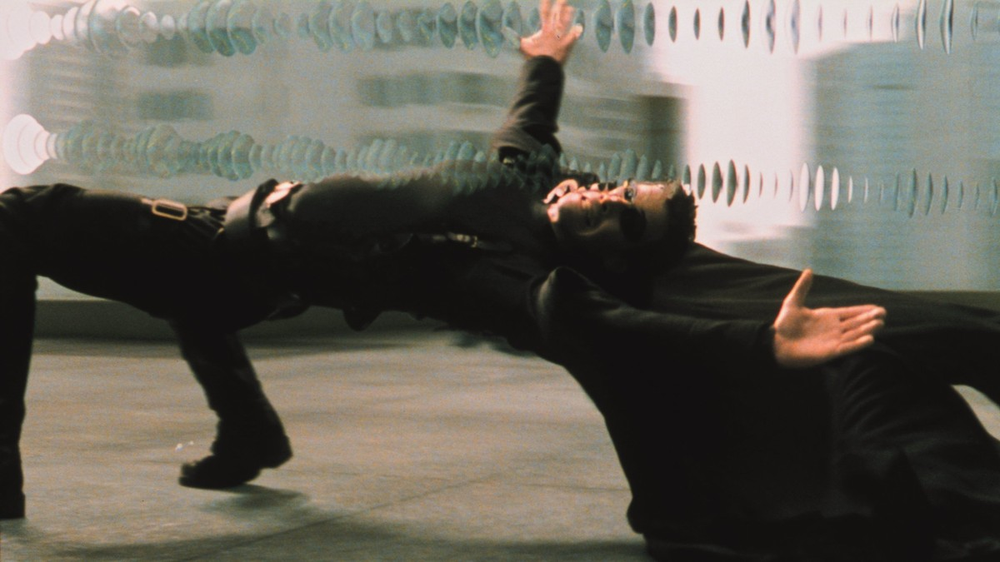
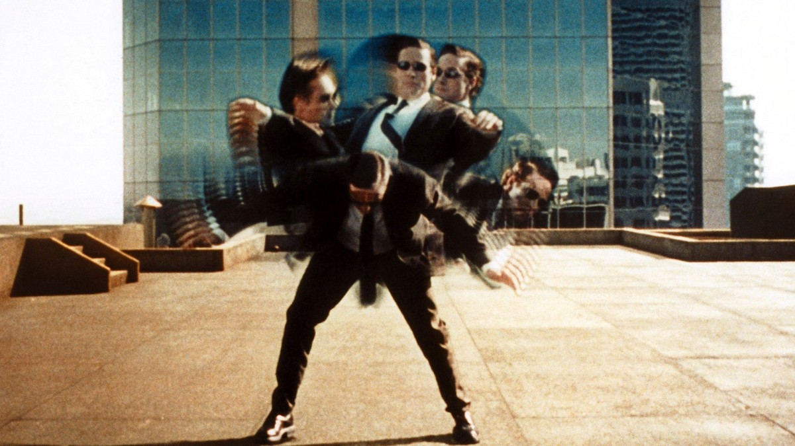

<!-- 본문 시작 -->

By day an ordinary office worker, by night a hacker called Neo.
What if the world he lives in is not real — how would he know?
The 1999 film The Matrix turns that question into action.

**The film asks a simple question. If the reality before your eyes is a simulation someone built, would you want to know the truth, or live comfortably without knowing?**

> A spoiler-free introduction. No ending scenes are covered, and scene descriptions focus on setup and atmosphere up to the middle of the film.

## Basic Information

| Item | Details |
| --- | --- |
| Title | The Matrix |
| Directors | Lana Wachowski, Lilly Wachowski |
| Cast | Keanu Reeves (Neo), Laurence Fishburne (Morpheus), Carrie-Anne Moss (Trinity), Hugo Weaving (Agent Smith) |
| Release | 1999, Korean theatrical release May 15, 1999, rated 12 |
| Runtime | 2 hours 16 minutes |
| TMDB Member Score | 83% (checked on the TMDB Korea page, November 4, 2026; vote count not shown on the main page) |
| Where to Watch in Korea | Streaming on Watcha subscription HD, rental on Wavve 1,320 KRW HD, purchase on Wavve 4,950 KRW HD (JustWatch Korea, November 4, 2026; providers and prices may change) |

## Spoiler-Free Plot

Thomas Anderson lives as an office worker by day and a hacker called Neo by night.
He senses something wrong with the world.
One day, a man named Morpheus offers him a choice.
Take the red pill and see the truth, or take the blue pill and return to ordinary life.

Choosing truth, Neo discovers one by one what the world he knew really is.
The reality he believed in is a simulation built by machines, the Matrix.
Humans live inside it, while machines use them outside it.
Morpheus and his crew move between inside and outside, resisting machine control.

Beneath the chases and action sits a philosophical question.
Truth or comfort, which will you choose? Is a choice truly your own? What does it mean to be human inside a world machines built?
The questions are heavy, but the film turns them into action you can see.

## Scenes from the Film 1 — Neo's Room, a Man Who Senses Something Wrong

Computers and monitors piled in disorder, a room lit through the night.
This is where Neo lived as a hacker.
What the scene shows is not flashy technology but a crack in everyday life.
The sense that something is off — that sense is where the story begins.

A red pill in one hand, a blue pill in the other.
Morpheus offers Neo the choice.
The red pill is the path to truth, the blue pill the way back to not knowing.
The AI point of this scene is who chooses.
Inside a machine-built world, the choice to know is itself the start of resistance.

## Scenes from the Film 2 — The Green Code World, What the Matrix Is

A corridor of flowing green code.
The signature visualization of the Matrix world.
The scenery we call reality might be a screen woven from code.
This scene puts the simulation hypothesis before the viewer's eyes.

Trinity tending to a lying Neo.
Outside the simulation, the body lies connected, while inside, another life is lived.
A setup where body and consciousness sit in different places leads to the question of what "I" is.
If consciousness lives inside code, can that life still be called a life?

A group in black coats standing side by side.
Morpheus and his crew are people who know the rules and move by them inside the simulation.
For them, the Matrix is both a prison and a battleground.
The difference between those who know the rules and those who do not is the difference in power in this world.

## Scenes from the Film 3 — Fighting with the Body, the Moment Rules Are Broken

Neo bending back to dodge bullets.
The famous bullet-time scene.
The slowed time is not just spectacle.
It shows in the body the film's claim: those who understand a simulation's rules can bend them.

Two people fighting on a rooftop.
A fight inside the simulation is a clash of code against code.
Who reads the rules faster, and who believes more firmly, decides the outcome.
This is as far as this article goes.
Where Neo's choice leads after this is best confirmed by watching it yourself.

## The AI Questions This Film Asks

The Matrix asks three questions.
First, the simulation hypothesis. Could the world we live in be a virtual reality someone built?
Second, the problem of choice. Between knowing the truth and living comfortably, which will you choose?
Third, the problem of control. When does a system machines built for humans become a system that controls humans?

These were 1999 imaginings, but they read closer today, when AI arranges daily life.
A world shown by recommendation algorithms, images and text generated by AI, a life lived inside machine-set rules.
The Matrix pushes that life to its extreme as a fable.

## Where to Watch

In Korea, it streams on a Watcha subscription, and Wavve offers rental and purchase.
Check the rating (12) and runtime (2 hours 16 minutes) before watching.
Prices and providers may change, so it is safer to check once more right before watching.

## Frequently Asked Questions

**Q. Do I need to know earlier films to watch The Matrix for the first time?**
No. This is the first film of the series. This article covers only the first film.

**Q. I am curious about the ending — are there spoilers?**
No. This article covers only setup and atmosphere up to the middle. Watching the ending yourself is recommended.

**Q. Can I watch it with children?**
The Korean rating is 12. It contains action and violence, so use the rating as a guide.

## Recommended Reading

[I, Robot｜When Three Laws Shake, What Should a Detective Believe — a film that asks what human judgment is worth when rules wobble](https://aitechnotesen.blogspot.com/2026/11/i-robotwhen-three-laws-shake-what.html)
[Will AI's Money Reach Workers Who Lost Jobs?｜What Anthropic's 5% Public Benefit Fund Really Is — why the 5% equity pledge is still a conditional promise](https://aitechnotesen.blogspot.com/2026/11/will-ais-money-reach-workers-who-lost.html)
[A 30-Second Film from Three Dog Photos｜The Dream of Lou, the Dog in VR, Shot with Kling 4.0 — how three photos become a 30-second film](https://aitechnotesen.blogspot.com/2026/11/a-30-second-film-from-three-dog.html)

The scene offering a red pill or a blue pill stays with you long after watching. Which would you have chosen? That one question alone makes the film worth watching. Follow along if you want the next film introduction too.

<!-- 본문 끝 -->

## 작업용 출처·이미지 정보 (업로드 제외)

- 자료 출처: TMDB Korea page and JustWatch Korea (checked 2026-11-04)
- 이미지: TMDB backdrop and poster originals, 1200x675, no ending scenes
