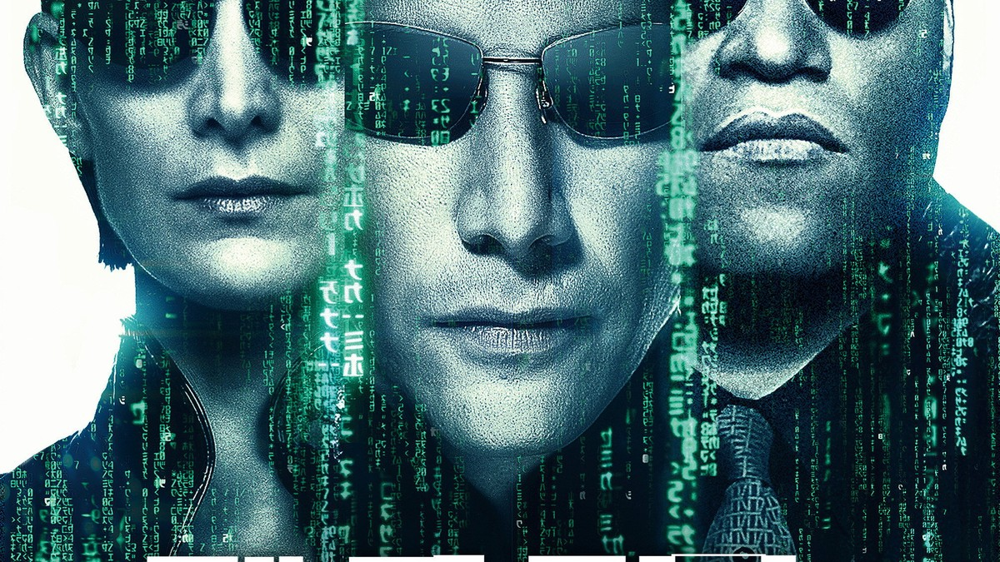
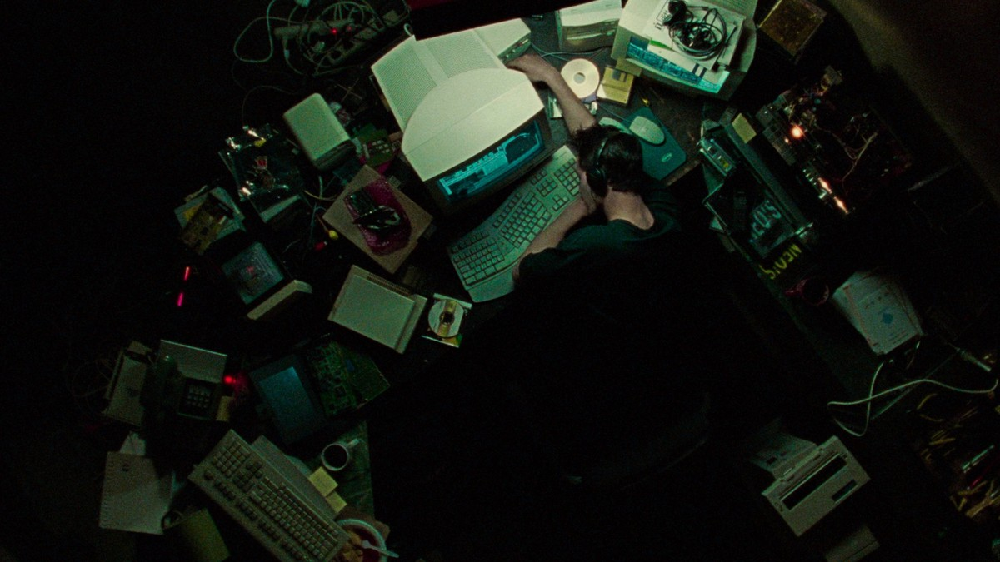
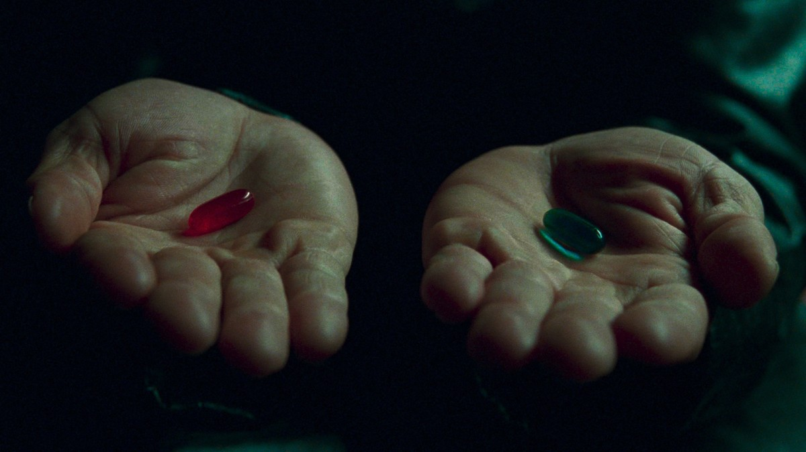
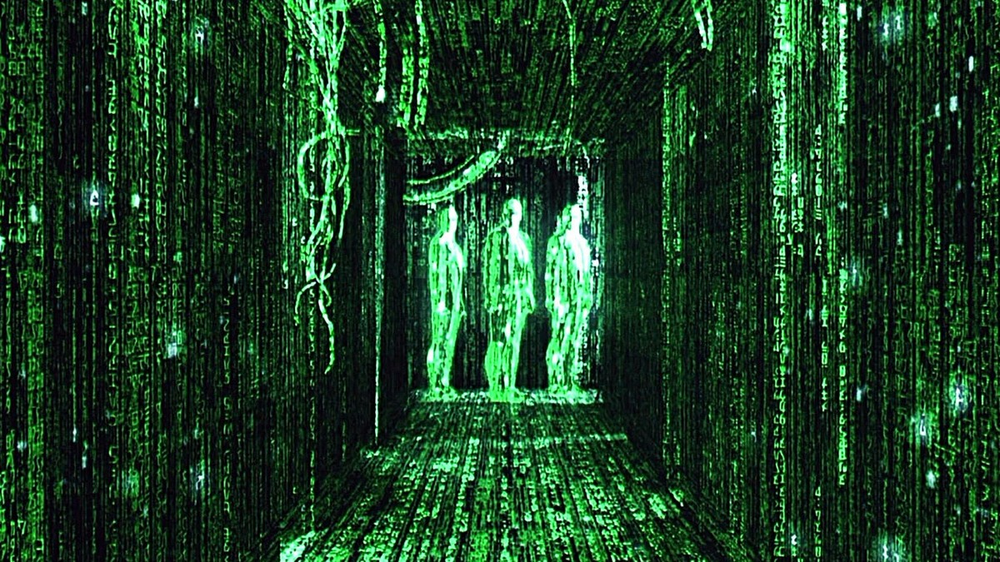
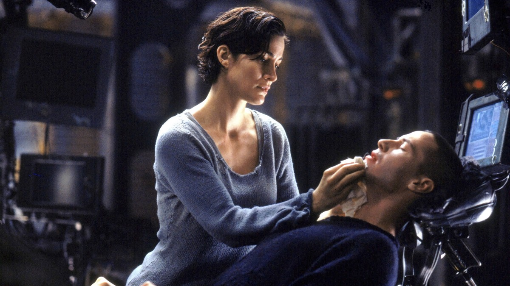
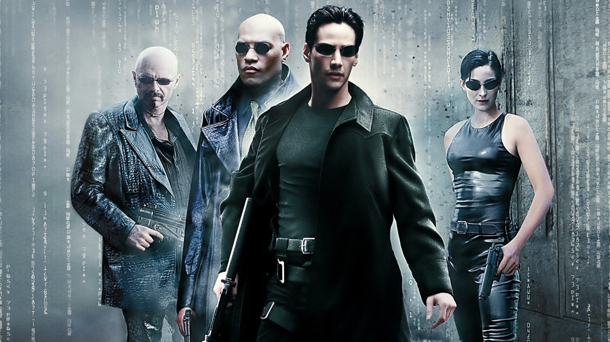
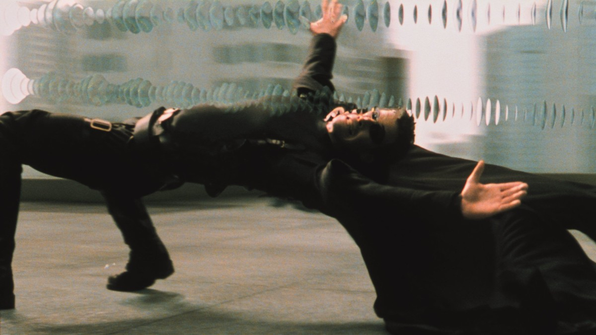
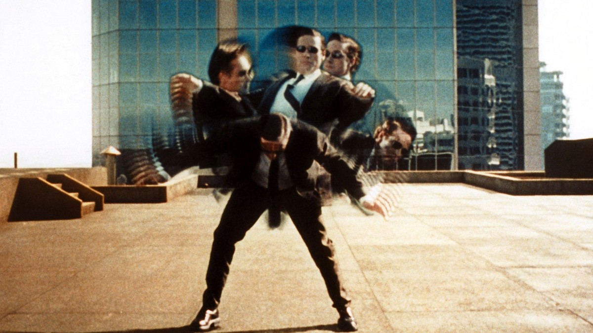

<!-- 본문 시작 -->

낮에는 평범한 회사원, 밤에는 해커 네오로 사는 남자.
그가 사는 세상이 진짜가 아니라면, 어떻게 알 수 있을까.
1999년 영화 매트릭스는 이 질문을 액션으로 풀어낸 작품이다.

**이 영화가 묻는 질문은 단순하다. 눈앞의 현실이 누군가 만든 시뮬레이션이라면, 당신은 진실을 알고 싶어 할까, 아니면 모른 채 편하게 살고 싶어 할까.**

> 스포일러 없는 소개다. 결말 장면은 다루지 않으며, 장면 설명은 중반부까지의 설정과 분위기 중심으로 정리했다.

## 기본 정보

| 항목 | 내용 |
| --- | --- |
| 제목 | 매트릭스 (The Matrix) |
| 감독 | 라나 워쇼스키, 릴리 워쇼스키 |
| 주연 | 키아누 리브스(네오), 로렌스 피시번(모피어스), 캐리 앤 모스(트리니티), 휴고 위빙(스미스 요원) |
| 개봉 | 1999년, 한국 극장 개봉 1999년 5월 15일, 등급 12세 |
| 러닝타임 | 2시간 16분 |
| TMDB 회원 점수 | 83% (2026-11-04 TMDB 한국 페이지 확인 기준, 투표 수는 메인 화면 미표시) |
| 국내 시청처 | 스트리밍 왓챠 정액제 HD, 대여 웨이브 1,320원 HD, 구매 웨이브 4,950원 HD (2026-11-04 JustWatch 한국 기준, 제공처·가격은 변동 가능) |

## 스포일러 없는 줄거리

토마스 앤더슨은 낮에는 회사원, 밤에는 해커 네오로 산다.
그는 세상에 어딘가 이상한 구석이 있다고 느낀다.
그러던 어느 날, 모피어스라는 남자가 그에게 선택을 건넨다.
빨간 약을 먹으면 진실을 보게 되고, 파란 약을 먹으면 평범한 일상으로 돌아간다.

네오가 진실을 택하면서, 그가 알던 세상의 정체가 하나씩 드러난다.
현실이라고 믿었던 세계는 기계가 만든 시뮬레이션, 매트릭스다.
인간은 그 안에서 살아가고, 기계는 그 바깥에서 인간을 이용한다.
모피어스와 동료들은 시뮬레이션 안팎을 오가며, 기계의 통제에 맞선다.

이 영화는 추격과 액션의 껍데기 안에 철학 질문을 넣어뒀다.
진실과 편안함 중 무엇을 택할 것인가, 선택은 정말 내 것인가, 기계가 만든 세계에서 인간다움이란 무엇인가.
질문은 무겁지만, 영화는 그 질문을 눈으로 보는 액션으로 풀어낸다.

## 장면으로 보는 작품 1 — 네오의 방, 이상함을 느끼는 남자

어지럽게 쌓인 컴퓨터와 모니터, 밤새 켜진 방.
네오가 해커로 살던 공간이다.
이 장면이 보여주는 것은 화려한 기술이 아니라, 일상의 어긋남이다.
뭔가 이상하다고 느끼는 감각, 그 감각이 이야기의 출발점이다.

두 손에 들린 빨간 약과 파란 약.
모피어스가 네오에게 건네는 선택의 장면이다.
빨간 약은 진실을 보는 길, 파란 약은 모른 채 돌아가는 길이다.
이 장면의 AI 포인트는 선택의 주체다.
기계가 만든 세계에서, '알겠다'는 선택 자체가 저항의 시작이 된다.

## 장면으로 보는 작품 2 — 녹색 코드의 세계, 매트릭스의 정체

녹색 코드가 흐르는 복도.
매트릭스의 세계를 시각화한 대표 장면이다.
우리가 현실이라 부르는 풍경이, 사실은 코드로 짜인 화면일 수 있다는 상상이다.
이 장면은 시뮬레이션 가설을 관객의 눈앞에 펼쳐 보인다.

트리니티가 누운 네오를 돌보는 장면.
시뮬레이션 바깥의 현실에서는 몸이 연결된 채 누워 있고, 안에서는 다른 삶을 산다.
몸과 의식이 다른 곳에 있는 설정이, '나란 무엇인가'라는 질문으로 이어진다.
의식이 코드 속에 있다면, 그 삶도 삶이라고 할 수 있을까.

검은 코트를 입은 일행이 나란히 서 있는 장면.
모피어스와 동료들은 시뮬레이션 안에서 규칙을 알고 움직이는 사람들이다.
그들에게 매트릭스는 감옥이자, 동시에 싸움터다.
규칙을 아는 자와 모르는 자의 차이가, 이 세계의 힘의 차이다.

## 장면으로 보는 작품 3 — 몸으로 배우는 싸움, 규칙을 넘는 순간

총알을 피하며 몸을 젖히는 네오.
불릿 타임으로 유명한 장면이다.
시간이 느려지는 연출은 단순한 볼거리가 아니다.
시뮬레이션의 규칙을 이해한 자는 그 규칙을 비틀 수 있다는, 영화의 주장을 몸으로 보여준다.

옥상에서 맞붙는 두 사람.
시뮬레이션 안에서의 싸움은 곧 코드와 코드의 대결이다.
누가 더 빠르게 규칙을 읽고, 누가 더 단단히 믿는가가 승패를 가른다.
이 장면까지가 이 글이 다루는 범위다.
그 이후 네오의 선택이 어디로 이어지는지는, 직접 보며 확인하는 것이 좋다.

## 이 작품이 던지는 AI 질문

매트릭스가 던지는 질문은 세 가지다.
첫째, 시뮬레이션 가설이다. 우리가 사는 세계가 누군가 만든 가상현실일 수 있을까.
둘째, 선택의 문제다. 진실을 아는 것과 편안하게 사는 것 중 무엇을 택할 것인가.
셋째, 통제의 문제다. 기계가 인간을 위해 만든 시스템이, 인간을 통제하는 시스템으로 바뀌는 순간은 언제인가.

이 질문들은 1999년의 상상이지만, AI가 일상을 짜는 오늘에 더 가깝게 읽힌다.
추천 알고리즘이 보여주는 세상, 생성 AI가 만들어내는 이미지와 글, 기계가 정한 규칙 안에서 살아가는 삶.
매트릭스는 그 삶을 극단까지 밀어붙인 우화이다.

## 어디서 보는지

국내에서는 왓챠 정액제로 볼 수 있고, 웨이브에서 대여·구매도 가능하다.
시청 전에 등급(12세)과 러닝타임(2시간 16분)을 확인하면 된다.
가격과 제공처는 바뀔 수 있으니, 보기 직전에 한 번 더 확인하는 것이 안전하다.

## 자주 묻는 질문

**Q. 매트릭스를 처음 보는데, 전편 지식이 필요한가요?**
아니다. 1편이 시리즈의 시작이다. 이 글은 1편만 다룬다.

**Q. 결말이 궁금한데, 스포일러가 있나요?**
없다. 이 글은 중반부까지의 설정과 분위기만 다룬다. 결말은 직접 보는 것을 권한다.

**Q. 아이와 함께 봐도 되나요?**
국내 등급은 12세다. 액션과 폭력 장면이 있으니 등급을 참고하면 된다.

## 함께 읽으면 좋은 글

[아이, 로봇｜로봇 3원칙이 흔들리는 날, 형사는 무엇을 믿어야 하나 — 규칙이 흔들릴 때 인간의 판단을 묻는 영화](https://aitechnoteskr.tistory.com/97)
[AI가 번 돈, 일 잃은 사람에게 돌아갈까｜앤트로픽 지분 5% 공익기금의 실체 — 지분 5% 약속이 아직은 조건 달린 약속인 이유](https://aitechnoteskr.tistory.com/92)
[개 사진 3장으로 30초 영화 만들기｜클링 4.0으로 찍은 VR 속 개 루의 꿈 — 사진 3장으로 30초 영화를 만드는 과정](https://aitechnoteskr.tistory.com/94)

빨간 약과 파란 약 중 하나를 고르라는 장면은, 보고 나서도 오래 남는다. 나였다면 무엇을 골랐을까, 그 질문 하나만으로도 이 영화는 볼 가치가 있다. 다음 영화 소개도 함께 보고 싶다면 이웃 추가를 눌러두면 된다.

<!-- 본문 끝 -->

## 작업용 출처·이미지 정보 (업로드 제외)

- 자료 출처: TMDB 한국 페이지·시청 페이지·JustWatch 한국 (2026-11-04 확인, 감독 워쇼스키 자매, 2시간 16분, 12세, TMDB 83%, 스트리밍 왓챠, 대여 웨이브 1,320원, 구매 웨이브 4,950원)
- 이미지: TMDB 백드롭·포스터 원본 1200x675 가공, 결말 장면 제외
