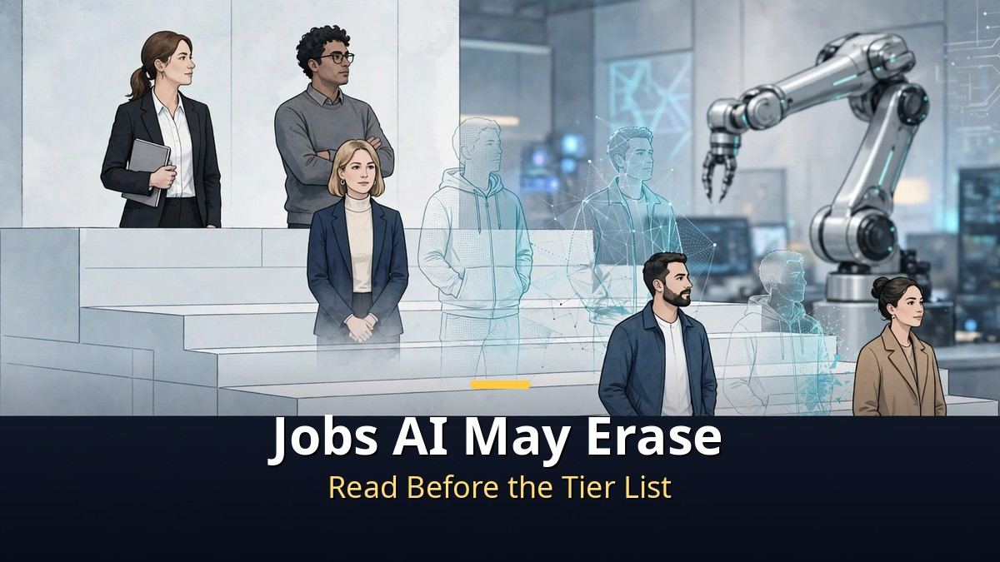
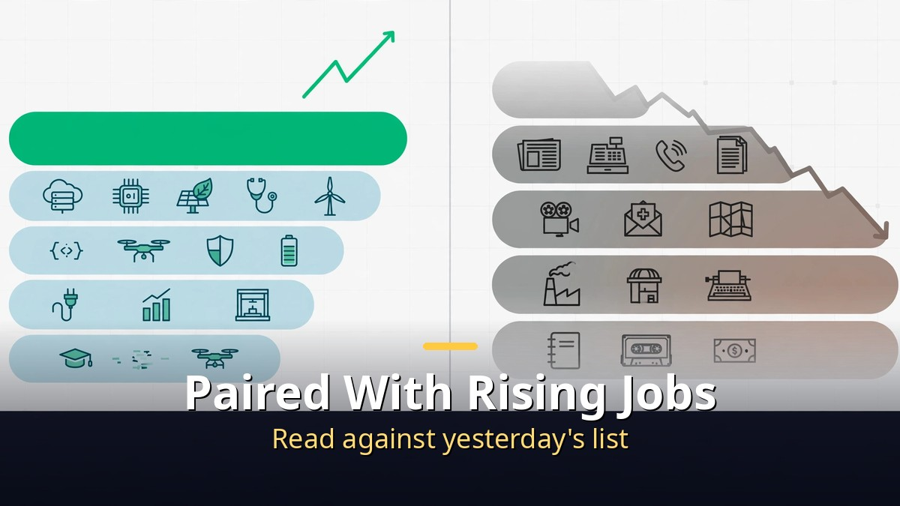
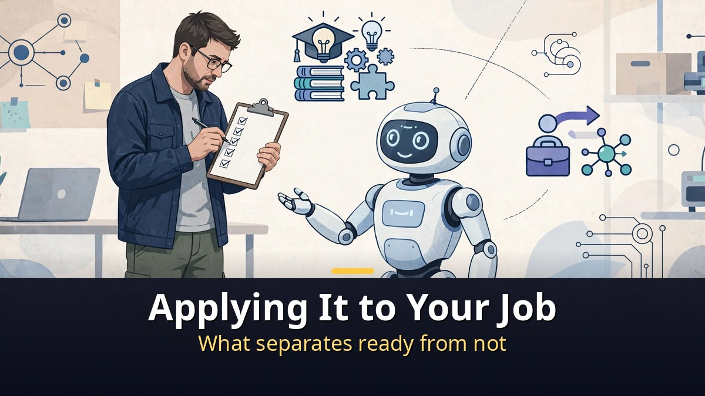
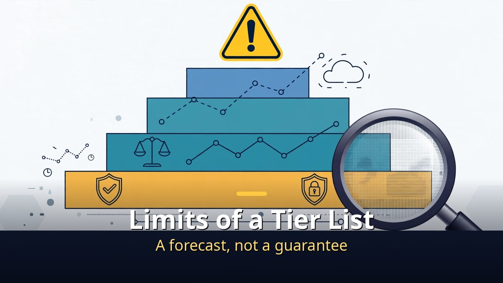

<!-- 본문 시작 -->

Yesterday we covered jobs rising in the AI era.
Today is the pair: jobs AI is erasing.
The honjobs video's core is not a list of job names.
It is a standard that splits the speed of disappearance into five tiers.
This article follows that standard, and sorts how to check where your job sits.

> Key takeaway: This video's tiers are closer to "how far disappearance has progressed" than to "what will vanish next." From jobs already disappearing most, to jobs with good prospects but numbers still short, five stages. A tier list should be read as a checklist, not a prophecy.

## What Standard Divides the Disappearing-Jobs Tier List?

The video splits AI replacement risk into five tiers.
Tier 1: jobs already disappearing the most.
Tier 2: jobs almost disappearing right now.
Tier 3: jobs with good prospects, but less so than tiers 1 and 2.
Tier 4: jobs improving, but with unclear prospects.
Tier 5: jobs with good prospects, but with numbers still lacking.

The point to notice is what the order means.
Tiers 1 and 2 are not "jobs that will disappear someday" but "jobs disappearing already."
From tier 3 on, the direction splits.
"Good prospects" and "numbers following" are not the same statement.
Tier 4's "improving but unclear" is likewise different from a stable future.
Read a tier by its stage description first, not its name.
Read together with yesterday's rising-jobs article, the two sides of the same labor market appear.
The rising-jobs article showed jobs whose numbers grew; today's shows the speed at which jobs shrink.

## Which Case Is Already Confirmed by Numbers?

The video's most concrete case is Salesforce's customer service.
Customer service staff reportedly fell from about 9,000 to about 5,000.
Customer service work is also described as down 40–50%.
These numbers matter because they show change already in progress, not a guess about "someday."

Why customer service shrinks first can be found in the work's nature.
Questions repeat, answers follow patterns, and everything is recorded.
Such work is easy for AI to learn, and its automation effect is easy to measure.
Work that meets people face to face and carries judgment and responsibility does not shrink at the same speed.
The video's tier standard converges on the same difference.
Is it repetitive? Is it left as data? Does human judgment and responsibility sit in between?
Follow the video's tier judgments for job-by-job grounds, but read the numbers as cases only.
One company's staffing change is not every customer service team's future.
This case reads even clearer paired with [Rising Jobs in the AI Era: The US and Korea Tell Different Stories｜What a 15-Job Tier List Really Means](https://aitechnotesen.blogspot.com/2026/11/rising-jobs-in-ai-era-us-and-korea-tell.html).
Yesterday's article showed jobs whose numbers grew; today's shows jobs whose numbers shrank.

## How Do I Check Which Tier My Job Is Near?

Apply the tier list to your job with five check questions.
First, is most of my work repeated questions, documents, or data entry?
Second, is that process left as data and records?
Third, when AI is wrong, is the responsibility mine or the system's?
Fourth, does the customer need to meet a person to feel reassured?
Fifth, are people who handle AI growing in my field?

| Check question | More "yes" | More "no" |
|---|---|---|
| Mostly repetitive work? | Nearer the shrinking side | Nearer the staying side |
| Process left as records? | Easy for automation to learn | Little learning material |
| Am I responsible when wrong? | Human judgment remains | The system substitutes |
| Face-to-face reassurance needed? | People remain | Remote and automation are easy |
| People handling AI growing? | Signal of new roles | Change is slower |

This table's conclusion is not "change jobs."
Within the same job, the first move is to shrink repetitive work and grow judgment, face-to-face, and AI-use shares.
A tier list fits as a checklist for changing a job's composition, not as a standard for abandoning it.
Do not forget the video's tiers are the creator's judgment.
They are a summary of cases and prospects, not official statistics.

## Frequently Asked Questions

**Q. Does tier 1 mean I will soon lose my job?**
No. Tier 1 is described as the stage "already disappearing the most." It shows the speed at which a kind of work shrinks, not an individual's future.

**Q. Is the tier list official data?**
No. It is the video creator's summary of cases and prospects. The Salesforce numbers and the tier judgments should be read separately.

**Q. Reading only the disappearing-jobs article feels anxious. How should I read it?**
Read it together with yesterday's rising-jobs article. Shrinking and growing jobs happen at the same time in the same market, and preparation leans toward "changing a job's composition" rather than "changing jobs."

## Recommended Reading

[How to Use Claude Changed｜Four Updates: Code, Browser, Files, and Plan Mode — four changes in code, browser, files, and plan mode](https://aitechnotesen.blogspot.com/2026/11/how-to-use-claude-changedfour-updates.html)
[Will AI's Money Reach Workers Who Lost Jobs?｜What Anthropic's 5% Public Benefit Fund Really Is — why the 5% equity pledge is still a conditional promise](https://aitechnotesen.blogspot.com/2026/11/will-ais-money-reach-workers-who-lost.html)
[I, Robot｜When Three Laws Shake, What Should a Detective Believe — a film that asks what human judgment is worth when rules wobble](https://aitechnotesen.blogspot.com/2026/11/i-robotwhen-three-laws-shake-what.html)

A tier list is not a ruler that judges your job, but a mirror that checks your job's composition. Once you see which tier you are near, the next step is growing judgment and face-to-face shares within it. Follow along if you want to keep following this topic.

<!-- 본문 끝 -->

## 작업용 출처·이미지 정보 (업로드 제외)

- Source: honjobs 영상 TQjQRWhl-gE(2026-11-03, 14:16, 스크립트 패널 0:00~14:13 확인 기준) + 세일즈포스 고객센터 사례(영상 언급 수치)
- Images: images/01-hero-en.jpg ~ 04-img3-en.jpg / original illustration + English banner overlay (1200x675)
