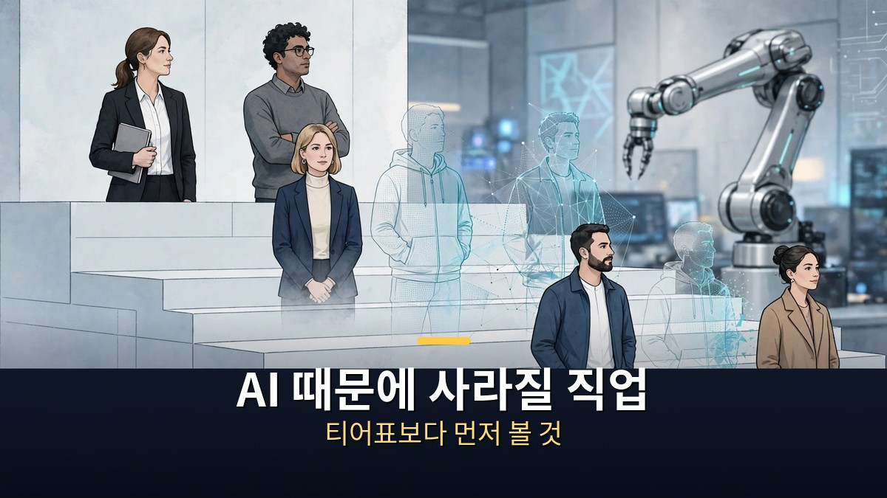
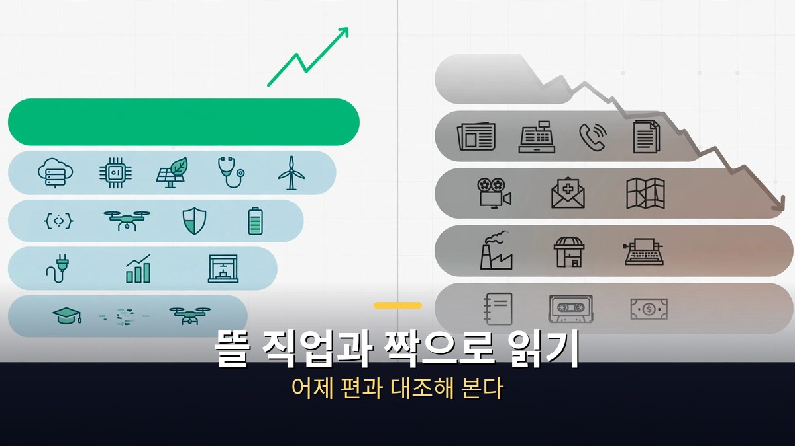
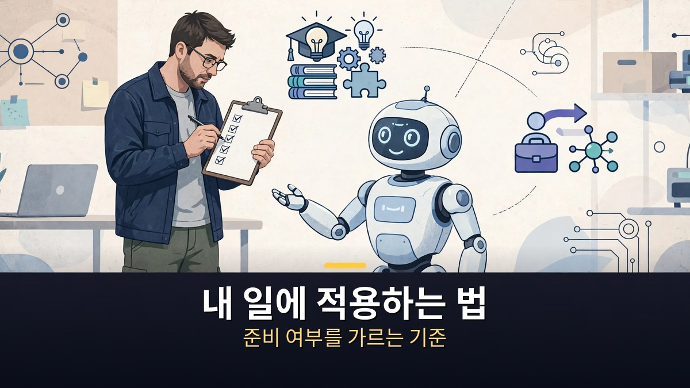
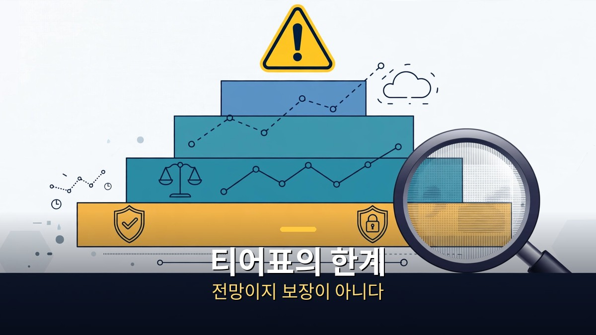

<!-- 본문 시작 -->

어제는 AI 시대에 뜨는 직업을 정리했다.
오늘은 그 짝, AI 때문에 사라질 직업이다.
혼잡스 영상의 핵심은 직업 이름 나열이 아니다.
사라짐의 속도를 5개 티어로 나누는 기준이다.
이 글은 그 기준을 따라, 내 일이 어느 티어에 가까운지 점검하는 법을 정리한다.

> 핵심 정리: 이 영상의 티어는 '사라질 순서'가 아니라 '사라짐의 진행도'에 가깝다. 이미 가장 많이 사라지고 있는 일부터, 전망은 좋지만 숫자가 아직 부족한 일까지 다섯 단계로 나눈다. 티어표는 예언이 아니라 점검표로 읽어야 한다.

## 사라질 직업 티어표는 어떤 기준으로 나눴을까?

영상은 AI 대체 가능성을 다섯 티어로 나눈다.
1티어는 이미 가장 많이 사라지고 있는 직업이다.
2티어는 현재 거의 사라지고 있는 직업이다.
3티어는 전망은 좋지만 1·2티어에 비해서는 아직 덜한 직업이다.
4티어는 나아지고 있지만 전망이 불투명한 직업이다.
5티어는 전망이 좋지만 숫자가 부족한 직업이다.

이 구분에서 눈여겨볼 점은 순서의 의미다.
1티어와 2티어는 '앞으로 사라질 것'이 아니라 '이미 사라지는 중'인 일이다.
3티어부터는 방향이 갈린다.
전망이 좋다는 말과 숫자가 따라온다는 말은 같은 말이 아니다.
4티어의 '나아지고 있지만 불투명하다'는 표현도 마찬가지다.
좋아지는 추세와 안정적인 미래는 다르다.
티어를 읽을 때는 이름보다 이 단계 설명을 먼저 봐야 한다.
어제 정리한 뜰 직업 편과 짝으로 읽으면, 같은 노동시장의 양면이 보인다.
뜰 직업 편은 숫자가 늘어난 일을, 오늘 편은 일이 줄어드는 속도를 본다.

## 이미 숫자로 확인되는 사례는 무엇일까?

영상에서 가장 구체적인 사례는 세일즈포스(Salesforce)의 고객센터다.
고객센터 인력이 약 9,000명에서 약 5,000명으로 줄었다고 언급된다.
고객센터 업무가 40~50% 줄었다는 취지의 설명도 함께 나온다.
이 숫자가 중요한 이유는, 'AI가 언젠가 대체할 것'이라는 추측이 아니라 이미 진행 중인 변화이기 때문이다.

고객센터가 먼저 줄어드는 이유는 업무의 성격에서 찾을 수 있다.
질문이 반복되고, 답의 패턴이 정해져 있고, 기록으로 남는다.
이런 일은 AI가 배우기 쉽고, 자동화 효과를 재기도 쉽다.
반대로 현장에서 사람을 직접 만나고, 책임을 지고 판단해야 하는 일은 같은 속도로 줄지 않는다.
영상이 티어를 나누는 기준도 결국 이 차이로 수렴한다.
반복되는가, 데이터로 남는가, 사람의 판단과 책임이 끼어 있는가.
자세한 직종별 근거는 영상의 티어 평가를 따르되, 숫자 자체는 사례로만 읽어야 한다.
한 회사의 인력 변화가 모든 고객센터의 미래는 아니기 때문이다.
이 사례는 [AI 시대에 뜨는 직업, 미국과 한국이 다르다｜15개 직업 티어표의 진짜 의미](https://aitechnoteskr.tistory.com/101)와 짝으로 보면 더 분명해진다.
뜰 직업 편이 숫자가 늘어난 일을 보여줬다면, 오늘 편은 숫자가 줄어든 일을 보여준다.

## 내 일은 어느 티어에 가까운지 어떻게 점검할까?

티어표를 내 일에 대입할 때는 다섯 가지 질문으로 점검한다.
첫째, 내 일의 대부분이 반복되는 질문·서류·입력인가.
둘째, 그 과정이 데이터와 기록으로 남는가.
셋째, AI가 틀렸을 때 책임을 지는 사람이 나인가, 시스템인가.
넷째, 고객이 사람을 직접 만나야 안심하는 일인가.
다섯째, 내 분야에서 AI를 다루는 사람이 늘고 있는가.

| 점검 질문 | '예'가 많을수록 | '아니오'가 많을수록 |
|---|---|---|
| 반복 업무가 대부분인가 | 사라짐 쪽에 가깝다 | 유지 쪽에 가깝다 |
| 과정이 기록으로 남는가 | 자동화 학습이 쉽다 | 학습 자료가 부족하다 |
| 틀렸을 때 내 책임인가 | 사람의 판단이 남는다 | 시스템이 대신한다 |
| 대면 안심이 필요한가 | 사람이 남는다 | 원격·자동화가 쉽다 |
| AI 다루는 사람이 늘고 있는가 | 새 역할의 신호다 | 변화가 더디다 |

이 표의 결론은 '직업을 바꾸라'가 아니다.
같은 직업 안에서도 반복 업무는 줄이고, 판단·대면·AI 활용 비중을 늘리는 방향이 먼저다.
티어표는 직업을 버리는 기준이 아니라, 일의 구성을 바꾸는 점검표로 쓰는 것이 맞다.
영상의 티어 자체가 제작자의 판단이라는 점도 잊지 말자.
공식 통계가 아니라, 사례와 전망을 묶은 정리라는 한계가 있다.

## 자주 묻는 질문

**Q. 1티어에 들면 곧 일자리를 잃는다는 뜻인가?**
아니다. 1티어는 '이미 가장 많이 사라지고 있는' 단계라는 설명이다. 개인의 미래가 아니라, 일의 종류가 줄어드는 속도를 보여준다.

**Q. 티어표는 공식 자료인가?**
아니다. 영상 제작자가 사례와 전망을 묶어 정리한 판단이다. 숫자가 나온 세일즈포스 사례와 티어 평가는 구분해서 읽어야 한다.

**Q. 사라질 직업 편만 보면 불안해지는데, 어떻게 읽어야 하나?**
어제의 뜰 직업 편과 함께 읽는 것이 좋다. 줄어드는 일과 늘어나는 일이 같은 시장에서 동시에 일어나고, 준비의 방향은 '일을 바꾸는 것'보다 '일의 구성을 바꾸는 것'에 가깝다.

## 함께 읽으면 좋은 글

[AI 시대에 뜨는 직업, 미국과 한국이 다르다｜15개 직업 티어표의 진짜 의미 — 숫자가 늘어난 일을 보여준 어제 편](https://aitechnoteskr.tistory.com/101)
[AI가 과학을 해냈다고? 점수보다 검증부터｜벤치마크 오류와 논문 감사의 교훈 — 점수보다 검증 과정을 먼저 보는 법](https://aitechnoteskr.tistory.com/100)
[매트릭스｜빨간 약을 건넨 모피어스, 시뮬레이션 속 네오의 선택 — 시뮬레이션 속 진실을 묻는 고전 SF](https://aitechnoteskr.tistory.com/103)

티어표는 내 일을 재단하는 자가 아니라, 내 일의 구성을 점검하는 거울이다. 어느 티어에 가까운지 확인했다면, 다음은 그 안에서 판단과 대면의 비중을 늘리는 일이다. 이 주제를 계속 따라가려면 이웃 추가를 눌러두면 된다.

<!-- 본문 끝 -->

## 작업용 출처·이미지 정보 (업로드 제외)

- 자료 출처: honjobs 영상 TQjQRWhl-gE(2026-11-03, 14:16, 스크립트 패널 0:00~14:13 확인 기준) + 세일즈포스 고객센터 사례(영상 언급 수치)
- 이미지: images/01-hero.jpg ~ 04-img3.jpg / 자작 일러스트 + 한글 배너 오버레이 (1200x675)
