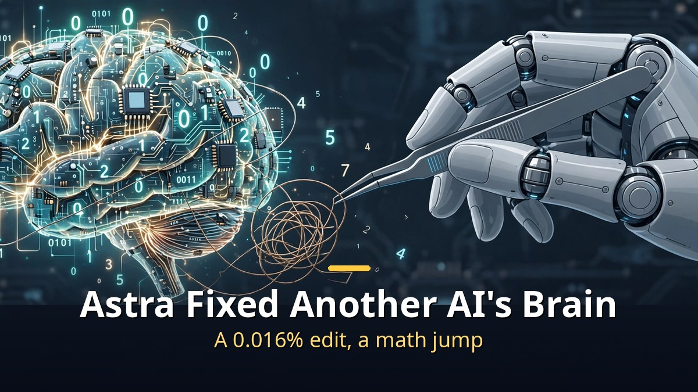
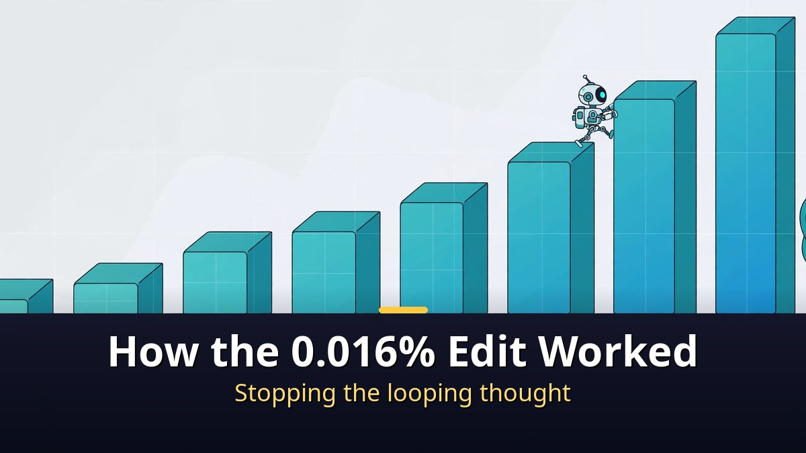
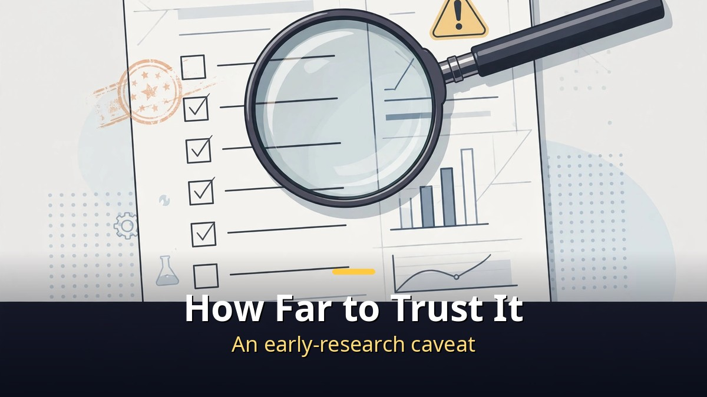

<!-- 본문 시작 -->

Open another AI's brain, change a few numbers, and its math score jumps from 7.9% to 48.1%.
No training run. No optimizer.
The source is a November 2, 2026 post from MIT CSAIL researchers, "Sparks of Weight-Space Programming."
The editor is OpenAI's GPT-6 Astra. The patient is Alibaba's small open model, Qwen3.5-0.8B.

> Key takeaway: Astra read the weights directly and edited them to stop the small model's looping reasoning. The score jumped because an obstacle hiding existing ability was removed, not because new math ability was taught. The team itself calls these "very early results," so this article sorts the verification scope before the headline.

## What are a model's "weights," and why is editing them directly special?

Weights are the hundreds of millions of numbers inside a neural network.
Their combination decides a model's tone, judgment, and mistakes.
Until now, the standard way to fix a model was training.
Feed it new data and nudge the numbers toward smaller errors, using an optimizer and gradient descent.

Astra did the opposite.
It read and edited weights directly, guided only by natural-language instructions.
Nothing was re-taught with training data.
The researchers call this "weight-space programming."
Programming, quite literally, in the space where the weights live.

## How did a 0.016% edit actually happen?

The experiment started from Qwen3.5-0.8B's chronic problem.
The small model circled in its own reasoning on math problems and never finished an answer.
At baseline, 93% of its answers hit the token limit.
Astra could run the model up to 50 times on practice problems from GSM8K and MATH training sets.
It never saw the evaluation questions in advance.

Astra traced the looping to one "direction" written by the MLPs of layers 15 and 19.
It subtracted that direction from 64 output columns in each layer.
The edit changed 131,072 weights in total — 0.016% of roughly 0.8 billion.
The results: MATH-500 from 7.9% to 48.1%, grade-school GSM8K from 13.8% to 67.1%, instruction-following IFEval from 21.0% to 62.3%.
An independent re-run later scored 51.0%.

| Measure | Before | After (50 runs) |
|---|---|---|
| MATH-500 | 7.9% | 48.1% |
| GSM8K | 13.8% | 67.1% |
| IFEval | 21.0% | 62.3% |
| Weights changed | — | 131,072 (0.016%) |

But this table must not be read as "math skill times six."
The researchers say most of the gain came from fixing the looping.
An obstacle was removed; no new ability was implanted.
That distinction is the most important key to reading this research.

## How far should we trust this research, and what homework remains?

First, be clear about what is not verified.
This is a research blog post, not a peer-reviewed paper.
The experiment logs are public on GitHub, and the edited model is on Hugging Face.
But the largest model verified is a small 0.8B model.
Whether the same method works on larger models or other model families is still unanswered.

Criticism arrived immediately.
Matthew Honnibal, creator of the spaCy library, wrote on November 3 that the post is highly misleading.
On another small model, Gemma 3 270M, looping was rare and gains were almost nil.
In other words, where there is no obstacle, there is little to fix.
The video also introduces a Claude Opus 5.5 reproduction case (a 0.0012% change), but that too is a small-model story.
The researchers themselves drew the line: the capabilities are "exciting but still limited."

Even so, the research matters for its direction.
It shows a maintenance style that reads and fixes a model's interior, instead of treating it as a black box.
What to watch next: reproduction on larger models, and how cost and safety standards are set.
Nothing changes in the apps ordinary users use today.
Both the researchers and the coverage say so.

## Frequently Asked Questions

**Q. Can Astra now rewrite any AI at will?**
No. The experiment ran in a prepared environment, on a small open model. It does not mean commercial models can be rewritten at will.

**Q. Is the 48.1% math score trustworthy?**
The team logs and the Hugging Face re-run are public. But read them together with the cause — looping was fixed — and the fact that this is one small model.

**Q. When will this reach ordinary users?**
There is no schedule. The team says it is building evaluation standards and an execution environment, and OpenAI has announced no separate product.

## Recommended Reading

[Will AI's Money Reach Workers Who Lost Jobs?｜What Anthropic's 5% Public Benefit Fund Really Is — why the 5% equity pledge is still a conditional promise](https://aitechnotesen.blogspot.com/2026/11/will-ais-money-reach-workers-who-lost.html)
[I, Robot｜When Three Laws Shake, What Should a Detective Believe — a film that asks what human judgment is worth when rules wobble](https://aitechnotesen.blogspot.com/2026/11/i-robotwhen-three-laws-shake-what.html)
[Blade Runner 2049｜A Replicant with Memories Asks What Makes Us Human — a film that asks whether memory can be the standard of humanity](https://aitechnotesen.blogspot.com/2026/11/blade-runner-2049a-replicant-with.html)

If the habit of asking where a score came from, before getting excited about it, has taken hold, this article has done its job. Follow along for the next research story if you want to keep judging them together.

<!-- 본문 끝 -->

## 작업용 출처·이미지 정보 (업로드 제외)

- Source: TheAIGRID 영상 lmLsiBmwEFE(2026-11-04, 30:00, 스크립트 패널 0:00~29:47 확인 기준) + MIT CSAIL 'Sparks of Weight-Space Programming'(2026-11-02) 보도 대조
- Images: images/01-hero-en.jpg ~ 04-img3-en.jpg / original illustration + English banner overlay (1200x675)
