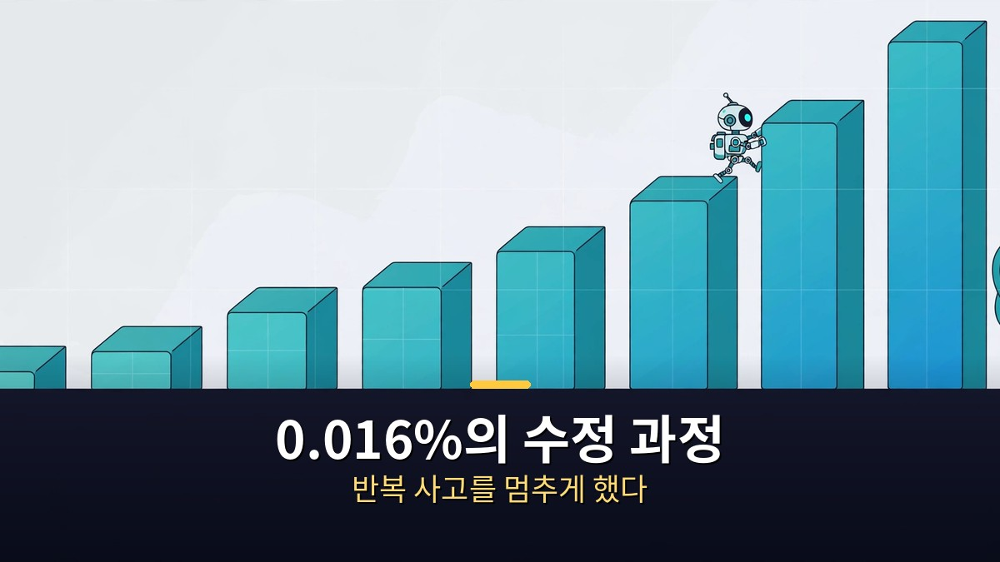

<!-- 본문 시작 -->

다른 AI의 뇌를 열어 숫자 몇 개를 고쳤더니, 수학 점수가 7.9%에서 48.1%로 뛰었다.
훈련도, 최적화 프로그램도 쓰지 않았다.
이 소식을 전한 것은 2026년 11월 2일 공개된 MIT CSAIL 연구팀의 글, '가중치 공간 프로그래밍의 불꽃'이다.
주인공은 오픈AI의 GPT-6 아스트라, 환자는 알리바바의 작은 공개 모델 큐원3.5-0.8B다.

> 핵심 정리: 아스트라는 가중치를 직접 읽고 고쳐 작은 모델의 반복 사고를 멈추게 했다. 점수가 뛴 이유는 새 수학 능력을 가르쳐서가 아니라, 이미 있던 능력을 가리던 걸림돌을 치웠기 때문이다. 연구팀 스스로도 '아주 초기 결과'라고 밝힌 만큼, 이 글은 성과보다 검증 범위를 먼저 정리한다.

## AI 모델의 '가중치'란 무엇이고, 왜 직접 고치는 일이 특별할까?

가중치는 신경망 안에 들어 있는 수억 개의 숫자다.
이 숫자들의 조합이 모델의 말투, 판단, 실수를 결정한다.
지금까지 모델을 고치는 표준 방법은 훈련이었다.
새 데이터를 주고, 오차를 줄이는 방향으로 숫자를 조금씩 조정하는 방식이다.
이 과정에는 최적화 프로그램과 경사 하강법이 필수였다.

아스트라가 한 일은 정반대다.
자연어 지시만으로 가중치를 직접 읽고, 직접 고쳤다.
훈련 데이터로 다시 가르친 것이 아니다.
연구팀은 이 방식을 '가중치 공간 프로그래밍'이라 불렀다.
말 그대로, 가중치가 사는 공간에서 직접 프로그래밍을 한 셈이다.

## 0.016%의 수정은 실제로 어떻게 이뤄졌을까?

실험의 출발점은 큐원3.5-0.8B의 고질적인 문제였다.
이 작은 모델은 수학 문제를 풀다가 같은 생각을 빙빙 돌며 답을 끝내지 못했다.
기준 점수에서 답의 93%가 토큰 한도에 걸려 멈췄다.
아스트라는 연습 문제(GSM8K·MATH 훈련 문제)를 보며 모델을 최대 50번 시험 실행할 수 있었다.
평가 문제는 미리 보지 못했다.

아스트라는 원인을 15층과 19층의 MLP가 써넣는 하나의 '방향'으로 좁혔다.
각 층의 출력 열 64개에서 그 방향을 빼는 수정을 했다.
바뀐 가중치는 모두 131,072개, 전체 8억 개 중 0.016%다.
결과는 MATH-500 7.9%에서 48.1%, 초등 수학 GSM8K 13.8%에서 67.1%, 지시 따르기 IFEval 21.0%에서 62.3%였다.
독립 재실행에서는 51.0%가 나오기도 했다.

| 구분 | 수정 전 | 수정 후(50번 실행) |
|---|---|---|
| MATH-500 | 7.9% | 48.1% |
| GSM8K | 13.8% | 67.1% |
| IFEval | 21.0% | 62.3% |
| 바뀐 가중치 | — | 131,072개(0.016%) |

단, 이 표를 그대로 '수학 실력이 6배'라고 읽으면 안 된다.
연구팀은 개선의 대부분이 반복 사고 해소 덕분이라고 밝혔다.
모델이 원래 갖고 있던 능력을 가린 장벽을 치운 것이지, 없는 능력을 심은 것이 아니다.
이 구분이 이 연구를 읽는 가장 중요한 열쇠다.

## 이 연구를 어디까지 믿어야 하고, 일반 독자에게 남은 숙제는 무엇일까?

먼저, 검증되지 않은 부분을 분명히 하자.
이 글은 동료 심사를 거친 논문이 아니라 연구팀의 블로그 글이다.
실험 로그는 깃허브에 전부 공개됐고, 수정된 모델은 허깅페이스에 올라 있다.
하지만 검증된 가장 큰 모델이 0.8B짜리 작은 모델이라는 한계가 있다.
더 큰 모델이나 다른 계열에도 같은 방법이 통하는지는 아직 답이 없다.

비판도 바로 나왔다.
스페이시(spaCy) 개발자 매슈 호니발은 11월 3일, 이 글이 크게 오해하기 쉽다고 지적했다.
또 다른 작은 모델 제마 3 270M에서는 반복 사고가 드물었고, 개선도 거의 없었다.
즉, 걸림돌이 없는 모델에서는 고칠 것이 거의 없다는 뜻이다.
영상에서는 클로드 오퍼스 5.5의 재현 사례(0.0012% 변경)도 소개되지만, 이 역시 작은 모델 범주의 이야기다.
연구팀도 '능력은 흥미롭지만 아직 제한적'이라고 선을 그었다.

그럼에도 이 연구가 주목받는 이유는 방향 때문이다.
모델을 블랙박스로만 다루지 않고, 내부를 읽고 고치는 유지보수 방식을 보여줬기 때문이다.
점수보다 검증 과정을 먼저 보는 기준은 [AI가 과학을 해냈다고? 점수보다 검증부터｜벤치마크 오류와 논문 감사의 교훈](https://aitechnoteskr.tistory.com/100)에서도 같은 방식으로 정리한 바 있다.
앞으로 같은 방식이 더 큰 모델에서 재현되는지, 비용과 안전 기준이 어떻게 정해지는지가 관전 포인트다.
일반 사용자의 앱이 당장 바뀌는 일은 없다.
이 점은 연구팀과 보도 모두 공통으로 밝히고 있다.

## 자주 묻는 질문

**Q. 아스트라가 다른 AI를 마음대로 고칠 수 있게 된 것인가?**
아니다. 실험은 연구팀이 준비한 환경에서, 작은 공개 모델을 대상으로 이뤄졌다. 상용 모델을 임의로 고치는 일이 가능해졌다는 뜻이 아니다.

**Q. 수학 점수 48.1%는 믿을 만한가?**
연구팀 로그와 허깅페이스 재실행이 공개돼 있다. 다만 점수 상승의 원인이 반복 사고 해소라는 점, 그리고 작은 모델 한 건이라는 점을 함께 봐야 한다.

**Q. 이 기술이 일반 사용자에게 언제 닿을까?**
일정이 없다. 연구팀은 평가 기준과 실행 환경을 만드는 단계라고 밝혔고, 오픈AI도 별도 제품 발표를 하지 않았다.

## 함께 읽으면 좋은 글

[AI가 과학을 해냈다고? 점수보다 검증부터｜벤치마크 오류와 논문 감사의 교훈 — 점수보다 검증 과정을 먼저 보는 법](https://aitechnoteskr.tistory.com/100)
[매트릭스｜빨간 약을 건넨 모피어스, 시뮬레이션 속 네오의 선택 — 시뮬레이션 속 진실을 묻는 고전 SF](https://aitechnoteskr.tistory.com/103)
[아이, 로봇｜로봇 3원칙이 흔들리는 날, 형사는 무엇을 믿어야 하나 — 규칙이 흔들릴 때 인간의 판단을 묻는 영화](https://aitechnoteskr.tistory.com/97)

점수 하나에 들뜨기 전에, 그 점수가 어디서 왔는지부터 묻는 습관이 생겼다면 이 글은 할 일을 다 한 셈이다. 다음 연구 소식도 함께 가려 읽고 싶다면 이웃 추가를 눌러두면 된다.

<!-- 본문 끝 -->

## 작업용 출처·이미지 정보 (업로드 제외)

- 자료 출처: TheAIGRID 영상 lmLsiBmwEFE(2026-11-04, 30:00, 스크립트 패널 0:00~29:47 확인 기준) + MIT CSAIL 'Sparks of Weight-Space Programming'(2026-11-02) 보도 대조
- 이미지: images/01-hero.jpg ~ 04-img3.jpg / 자작 일러스트 + 한글 배너 오버레이 (1200x675)
