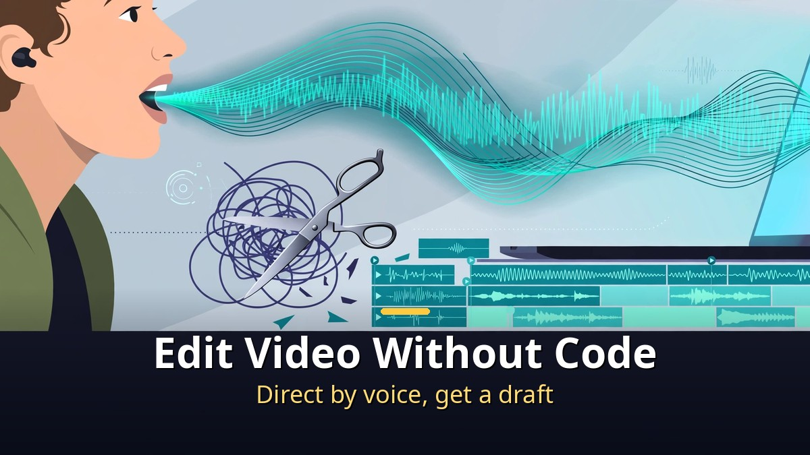
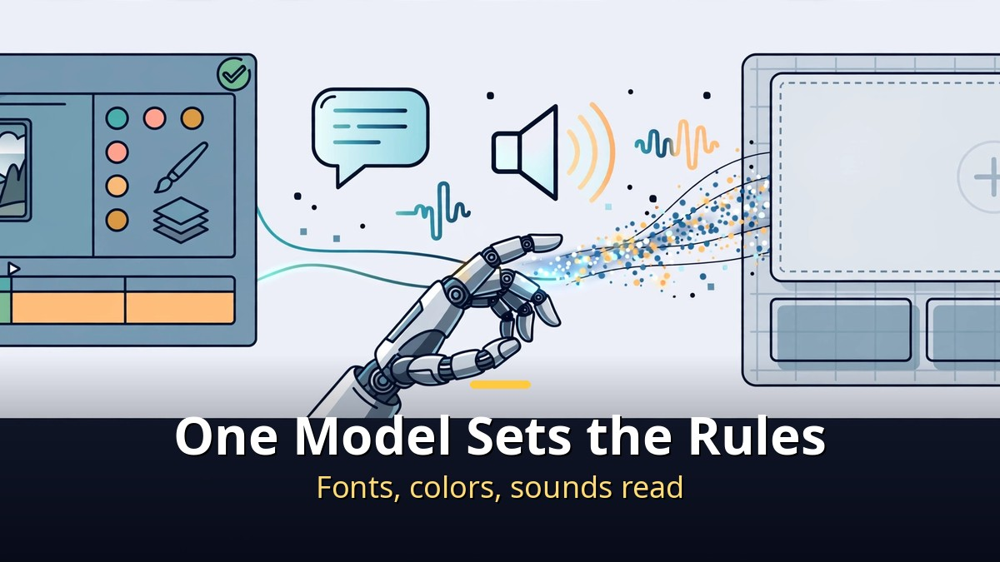
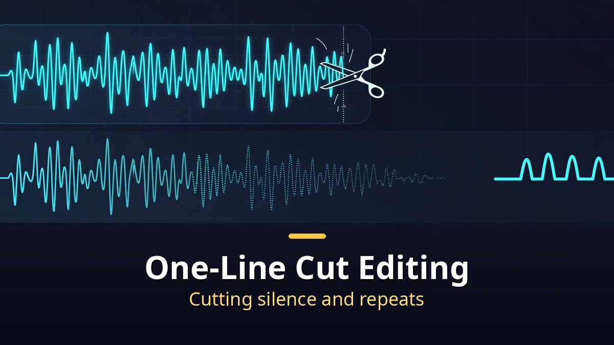
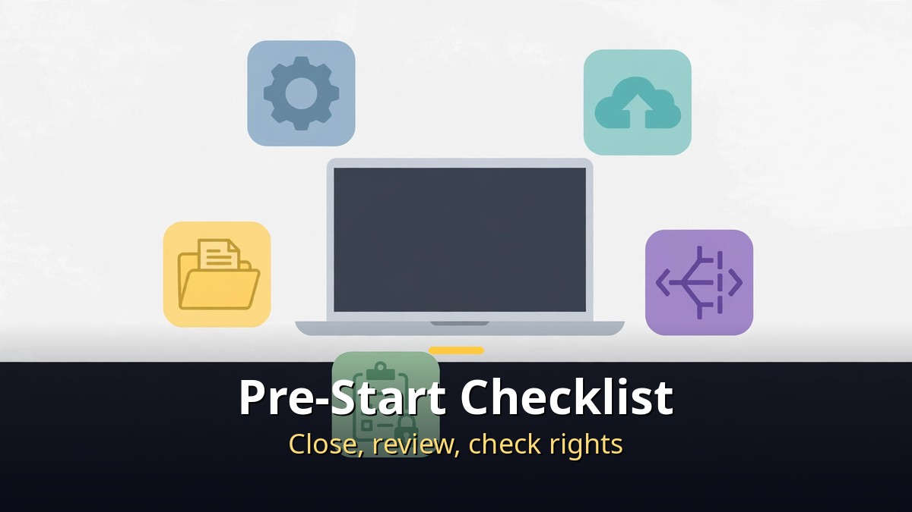

<!-- 본문 시작 -->

Matt Wolfe's new video does what its title says.
How to get Claude to edit videos, with no code.
At the center are Claude Opus 5.5 and the vidIQ MCP.
Analyze popular videos, build editing rules that fit your channel, and finish a Short with those rules.
This article follows the 32-minute video's actual flow, sorting what to hand over and where a human must stop.

> Key takeaway: Claude does not press editing buttons for you. First it builds a "skill" — the editing rules of your channel. With that skill, A-roll trimming, B-roll, subtitles, and music follow in one flow. But that flow works well only up to Shorts and talking-head informational videos.

## What Does Building a Channel-Fit Editing Skill With vidIQ MCP Mean?

The first step is not editing, but analysis.
Connect the vidIQ MCP to Claude, and it can analyze popular videos and scripts.
Which topics land, which script structures get reactions, what patterns your channel's videos follow.
From that analysis, Claude builds a "skill."
A skill is a bundle of rules: this channel edits this way.
Subtitle style, cut rhythm, where B-roll goes — all hardened into rules.

This step matters because without rules, results vary every time.
One day subtitles run long; another day the music overpowers.
Once a skill exists, the next video starts from the same standard.
The video's own outline shows the flow: idea generation with vidIQ (02:29), from script writing to AI editing (04:11), setup (07:15), vidIQ connection (09:21), and developing channel-fit usage (10:55).
Editing comes last, after analysis and rule-building are done.

## How Does Voice-Directed Short Editing Actually Run?

Full editing starts with tidying the A-roll.
A-roll is the footage of the person speaking.
Claude cuts pauses and mistakes, then joins the remaining speech naturally.
On top come B-roll (supporting footage), subtitles, music, and effects.
The actual cutting and joining is done by FFmpeg.
Claude directs; FFmpeg executes.
Hyperframes (moving text), ElevenLabs (voice and transcription), and Blender extensions are also mentioned in this flow.

| Step | What to ask Claude | What you check |
|---|---|---|
| Analysis and skill | Analyze popular videos and scripts, make channel rules | Whether the rules fit your channel |
| A-roll tidy | Cut pauses and mistakes | Natural flow around cuts |
| Dressing | Attach B-roll, subtitles, music, effects | Subtitle typos, volume, rights |
| Finishing | Re-edit reflecting feedback | Final eye check before export |

The demo section shows trial and error as it happened.
In the NVIDIA MotionBricks demo, ElevenLabs transcription failed and the NVIDIA site download was blocked.
After fixing the problems, a feedback-driven re-edit took about 36 minutes.
That is the video's most honest part.
AI editing is not "done in one shot" but a process of fixing and re-running.
For how Claude itself recently changed, see [How to Use Claude Changed｜Four Updates: Code, Browser, Files, and Plan Mode](https://aitechnotesen.blogspot.com/2026/11/how-to-use-claude-changedfour-updates.html).

## Why Do Shorts Work, While Long-Form Still Needs Human Hands?

The video's conclusion is clear.
AI editing works fairly well for Shorts and talking-head informational videos.
Their structure is simple, speech drives the flow, and formats repeat.
Long-form, by contrast, is still presented as preferring human editing.
Long narrative, subtle rhythm, and reading a scene's intent are not yet covered by rules alone.

Another conclusion is about the market.
When the editing barrier falls, content itself commoditizes easily.
What gains value then is curation — the judgment of what to pick and in what order to show it.
As tools take over editing, the human share shifts to "what to make" and "what to cut."
Do not forget the premises of following this video as-is.
Tools like Claude Opus 5.5 and vidIQ may require paid plans and accounts, and reusing others' music, video, or fonts can raise copyright issues.
AI may make the draft, but the final check and responsibility stay with the human.

## Frequently Asked Questions

**Q. Does it really need zero code?**
Video editing itself can be directed by voice. But during tool connection and error fixing, you need enough judgment to read Claude's messages and give the next instruction.

**Q. Is Premiere Pro required?**
The video description introduces Premiere Pro usage. But the core flow is Claude's direction and FFmpeg's execution, so the skill and review flow matter more than which editor you use.

**Q. Can I upload an AI-made Short as-is?**
Not recommended. Check subtitles, volume, and rights, finish the feedback re-edit, and then export.

## Recommended Reading

[How to Use Claude Changed｜Four Updates: Code, Browser, Files, and Plan Mode — four changes in code, browser, files, and plan mode](https://aitechnotesen.blogspot.com/2026/11/how-to-use-claude-changedfour-updates.html)
[Will AI's Money Reach Workers Who Lost Jobs?｜What Anthropic's 5% Public Benefit Fund Really Is — why the 5% equity pledge is still a conditional promise](https://aitechnotesen.blogspot.com/2026/11/will-ais-money-reach-workers-who-lost.html)
[I, Robot｜When Three Laws Shake, What Should a Detective Believe — a film that asks what human judgment is worth when rules wobble](https://aitechnotesen.blogspot.com/2026/11/i-robotwhen-three-laws-shake-what.html)

Instead of memorizing editing buttons, build your channel's rules first. From the next Short on, the flow is: direct by voice, fix, and verify by eye. Follow along if you want to keep following this topic.

<!-- 본문 끝 -->

## 작업용 출처·이미지 정보 (업로드 제외)

- Source: Matt Wolfe 영상 ep4psgAFOqc(2026-11-05, 32:44, 스크립트 패널 0:00~32:39 확인 기준, vidIQ MCP·MotionBricks 데모 포함)
- Images: images/01-hero-en.jpg ~ 04-img3-en.jpg / original illustration + English banner overlay (1200x675)
