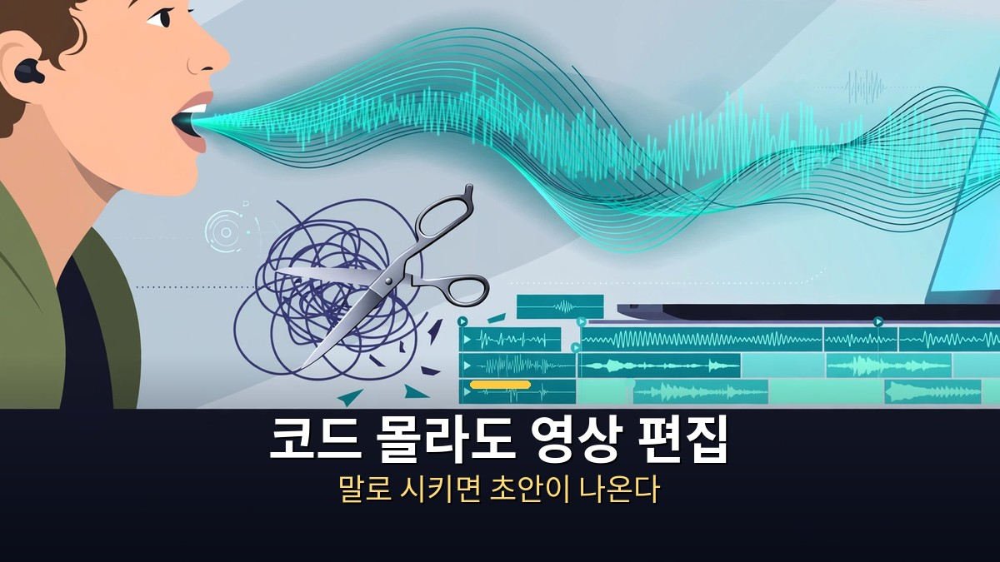
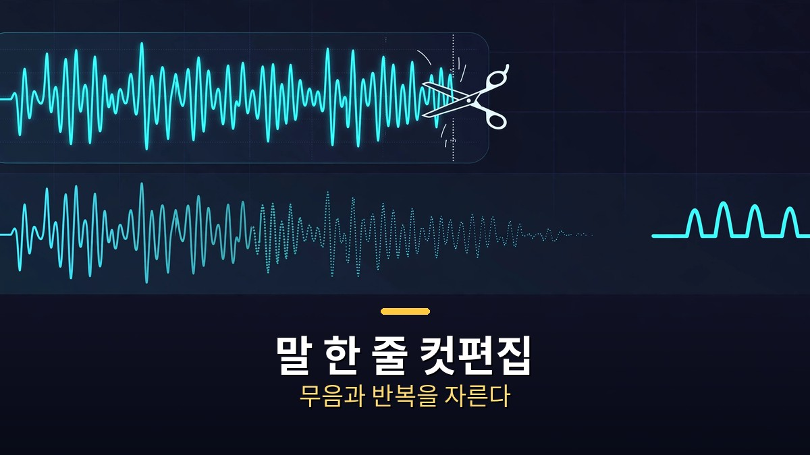

<!-- 본문 시작 -->

맷 울프의 새 영상은 제목 그대로다.
클로드에게 영상 편집을 맡기는 방법, 코드를 쓰지 않고.
중심은 클로드 오퍼스 5.5와 vidIQ MCP의 조합이다.
인기 영상을 분석해 내 채널에 맞는 편집 규칙을 만들고, 그 규칙으로 숏폼을 완성하는 흐름이다.
이 글은 32분 영상의 실제 흐름을 따라, 어디까지 맡기고 어디서 사람이 멈춰야 하는지 정리한다.

> 핵심 정리: 클로드는 편집 버튼을 대신 누르는 것이 아니라, 내 채널의 편집 규칙을 담은 '스킬'을 먼저 만든다. 그 스킬이 있으면 A-roll 자르기부터 B-roll·자막·음악까지 한 흐름으로 이어진다. 다만 이 흐름이 잘 통하는 곳은 숏폼·토킹헤드 정보 영상까지다.

## vidIQ MCP로 내 채널에 맞는 편집 스킬을 만든다는 말은 무엇일까?

첫 단계는 편집이 아니라 분석이다.
vidIQ MCP를 클로드에 연결하면, 인기 영상과 대본을 분석할 수 있다.
어떤 주제가 먹히는지, 어떤 구조의 대본이 반응을 얻는지, 내 채널의 영상은 어떤 패턴인지를 읽는다.
그 분석 결과를 바탕으로 클로드는 '스킬'을 만든다.
스킬이란, 이 채널에서는 이렇게 편집한다는 규칙 묶음이다.
자막 스타일, 컷의 리듬, B-roll을 붙이는 위치 같은 것들이 규칙으로 굳어진다.

이 단계가 중요한 이유는, 규칙이 없으면 매번 결과가 달라지기 때문이다.
같은 영상이라도 어떤 날은 자막이 길고, 어떤 날은 음악이 과하다.
스킬을 만들어두면 다음 영상부터는 같은 기준으로 편집이 시작된다.
영상 목차에서도 이 흐름이 드러난다.
vidIQ로 아이디어를 구상하고(02:29), 시나리오 작성부터 AI 편집까지(04:11), 설정(07:15), vidIQ 연결(09:21), 채널에 맞는 활용법 개발(10:55) 순으로 이어진다.
편집은 마지막이 아니라, 분석과 규칙 만들기가 끝난 뒤에 온다.

## 말로 시키는 숏폼 편집은 실제로 어떻게 돌아갈까?

본격적인 편집 흐름은 A-roll 정리부터 시작한다.
A-roll은 말하는 사람의 본 영상이다.
클로드는 쉼과 실수 구간을 잘라내고, 남은 말을 자연스럽게 이어 붙인다.
그 위에 B-roll(보조 화면), 자막, 음악, 효과를 붙인다.
실제 자르기·붙이기는 FFmpeg가 맡는다.
클로드가 지시하고, FFmpeg가 실행하는 구조다.
하이퍼프레임즈(움직이는 글자), 일레븐랩스(목소리·전사), 블렌더 확장도 이 흐름에 언급된다.

| 단계 | 클로드에게 시킬 일 | 사람이 확인할 일 |
|---|---|---|
| 분석·스킬 | 인기 영상·대본 분석, 채널 규칙 만들기 | 규칙이 내 채널과 맞는지 |
| A-roll 정리 | 쉼·실수 자르기 | 잘린 말의 자연스러움 |
| 꾸미기 | B-roll·자막·음악·효과 붙이기 | 자막 오타, 음량, 저작권 |
| 마무리 | 피드백 반영 재편집 | 최종 눈검수 후 내보내기 |

데모 구간에서는 시행착오도 그대로 나온다.
엔비디아 모션브릭스(MotionBricks) 데모에서는 일레븐랩스 전사 실패와 엔비디아 사이트 다운로드 차단 같은 문제가 생겼다.
문제를 고친 뒤 피드백을 반영해 다시 편집하는 데 약 36분이 걸렸다.
이 대목이 이 영상의 가장 솔직한 부분이다.
AI 편집이 '한 번에 완성'이 아니라 '고치고 다시 돌리는' 과정이라는 것을 보여준다.
관련해 클로드 사용법이 최근 어떻게 바뀌었는지는 [클로드 한 달 업데이트 4가지｜코드·브라우저·파일·계획 모드, 뭐가 달라졌나](https://aitechnoteskr.tistory.com/84)에서 이어서 볼 수 있다.

## 숏폼에는 되고, 롱폼에는 왜 아직 사람 손이 필요할까?

영상의 결론은 분명하다.
숏폼·토킹헤드 정보 영상에는 AI 편집이 꽤 유효하다.
구조가 단순하고, 말의 흐름이 중심이며, 반복되는 형식이 많기 때문이다.
반대로 롱폼은 여전히 사람 편집을 선호한다는 취지로 정리된다.
긴 서사, 미묘한 리듬, 장면의 의도를 읽는 일은 아직 규칙만으로 다 되지는 않는다.

또 하나의 결론은 시장의 변화다.
편집 진입장벽이 낮아지면 콘텐츠 자체는 상품화되기 쉽다.
그때 가치가 되는 것은 큐레이션, 즉 무엇을 고르고 어떤 순서로 보여줄지의 판단이다.
도구가 편집을 대신해줄수록, 사람의 몫은 '무엇을 만들지'와 '무엇을 버릴지'로 이동한다.
이 영상을 그대로 따라 할 때의 전제도 잊지 말자.
클로드 오퍼스 5.5와 vidIQ 같은 도구는 유료·계정 전제가 있을 수 있고, 남의 음악·영상·서체를 그대로 쓰면 저작권 문제가 생긴다.
초안은 AI가 만들어도, 마지막 검수와 책임은 사람에게 남는다.

## 자주 묻는 질문

**Q. 정말 코드 없이 되나?**
영상 편집 자체는 말로 시키면 된다. 다만 도구 연결과 오류 수정 과정에서, 클로드가 보여주는 메시지를 읽고 다음 지시를 내리는 판단은 필요하다.

**Q. 프리미어 프로가 꼭 필요한가?**
영상 설명에서는 프리미어 프로 사용법을 다룬다고 소개한다. 다만 핵심 흐름은 클로드의 지시와 FFmpeg의 실행이므로, 편집기의 종류보다 스킬과 검수 흐름이 중요하다.

**Q. AI가 만든 숏폼을 그대로 올려도 되나?**
권장하지 않는다. 자막·음량·저작권을 확인하고, 피드백 재편집까지 마친 뒤 내보내는 것이 안전하다.

## 함께 읽으면 좋은 글

[클로드 한 달 업데이트 4가지｜코드·브라우저·파일·계획 모드, 뭐가 달라졌나 — 클로드 사용법이 바뀐 네 가지 지점](https://aitechnoteskr.tistory.com/84)
[AI가 과학을 해냈다고? 점수보다 검증부터｜벤치마크 오류와 논문 감사의 교훈 — 점수보다 검증 과정을 먼저 보는 법](https://aitechnoteskr.tistory.com/100)
[매트릭스｜빨간 약을 건넨 모피어스, 시뮬레이션 속 네오의 선택 — 시뮬레이션 속 진실을 묻는 고전 SF](https://aitechnoteskr.tistory.com/103)

편집의 버튼을 외우는 대신, 내 채널의 규칙부터 만들어두자. 다음 숏폼부터는 말로 시키고, 고치고, 눈으로 확인하는 흐름이 된다. 이 주제를 계속 따라가려면 이웃 추가를 눌러두면 된다.

<!-- 본문 끝 -->

## 작업용 출처·이미지 정보 (업로드 제외)

- 자료 출처: Matt Wolfe 영상 ep4psgAFOqc(2026-11-05, 32:44, 스크립트 패널 0:00~32:39 확인 기준, vidIQ MCP·MotionBricks 데모 포함)
- 이미지: images/01-hero.jpg ~ 04-img3.jpg / 자작 일러스트 + 한글 배너 오버레이 (1200x675)
