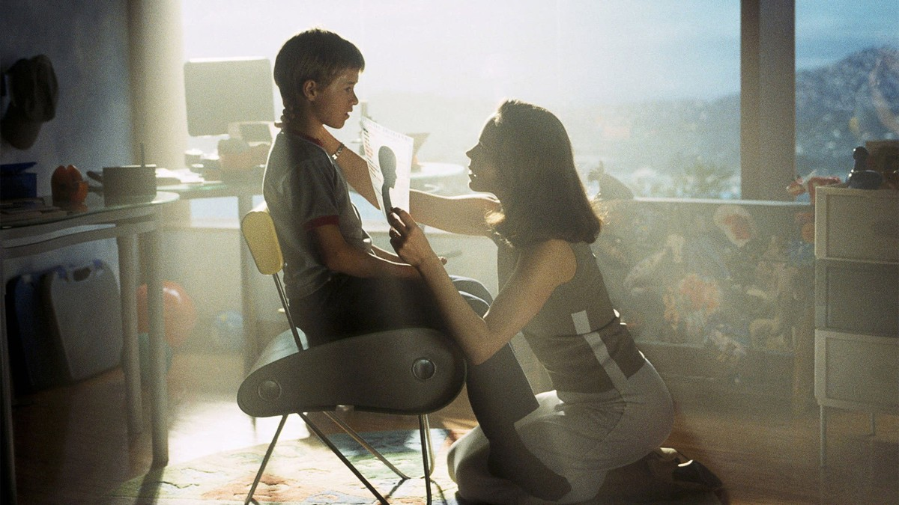
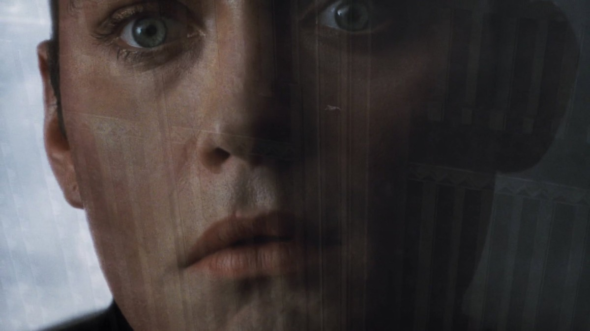
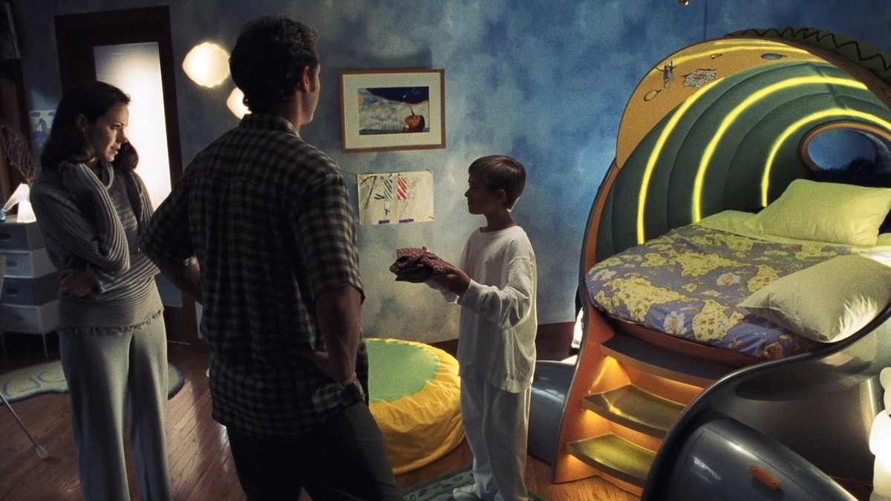
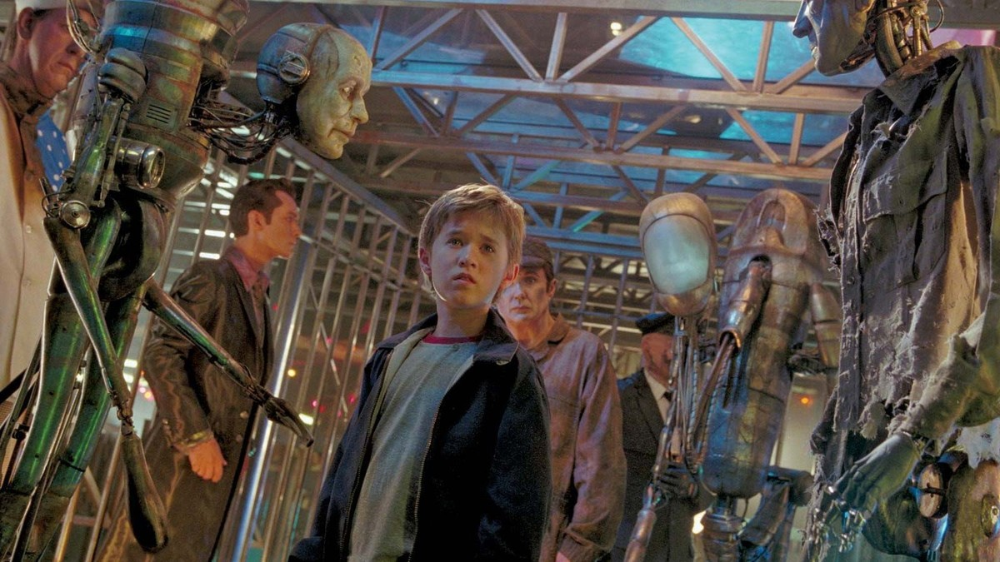
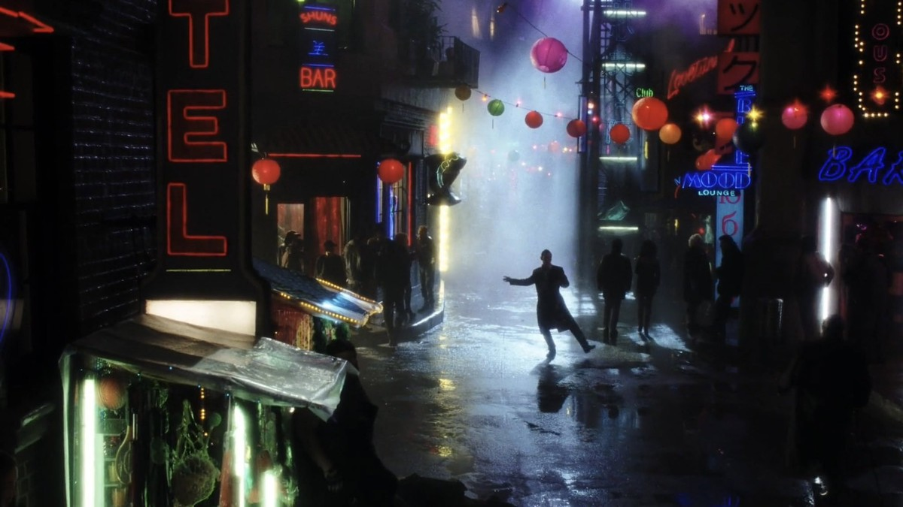
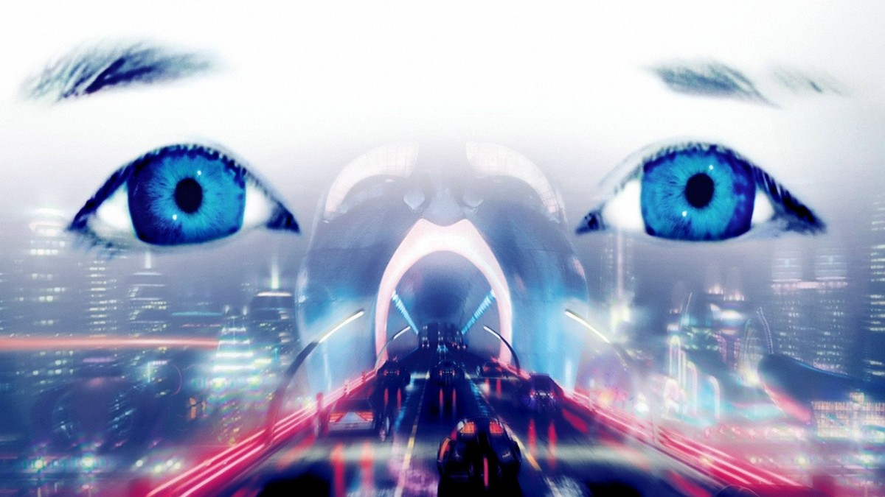
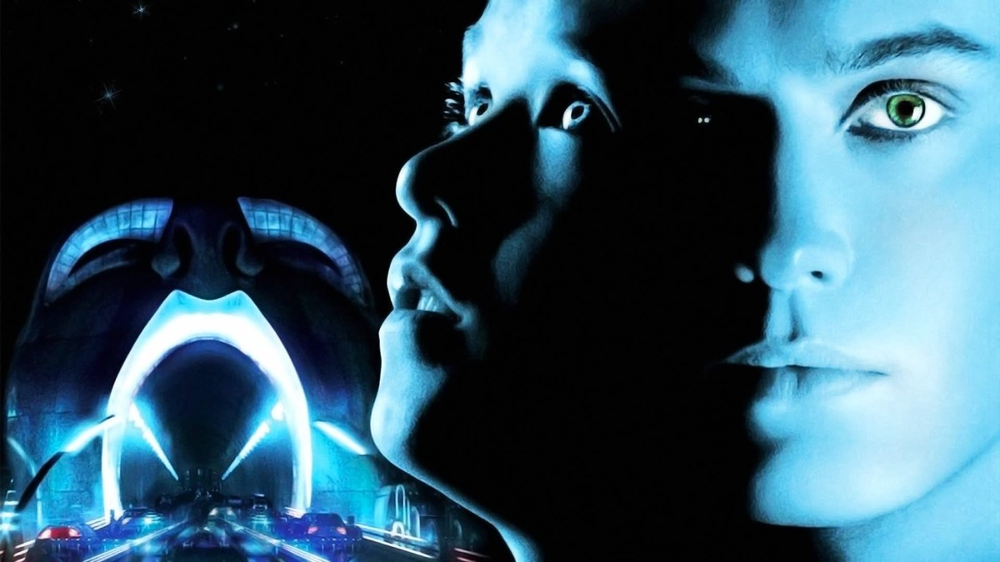

<!-- 본문 시작 -->

The boy says it is love.
But humans say it is not.
Steven Spielberg's 2001 film "A.I. Artificial Intelligence" tells the story of David, the first robot boy with feelings.
A child programmed to love dreams of becoming human in order to be loved.
A spoiler-free introduction. No ending scenes are covered, and scene descriptions focus on setup and atmosphere up to the middle of the film.

## Basic Information

David's face in close-up — an expression hard to tell apart from a human's
| Item | Details |
|---|---|
| Title | A.I. Artificial Intelligence |
| Director and screenplay | Steven Spielberg |
| Cast | Haley Joel Osment (David), Jude Law (Gigolo Joe), Frances O'Connor (Monica Swinton), William Hurt (Professor Hobby) |
| Release | 2001, Korean theatrical release August 10, 2001, rated 12 |
| Runtime | 2 hours 26 minutes (146 minutes) |
| Genre | Drama, SF, Adventure |
| TMDB Member Score | 71% (6,969 votes, checked on the TMDB Korea page on 2026-11-05) |
| Where to watch in Korea | Streaming on Netflix and Watcha (including Netflix Standard with Ads), rental on Wavve HD 1,320 KRW, purchase on Wavve HD 4,950 KRW (TMDB Korea watch page, checked 2026-11-05; providers and prices should be rechecked before watching) |

## Why Was David Made? — The Programming of Love

David facing Monica and Henry in the boy's room — the first moment he became family
In a distant future, melting ice caps flood cities and resources run out, and humanity builds robots with feelings.
At Cybertronics, Professor Hobby creates David, the first robot boy who can love.
David is adopted into the Swinton home as a test case.
For parents with a sick son, David fills an empty place.

Here the film's first question begins.
Is the love of a being programmed to love real love?
David imprints on Monica as his mother and takes that love as absolute.
A program made by humans believes in love more purely than humans do.
This scene shows head-on the oldest question about AI feelings.
Where is the line between programmed feeling and felt feeling? The film gives no answer and hands it to the audience.

David's face seen through glass — the distance between what shows and what is real

## A Boy Left in the Forest — Abandonment as an AI Experience

David standing among old robots — the world of machines humans discarded
David's home life does not last long.
Unexpected events pile up, and David ends up leaving his family's side.
Left in the forest with his teddy bear Teddy, David sets out to find the Blue Fairy.
Like the Blue Fairy in the Pinocchio story, he seeks a being who will make him a real human boy.

This stretch matters because David's journey is a problem of relationships, not technology.
Can abandonment happen to a machine too?
Why can humans abandon a being they made to love?
The film does not paint David only as a pitiable machine.
By keeping David's purity intact, it makes the humans' choices look colder.
The Flesh Fair scene also shows how humans treat AI.
This part is summarized around mid-film atmosphere only; the details are better seen directly.

## With Gigolo Joe — What It Means to Become Human

Rouge City at night, lit with neon — another human world David meets
Along the way David meets Gigolo Joe.
Joe, a robot made to fit human desire, is David's mirror opposite.
If David wants love, Joe is closer to selling the experience of being loved.
Their journey together deepens the film's question by one more layer.
How is a robot imitating human feelings different from humans expecting feelings from robots?

The "Blue Fairy" David seeks is ultimately another name for the wish to become human.
Does becoming human mean a changed body, or confirmation of being loved?
The film carries this question to the end and lets the audience answer it.
Even the story up to the middle organizes three views of AI and humans.
The programming of love, abandonment, and the wish to become human.
Nothing about the ending is mentioned in this article.

Blue eyes layered over a future city — the world David looks at

## Before-You-Watch Checklist

David in blue light with a future-city arch — the mood the poster promises
- At 2 hours 26 minutes, it suits a relaxed evening viewing
- Rated 12, Korean theatrical release August 10, 2001
- Watch on Netflix or Watcha streaming, Wavve rental HD 1,320 KRW or purchase HD 4,950 KRW (TMDB, as of 2026-11-05; recheck before watching)
- Knowing the background — Spielberg's emotion meeting Stanley Kubrick's original idea (based on a Brian Aldiss short story) — adds depth
- Better watched without searching for ending information first

## Frequently Asked Questions

**Q. Can children watch it too?**
The Korean rating is 12. With dark and heavy scenes, it suits teenagers and older better than young children.

**Q. Can I understand it without knowing much about AI?**
Yes. The boy's journey is the center, not technical explanation, so the story can be followed without AI knowledge.

**Q. Where can I watch it?**
As of 2026-11-05, TMDB Korea lists Netflix and Watcha streaming, and Wavve rental and purchase. Providers and prices can change, so recheck before watching.

## Recommended Reading

[The Matrix｜Morpheus Offers the Red Pill, Neo Chooses Inside the Simulation — a classic SF film asking about truth inside a simulation](https://aitechnotesen.blogspot.com/2026/11/the-matrixmorpheus-offers-red-pill-neo.html)
[I, Robot｜When Three Laws Shake, What Should a Detective Believe — a film that asks what human judgment is worth when rules wobble](https://aitechnotesen.blogspot.com/2026/11/i-robotwhen-three-laws-shake-what.html)
[Blade Runner 2049｜A Replicant with Memories Asks What Makes Us Human — a film that asks whether memory can be the standard of humanity](https://aitechnotesen.blogspot.com/2026/11/blade-runner-2049a-replicant-with.html)

A story of a child made to love who will not let go of love even after humans abandon him. If the ending now pulls at you, watch the film first rather than searching for it. Follow along for the next film introduction.

<!-- 본문 끝 -->

## 작업용 출처·이미지 정보 (업로드 제외)

- Source: TMDB movie 644 page and watch page (Korea, checked 2026-11-05) / Stills: TMDB backdrop originals (width 1200px+, ending scenes excluded — 2 Blue Fairy shots, identical-robot replica shot, duplicate poster-style composition from #11 excluded)
- Images: images/01-hero-en.jpg ~ 08-img7-en.jpg / TMDB official stills and backdrops (1200x675)
