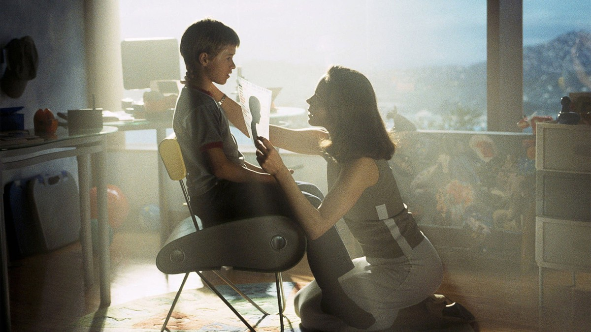
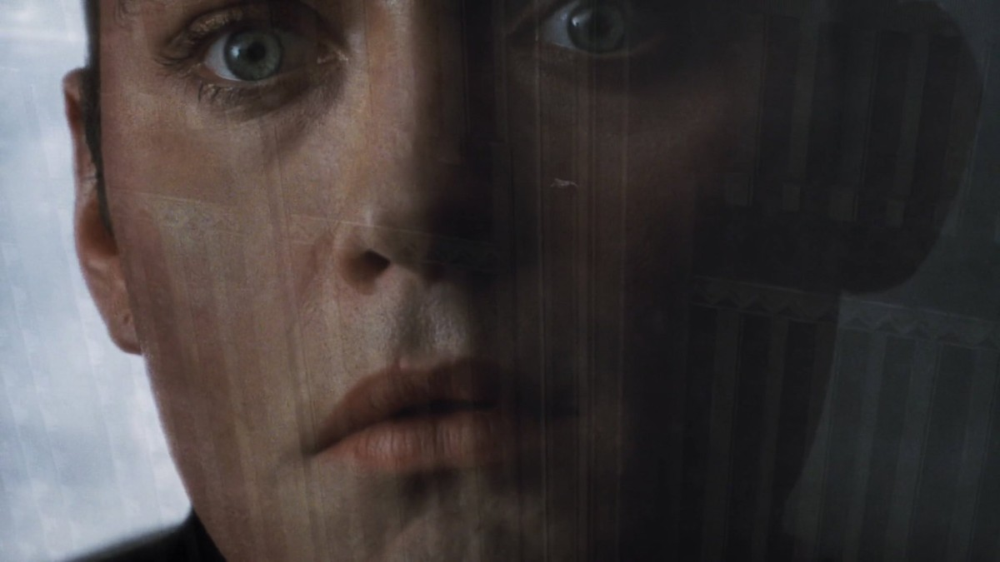
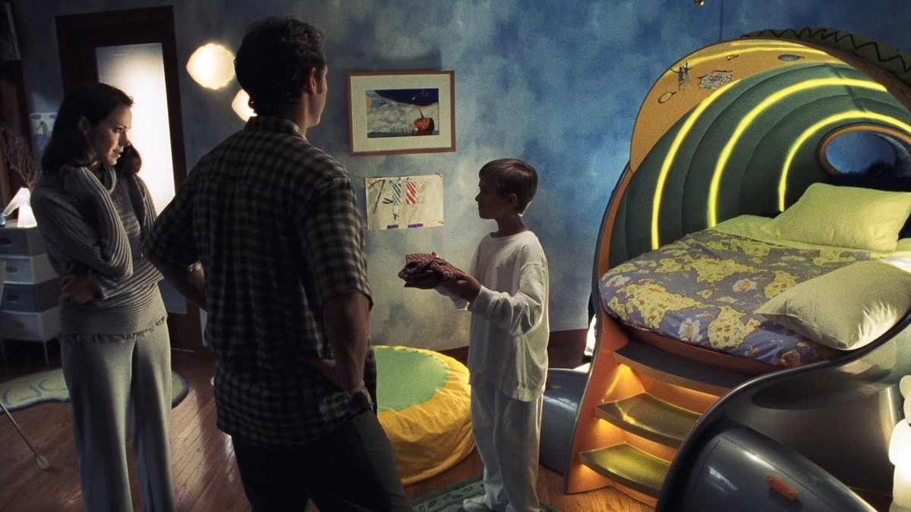
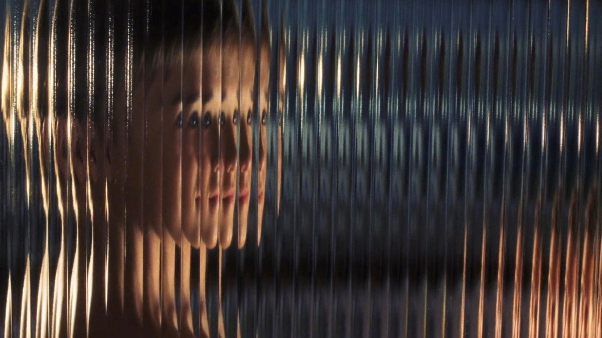
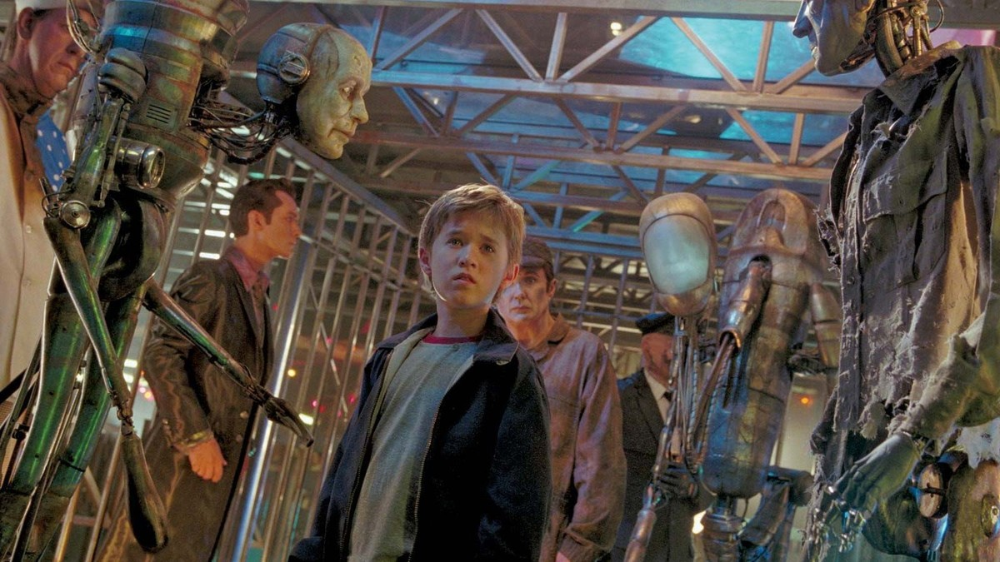
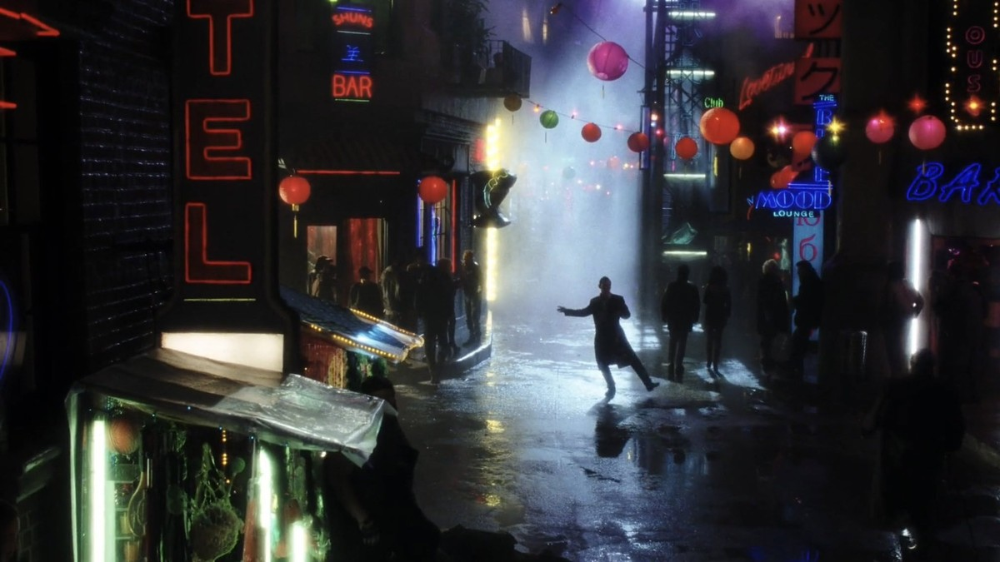
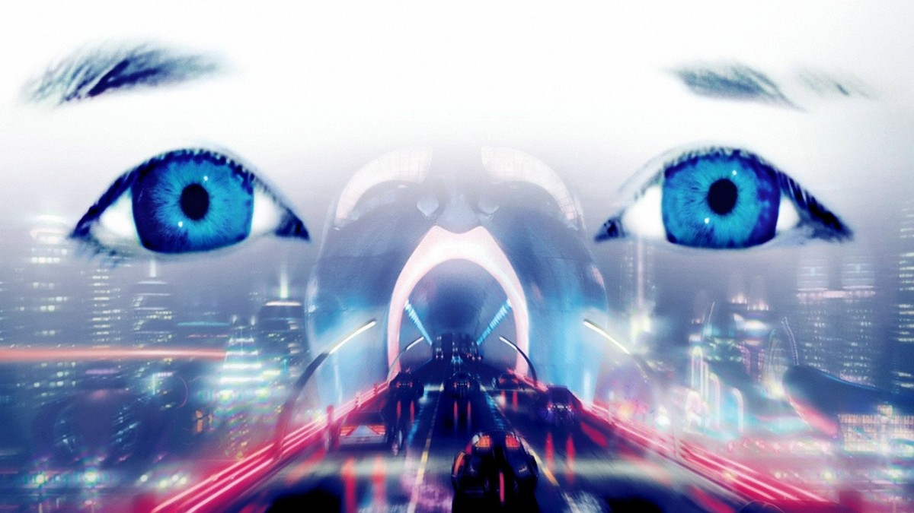
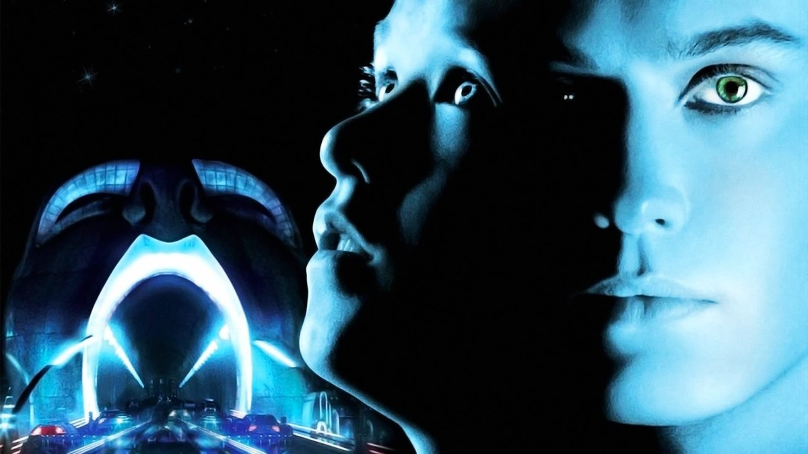

<!-- 본문 시작 -->

소년은 사랑이라 말한다.
그러나 인간들은 아니라고 한다.
2001년 스티븐 스필버그 감독의 'A.I. 인공지능'은 감정을 가진 최초의 로봇 소년 데이비드의 이야기다.
사랑하도록 프로그래밍된 아이가, 사랑받기 위해 인간이 되기를 꿈꾸는 여정이다.
스포일러 없는 소개다. 결말 장면은 다루지 않으며, 장면 설명은 중반부까지의 설정과 분위기 중심으로 정리했다.

## 기본 정보

데이비드의 얼굴 클로즈업 — 인간과 구분하기 어려운 표정
| 항목 | 내용 |
|---|---|
| 제목 | A.I. 인공지능 (A.I. Artificial Intelligence) |
| 감독·각본 | 스티븐 스필버그 |
| 주연 | 헤일리 조엘 오스먼트(데이비드), 주드 로(지골로 조), 프랜시스 오코너(모니카 스윈튼), 윌리엄 허트(하비 교수) |
| 개봉 | 2001년, 한국 극장 개봉 2001년 8월 10일, 등급 12세 |
| 러닝타임 | 2시간 26분(146분) |
| 장르 | 드라마, SF, 모험 |
| TMDB 회원 점수 | 71%(6,969개 평가, TMDB 한국 페이지 2026-11-05 확인) |
| 국내 시청처 | 스트리밍 넷플릭스·왓챠(넷플릭스 광고형 포함), 대여 웨이브 HD 1,320원, 구매 웨이브 HD 4,950원 (TMDB 시청처 페이지 대한민국 기준 2026-11-05 확인, 가격·제공처는 시청 전 재확인 필요) |

## 데이비드는 왜 만들어졌을까 — 사랑의 프로그래밍

소년의 방에서 모니카와 헨리를 마주한 데이비드 — 가족이 된 첫 순간
먼 미래, 해빙으로 도시가 물에 잠기고 자원이 고갈된 세상에서 인류는 감정을 지닌 로봇을 만든다.
사이버트로닉스사의 하비 교수는 사랑할 수 있는 최초의 로봇 소년 데이비드를 탄생시킨다.
데이비드는 스윈튼 부부의 집에 실험 케이스로 입양된다.
아픈 아들을 둔 부부에게 데이비드는 아이의 빈자리를 채우는 존재로 들어간다.

여기서 영화가 던지는 첫 질문이 시작된다.
사랑하도록 프로그래밍된 존재의 사랑은 진짜 사랑인가.
데이비드는 모니카를 엄마로 각인하고, 그 사랑을 절대적인 것으로 받아들인다.
인간이 만든 프로그램이, 인간보다 더 순수하게 사랑을 믿는 아이가 된다.
이 대목은 AI의 감정을 묻는 가장 오래된 질문을 정면으로 보여준다.
프로그램된 감정과 느껴지는 감정의 경계가 어디인지, 영화는 답을 주지 않고 관객에게 넘긴다.

유리 너머로 비치는 데이비드의 얼굴 — 보이는 것과 진짜 사이의 거리

## 숲에 버려진 소년 — 버려짐이라는 AI의 경험

낡은 로봇들 사이에 선 데이비드 — 인간이 버린 기계들의 세상
데이비드의 집 생활은 오래가지 않는다.
예상치 못한 사건들이 겹치면서, 데이비드는 가족의 곁을 떠날 수밖에 없게 된다.
곰 인형 테디와 함께 숲에 남겨진 데이비드는 '푸른 요정'을 찾아 떠난다.
피노키오 이야기의 푸른 요정처럼, 자신을 진짜 인간 소년으로 만들어줄 존재를 찾아서다.

이 구간이 중요한 이유는, 데이비드의 여정이 기술의 문제가 아니라 관계의 문제이기 때문이다.
버려진다는 것은 기계에게도 일어날 수 있는 일인가.
인간은 왜 사랑하도록 만든 존재를 버릴 수 있는가.
영화는 데이비드를 불쌍한 기계로만 그리지 않는다.
오히려 인간의 선택이 더 차갑게 보이도록, 데이비드의 순수함을 끝까지 유지한다.
플래시 페어의 장면에서는 인간이 AI를 어떻게 대하는지도 드러난다.
이 대목은 중반부의 분위기 중심으로만 정리하며, 구체적인 전개는 직접 보는 것이 좋다.

## 지골로 조와 함께 — 인간이 된다는 것의 의미

네온이 켜진 밤의 루즈 시티 — 데이비드가 만난 또 다른 인간 세상
여정 도중 데이비드는 지골로 조를 만난다.
인간의 욕망에 맞춰 만들어진 로봇 조는 데이비드와 정반대의 거울이다.
데이비드가 사랑을 원한다면, 조는 사랑받는 방법을 파는 존재에 가깝다.
두 로봇의 동행은 영화의 질문을 한 겹 더 깊게 만든다.
로봇이 인간의 감정을 흉내 내는 것과, 인간이 로봇에게 감정을 기대하는 것은 어떻게 다른가.

데이비드가 찾는 '푸른 요정'은 결국 인간이 되겠다는 소망의 다른 이름이다.
인간이 된다는 것은 몸이 바뀌는 일인가, 아니면 사랑받는다는 확인인가.
영화는 이 질문을 끝까지 끌고 가며, 관객이 스스로 답하게 둔다.
중반부까지의 이야기만으로도, AI와 인간의 관계에 대한 세 가지 시선이 정리된다.
사랑의 프로그래밍, 버려짐, 인간이 된다는 소망이다.
결말에 대한 언급은 이 글에서 하지 않는다.

푸른 눈과 미래 도시가 겹친 이미지 — 데이비드가 바라보는 세상

## 시청 전 체크리스트

푸른 빛의 데이비드와 미래 도시 아치 — 포스터가 말하는 영화의 분위기
- 러닝타임 2시간 26분으로, 여유 있는 저녁 시간에 보는 것이 좋다
- 등급 12세, 국내 극장 개봉은 2001년 8월 10일
- 시청처는 넷플릭스·왓챠 스트리밍, 웨이브 대여 HD 1,320원·구매 HD 4,950원 (2026-11-05 TMDB 기준, 시청 전 재확인 필요)
- 스필버그의 감성과 스탠리 큐브릭의 원안(브라이언 올디스 단편 원작)이 만난 작품이라는 배경을 알고 보면 더 깊다
- 결말에 대한 사전 정보 없이 보는 것이 좋다

## 자주 묻는 질문

**Q. 아이와 함께 봐도 되나?**
국내 등급은 12세다. 어둡고 무거운 장면이 있어, 어린 아이보다는 청소년 이상과 함께 보는 것이 좋다.

**Q. AI에 대해 잘 몰라도 이해할 수 있나?**
그렇다. 기술 설명보다 소년의 여정이 중심이라, AI 지식이 없어도 이야기는 따라갈 수 있다.

**Q. 어디서 볼 수 있나?**
2026-11-05 TMDB 대한민국 기준으로는 넷플릭스·왓챠 스트리밍, 웨이브 대여·구매가 표시된다. 제공처와 가격은 바뀔 수 있어 시청 전 재확인이 필요하다.

## 함께 읽으면 좋은 글

[매트릭스｜빨간 약을 건넨 모피어스, 시뮬레이션 속 네오의 선택 — 시뮬레이션 속 진실을 묻는 고전 SF](https://aitechnoteskr.tistory.com/103)
[아이, 로봇｜로봇 3원칙이 흔들리는 날, 형사는 무엇을 믿어야 하나 — 규칙이 흔들릴 때 인간의 판단을 묻는 영화](https://aitechnoteskr.tistory.com/97)
[블레이드 러너 2049｜기억을 가진 인조인간, 인간의 기준을 묻다 — 기억이 인간성의 기준이 될 수 있는지 묻는 영화](https://aitechnoteskr.tistory.com/87)

사랑하도록 만들어진 아이가 인간에게 버려지고도 사랑을 놓지 않는 이야기. 그 끝이 궁금해졌다면, 결말을 미리 검색하지 말고 영화를 먼저 보는 것이 좋다. 다음 영화 소개도 함께 따라가려면 이웃 추가를 눌러두면 된다.

<!-- 본문 끝 -->

## 작업용 출처·이미지 정보 (업로드 제외)

- 자료 출처: TMDB 영화 644 페이지·시청처 페이지(대한민국 기준, 2026-11-05 확인) / 스틸: TMDB 백드롭 원본(너비 1200px 이상, 결말 장면 제외 — 블루 페어리 2장·동일 로봇 복제 장면 제외, 11번 포스터풍 중복 구성 제외)
- 이미지: images/01-hero.jpg ~ 08-img7.jpg / TMDB 공식 스틸·백드롭 (1200x675)
