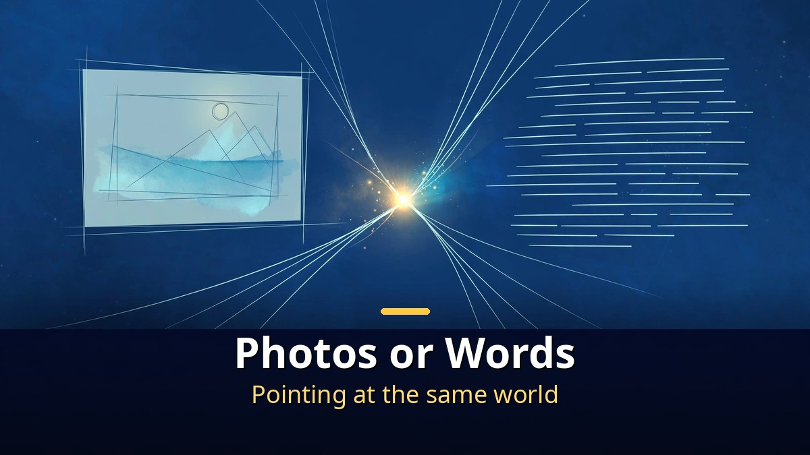
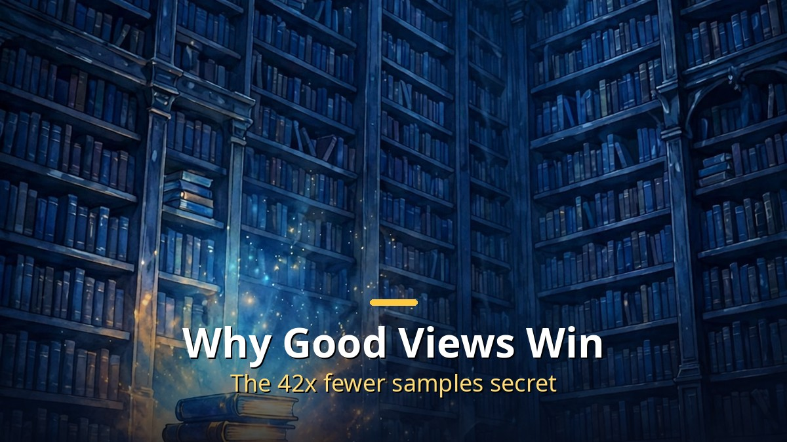

<!-- 본문 시작 -->

A tiny model with 109 million parameters reportedly beat a giant with 72 billion.
The story comes from a new paper by Yann LeCun, one of the "godfathers of AI."
But the real point is not a small model winning.
It is a mathematical proof about how AI learns the world.
This article checks the paper itself and the coverage, to sort out what the numbers mean and how far they can be trusted.

> Key takeaway: LeCun and Balestriero's paper turns the idea that "AIs trained on different senses end up understanding the same world in the same way" from a hypothesis into a theorem. A 109M model aligning with image recognition better than 72B models is evidence that what matters is not scale but what you pair together while teaching. Even so, this is one metric from a paper that has not yet been peer-reviewed.

## What Is the Platonic Representation Hypothesis, and Why Did It Need a Proof?

Whether learned from photos or from words, it points at the same world.

First, the terms.
The "Platonic Representation Hypothesis" is a hypothesis put forward by MIT researchers in 2024.
Whether trained on photos, text, or sound, AI models converge on the same understanding of the world as they grow larger.
The name borrows from Plato's "Forms."
Different appearances, one essence.

Until now, this hypothesis had only been observed.
Researchers measured several models and found they really did resemble each other.
Why they resembled each other, and under what conditions, had not been proved.
That is why LeCun's long-championed "world models" and "JEPA" learning method came back into focus.

JEPA stands for Joint-Embedding Predictive Architecture.
Instead of predicting pixels or words directly, it predicts in an abstract representation space.
It discards unnecessary detail and keeps only the skeleton of a scene.
LeCun has long argued that scaling language models alone will not reach human-level AI.
This paper attaches mathematical support to that argument.

## How Did a 109M Model Beat a 72B One?

Seeing the same scene twice beats reading the same document twice.

The paper is titled "Proving and Improving the Platonic Representation Hypothesis with JEPAs."
Its authors are Randall Balestriero of Brown University and Yann LeCun, posted to arXiv (2610.39302) on October 29, 2026.
The core is the distinction between "good views" and "bad views."

A good view is a pair of two observations of one scene.
A photo and a sentence describing it, for example — the same world seen through two different senses.
A bad view is a pair cut from a single observation.
Two slices of one document, like two spans of the same sentence.
The paper proves that JEPAs trained on good views arrive at the same representation even when trained separately on different modalities.
They match up to a single rotation; the essence is the same.

The striking part is the claim that next-token prediction has the same mathematical form as a bad-view JEPA.
Learning by guessing the next word is like splitting one document into two pieces and matching them.
So next-token prediction is an inefficient route to a shared representation of the world.

The experiments point the same way.
A 109M-parameter text JEPA, trained on the texts of 940 million web images, scored 0.184 on an alignment measure with the image encoder DINOv2.
Qwen2.5-72B scored 0.154, Llama-3-70B scored 0.151, and CLIP's text encoder scored 0.124.
Good views also needed about 42 times fewer training samples than next-token prediction to reach the same alignment.

| Measure | 109M JEPA | Qwen2.5-72B | Llama-3-70B |
|---|---|---|---|
| Parameters | 109 million | 72 billion | 70 billion |
| Alignment with image recognition | 0.184 | 0.154 | 0.151 |
| Training method | Good-view JEPA | Next-token prediction | Next-token prediction |

By the numbers alone, a model more than 600 times smaller beat the giants.
But this table must not be read as "the small model got smarter."
What was measured was alignment of representations with image recognition — one metric, not math, coding, or writing skill.
The authors themselves made clear it is "one specific metric."

The background is worth noting too.
LeCun left Meta after twelve years as its chief AI scientist and founded AMI Labs.
AMI Labs raised $1.03 billion in March 2026 and has since announced a 15M-parameter world model, H-JEPA, and more.
This paper is the academic root of that direction.

## How Far Should We Trust It — and What Changes Right Now?

One proof does not overturn an industry. Check the scope of verification first.

The first thing to check is the verification status.
This paper is a preprint that has not yet been peer-reviewed.
No independent replication has been reported.
The empirical case rests on the authors' choice of one metric and one benchmark setup.
So the conclusion "JEPA will replace LLMs" cannot be drawn from this paper alone.

Counterarguments exist too.
Richard Sutton's "bitter lesson" says scale and compute win in the end.
The video also covers the objection that JEPAs could break down as they scale.
LeCun's claim and Sutton's lesson are an undecided debate.
It will be settled by future replication and scaling, not by a single paper.

So how should ordinary readers take this news?
A checklist helps.

- This is a proof about a learning method, not a new chatbot launch. The apps you use today do not change.
- The numbers 0.184 versus 0.154 are one metric, "representation alignment." They are not math or coding scores.
- Needing 42 times fewer samples is the efficiency of the "good view" training design. It means pairs must be chosen well, not that data can be skipped.
- What to watch next is replication: whether other groups reproduce the result, and whether it holds for larger models.

## Closing

LeCun's paper attaches mathematics to an old argument: "making it bigger is not the only answer."
The scene of a small model winning is dramatic, but the real message is quiet.
What you pair together while teaching matters as much as how big you build it.
If this proof survives replication, the way AI is built may gradually change.
Until then, the best way to read this news is to check the scope of verification before the numbers.

## Frequently Asked Questions

**Q. Does this mean the 109M model is smarter than the 72B model?**
A. No. It scored higher on one metric — alignment of representations with image recognition. It does not mean it is better at math, coding, or writing.

**Q. Will JEPA replace LLMs?**
A. Not yet. This paper proves something about the efficiency and convergence of a learning method; it does not show that a general-purpose chatbot has been replaced. Replication and scaling remain.

**Q. What is the Platonic Representation Hypothesis?**
A. The idea that AIs trained on different senses — photos, text, sound — converge on the same understanding of the world as they scale. This paper turns it into a theorem for JEPAs.

**Q. What does this mean for ordinary users?**
A. The apps you use do not change right away. It can be read as a signal that AI may learn well with less data in the future.

## Recommended Reading

[Jobs AI Is Erasing: Read the Tier List Before the Headlines｜A 5-Tier Standard and a Checklist for Your Job — a checklist for where your job sits](https://aitechnotesen.blogspot.com/2026/11/jobs-ai-is-erasing-read-tier-list.html)
[A.I. Artificial Intelligence｜A Boy Robot Programmed to Love, and What It Means to Become Human — a robot boy who asks what love means](https://aitechnotesen.blogspot.com/2026/11/ai-artificial-intelligencea-boy-robot.html)
[I, Robot｜When Three Laws Shake, What Should a Detective Believe — a film that asks what human judgment is worth when rules wobble](https://aitechnotesen.blogspot.com/2026/11/i-robotwhen-three-laws-shake-what.html)

One paper does not overturn an industry. But the habit of checking the scope of verification first keeps you steady when the next headline arrives. Follow along if you want to keep judging these stories together.

<!-- 본문 끝 -->

## 작업용 출처·이미지 정보 (업로드 제외)

- Source: TheAIGRID 영상 _fEqQa5hBmI(2026-11-05, 30:00, 스크립트 패널 0:00~29:53 확인 기준) + arXiv 2610.39302 원문 대조
- Images: images/01-hero-en.jpg ~ 04-img3-en.jpg / original illustration + English banner overlay (1200x675)
