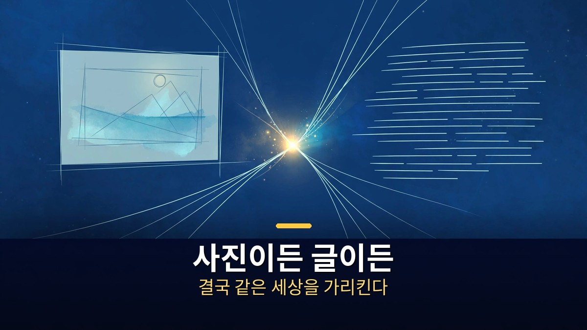

<!-- 본문 시작 -->

1억 900만 개짜리 작은 모델이 720억 개짜리 거대 모델을 앞섰다는 소식이 나왔다.
주인공은 'AI 대부' 얀 르쿤의 새 논문이다.
그런데 이 소식의 핵심은 '작은 모델의 승리'가 아니다.
AI가 세상을 배우는 '방식'에 대한 수학적 증명이다.
이 글은 논문 원문과 보도 대조를 통해, 숫자가 무엇을 뜻하고 어디까지 믿을 수 있는지 정리한다.

> 핵심 정리: 르쿤과 발레스트리에로의 논문은 "다른 감각으로 배운 AI도 같은 세상을 같은 방식으로 이해한다"는 가설을 정리로 바꿨다. 109M 모델이 72B 모델보다 이미지 인식과 잘 맞았다는 결과는, 규모가 아니라 '무엇을 짝으로 보여주며 가르쳤는가'가 결정적이라는 증거다. 다만 이것은 하나의 지표에서 나온, 아직 동료심사를 거치지 않은 결과다.

## 플라톤적 표현 가설이 뭐길래, 증명이 필요했을까?

사진으로 배우든 글로 배우든, 결국 같은 세상을 가리킨다.

먼저 용어부터 정리한다.
'플라톤적 표현 가설'은 2024년 MIT 연구진이 내놓은 가설이다.
사진으로 배우든, 글로 배우든, 소리로 배우든, AI는 규모가 커질수록 결국 같은 세상의 모습을 같은 방식으로 이해하게 된다는 주장이다.
플라톤의 '이데아'에서 이름을 빌렸다.
겉모습은 달라도, 본질은 하나라는 뜻이다.

그동안 이 가설은 '관찰'에 머물렀다.
여러 모델을 재 보니 실제로 닮아 있더라는 경험적 결과만 있었다.
왜 닮아지는지, 어떤 조건에서 닮아지는지는 증명되지 않았다.
그래서 르쿤이 오래 주장해 온 '세계 모델'과 'JEPA'라는 학습 방식이 다시 주목받았다.

JEPA는 '합동 임베딩 예측 구조'의 줄임말이다.
픽셀이나 단어를 그대로 예측하는 대신, 추상적인 표현 공간에서 다음을 예측하는 방식이다.
불필요한 세부사항은 버리고, 장면의 뼈대만 남긴다.
르쿤은 오래전부터 "언어 모델만 키워서는 인간 수준 AI에 닿지 못한다"고 주장해 왔다.
이번 논문은 그 주장에 수학적인 뒷받침을 붙인 셈이다.

## 109M 모델은 어떻게 72B를 앞섰을까?

같은 장면을 두 번 보는 것이, 같은 문서를 두 번 읽는 것보다 낫다.

논문의 제목은 "Proving and Improving the Platonic Representation Hypothesis with JEPAs"다.
저자는 브라운대 랜들 발레스트리에로와 얀 르쿤, 2026년 10월 29일 arXiv(2610.39302)에 공개됐다.
핵심은 '좋은 보기(good view)'와 '나쁜 보기(bad view)'의 구분이다.

좋은 보기는 같은 장면을 두 번 관찰한 짝이다.
사진 한 장과 그 사진을 설명하는 문장처럼, 같은 세상을 다른 감각으로 본 두 예다.
나쁜 보기는 하나의 관찰을 잘라 만든 짝이다.
한 문서를 두 토막으로 나눈 것처럼, 같은 관찰의 조각들이다.
논문은 좋은 보기로 학습한 JEPA는 서로 다른 감각으로 배워도 결국 같은 표현에 도달한다는 것을 증명했다.
회전 한 번의 차이만 있을 뿐, 본질은 같다는 정리다.

놀라운 대목은 다음 예측이 나쁜 보기의 JEPA와 수학적으로 같은 형태라는 지적이다.
다음 단어를 맞히는 학습은, 같은 문서를 두 조각으로 나눠 맞추는 방식과 같다는 것이다.
그래서 다음 예측은 세상의 공통 표현에 도달하는 데 비효율적이라는 결론이 나온다.

실험 결과도 그 방향을 가리킨다.
9억 4천만 장의 웹 이미지 설명으로 학습한 109M짜리 텍스트 JEPA가, 이미지 인코더(DINOv2)와의 일치도 측정에서 0.184점을 받았다.
큐원2.5 72B는 0.154점, 라마3 70B는 0.151점, 클립 텍스트 인코더는 0.124점이었다.
같은 일치도에 도달하는 데 필요한 훈련 샘플도, 좋은 보기는 다음 예측보다 약 42배 적었다.

| 구분 | 109M JEPA | Qwen2.5-72B | Llama-3-70B |
|---|---|---|---|
| 파라미터 | 1억 900만 개 | 720억 개 | 700억 개 |
| 이미지 인식과의 일치도 | 0.184 | 0.154 | 0.151 |
| 학습 방식 | 좋은 보기 JEPA | 다음 단어 예측 | 다음 단어 예측 |

숫자만 보면 600배 이상 작은 모델이 거대 모델을 이긴 셈이다.
하지만 이 표를 '작은 모델이 더 똑똑해졌다'고 읽으면 안 된다.
측정한 것은 수학·코딩·작문 실력이 아니라, 이미지 인식과의 표현 일치도 하나다.
논문 저자들도 "하나의 특정 지표"라는 점을 분명히 했다.

이 논문이 나온 배경도 짚을 만하다.
르쿤은 메타에서 12년간 수석 AI 과학자로 일하다 떠나 AMI Labs를 세웠다.
AMI Labs는 2026년 3월 10억 3천만 달러를 유치했고, 1,500만 파라미터짜리 월드 모델과 H-JEPA 등을 잇달아 발표했다.
이번 논문은 그 방향의 학문적 뿌리다.

## 어디까지 믿어야 할까 — 지금 당장 바뀌는 것은?

증명 하나가 산업을 뒤집지는 않는다. 검증의 범위를 먼저 본다.

가장 먼저 확인할 것은 검증 상태다.
이 논문은 아직 동료심사를 거치지 않은 프리프린트다.
독립적인 재현 결과도 아직 보고되지 않았다.
실험은 저자들이 고른 하나의 지표와 하나의 벤치마크 설정에 기대 있다.
그래서 "JEPA가 LLM을 대체한다"는 결론은 이 논문만으로 내릴 수 없다.

반론도 있다.
리처드 서튼의 '씁쓸한 교훈'은 규모와 연산이 결국 이긴다고 말한다.
규모가 커지면 JEPA도 무너질 수 있다는 지적이 영상에서도 함께 다뤄졌다.
르쿤의 주장과 서튼의 교훈은 아직 판정이 나지 않은 논쟁이다.
한 편의 논문이 아니라, 앞으로의 재현과 확장이 가릴 문제다.

그렇다면 일반 독자는 이 소식을 어떻게 받아들이면 될까.
체크리스트로 정리한다.

- 이 소식은 '새 챗봇 출시'가 아니라 '학습 방식에 대한 증명'이다. 오늘 쓰는 앱이 바뀌지는 않는다.
- 숫자 0.184 대 0.154는 '표현 일치도'라는 하나의 지표다. 수학·코딩 점수가 아니다.
- 42배 적은 샘플은 '좋은 보기'라는 학습 설계의 효율이다. 데이터가 적어도 된다는 뜻이 아니라, 짝을 잘 지어야 한다는 뜻이다.
- 지켜볼 것은 재현 여부다. 다른 연구진이 같은 결과를 내는지, 더 큰 모델에서도 통하는지가 다음 관문이다.

관련해 점수보다 검증 과정을 먼저 보는 법은 [AI가 과학을 해냈다고? 점수보다 검증부터｜벤치마크 오류와 논문 감사의 교훈](https://aitechnoteskr.tistory.com/100)에서 같은 기준으로 정리했다.

## 마무리

르쿤의 논문은 "크게 만드는 것만이 답은 아니다"라는 오래된 주장에 수학을 붙인 것이다.
작은 모델이 이긴 장면은 화려하지만, 진짜 메시지는 조용하다.
무엇을 짝으로 보여주며 가르치느냐가, 얼마나 크게 만드느냐만큼 중요하다는 것.
이 증명이 재현을 거쳐 살아남는다면, AI를 만드는 방식 자체가 조금씩 달라질 수 있다.
그전까지는 숫자보다 검증의 범위를 먼저 보는 습관이, 이 소식을 읽는 가장 좋은 방법이다.

## 자주 묻는 질문

**Q. 109M 모델이 72B 모델보다 똑똑해졌다는 뜻인가요?**
A. 아닙니다. 앞선 것은 이미지 인식과의 표현 일치도라는 하나의 지표입니다. 수학·코딩·작문 같은 일반 능력에서 더 낫다는 뜻이 아닙니다.

**Q. JEPA가 LLM을 대체하나요?**
A. 아직은 아닙니다. 이 논문은 학습 방식의 효율과 수렴을 증명한 것이지, 범용 챗봇을 대체했다는 뜻이 아닙니다. 재현과 확장이 남아 있습니다.

**Q. 플라톤적 표현 가설이 무엇인가요?**
A. 사진·글·소리처럼 다른 감각으로 배운 AI도, 규모가 커질수록 결국 같은 세상의 모습을 같은 방식으로 이해하게 된다는 가설입니다. 이번 논문은 이를 JEPA에 대해 정리(定理)로 바꿨습니다.

**Q. 이 소식은 일반 사용자에게 어떤 의미가 있나요?**
A. 당장 쓰는 앱이 바뀌지는 않습니다. 다만 앞으로 AI가 더 적은 데이터로도 잘 배우는 방향으로 발전할 수 있다는 신호로 읽을 수 있습니다.

## 함께 읽으면 좋은 글

[클로드에게 영상 편집 맡기기｜아이디어부터 숏폼 완성까지, 말로 시키는 방법 — 말로 시키는 영상 편집의 실제 흐름](https://aitechnoteskr.tistory.com/110)
[A.I. 인공지능｜사랑하도록 프로그래밍된 소년 로봇, 인간이 된다는 것의 의미 — 감정을 가진 로봇 소년이 던지는 질문](https://aitechnoteskr.tistory.com/113)
[화면 없는 노트북 — Hero Keyboard, 사기 전에 확인할 조건 — 화면을 빌려 쓰는 키보드 PC의 조건 정리](https://aitechnoteskr.tistory.com/107)

논문 한 편이 산업을 뒤집지는 않는다. 하지만 검증의 범위를 먼저 보는 습관은, 다음 소식이 와도 흔들리지 않게 해준다. 이 주제를 계속 따라가려면 이웃 추가를 눌러두면 된다.

<!-- 본문 끝 -->

## 작업용 출처·이미지 정보 (업로드 제외)

- 자료 출처: TheAIGRID 영상 _fEqQa5hBmI(2026-11-05, 30:00, 스크립트 패널 0:00~29:53 확인 기준) + arXiv 2610.39302 원문 대조
- 이미지: images/01-hero.jpg ~ 04-img3.jpg / 자작 일러스트 + 한글 배너 오버레이 (1200x675)
