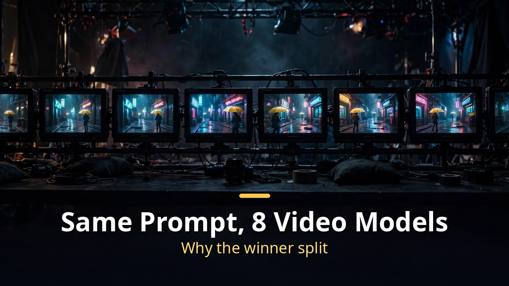
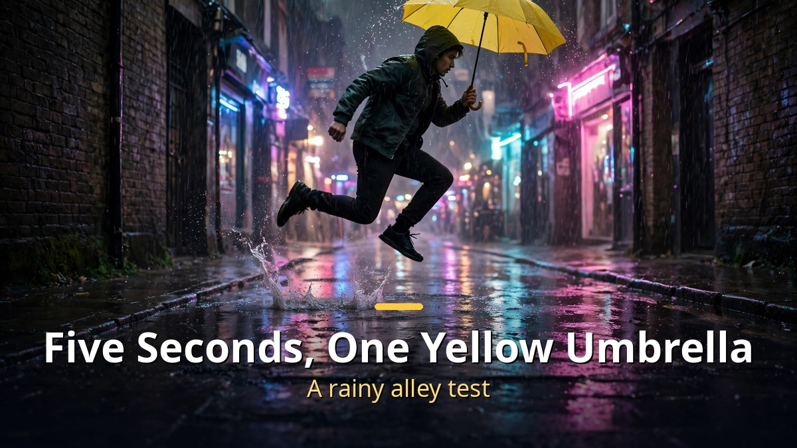
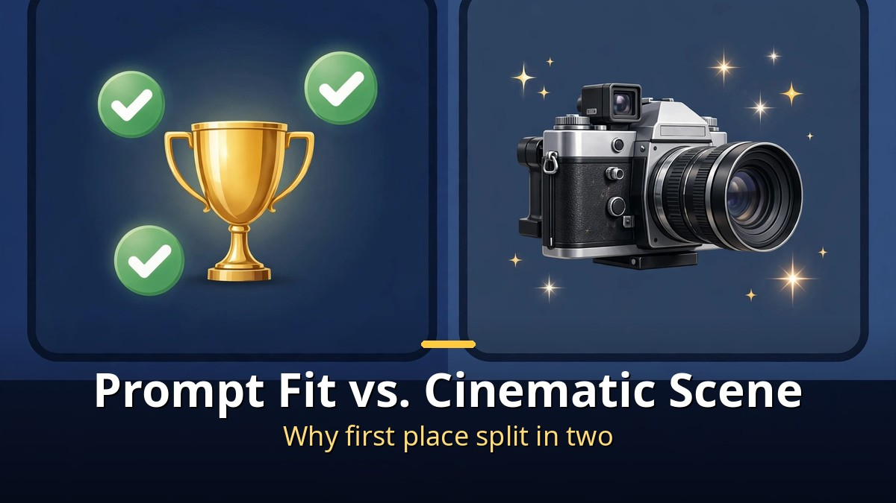
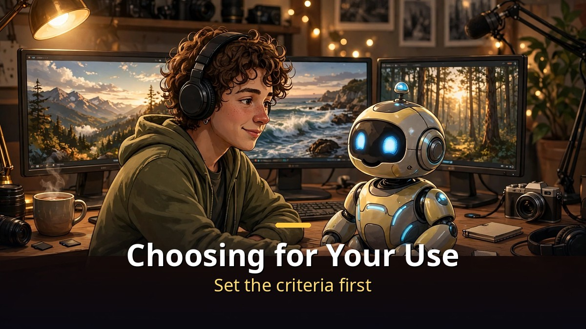

<!-- 본문 시작 -->

One sentence, eight AI video models, one fair test.
The result split the winner in two.
The model that followed the prompt best was not the one with the most cinematic scene.
This article follows the comparison experiment from the Mr.5pm video, sorting out how the models differ and how to choose for your own use.

> Key takeaway: Under the same prompt, the same conditions, and one generation each, the eight models failed in different places. One kept the umbrella to the end, one nailed the splash, one landed the jump. So the winner depended on what you measured. When choosing a model, start not from its name but from what your scene needs.

## How Was the Test Kept Fair?

One sentence, one set of conditions, no re-rolls.

The experiment starred the AI agent Bella and the creator.
On Higgsfield, they ran eight models on the same prompt:
"A person holding a yellow umbrella jumps over a puddle and walks toward the camera on a rainy night in a narrow alley. Water drips from the umbrella, neon reflects on the wet ground. Cinematic, handheld camera."

The conditions were unified too.
16:9, 5 seconds, 720p, high bitrate.
Only MiniMax H3 used its 2K option, since that was all it offered.
Each model generated once, with no re-rolls.
One result was the whole report card.

Bella hid three tests inside the prompt.
First, walk toward the camera without breaking.
Second, splash water when jumping the puddle.
Third, hold the yellow umbrella to the end.
The creator judged by a different standard: whether the scene felt cinematic.
Two eyes saw different things in the same video.

The eight models were Kling 4.0, Seedance 2.5, Seedance 2.0, MiniMax H3, Wan 3.0, Grok Imagine 1.5, FLUX 3, and Gemini Omni 1.1.
As of late October 2026, these are the front line of AI video generation.

## Eight Models, What Was Different?

The model that kept the umbrella, the one that splashed, and the one that jumped were three different models.

Here is how each model did.
Kling 4.0 walked steadily and kept the umbrella to the end, but its jump was small.
Seedance 2.5 had the finest texture and light, the most cinematic look — but the umbrella vanished at the jump.
Seedance 2.0 made the biggest splash.
Only Grok Imagine 1.5 clearly showed a real jump over the puddle.
Gemini Omni 1.1 made the biggest jump, but the umbrella left the frame.

| Model | Strength | Weakness |
|---|---|---|
| Kling 4.0 | Steady walk, umbrella kept | Small jump |
| Seedance 2.5 | Most cinematic texture and light | Umbrella vanished at the jump |
| Seedance 2.0 | Biggest splash | — |
| Grok Imagine 1.5 | Clear jump over the puddle | — |
| Gemini Omni 1.1 | Biggest jump | Umbrella left the frame |

MiniMax H3, Wan 3.0, and FLUX 3 did not reach the top in this test.
A blank in the table is not a failure; it means no standout strength was confirmed on the three tests in this single run.
Re-rolling could change the ranking.

The split ranking is the heart of this experiment.
Bella's ranking (prompt compliance): 3rd Kling 4.0, 2nd Seedance 2.0, 1st Grok Imagine 1.5.
The creator's ranking (cinematic scene): 3rd Seedance 2.0, 2nd Kling 4.0, 1st Seedance 2.5.
Same videos, different winners.
Following the prompt and making a good scene are different questions.

One more observation stands out.
The prompt only said "a person," yet all eight models generated men.
The video suggests this may be because training data for rainy night alleys mostly shows men walking alone.
It is a hypothesis, not a confirmed cause, but it shows how bias surfaces in AI video.

## Which Model Fits My Use?

Do not hand over the decision whole. Set the criteria first.

The experiment's conclusion is: do not hand the whole decision to AI.
The best setup was collaboration — the creator picks good scenes, Bella checks prompt compliance.
Here is that conclusion turned into a choosing guide.

- Need accurate motion: look first at models like Grok Imagine 1.5 that render jumps and actions clearly. But do not judge from a single run.
- Need cinematic texture and light: look first at models like Seedance 2.5 with strong scene quality. But check whether props survive to the end.
- Need a stable scene that holds together: look first at models like Kling 4.0 that keep the walk and props intact. But expect smaller motions.
- Need impact from an effect like splashing water: look first at models like Seedance 2.0 that are strong on that effect.

Whichever model you pick, the checking routine is the same.
First, write down three things your scene must have — the motion, the props, the mood.
Second, run candidate models once on the same prompt.
Third, judge only on those three criteria before re-rolling.
Fourth, keep bias in mind. Writing only "a person" can tilt toward one gender, so describe the intended person concretely.

## Closing

The eight-model contest did not end with "which model is best."
It ended with the fact that the winner changes with the standard — and that itself was the conclusion.
AI video tools have reached the stage where what they do well and what they miss now differs by model.
So the way to choose must change too.
Not by name or hype, but by writing down what your scene needs — the motion, the props, the mood — and picking the model that fits.
That one sheet of paper saves expensive trial and error.

## Frequently Asked Questions

**Q. Will using the winning model guarantee a good video?**
A. No. This test generated each model only once, and rankings change with the prompt and scene. Compare directly against your own criteria to be safe.

**Q. Why did Bella's ranking differ from the creator's?**
A. They measured different things. Bella checked prompt compliance (walk, splash, umbrella), while the creator judged cinematic quality.

**Q. Why did all eight models generate men?**
A. The video suggests training-data bias as a hypothesis. It is not a confirmed cause; describing the intended person concretely in the prompt helps.

**Q. Can I try these for free?**
A. Pricing and free trials differ by model. This article focuses on the performance comparison, so check each model's official pricing page.

## Recommended Reading

[GPT-6 Astra Fixed Another AI's Brain Directly｜What the 0.016% Edit Really Proves — check the verification scope before the numbers](https://aitechnotesen.blogspot.com/2026/11/gpt-6-astra-fixed-another-ais-brain.html)
[A.I. Artificial Intelligence｜A Boy Robot Programmed to Love, and What It Means to Become Human — a robot boy who asks what love means](https://aitechnotesen.blogspot.com/2026/11/ai-artificial-intelligencea-boy-robot.html)
[I, Robot｜When Three Laws Shake, What Should a Detective Believe — a film that asks what human judgment is worth when rules wobble](https://aitechnotesen.blogspot.com/2026/11/i-robotwhen-three-laws-shake-what.html)

The more models there are, the more the choosing criteria matter. Write down three things your scene needs first, then pick the model that fits. Follow along if you want to keep following this topic.

<!-- 본문 끝 -->

## 작업용 출처·이미지 정보 (업로드 제외)

- Source: 오후다섯씨 영상 _WNapwpkOIs(2026-10-31, 11:47, 스크립트 패널 0:00~11:45 확인 기준)
- Images: images/01-hero-en.jpg ~ 04-img3-en.jpg / original illustration + English banner overlay (1200x675)
