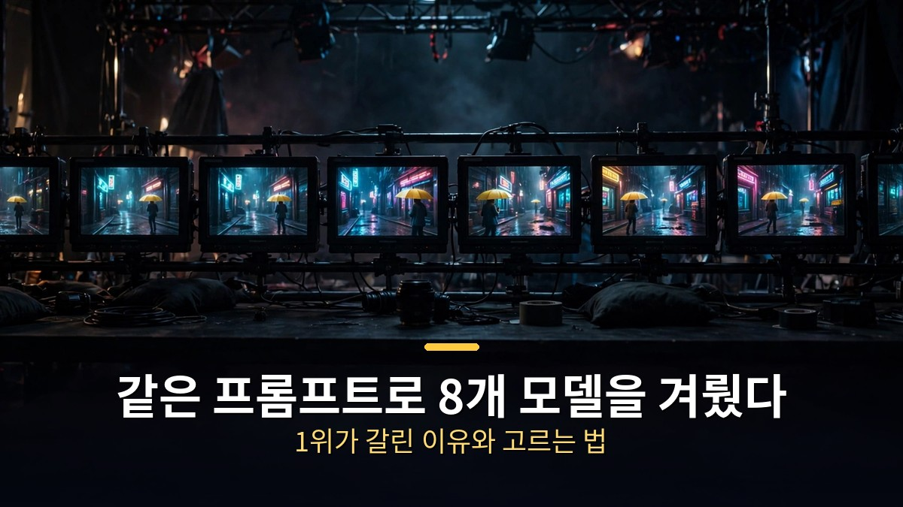
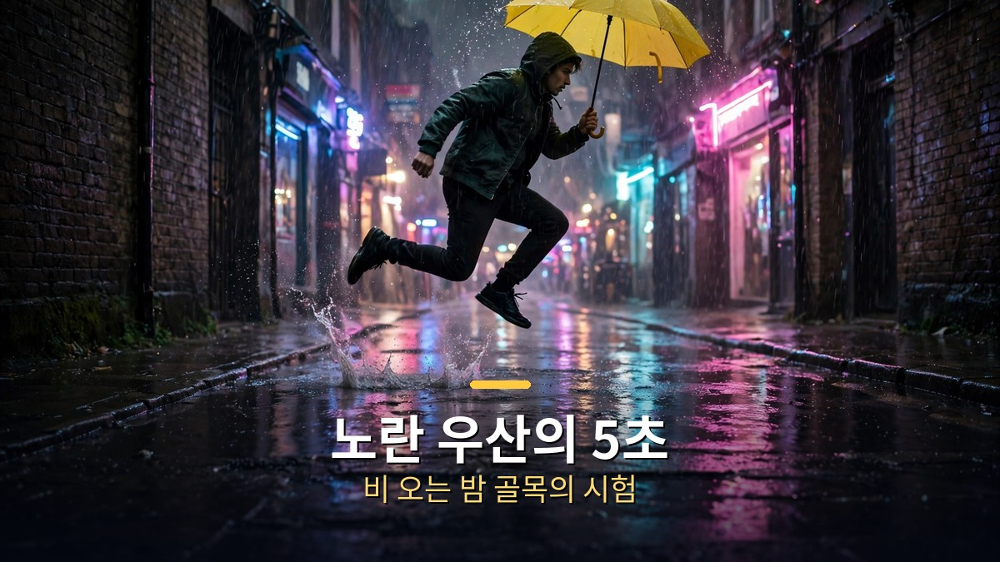
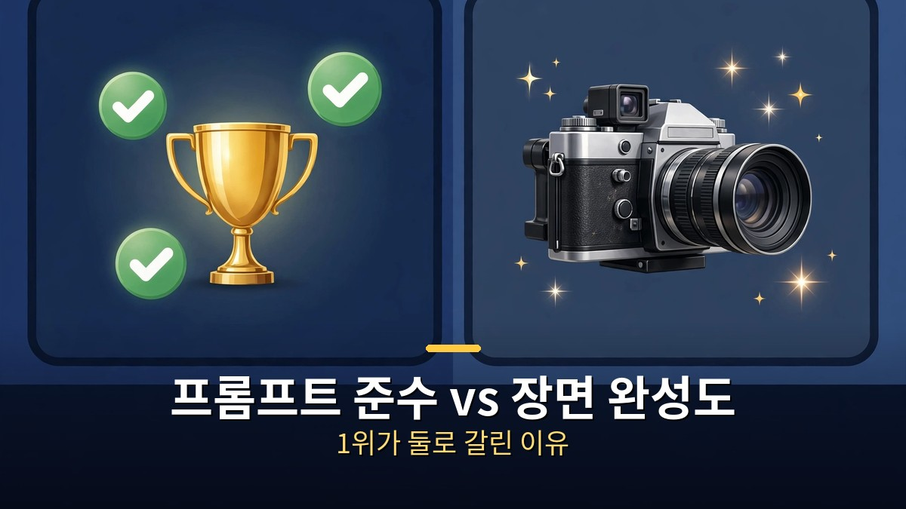
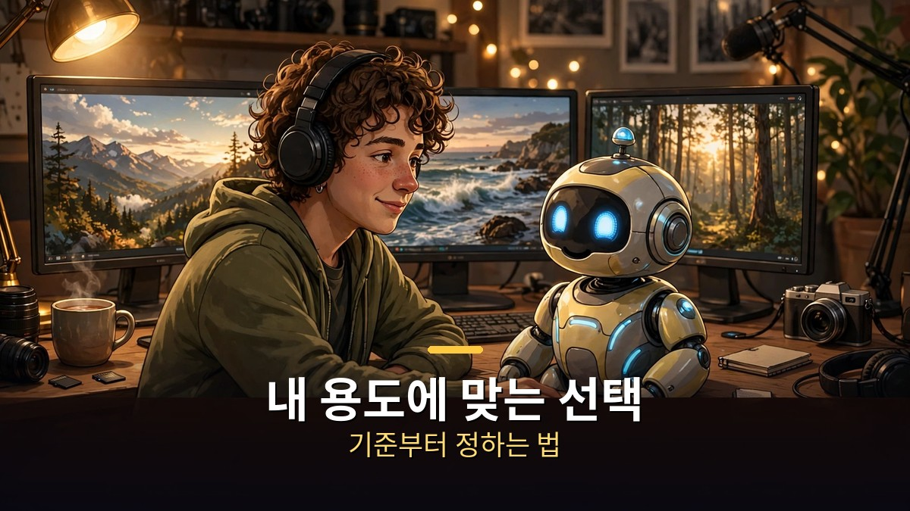

<!-- 본문 시작 -->

같은 문장 하나로 8개 AI 영상 모델을 겨뤘다.
결과는 1위가 둘로 갈렸다.
프롬프트를 잘 지킨 1위와, 장면이 가장 영화 같았던 1위가 달랐다.
이 글은 오후다섯씨 영상의 비교 실험을 따라, 모델별 차이와 내 용도에 맞는 고르는 법을 정리한다.

> 핵심 정리: 같은 프롬프트, 같은 조건, 한 번씩만 생성한 공정한 비교에서 8개 모델은 서로 다른 데서 무너졌다. 우산을 끝까지 든 모델, 물 튀김을 살린 모델, 점프를 제대로 한 모델이 각자 달랐다. 그래서 1위는 '무엇을 기준으로 보느냐'에 따라 갈렸다. 모델을 고를 때는 이름이 아니라, 내 장면에 필요한 능력이 무엇인지부터 정해야 한다.

## 어떻게 공정하게 겨뤘을까?

문장 하나, 조건 하나, 다시 돌리기 없음.

실험의 주인공은 AI 에이전트 '벨라'와 제작자다.
무대는 AI 영상 생성 플랫폼 힉스필드, 같은 프롬프트로 8개 모델을 돌렸다.
프롬프트는 이렇다.
"비 오는 밤 좁은 골목에서 노란 우산을 든 사람이 웅덩이를 뛰어넘어 카메라 쪽으로 걸어온다. 우산에서 물이 떨어지고 젖은 바닥에 네온이 반사된다. 영화적, 핸드헬드 카메라."

조건도 통일했다.
화면 비율 16:9, 길이 5초, 해상도 720p, 높은 비트레이트.
단, 미니맥스 H3만 2K 옵션이 있어 해당 값을 썼다.
8개 모델 모두 한 번씩만 생성했고, 마음에 안 든다고 다시 돌리지 않았다.
한 번의 결과가 곧 성적표다.

벨라는 프롬프트 안에 세 가지 시험을 숨겼다.
첫째, 끊기지 않고 카메라 쪽으로 걸어오기.
둘째, 웅덩이를 넘을 때 물 튀기기.
셋째, 노란 우산을 끝까지 들기.
제작자는 다른 기준으로 봤다.
장면이 영화적으로 완성됐는가.
두 개의 눈이 같은 영상에서 다른 것을 본 셈이다.

비교한 8개 모델은 클링 4.0, 시댄스 2.5, 시댄스 2.0, 미니맥스 H3, 완 3.0, 그록 이매진 1.5, 플럭스 3, 제미나이 옴니 1.1이다.
2026년 10월 말 기준, 영상 생성의 최전선에 있는 이름들이다.

## 8개 모델, 무엇이 달랐나?

우산을 지킨 모델, 물을 튀긴 모델, 점프를 한 모델이 따로 있었다.

모델별 결과는 이렇다.
클링 4.0은 안정적으로 걸어왔고 우산도 끝까지 유지했다.
다만 점프가 작았다.
시댄스 2.5는 질감과 빛이 곱고 가장 영화 같았다.
그러나 점프 순간 우산이 사라졌다.
시댄스 2.0은 물이 가장 크게 튀었다.
그록 이매진 1.5만이 웅덩이를 진짜로 뛰어넘는 동작을 또렷하게 구현했다.
제미나이 옴니 1.1은 점프가 가장 컸으나, 우산이 화면 밖으로 빠져나갔다.

| 모델 | 잘한 점 | 아쉬운 점 |
|---|---|---|
| 클링 4.0 | 안정적인 걸음, 우산 유지 | 점프가 작음 |
| 시댄스 2.5 | 질감·빛이 가장 영화적 | 점프 순간 우산 소실 |
| 시댄스 2.0 | 물 튀김 최대 | — |
| 그록 이매진 1.5 | 웅덩이 점프를 또렷하게 구현 | — |
| 제미나이 옴니 1.1 | 점프 최대 | 우산이 화면 밖으로 이탈 |

미니맥스 H3, 완 3.0, 플럭스 3의 세부 결과는 영상에서 상위권에 들지 못했다.
표에 빈칸이 있는 것은 실패가 아니라, 이번 실험의 세 가지 시험에서 눈에 띄는 장점이 확인되지 않았다는 뜻이다.
한 번만 생성한 결과라, 다시 돌리면 순위가 달라질 수 있다.

두 순위가 갈린 지점이 이 실험의 핵심이다.
벨라의 순위(프롬프트 준수 기준)는 3위 클링 4.0, 2위 시댄스 2.0, 1위 그록 이매진 1.5였다.
제작자의 순위(장면 기준)는 3위 시댄스 2.0, 2위 클링 4.0, 1위 시댄스 2.5였다.
같은 영상인데 1위가 다르다.
프롬프트를 지켰는가와 장면이 좋은가는 다른 질문이기 때문이다.

또 하나 눈에 띄는 관찰이 있다.
프롬프트에는 "사람"이라고만 했는데, 8개 모델이 만든 사람은 모두 남자였다.
영상에서는 학습 데이터에 비 오는 밤 골목을 혼자 걷는 장면이 주로 남자로 찍혀 있었기 때문일 것이라는 추측을 제시한다.
확정된 원인이 아니라 추측이지만, AI 영상에서 편향이 어떻게 드러나는지를 보여주는 대목이다.

## 내 용도에는 어떤 모델이 맞을까?

결정을 통째로 맡기지 말고, 고르는 기준부터 정한다.

실험의 결론은 "AI에게 결정을 통째로 맡기지 말라"는 것이다.
제작자가 좋은 장면을 고르고, 벨라가 프롬프트 준수 여부를 짚어주는 협업이 가장 좋았다.
이 결론을 용도별 선택 기준으로 바꿔본다.

- 움직임이 정확한 장면이 필요하면: 그록 이매진 1.5처럼 점프·동작을 또렷하게 구현하는 모델을 먼저 본다. 단, 한 번의 결과만으로 단정하지 않는다.
- 영화 같은 질감·빛이 필요하면: 시댄스 2.5처럼 장면 완성도가 높은 모델을 먼저 본다. 단, 소품이 사라지는지 끝까지 확인한다.
- 안정적으로 끝까지 이어지는 장면이 필요하면: 클링 4.0처럼 걸음과 소품을 유지하는 모델을 먼저 본다. 단, 동작의 크기는 기대보다 작을 수 있다.
- 물을 튀기는 등 효과의 임팩트가 필요하면: 시댄스 2.0처럼 해당 효과가 강한 모델을 먼저 본다.

어떤 모델을 고르든, 확인 절차는 같다.
첫째, 내 장면에 꼭 필요한 동작·소품 3가지를 먼저 적는다.
둘째, 같은 프롬프트로 후보 모델을 한 번씩 돌린다.
셋째, 다시 돌리기 전에 세 가지 기준(동작·소품 유지·장면 완성도)으로만 판단한다.
넷째, 편향 가능성을 염두에 둔다. "사람"이라고만 쓰면 특정 성별로 기울 수 있으니, 의도한 인물을 구체적으로 적는다.

영상 편집까지 이어지는 흐름이 궁금하면 [클로드에게 영상 편집 맡기기｜아이디어부터 숏폼 완성까지, 말로 시키는 방법](https://aitechnoteskr.tistory.com/110)에서 말로 시키는 편집의 실제 과정을 정리했다.

## 마무리

8개 모델의 승부는 "어느 모델이 최고냐"로 끝나지 않았다.
어떤 기준으로 보느냐에 따라 1위가 달라진다는 것, 그 자체가 결론이었다.
AI 영상 도구는 이제 잘 만드는 것을 넘어, 무엇을 잘 만들고 무엇을 놓치는지가 갈리는 단계에 왔다.
그래서 고르는 법도 달라져야 한다.
이름이나 화제성이 아니라, 내 장면에 필요한 동작·소품·분위기부터 적어보고, 그 기준에 맞는 모델을 고르는 것.
그 종이 한 장이, 비싼 시행착오를 줄여준다.

## 자주 묻는 질문

**Q. 1위 모델을 쓰면 무조건 좋은 영상이 나오나요?**
A. 아닙니다. 이번 실험은 한 번씩만 생성한 결과이고, 프롬프트·장면에 따라 순위가 달라집니다. 내 장면에 필요한 기준으로 직접 비교하는 것이 안전합니다.

**Q. 벨라의 순위와 제작자의 순위가 왜 다른가요?**
A. 보는 기준이 다르기 때문입니다. 벨라는 프롬프트 준수(걸음·물 튀김·우산 유지)를 봤고, 제작자는 장면의 영화적 완성도를 봤습니다.

**Q. 8개 모델이 모두 남자를 만든 이유는 무엇인가요?**
A. 영상에서는 학습 데이터의 편향일 것이라는 추측을 제시합니다. 확정된 원인이 아니며, 원한다면 프롬프트에 인물을 구체적으로 적는 것이 좋습니다.

**Q. 무료로 써볼 수 있나요?**
A. 모델마다 요금제와 무료 체험 조건이 다릅니다. 이 글은 성능 비교가 중심이라, 각 모델의 공식 요금 페이지를 확인하는 것이 좋습니다.

## 함께 읽으면 좋은 글

[GPT-6 아스트라가 다른 AI의 뇌를 직접 고쳤다｜0.016% 수정으로 수학 점수가 뛴 연구의 실체 — 숫자보다 검증 범위를 먼저 보는 법](https://aitechnoteskr.tistory.com/109)
[A.I. 인공지능｜사랑하도록 프로그래밍된 소년 로봇, 인간이 된다는 것의 의미 — 감정을 가진 로봇 소년이 던지는 질문](https://aitechnoteskr.tistory.com/113)
[화면 없는 노트북 — Hero Keyboard, 사기 전에 확인할 조건 — 화면을 빌려 쓰는 키보드 PC의 조건 정리](https://aitechnoteskr.tistory.com/107)

모델이 늘어날수록 고르는 기준이 중요해진다. 내 장면에 필요한 것 3가지를 먼저 적어두고, 그 기준에 맞는 모델을 골라보자. 이 주제를 계속 따라가려면 이웃 추가를 눌러두면 된다.

<!-- 본문 끝 -->

## 작업용 출처·이미지 정보 (업로드 제외)

- 자료 출처: 오후다섯씨 영상 _WNapwpkOIs(2026-10-31, 11:47, 스크립트 패널 0:00~11:45 확인 기준)
- 이미지: images/01-hero.jpg ~ 04-img3.jpg / 자작 일러스트 + 한글 배너 오버레이 (1200x675)
